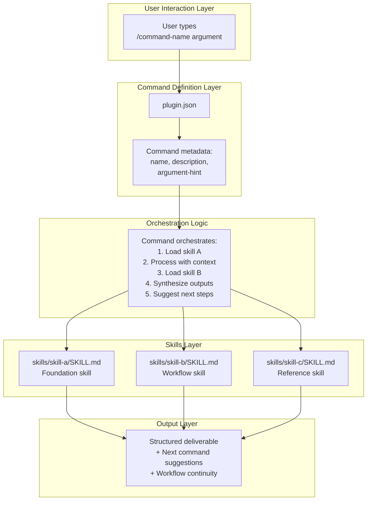
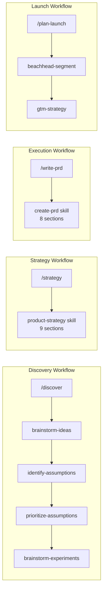
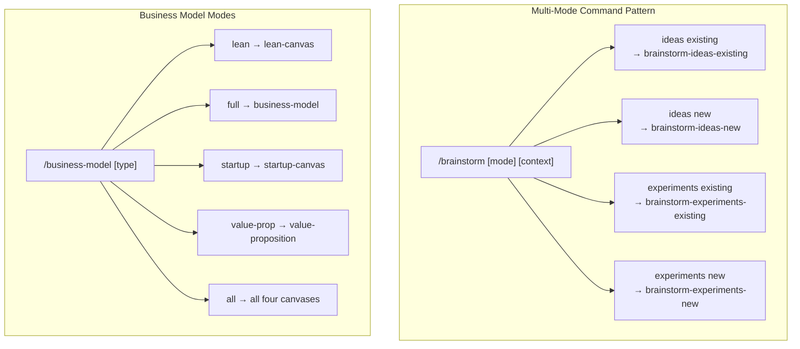
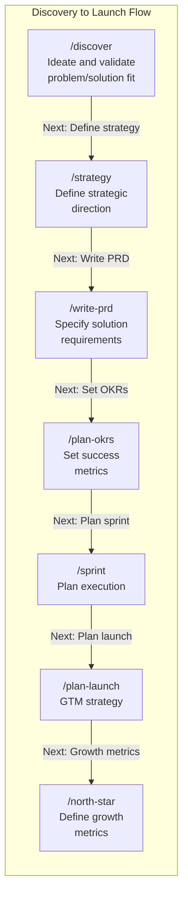
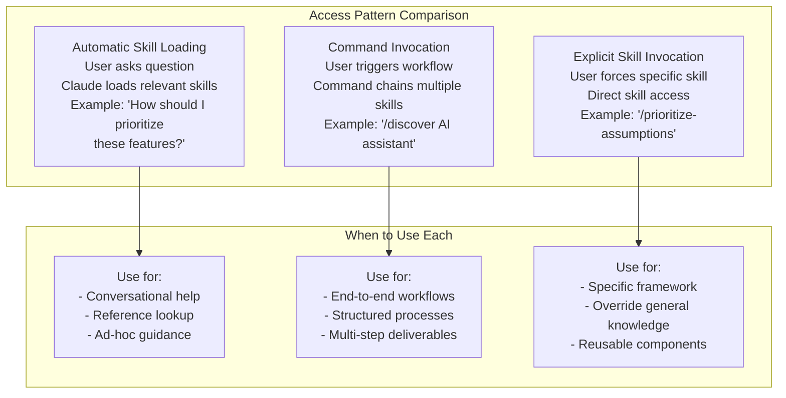

<!-- source: DeepWiki mcp.deepwiki.com · repo phuryn/pm-skills · page 6 Key Commands · fetched 2026-10-26 -->

# Key Commands

<details>
<summary>Relevant source files</summary>

The following files were used as context for generating this wiki page:

- [README.md](README.md)

</details>


This page provides an overview of the 36 commands available across the PM Skills Marketplace and explains how commands orchestrate multiple skills into end-to-end workflows. Commands represent the orchestration layer that transforms atomic skills into guided product management processes.

For detailed documentation of the most important workflow commands, see:
- [/discover Command](#6.1) - Complete discovery cycle
- [/strategy Command](#6.2) - Product strategy canvas
- [/write-prd Command](#6.3) - PRD creation workflow
- [/plan-launch Command](#6.4) - GTM strategy workflow

**Scope**: This page covers command architecture, invocation patterns, and a comprehensive catalog. For individual skill documentation, see [Plugin Reference](#4). For the skills vs commands distinction, see [Three-Tier Abstraction Model](#3.1).

---

## Command Architecture

Commands are user-triggered workflows invoked with `/command-name` syntax. Each command chains one or more skills from the [skills/](pm-*/skills/) directories into a structured process with predefined steps, orchestrated outputs, and suggested next actions.

### Command Orchestration Model



**Sources**: [README.md:31-45]()

### File Structure and Command Definition

Commands are defined in each plugin's `plugin.json` manifest. Each command declaration includes:

| Field | Purpose | Example |
|-------|---------|---------|
| `name` | Command invocation name | `"discover"` |
| `description` | Purpose and workflow summary | `"Full discovery cycle: ideation → assumption mapping → prioritization → experiment design"` |
| `argument-hint` | User guidance on parameters | `"[product/feature description]"` |
| `skills` | Referenced skill directories | `["brainstorm-ideas", "identify-assumptions", "prioritize-assumptions", "brainstorm-experiments"]` |

**File structure example:**

```
pm-product-discovery/
├── plugin.json              # Contains command definitions
├── README.md
└── skills/
    ├── brainstorm-ideas/
    │   └── SKILL.md
    ├── identify-assumptions/
    │   └── SKILL.md
    ├── prioritize-assumptions/
    │   └── SKILL.md
    └── brainstorm-experiments/
        └── SKILL.md
```

**Sources**: [README.md:39](), plugin directory structure inferred from [README.md:99-393]()

---

## Command Types and Characteristics

### Workflow Commands (End-to-End Processes)

These commands orchestrate multi-step processes from problem definition to actionable output:



**Sources**: [README.md:120](), [README.md:162](), [README.md:207](), [README.md:313]()

### Utility Commands (Single-Purpose Tools)

Commands that perform specific transformations or analyses:

- `/proofread` - Grammar and flow checking via `grammar-check` skill
- `/generate-data` - Dummy dataset creation via `dummy-dataset` skill
- `/meeting-notes` - Transcript summarization via `summarize-meeting` skill
- `/stakeholder-map` - Stakeholder analysis via `stakeholder-map` skill

**Sources**: [README.md:206-216]()

### Analysis Commands (Data Processing)

Commands that process input data and generate insights:

- `/analyze-test` - A/B test statistical analysis via `ab-test-analysis` skill
- `/analyze-cohorts` - Retention and engagement analysis via `cohort-analysis` skill
- `/analyze-feedback` - Sentiment and segmentation via `sentiment-analysis` and `user-segmentation` skills
- `/competitive-analysis` - Competitive landscape via `competitor-analysis` skill

**Sources**: [README.md:278-282](), [README.md:248-251]()

### Parameterized Commands (Multi-Mode)

Some commands accept parameters to select execution mode:



**Sources**: [README.md:121](), [README.md:163]()

---

## Complete Command Catalog

The marketplace contains **36 commands** across **8 plugins**:

### pm-product-discovery (5 commands)

| Command | Description | Key Skills Used |
|---------|-------------|-----------------|
| `/discover` | Full discovery cycle: ideation → assumptions → prioritization → experiments | `brainstorm-ideas`, `identify-assumptions`, `prioritize-assumptions`, `brainstorm-experiments` |
| `/brainstorm` | Multi-perspective ideation (ideas\|experiments × existing\|new) | `brainstorm-ideas-existing`, `brainstorm-ideas-new`, `brainstorm-experiments-existing`, `brainstorm-experiments-new` |
| `/triage-requests` | Analyze and prioritize feature requests | `analyze-feature-requests`, `prioritize-features` |
| `/interview` | Prepare interview script or summarize transcript (prep\|summarize) | `interview-script`, `summarize-interview` |
| `/setup-metrics` | Design product metrics dashboard | `metrics-dashboard` |

**Sources**: [README.md:118-124]()

### pm-product-strategy (5 commands)

| Command | Description | Key Skills Used |
|---------|-------------|-----------------|
| `/strategy` | Create complete 9-section Product Strategy Canvas | `product-strategy` |
| `/business-model` | Explore business models (lean\|full\|startup\|value-prop\|all) | `lean-canvas`, `business-model`, `startup-canvas`, `value-proposition` |
| `/value-proposition` | Design JTBD value proposition (6-part template) | `value-proposition` |
| `/market-scan` | Macro environment analysis (SWOT + PESTLE + Porter's + Ansoff) | `swot-analysis`, `pestle-analysis`, `porters-five-forces`, `ansoff-matrix` |
| `/pricing` | Design pricing strategy with competitive analysis | `pricing-strategy`, `monetization-strategy` |

**Sources**: [README.md:160-166]()

### pm-execution (10 commands)

| Command | Description | Key Skills Used |
|---------|-------------|-----------------|
| `/write-prd` | Create PRD from feature idea or problem statement | `create-prd` |
| `/plan-okrs` | Brainstorm team-level OKRs | `brainstorm-okrs` |
| `/transform-roadmap` | Convert feature-based roadmap to outcome-focused | `outcome-roadmap` |
| `/sprint` | Sprint lifecycle (plan\|retro\|release) | `sprint-plan`, `retro`, `release-notes` |
| `/pre-mortem` | Pre-mortem risk analysis on PRD/launch plan | `pre-mortem` |
| `/meeting-notes` | Summarize meeting transcript into structured notes | `summarize-meeting` |
| `/stakeholder-map` | Map stakeholders and create communication plan | `stakeholder-map` |
| `/write-stories` | Break features into backlog items (user\|job\|wwa) | `user-stories`, `job-stories`, `wwas` |
| `/test-scenarios` | Generate test scenarios from user stories | `test-scenarios` |
| `/generate-data` | Create realistic dummy datasets | `dummy-dataset` |

**Sources**: [README.md:205-216]()

### pm-market-research (3 commands)

| Command | Description | Key Skills Used |
|---------|-------------|-----------------|
| `/research-users` | Build personas, segment users, map customer journey | `user-personas`, `market-segments`, `customer-journey-map` |
| `/competitive-analysis` | Analyze competitive landscape | `competitor-analysis` |
| `/analyze-feedback` | Sentiment analysis and segment insights from user feedback | `sentiment-analysis`, `user-segmentation` |

**Sources**: [README.md:247-251]()

### pm-data-analytics (3 commands)

| Command | Description | Key Skills Used |
|---------|-------------|-----------------|
| `/write-query` | Generate SQL queries from natural language | `sql-queries` |
| `/analyze-cohorts` | Cohort analysis on user engagement data | `cohort-analysis` |
| `/analyze-test` | Analyze A/B test results | `ab-test-analysis` |

**Sources**: [README.md:278-282]()

### pm-go-to-market (3 commands)

| Command | Description | Key Skills Used |
|---------|-------------|-----------------|
| `/plan-launch` | Full GTM strategy from beachhead to launch plan | `beachhead-segment`, `ideal-customer-profile`, `gtm-strategy` |
| `/growth-strategy` | Design growth loops and evaluate GTM motions | `growth-loops`, `gtm-motions` |
| `/battlecard` | Create competitive battlecard | `competitive-battlecard` |

**Sources**: [README.md:311-315]()

### pm-marketing-growth (2 commands)

| Command | Description | Key Skills Used |
|---------|-------------|-----------------|
| `/market-product` | Brainstorm marketing ideas, positioning, value props, names | `marketing-ideas`, `positioning-ideas`, `value-prop-statements`, `product-name` |
| `/north-star` | Define North Star Metric and supporting input metrics | `north-star-metric` |

**Sources**: [README.md:344-347]()

### pm-toolkit (5 commands)

| Command | Description | Key Skills Used |
|---------|-------------|-----------------|
| `/review-resume` | Comprehensive PM resume review | `review-resume` |
| `/tailor-resume` | Tailor resume to specific job description | `review-resume` |
| `/draft-nda` | Draft Non-Disclosure Agreement | `draft-nda` |
| `/privacy-policy` | Draft privacy policy | `privacy-policy` |
| `/proofread` | Check grammar, logic, and flow | `grammar-check` |

**Sources**: [README.md:374-380]()

---

## Command Invocation Patterns

### Basic Syntax

```
/command-name [argument]
```

Commands accept natural language arguments that provide context for the workflow:

```
/discover AI-powered meeting summarizer for remote teams
/strategy B2B project management tool for agencies
/write-prd Smart notification system that reduces alert fatigue
/plan-launch AI code review tool targeting mid-size engineering teams
```

**Sources**: [README.md:134-137](), [README.md:176-178](), [README.md:226-228](), [README.md:325-327]()

### Parameterized Commands

Some commands require mode selection:

```
/brainstorm ideas existing — We need to improve our onboarding flow
/brainstorm experiments new — Testing demand for an AI writing assistant
/business-model lean — Early-stage marketplace startup
/sprint retro — Here are the notes from our last sprint
/interview prep — We're interviewing enterprise buyers
```

**Sources**: [README.md:135-136]()

### Commands with File Attachments

Data analysis and document review commands accept file attachments:

```
/analyze-test Here are the results from our checkout flow A/B test [attach CSV]
/analyze-feedback Here's 200 NPS responses from Q4 [attach file]
/triage-requests Prioritize these 12 feature requests [attach CSV]
/review-resume [attach your PM resume]
```

**Sources**: [README.md:131](), [README.md:263](), [README.md:292](), [README.md:389]()

---

## Command Chaining and Workflow Continuity

Commands are designed to suggest logical next steps, creating a continuous workflow that mirrors the product development lifecycle:



### Cross-Plugin Command Flows

Commands from different plugins combine to support complete workflows:

| Workflow Stage | Primary Command | Supporting Commands |
|----------------|-----------------|---------------------|
| **Discovery** | `/discover` | `/interview`, `/research-users`, `/triage-requests` |
| **Strategy** | `/strategy` | `/business-model`, `/value-proposition`, `/market-scan`, `/pricing` |
| **Execution** | `/write-prd` | `/plan-okrs`, `/transform-roadmap`, `/stakeholder-map`, `/write-stories` |
| **Development** | `/sprint` | `/meeting-notes`, `/pre-mortem`, `/test-scenarios`, `/generate-data` |
| **Launch** | `/plan-launch` | `/battlecard`, `/market-product`, `/competitive-analysis` |
| **Growth** | `/north-star` | `/growth-strategy`, `/analyze-test`, `/analyze-cohorts`, `/analyze-feedback` |

**Sources**: [README.md:45](), inferred from plugin structure [README.md:99-393]()

### Command Output Structure

After execution, commands typically provide:

1. **Primary Deliverable**: The structured output (canvas, document, analysis)
2. **Next Steps**: Suggested follow-up actions
3. **Related Commands**: Commands that extend or build on the current output

Example output pattern:

```
✓ Discovery cycle complete

Deliverables:
- 8 validated opportunity areas
- 24 mapped assumptions (prioritized by impact × risk)
- 6 experiment designs ready for execution

Suggested next steps:
→ /strategy to define product positioning before experiments
→ /write-prd to document the highest-priority opportunity
→ /setup-metrics to establish success criteria for experiments
```

**Sources**: [README.md:45]()

---

## Command vs Skill Invocation

The system supports three access patterns with different use cases:



**Key differences:**

| Aspect | Automatic | Command | Explicit Skill |
|--------|-----------|---------|----------------|
| **Syntax** | Natural question | `/command-name` | `/skill-name` |
| **Orchestration** | Claude decides | Predefined chain | Single skill |
| **Structure** | Flexible | Structured | Focused |
| **Best for** | Quick help | Complete workflows | Specific frameworks |

**Sources**: [README.md:31-43](), high-level diagram 4 from context

---

## Summary

Commands serve as the **orchestration layer** that transforms 65 atomic skills into 36 guided workflows. The command architecture enables:

- **Structured processes**: Multi-step workflows with predefined skill chaining
- **Workflow continuity**: Commands suggest next steps aligned with product lifecycle
- **Flexibility**: Parameterized modes and natural language arguments
- **Discoverability**: Descriptive names and argument hints guide usage

The most impactful commands—`/discover`, `/strategy`, `/write-prd`, and `/plan-launch`—are documented in detail in sections [6.1](#6.1), [6.2](#6.2), [6.3](#6.3), and [6.4](#6.4).

For the complete skill catalog, see [Plugin Reference](#4). For the theoretical foundation of the skills-commands-plugins abstraction, see [Three-Tier Abstraction Model](#3.1).

**Sources**: [README.md:31-45](), [README.md:99-393]()

---

