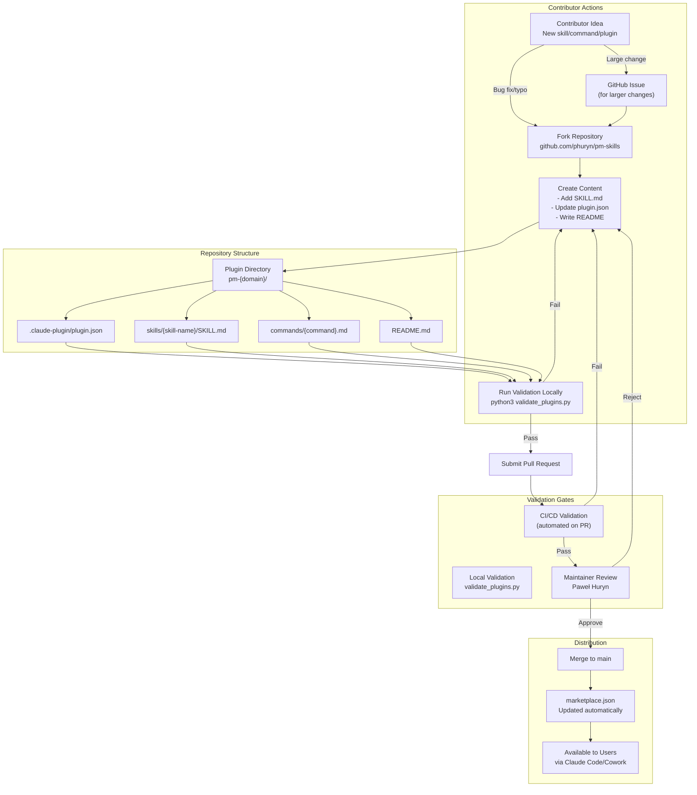
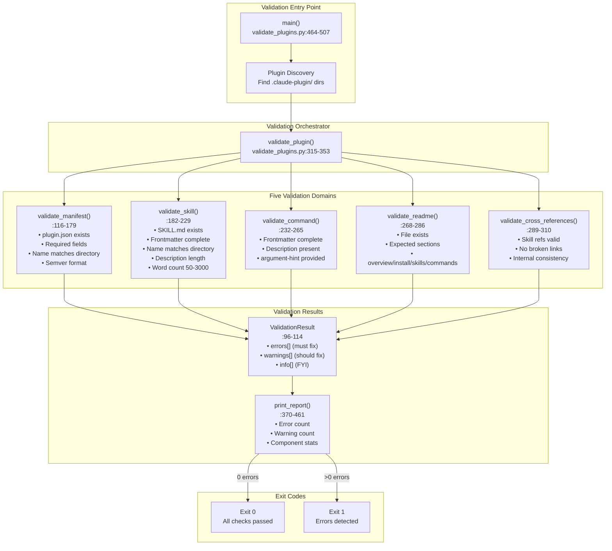
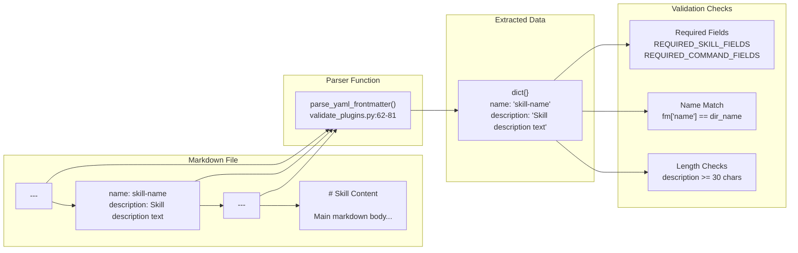

<!-- source: DeepWiki mcp.deepwiki.com · repo phuryn/pm-skills · page 7 Contributing · fetched 2026-10-26 -->

# Contributing

<details>
<summary>Relevant source files</summary>

The following files were used as context for generating this wiki page:

- [.gitignore](.gitignore)
- [CONTRIBUTING.md](CONTRIBUTING.md)
- [validate_plugins.py](validate_plugins.py)

</details>


This page documents the contribution system for the PM Skills Marketplace, including the workflow for submitting new skills, commands, or plugins, and the automated validation that enforces structural quality. The marketplace is maintained by Paweł Huryn and welcomes community contributions that expand its coverage of product management frameworks and methodologies.

For detailed contribution guidelines and requirements, see [Contribution Guidelines](#7.1). For information about the automated validation system, see [Plugin Validation System](#7.2).

**Sources**: [CONTRIBUTING.md:1-23]()

---

## Contribution Workflow Architecture

The contribution system implements a quality-gated workflow that ensures all submitted content meets structural standards before merging into the marketplace.

### End-to-End Contribution Pipeline



**Sources**: [CONTRIBUTING.md:5-22](), [validate_plugins.py:1-18]()

---

## Contribution Types and Requirements

The marketplace accepts three types of contributions, each with specific structural requirements:

### Contribution Type Matrix

| Contribution Type | File Structure | Required Frontmatter | Validation Scope |
|------------------|---------------|---------------------|------------------|
| **Skill** | `pm-{plugin}/skills/{skill-name}/SKILL.md` | `name`, `description` | [validate_plugins.py:182-229]() |
| **Command** | `pm-{plugin}/commands/{command-name}.md` | `description`, `argument-hint` | [validate_plugins.py:232-265]() |
| **Plugin** | `pm-{plugin}/.claude-plugin/plugin.json` | `name`, `version`, `description`, `author` | [validate_plugins.py:116-179]() |
| **Bug Fix** | Any file | N/A | Context-dependent |

**Sources**: [CONTRIBUTING.md:10-16](), [validate_plugins.py:30-44]()

---

## Quality Assurance Architecture

The validation system enforces 50+ structural checks across five validation domains. All contributions must pass validation before merging.

### Validation System Components



**Sources**: [validate_plugins.py:1-507]()

---

## Structural Requirements by Component

### Plugin Directory Structure

Every plugin must conform to this file hierarchy:

```
pm-{domain}/
├── .claude-plugin/
│   └── plugin.json          # Manifest with name, version, description, author
├── skills/
│   ├── {skill-1}/
│   │   └── SKILL.md        # name must match directory
│   ├── {skill-2}/
│   │   └── SKILL.md
│   └── ...
├── commands/
│   ├── {command-1}.md      # description and argument-hint required
│   ├── {command-2}.md
│   └── ...
└── README.md               # Must include overview, install, skills, commands sections
```

**Sources**: [validate_plugins.py:116-353](), [CONTRIBUTING.md:13-16]()

---

## Validation Rules Codification

The validation system enforces both required and recommended standards:

### Required Validation Rules

| Component | Rule | Validator Function | Failure Type |
|-----------|------|-------------------|--------------|
| Manifest | `plugin.json` exists | [validate_manifest:121-123]() | Error |
| Manifest | `name` field present | [validate_manifest:133-135]() | Error |
| Manifest | `name` matches directory | [validate_manifest:138-140]() | Error |
| Manifest | `version` field present | [validate_manifest:133-135]() | Error |
| Manifest | `description` field present | [validate_manifest:133-135]() | Error |
| Skill | `SKILL.md` exists | [validate_skill:188-190]() | Error |
| Skill | Frontmatter present | [validate_skill:196-199]() | Error |
| Skill | `name` field present | [validate_skill:202-204]() | Error |
| Skill | `name` matches directory | [validate_skill:207-208]() | Error |
| Skill | `description` field present | [validate_skill:202-204]() | Error |
| Command | Frontmatter present | [validate_command:240-243]() | Error |
| Command | `description` field present | [validate_command:246-248]() | Error |

### Recommended Standards

| Component | Rule | Validator Function | Failure Type |
|-----------|------|-------------------|--------------|
| Manifest | `author` object with name/email | [validate_manifest:154-162]() | Warning |
| Manifest | `keywords` array | [validate_manifest:165-169]() | Warning |
| Manifest | `homepage` field | [validate_manifest:148-150]() | Warning |
| Manifest | `license` field | [validate_manifest:148-150]() | Warning |
| Manifest | Semver version format | [validate_manifest:143-145]() | Warning |
| Skill | Description ≥30 characters | [validate_skill:213-214]() | Warning |
| Skill | Word count 50-3000 | [validate_skill:224-227]() | Warning |
| Command | `argument-hint` field | [validate_command:251-253]() | Warning |

**Sources**: [validate_plugins.py:30-44](), [validate_plugins.py:116-310]()

---

## Frontmatter Parsing System

The validation system uses a lightweight YAML parser to extract and validate frontmatter metadata from markdown files:

### YAML Frontmatter Structure



**Sources**: [validate_plugins.py:62-81](), [validate_plugins.py:36-41]()

---

## Naming Conventions and Semantic Rules

The contribution guidelines enforce semantic distinctions between skills and commands:

### Skill vs Command Naming

| Component | Naming Rule | Examples | Rationale |
|-----------|------------|----------|-----------|
| **Skills** | Nouns (domain knowledge) | `opportunity-solution-tree`<br/>`lean-canvas`<br/>`value-proposition` | Skills represent knowledge artifacts or frameworks |
| **Commands** | Verbs (workflows) | `/discover`<br/>`/write-prd`<br/>`/plan-launch` | Commands represent actions or processes |

**Prohibited**: Cross-plugin references in commands. Commands may only reference skills within the same plugin. Suggestions for follow-up actions should be in natural language only.

**Sources**: [CONTRIBUTING.md:13](), [CONTRIBUTING.md:16]()

---

## Running Validation Locally

Contributors must run validation before submitting pull requests:

### Validation Execution

```bash
# Basic validation (scans current directory)
python3 validate_plugins.py

# Validate specific directory
python3 validate_plugins.py /path/to/plugins

# Exit codes
# 0 = All checks passed (warnings allowed)
# 1 = Errors detected (must fix)
```

### Validation Output Format

The validation report uses color-coded output ([validate_plugins.py:47-57]()):

- **Red ✗ ERROR**: Must fix before merging
- **Yellow ⚠ WARN**: Should fix (best practice)
- **Gray ℹ**: Informational (FYI)

**Sources**: [validate_plugins.py:464-507](), [validate_plugins.py:356-461](), [CONTRIBUTING.md:18]()

---

## Contributor Attribution

All contributors are publicly acknowledged:

- Contributors are listed in the repository
- Contributions are licensed under the [MIT License](LICENSE)
- By contributing, contributors agree to license their work under MIT

**Sources**: [CONTRIBUTING.md:17](), [CONTRIBUTING.md:20-22]()

---

## Maintainer and Review Process

The marketplace is maintained by **Paweł Huryn** (pawel@productcompass.pm).

### Review Workflow

1. **Small fixes** (bugs, typos) → Submit PR directly
2. **Large changes** (new skills, commands, plugins) → Open GitHub issue first to discuss approach

This two-track system ensures efficient processing of minor fixes while allowing discussion of architectural decisions for substantial additions.

**Sources**: [CONTRIBUTING.md:3](), [CONTRIBUTING.md:5-8]()

---

## Next Steps

- For detailed contribution guidelines, frontmatter requirements, and submission checklist, see [Contribution Guidelines](#7.1)
- For comprehensive documentation of the validation system and all 50+ checks, see [Plugin Validation System](#7.2)

---

