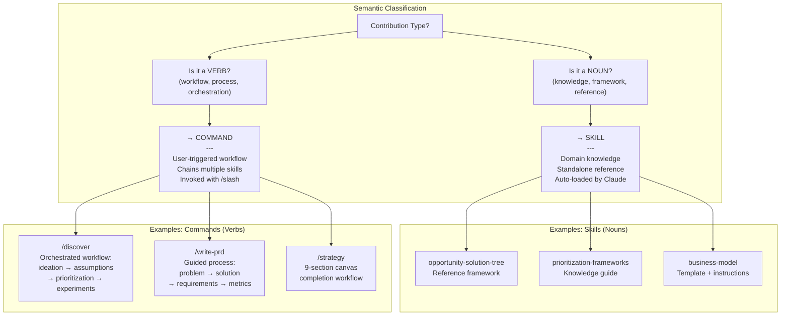
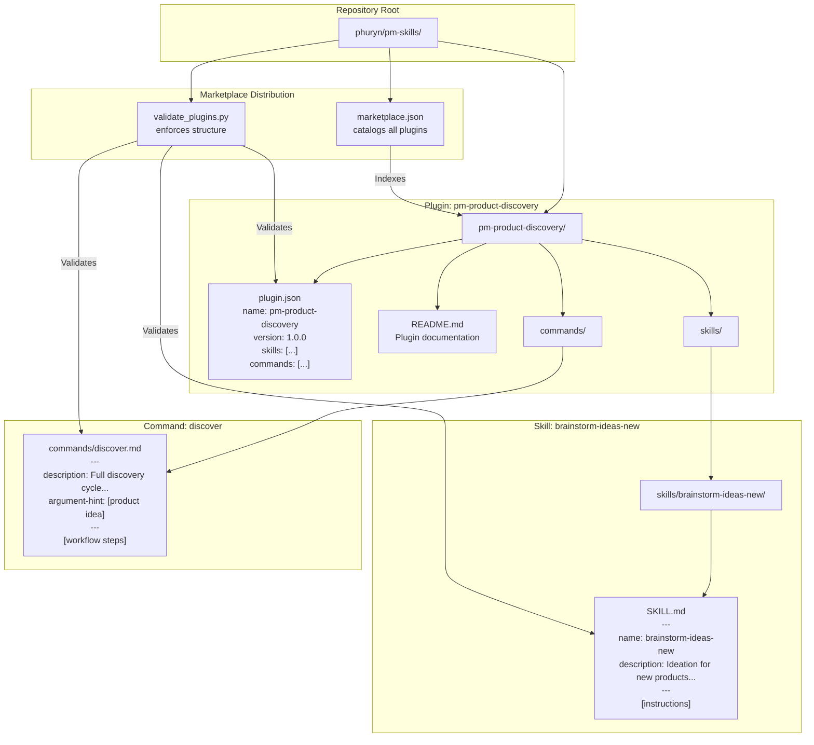
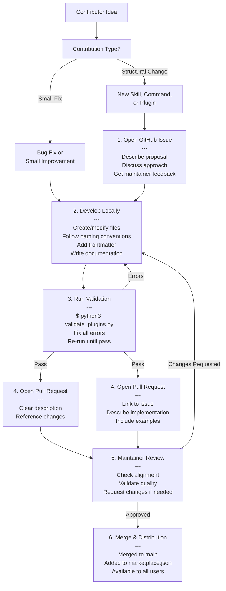

<!-- source: DeepWiki mcp.deepwiki.com · repo phuryn/pm-skills · page 7.1 Contribution Guidelines · fetched 2026-10-26 -->

# Contribution Guidelines

<details>
<summary>Relevant source files</summary>

The following files were used as context for generating this wiki page:

- [.gitignore](.gitignore)
- [CONTRIBUTING.md](CONTRIBUTING.md)
- [README.md](README.md)

</details>


This page explains how to contribute new skills, commands, or plugins to the PM Skills Marketplace. It covers the semantic distinction between skills and commands, required file structures, frontmatter specifications, and the submission workflow. For details about the automated validation system that enforces these guidelines, see [Plugin Validation System](#7.2).

**Scope**: This document focuses on the contributor experience and structural requirements. It does not cover the internal validation logic (see [#7.2](#7.2)) or the architectural rationale for the three-tier abstraction model (see [Three-Tier Abstraction Model](#3.1)).

---

## Contribution Types

The marketplace accepts five categories of contributions:

| Contribution Type | Complexity | Process | Example |
|------------------|------------|---------|---------|
| **Bug fixes** | Low | Direct PR | Fix typo in skill description |
| **Skill improvements** | Low-Medium | Direct PR | Add examples to existing skill |
| **New skills** | Medium | Issue first, then PR | Add `jobs-theory` skill to `pm-product-strategy` |
| **New commands** | Medium-High | Issue first, then PR | Add `/competitive-matrix` command |
| **New plugins** | High | Issue required | Add `pm-pricing-strategy` plugin |

**Process distinction**: Small fixes bypass the issue-tracking stage. Structural additions (skills, commands, plugins) require issue discussion to ensure alignment with marketplace philosophy and prevent duplication.

**Sources**: [CONTRIBUTING.md:1-22]()

---

## Skills vs Commands: Semantic Distinction

The marketplace enforces a strict semantic boundary between skills and commands:



**Decision criteria**:

- **Skills** answer: "What is X?" or "How does X work?" — They provide reusable knowledge that Claude references when relevant. Users don't invoke skills explicitly (though they can force-load with `/skill-name`).

- **Commands** answer: "How do I do X end-to-end?" — They orchestrate multiple skills into a structured workflow. Users explicitly trigger them with `/command-name argument`.

**Anti-pattern**: Do not create skills that are really workflows (e.g., `do-discovery` should be `/discover` command). Do not create commands that are really references (e.g., `/what-is-lean-canvas` should be `lean-canvas` skill).

**Sources**: [CONTRIBUTING.md:13-14](), [README.md:31-43]()

---

## File Structure Requirements

### Plugin Directory Structure

```
pm-{domain-name}/
├── plugin.json                    # Manifest (required)
├── README.md                      # Plugin documentation (required)
├── skills/                        # Skills directory (required)
│   ├── {skill-name}/
│   │   ├── SKILL.md              # Skill definition (required)
│   │   └── examples/             # Optional examples
│   ├── {another-skill}/
│   │   └── SKILL.md
│   └── ...
└── commands/                      # Commands directory (optional)
    ├── {command-name}.md
    ├── {another-command}.md
    └── ...
```

**Naming conventions**:

| Entity | Pattern | Example | Validation Rule |
|--------|---------|---------|----------------|
| Plugin directory | `pm-{domain}` | `pm-product-discovery` | Lowercase, hyphenated |
| Skill directory | `{skill-name}` | `opportunity-solution-tree` | Must match frontmatter `name` field |
| Skill file | `SKILL.md` | `SKILL.md` | Always uppercase `SKILL.md` |
| Command file | `{command-name}.md` | `discover.md` | Lowercase, hyphenated |

**Critical**: Skill directory names MUST match the `name` field in frontmatter. `validate_plugins.py` enforces this alignment.

**Sources**: [CONTRIBUTING.md:14-15](), [README.md:79]()

---

## Directory-to-Code Mapping



**Path resolution examples**:

- Plugin manifest: `pm-product-discovery/plugin.json`
- Skill definition: `pm-product-discovery/skills/brainstorm-ideas-new/SKILL.md`
- Command definition: `pm-product-discovery/commands/discover.md`
- Validation script: `validate_plugins.py` (repository root)
- Marketplace catalog: `marketplace.json` (repository root)

**Sources**: [CONTRIBUTING.md:18](), [README.md:41-43]()

---

## Frontmatter Requirements

### Skill Frontmatter

Every `SKILL.md` file must begin with YAML frontmatter:

```yaml
---
name: skill-name-here
description: Brief description of what this skill provides (minimum 30 characters, maximum 500)
---
```

**Requirements**:

| Field | Type | Constraints | Validation |
|-------|------|-------------|------------|
| `name` | string | Must match directory name exactly | `validate_plugins.py` checks alignment |
| `description` | string | ≥ 30 characters, ≤ 500 characters | Length validation enforced |

**Body requirements**:
- Content after frontmatter: 50–3000 words
- Must include instructions or reference material
- May include examples, templates, or frameworks

**Example** (from `pm-product-discovery/skills/opportunity-solution-tree/SKILL.md`):

```yaml
---
name: opportunity-solution-tree
description: Build an Opportunity Solution Tree (Teresa Torres) mapping outcome to opportunities, solutions, and experiments
---

[Skill content follows...]
```

**Sources**: [CONTRIBUTING.md:14]()

---

### Command Frontmatter

Every command file must begin with YAML frontmatter:

```yaml
---
description: Brief description of what this command does
argument-hint: [what the user should provide]
---
```

**Requirements**:

| Field | Type | Constraints | Example |
|-------|------|-------------|---------|
| `description` | string | Clear description of command purpose | `Full discovery cycle: ideation → assumptions → experiments` |
| `argument-hint` | string | User-facing guidance on arguments | `[product idea or problem statement]` |

**Body requirements**:
- Structured workflow steps
- Skill references (must be intra-plugin only)
- Suggested follow-up commands (natural language, not explicit references)

**Example** (from `pm-product-discovery/commands/discover.md`):

```yaml
---
description: Full discovery cycle: ideation → assumption mapping → prioritization → experiment design
argument-hint: [product idea or problem statement]
---

1. Brainstorm ideas using `/brainstorm-ideas-new`
2. Identify assumptions using `/identify-assumptions-new`
3. Prioritize assumptions using `/prioritize-assumptions`
4. Design experiments using `/brainstorm-experiments-new`
```

**Sources**: [CONTRIBUTING.md:14]()

---

## Cross-Plugin Reference Restrictions

Commands MUST NOT reference skills or commands from other plugins. This constraint ensures:

1. **Plugin independence**: Each plugin can be installed/uninstalled independently
2. **Reduced coupling**: Changes to one plugin don't break others
3. **Simpler validation**: `validate_plugins.py` checks for intra-plugin consistency only

**Allowed**:
```markdown
<!-- In pm-product-discovery/commands/discover.md -->
After brainstorming, use identify-assumptions skill to map risks.
```

**Prohibited**:
```markdown
<!-- In pm-product-discovery/commands/discover.md -->
After discovery, run /strategy from pm-product-strategy.  # ❌ Cross-plugin reference
```

**Workaround**: Suggest follow-ups in natural language:
```markdown
<!-- Acceptable approach -->
Discovery complete. Consider creating a product strategy next.
```

**Sources**: [CONTRIBUTING.md:16]()

---

## Contribution Workflow



**Process steps**:

1. **Issue Stage** (for new features):
   - Describe the skill/command/plugin proposal
   - Explain the PM methodology or use case
   - Get feedback on approach from maintainer (Paweł Huryn)

2. **Development Stage**:
   - Create files following structure in this document
   - Add required frontmatter
   - Write clear instructions or workflow steps
   - Include examples where applicable

3. **Validation Stage**:
   - Run `python3 validate_plugins.py` from repository root
   - Address all errors reported
   - Re-validate until clean pass

4. **PR Stage**:
   - Keep PR focused on single contribution
   - Write clear description
   - Link to issue (for features)
   - Include before/after examples

5. **Review Stage**:
   - Maintainer reviews for quality and alignment
   - May request changes
   - Validation must pass in CI

6. **Merge & Distribution**:
   - Contribution merged to `main` branch
   - Automatically available via `marketplace.json`
   - All users with marketplace installed receive update

**Sources**: [CONTRIBUTING.md:5-18]()

---

## Testing Your Contribution Locally

### Running the Validator

Before submitting a PR, validate your contribution:

```bash
# From repository root
python3 validate_plugins.py
```

**Expected output (success)**:
```
✓ All plugins validated successfully
```

**Expected output (errors)**:
```
✗ pm-product-discovery: Skill 'new-skill' missing required frontmatter field: description
✗ pm-product-discovery: Command 'new-command' references cross-plugin skill
```

**Common validation errors**:

| Error | Cause | Fix |
|-------|-------|-----|
| `Skill name mismatch` | Directory name ≠ frontmatter `name` | Rename directory or update frontmatter |
| `Description too short` | Description < 30 characters | Expand description |
| `Missing frontmatter` | No YAML frontmatter block | Add `---` delimited frontmatter |
| `Cross-plugin reference` | Command references external plugin | Remove reference or suggest in natural language |
| `Word count violation` | Skill body < 50 or > 3000 words | Adjust content length |

For detailed validation logic, see [Plugin Validation System](#7.2).

**Sources**: [CONTRIBUTING.md:18]()

---

## Testing in Claude Environment

### Testing Skills

Skills are auto-loaded by Claude when contextually relevant. To test:

1. Install your modified plugin locally:
   ```bash
   # For Claude Code CLI
   claude plugin install ./pm-your-plugin
   ```

2. Start a conversation that should trigger the skill:
   ```
   Help me prioritize these feature requests [provide context]
   ```

3. Verify Claude references your skill's framework/guidance

**Force-loading** (for explicit testing):
```
/your-skill-name [test scenario]
```

### Testing Commands

Commands are explicitly invoked. To test:

1. Install your modified plugin (as above)

2. Invoke the command:
   ```
   /your-command-name [test argument]
   ```

3. Verify:
   - Command executes step-by-step workflow
   - Skills are loaded in correct order
   - Output matches expected format
   - Follow-up suggestions appear

**Sources**: [README.md:35-37](), [README.md:41-45]()

---

## PR Best Practices

### PR Title Format

```
[Category] Brief description

Examples:
- [Skill] Add jobs-theory to pm-product-strategy
- [Command] Add /competitive-matrix to pm-market-research
- [Fix] Correct typo in brainstorm-ideas description
- [Docs] Update README with installation troubleshooting
```

### PR Description Template

```markdown
## Type
- [ ] Bug fix
- [ ] New skill
- [ ] New command
- [ ] Documentation improvement
- [ ] Other: _________

## Issue Link
Closes #[issue-number]

## Changes
- Brief bullet list of changes
- Keep focused on single contribution

## Testing
- [ ] Validated with `python3 validate_plugins.py`
- [ ] Tested in Claude Code/Cowork environment
- [ ] Verified skill/command works as expected

## Example Usage
[Provide example of skill/command in action]
```

### One Change Per PR

**Acceptable**:
- PR #1: Add `jobs-theory` skill to `pm-product-strategy`
- PR #2: Add `competitive-matrix` command to `pm-market-research`

**Not acceptable**:
- PR #1: Add 3 skills + 2 commands + documentation updates across 4 plugins

**Rationale**: Focused PRs are easier to review, test, and roll back if issues arise.

**Sources**: [CONTRIBUTING.md:12]()

---

## Contributor Recognition

All contributors are publicly listed in the repository. Contributors who add skills or commands are acknowledged in:

1. Repository `CONTRIBUTORS.md` (if it exists)
2. GitHub contributor graph
3. Commit history with clear attribution

By contributing, you agree to license your work under the [MIT License](LICENSE).

**Sources**: [CONTRIBUTING.md:17](), [CONTRIBUTING.md:20-22]()

---

## Maintainer Contact

**Maintainer**: Paweł Huryn  
**Email**: pawel@productcompass.pm  
**Newsletter**: [The Product Compass](https://www.productcompass.pm)

For contribution questions, open an issue on GitHub or email the maintainer directly.

**Sources**: [CONTRIBUTING.md:3](), [README.md:416]()

---

