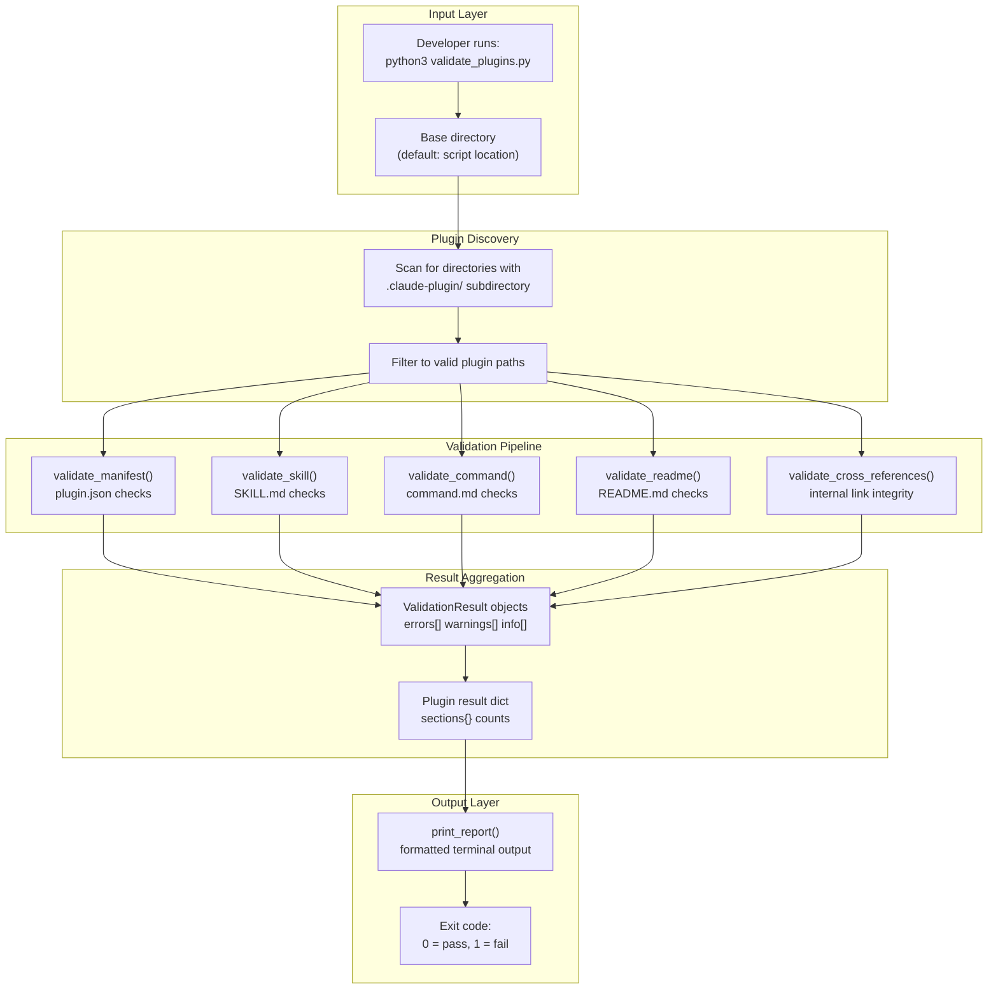
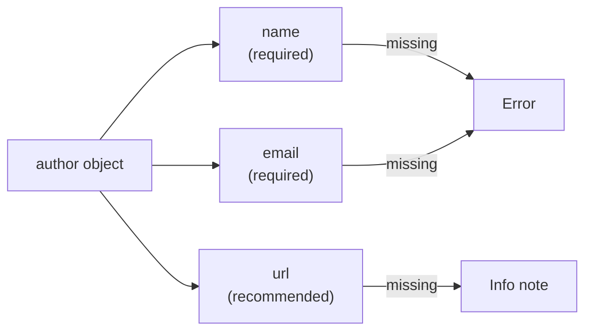
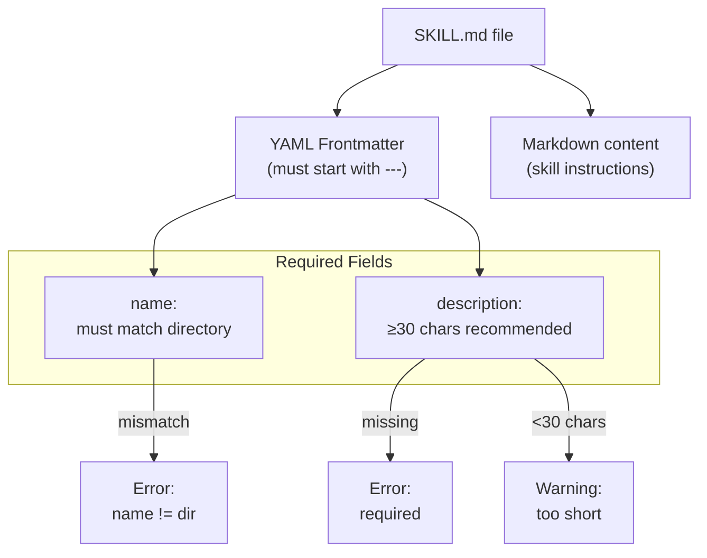
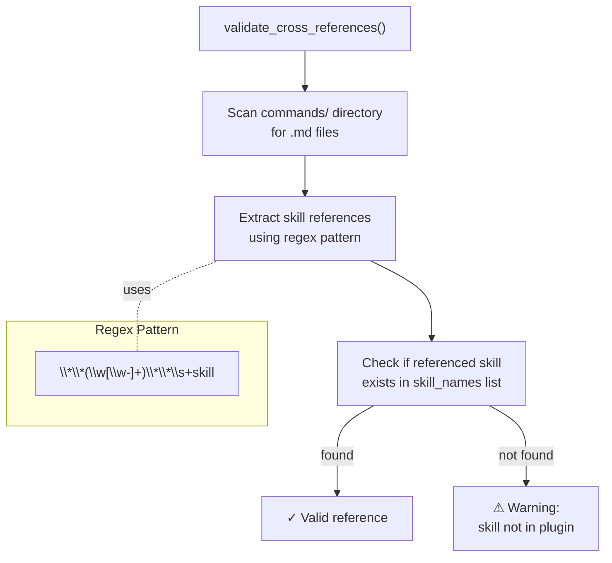
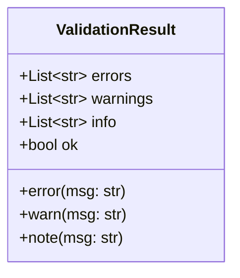
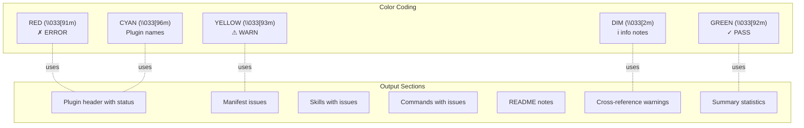
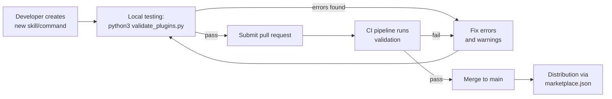

<!-- source: DeepWiki mcp.deepwiki.com · repo phuryn/pm-skills · page 7.2 Plugin Validation System · fetched 2026-10-26 -->

# Plugin Validation System

<details>
<summary>Relevant source files</summary>

The following files were used as context for generating this wiki page:

- [.gitignore](.gitignore)
- [CONTRIBUTING.md](CONTRIBUTING.md)
- [validate_plugins.py](validate_plugins.py)

</details>


This page documents the automated validation system that ensures all plugins in the PM Skills Marketplace meet structural and quality standards before distribution. The `validate_plugins.py` script performs 50+ checks across manifests, skills, commands, documentation, and cross-references to maintain consistency across the 8-plugin collection.

For general contribution guidelines and semantic rules (skills vs commands, naming conventions), see [Contribution Guidelines](#7.1). For installation and usage of validated plugins, see [Installation](#2.1).

---

## System Overview

The validation system operates as a pre-commit quality gate that enforces both the Claude Code plugin specification and marketplace-specific conventions. It validates plugins independently, checking that each plugin is self-contained and properly structured.

### Validation Architecture



**Sources**: [validate_plugins.py:464-503](), [validate_plugins.py:315-353]()

---

## Running the Validator

### Basic Execution

```bash
# Validate all plugins in current directory
python3 validate_plugins.py

# Validate plugins in specific directory
python3 validate_plugins.py /path/to/plugins
```

The script automatically discovers all directories containing a `.claude-plugin/` subdirectory and validates each one independently.

**Sources**: [validate_plugins.py:464-503](), [CONTRIBUTING.md:18]()

### Exit Codes and CI Integration

The validator returns exit codes suitable for CI/CD pipelines:

| Exit Code | Meaning | Condition |
|-----------|---------|-----------|
| `0` | Success | No errors found (warnings allowed) |
| `1` | Failure | One or more errors found |

Errors are blocking issues that must be fixed. Warnings indicate quality improvements but don't block distribution.

**Sources**: [validate_plugins.py:455-461](), [validate_plugins.py:503]()

---

## Validation Check Categories

The validation system performs checks across five categories, each implemented by a dedicated validator function in [validate_plugins.py]().

### 1. Manifest Validation (`validate_manifest`)

Validates `plugin.json` files located at `.claude-plugin/plugin.json` within each plugin directory.

#### Required Fields Check

| Field | Type | Validation | Error Type |
|-------|------|------------|------------|
| `name` | string | Must match directory name | Error |
| `version` | string | Must follow semver (x.y.z) | Warning if invalid |
| `description` | string | Must be present and ≥20 chars | Error if missing, Warning if short |

**Sources**: [validate_plugins.py:116-179](), [validate_plugins.py:31-32]()

#### Author Attribution



The `author` field must be an object with `name` and `email` as required fields. The `url` field is recommended but optional.

**Sources**: [validate_plugins.py:152-162](), [validate_plugins.py:33-34]()

#### Keywords and Metadata

The validator checks for recommended fields that improve plugin discoverability:

- **keywords**: Array of strings (warning if missing or non-array)
- **homepage**: URL to plugin documentation (warning if missing)
- **license**: License identifier (warning if missing)

**Sources**: [validate_plugins.py:148-150](), [validate_plugins.py:164-169]()

### 2. Skill Validation (`validate_skill`)

Each skill directory must contain a `SKILL.md` file with YAML frontmatter and structured content.

#### Frontmatter Requirements



The `name` field must exactly match the skill's directory name per the agentskills.io specification. This ensures consistent skill references across commands.

**Sources**: [validate_plugins.py:182-229](), [validate_plugins.py:36-37]()

#### Content Quality Checks

| Check | Threshold | Severity | Rationale |
|-------|-----------|----------|-----------|
| Minimum word count | 50 words | Warning | Skills need substantive guidance |
| Maximum word count | 3000 words | Warning | Suggests need for `references/` subdirectory |
| Description length | 30 characters | Warning | Must be descriptive for AI selection |
| Trigger phrases | "trigger", "use when", "use for" | Info | Improves automatic loading |

Word counts exclude YAML frontmatter using the `count_words()` function.

**Sources**: [validate_plugins.py:221-227](), [validate_plugins.py:84-91](), [validate_plugins.py:210-219]()

#### Frontmatter Parser Implementation

The validator uses a simple YAML parser for flat key-value pairs:

```python
# Simplified logic from parse_yaml_frontmatter()
def parse_yaml_frontmatter(content: str) -> Optional[dict]:
    # Must start with ---
    # Find closing ---
    # Parse key: value lines
    # Strip quotes from values
    # Return dict or None
```

This parser handles the subset of YAML used in skill frontmatter without requiring external dependencies.

**Sources**: [validate_plugins.py:62-81]()

### 3. Command Validation (`validate_command`)

Commands are markdown files in the `commands/` directory that orchestrate one or more skills into workflows.

#### Frontmatter Schema

| Field | Requirement | Purpose |
|-------|-------------|---------|
| `description` | Required | Human-readable command purpose |
| `argument-hint` | Recommended | Example of how to invoke command |

Commands must not reference skills from other plugins. Cross-plugin workflows should be suggested in natural language for users to execute as separate commands.

**Sources**: [validate_plugins.py:232-265](), [validate_plugins.py:39-41](), [CONTRIBUTING.md:16]()

#### Skill Reference Extraction

The validator uses regex pattern matching to detect skill references within command markdown:

```
Pattern: \*\*(\w[\w-]+)\*\*\s+skill
Captures: skill-name-here
```

This pattern identifies bold-formatted skill names followed by the word "skill", enabling cross-reference validation.

**Sources**: [validate_plugins.py:260-263]()

### 4. README Validation (`validate_readme`)

Each plugin must include a `README.md` file with standard sections.

#### Expected Sections

The validator performs case-insensitive substring matching for these section names:

1. **overview** - Plugin purpose and scope
2. **install** - Installation instructions  
3. **skill** - List of skills or "Skills" heading
4. **command** - List of commands or "Commands" heading

Missing sections generate info notes rather than errors, as README structure varies by plugin complexity.

**Sources**: [validate_plugins.py:268-286](), [validate_plugins.py:43-44]()

### 5. Cross-Reference Validation (`validate_cross_references`)

Ensures commands only reference skills that exist within the same plugin.



This check prevents broken command workflows and enforces plugin self-containment.

**Sources**: [validate_plugins.py:289-310](), [CONTRIBUTING.md:16]()

---

## Validation Result Structure

The validator uses a structured result object to categorize findings by severity.

### ValidationResult Class



**Properties:**
- `errors[]` - Blocking issues that fail validation (must fix)
- `warnings[]` - Quality issues that should be fixed (non-blocking)
- `info[]` - Informational notes about the plugin
- `ok` - Boolean property, returns `True` if `len(errors) == 0`

**Sources**: [validate_plugins.py:96-113]()

### Plugin Results Dictionary

Each plugin validation returns a dictionary with this structure:

```python
{
    "name": "pm-product-discovery",
    "skill_count": 13,
    "command_count": 5,
    "sections": {
        "manifest": ValidationResult(),
        "skills": {
            "skill-name-1": ValidationResult(),
            "skill-name-2": ValidationResult(),
            # ... one per skill
        },
        "commands": {
            "command-file.md": ValidationResult(),
            # ... one per command
        },
        "readme": ValidationResult(),
        "cross-refs": ValidationResult()
    }
}
```

**Sources**: [validate_plugins.py:315-353]()

---

## Understanding Validator Output

### Terminal Output Format

The validator uses ANSI color codes and structured formatting for readability:



**Sources**: [validate_plugins.py:47-57](), [validate_plugins.py:356-461]()

### Sample Output

```
┌─ pm-product-discovery  [13 skills, 5 commands]  ✓ PASS (2 warnings)
  Skills with issues:
    brainstorm-ideas:
      ⚠ WARN:  Description is very short (25 chars)
      ℹ Description lacks explicit trigger phrases (e.g., 'Triggers: ...')
  README:
      ℹ README: 456 words
└─────────────────────────────────────────────────────────────────────

Summary
=======================================================================
  Plugins:   8
  Skills:    65
  Commands:  36
  Total:     101 components

  ✓ ALL CHECKS PASSED (12 warnings)
```

Only plugins and components with issues are shown. Clean components are omitted for brevity.

**Sources**: [validate_plugins.py:370-461]()

---

## Common Validation Errors and Fixes

### Error: Missing YAML Frontmatter

**Symptom:** `✗ ERROR: Missing YAML frontmatter (must start with ---)`

**Cause:** `SKILL.md` or command file doesn't start with YAML frontmatter delimiter

**Fix:** Add frontmatter at the top of the file:

```markdown
---
name: skill-name-here
description: Skill description here
---

# Rest of skill content
```

**Sources**: [validate_plugins.py:197-199](), [validate_plugins.py:241-243]()

### Error: Name Mismatch

**Symptom:** `✗ ERROR: Name mismatch: frontmatter says 'old-name' but directory is 'new-name'`

**Cause:** Skill's frontmatter `name` field doesn't match its directory name

**Fix:** Either rename the directory or update the `name` field to match. The directory name is the source of truth.

```markdown
---
name: new-name  # Must match directory name
description: ...
---
```

**Sources**: [validate_plugins.py:206-208]()

### Error: Plugin Name Mismatch

**Symptom:** `✗ ERROR: Name mismatch: plugin.json says 'wrong-name' but directory is 'pm-plugin-name'`

**Cause:** `plugin.json` `name` field doesn't match plugin directory name

**Fix:** Update `plugin.json`:

```json
{
  "name": "pm-plugin-name",
  "version": "1.0.0",
  ...
}
```

**Sources**: [validate_plugins.py:138-140]()

### Warning: Cross-Plugin Reference

**Symptom:** `⚠ WARN: Command launch.md references skill 'external-skill' not found in this plugin`

**Cause:** Command references a skill from another plugin

**Fix:** Remove the skill reference and suggest the workflow in natural language:

```markdown
<!-- Instead of: Use **external-skill** skill -->
After completing this workflow, consider running the 
/other-command from pm-other-plugin to continue.
```

**Sources**: [validate_plugins.py:306-308](), [CONTRIBUTING.md:16]()

### Warning: Short Description

**Symptom:** `⚠ WARN: Description is very short (15 chars)`

**Cause:** Skill description is less than 30 characters

**Fix:** Expand the description to include:
- What the skill does
- When to use it (trigger phrases)
- Example use cases

```markdown
---
name: skill-name
description: |
  Create detailed user personas based on research data.
  Triggers: persona, user profile, customer segment
---
```

**Sources**: [validate_plugins.py:210-214]()

---

## Validation Configuration

The validation system uses constants defined at the top of `validate_plugins.py` for easy customization.

### Configuration Constants

| Constant | Value | Purpose |
|----------|-------|---------|
| `REQUIRED_MANIFEST_FIELDS` | `["name", "version", "description"]` | Fields that must exist in plugin.json |
| `RECOMMENDED_MANIFEST_FIELDS` | `["author", "keywords", "homepage", "license"]` | Fields that generate warnings if missing |
| `REQUIRED_SKILL_FIELDS` | `["name", "description"]` | Fields required in skill frontmatter |
| `REQUIRED_COMMAND_FIELDS` | `["description"]` | Fields required in command frontmatter |
| `RECOMMENDED_COMMAND_FIELDS` | `["argument-hint"]` | Command fields that should exist |
| `EXPECTED_README_SECTIONS` | `["overview", "install", "skill", "command"]` | Case-insensitive README section checks |

These constants can be modified to adjust validation rules without changing core logic.

**Sources**: [validate_plugins.py:28-44]()

---

## Integration with Contribution Workflow

The validation system integrates into the contribution workflow at multiple stages:



**Pre-commit Check**: Contributors should run the validator locally before submitting PRs.

**CI Enforcement**: The validation script returns exit code 1 on errors, enabling CI/CD integration.

**Quality Gate**: Only validated plugins reach the marketplace, ensuring consistent user experience.

**Sources**: [CONTRIBUTING.md:18](), [validate_plugins.py:503]()

---

## Extending the Validator

To add new validation checks:

1. **Add configuration constant** if needed (e.g., `REQUIRED_NEW_FIELD`)
2. **Modify validator function** (e.g., `validate_skill()`)
3. **Call `result.error()`, `result.warn()`, or `result.note()`** based on severity
4. **Test against existing plugins** to ensure no false positives

Example pattern:

```python
def validate_skill(skill_dir: str) -> ValidationResult:
    result = ValidationResult()
    # ... existing checks ...
    
    # New check
    if new_condition_not_met:
        result.error("New validation error message")
    
    return result
```

**Sources**: [validate_plugins.py:182-229](), [validate_plugins.py:96-113]()

---

**Sources**: [validate_plugins.py:1-508](), [CONTRIBUTING.md:1-23](), Diagram 6 from high-level architecture

---

