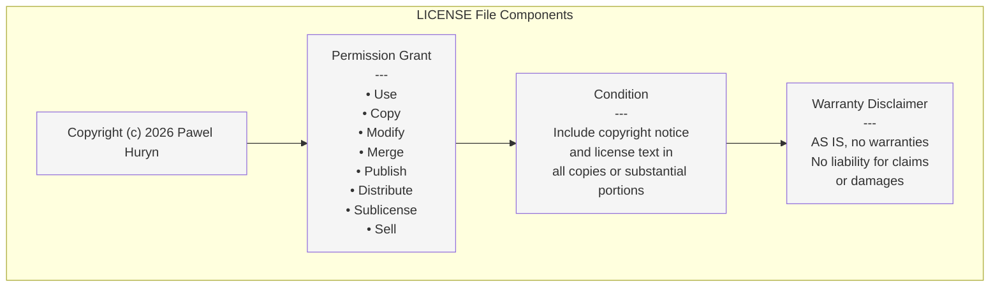
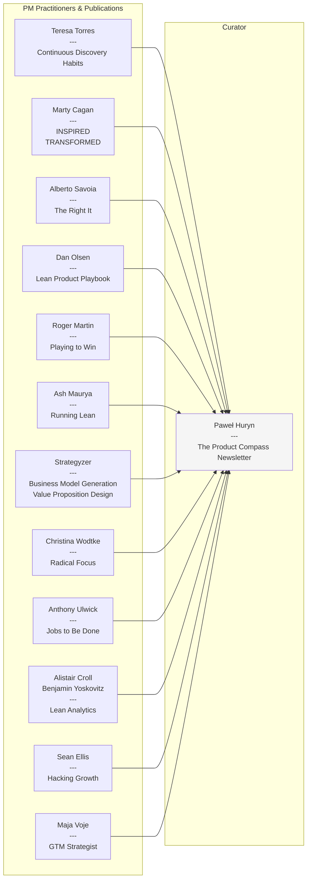
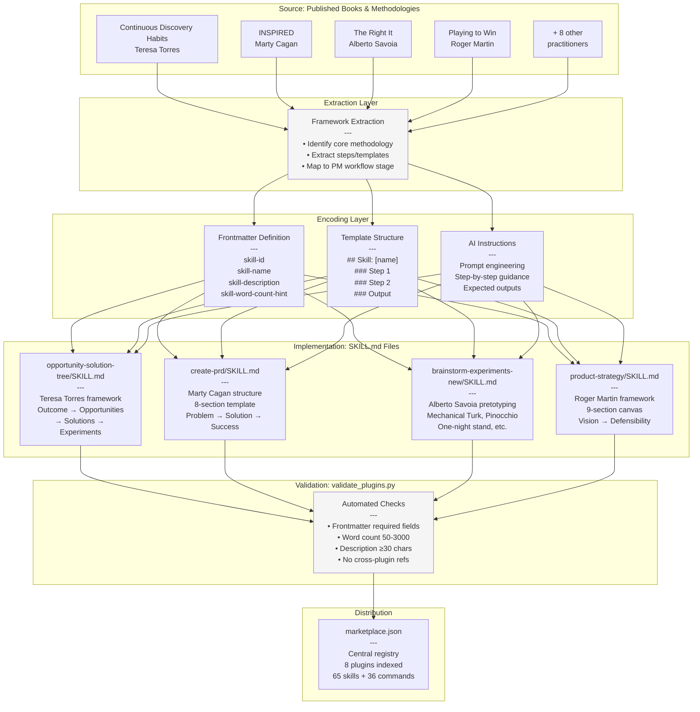
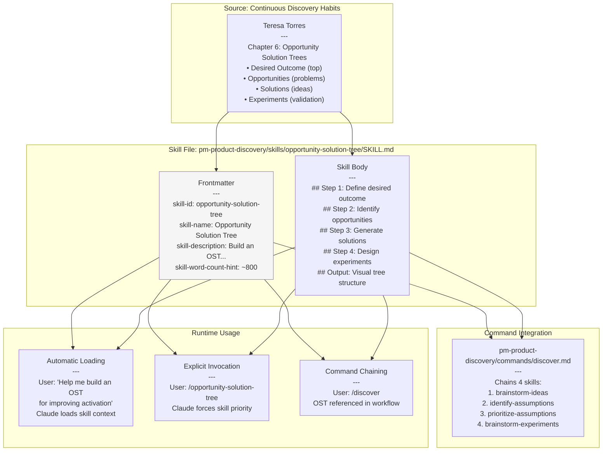

<!-- source: DeepWiki mcp.deepwiki.com · repo phuryn/pm-skills · page 8 License and Attribution · fetched 2026-10-26 -->

# License and Attribution

<details>
<summary>Relevant source files</summary>

The following files were used as context for generating this wiki page:

- [.gitattributes](.gitattributes)
- [LICENSE](LICENSE)
- [README.md](README.md)

</details>


This page documents the MIT license governing the PM Skills Marketplace codebase and attributes the product management practitioners whose methodologies and frameworks inform the 65 skills across 8 plugins. For information about contributing new skills or plugins, see [Contributing](#7).

---

## License Terms

The PM Skills Marketplace is released under the MIT License, one of the most permissive open-source licenses. The license grants broad permissions for use, modification, and distribution while requiring only attribution and disclaimer preservation.

### License File Structure



**Sources:** [LICENSE:1-21]()

### Covered Components

The MIT license applies to all components in the repository:

| Component Type | Examples | File Locations |
|----------------|----------|----------------|
| **Plugin Manifests** | `plugin.json` files | `pm-*/plugin.json` |
| **Skills** | `SKILL.md` files with frontmatter and instructions | `pm-*/skills/*/SKILL.md` |
| **Commands** | Command definition files | `pm-*/commands/*.md` |
| **Validation Scripts** | Plugin structure validation | `validate_plugins.py` |
| **Marketplace Definition** | Central registry of plugins | `marketplace.json` |
| **Documentation** | README, CONTRIBUTING guides | `README.md`, `CONTRIBUTING.md` |

**Sources:** [LICENSE:1-21](), [README.md:444-446]()

### License Requirements

Users of the PM Skills Marketplace must:

1. **Include the copyright notice** in copies or substantial portions of the software
2. **Include the full license text** in distributions
3. **Accept "as-is" terms** without warranty

The license does **not** require:
- Disclosure of source code modifications
- Sharing derivative works
- Using the same license for derived projects
- Notifying the original author of use

**Sources:** [LICENSE:10-14]()

---

## Framework Attribution

The 65 skills in the marketplace encode proven product management frameworks from 11 named practitioners. Each skill represents a translation of published methodologies into executable AI-guided workflows.

### Primary Framework Sources



**Sources:** [README.md:401-416]()

### Framework-to-Skill Mapping

This table maps each practitioner's methodologies to the specific skills and plugins where they are implemented:

| Practitioner | Core Framework | Implemented In | Skills/Commands |
|--------------|----------------|----------------|-----------------|
| **Teresa Torres** | Opportunity Solution Trees, Continuous Discovery | `pm-product-discovery` | `opportunity-solution-tree`<br/>`identify-assumptions-*`<br/>`interview-script`<br/>`/discover` |
| **Marty Cagan** | PRD structures, Product vision, Empowered teams | `pm-execution`<br/>`pm-product-strategy` | `create-prd`<br/>`product-vision`<br/>`/write-prd` |
| **Alberto Savoia** | Pretotyping, The Right It experiments | `pm-product-discovery` | `brainstorm-experiments-new`<br/>`identify-assumptions-new` |
| **Dan Olsen** | Lean Product Process, Product-Market Fit | `pm-product-strategy`<br/>`pm-execution` | `value-proposition`<br/>`prioritize-features` |
| **Roger L. Martin** | Strategy frameworks, Playing to Win | `pm-product-strategy` | `product-strategy`<br/>`/strategy` |
| **Ash Maurya** | Lean Canvas, Running Lean | `pm-product-strategy` | `lean-canvas`<br/>`/business-model lean` |
| **Strategyzer** | Business Model Canvas, Value Proposition Canvas | `pm-product-strategy` | `business-model`<br/>`value-proposition`<br/>`startup-canvas` |
| **Christina Wodtke** | OKRs, Radical Focus | `pm-execution` | `brainstorm-okrs`<br/>`/plan-okrs` |
| **Anthony W. Ulwick** | Jobs to Be Done, Outcome-Driven Innovation | `pm-product-strategy`<br/>`pm-market-research` | `value-proposition`<br/>`user-personas`<br/>`job-stories` |
| **Alistair Croll & Benjamin Yoskovitz** | North Star Metrics, Lean Analytics | `pm-marketing-growth`<br/>`pm-data-analytics` | `north-star-metric`<br/>`cohort-analysis`<br/>`/north-star` |
| **Sean Ellis** | Growth hacking, Growth loops | `pm-go-to-market` | `growth-loops`<br/>`/growth-strategy` |
| **Maja Voje** | Beachhead segments, GTM strategy | `pm-go-to-market` | `beachhead-segment`<br/>`gtm-strategy`<br/>`/plan-launch` |

**Sources:** [README.md:401-414](), [README.md:98-393]()

---

## Knowledge Translation Architecture

The marketplace functions as a knowledge translation engine, converting published PM methodologies into executable AI workflows through a structured encoding process.

### Translation Pipeline



**Sources:** [README.md:25-27](), [README.md:401-414]()

### Example: Teresa Torres → opportunity-solution-tree Skill

This diagram illustrates the translation of Teresa Torres' Opportunity Solution Tree framework into an executable skill:



**Sources:** [README.md:113](), [README.md:120]()

---

## Attribution Requirements for Derived Works

While the MIT license does not legally require attribution beyond the copyright notice, the PM Skills Marketplace requests that users acknowledge the framework creators when appropriate:

### When Creating Derivative Plugins

If you create plugins derived from PM Skills Marketplace skills:

1. **Retain framework attribution** in skill descriptions where methodologies are directly applied
2. **Cite original practitioners** when implementing their frameworks (e.g., "This skill implements Teresa Torres' Opportunity Solution Tree framework from *Continuous Discovery Habits*")
3. **Link to source books** in README documentation for further reading

### When Using Skills in Commercial Products

If you integrate PM Skills skills into commercial AI products:

1. **MIT license compliance** requires including the license text and copyright notice
2. **Framework attribution** is encouraged but not required (e.g., "Powered by frameworks from Teresa Torres, Marty Cagan, and other PM practitioners")
3. **Citation format** example: "This assistant uses product management frameworks curated in the PM Skills Marketplace (MIT License)"

**Sources:** [LICENSE:1-21](), [README.md:401-416]()

---

## Curator Attribution

The PM Skills Marketplace is curated by **Paweł Huryn**, author of [The Product Compass Newsletter](https://www.productcompass.pm). The curation involves:

- Framework selection from 11+ PM practitioners
- Knowledge encoding into 65 executable skills
- Plugin organization across 8 product lifecycle domains
- Command design for 36 orchestrated workflows
- Quality assurance through validation rules

**Sources:** [README.md:416](), [LICENSE:3]()

---

## License Badge Display

The repository displays license information through standard GitHub badges:

```markdown
[](https://github.com/phuryn/pm-skills/blob/main/LICENSE)
```

This badge appears at the top of [README.md:2]() and links to the full [LICENSE]() file, ensuring visibility and accessibility of licensing terms.

**Sources:** [README.md:2]()

---

## Summary

| Aspect | Details |
|--------|---------|
| **License Type** | MIT License (highly permissive) |
| **Copyright Holder** | Pawel Huryn (2026) |
| **Permissions** | Use, modify, distribute, sublicense, sell |
| **Requirements** | Include copyright notice and license text |
| **Framework Sources** | 11 PM practitioners, 12+ books |
| **Attribution Method** | Skill descriptions cite original frameworks |
| **Curator** | Paweł Huryn, The Product Compass Newsletter |

For questions about licensing or attribution, refer to [LICENSE]() or the [Contributing guidelines](#7).

**Sources:** [LICENSE:1-21](), [README.md:401-416]()