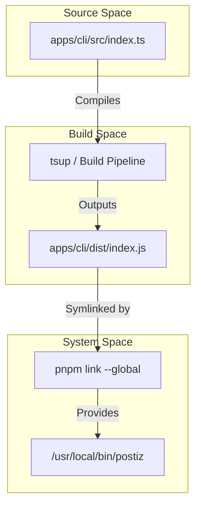
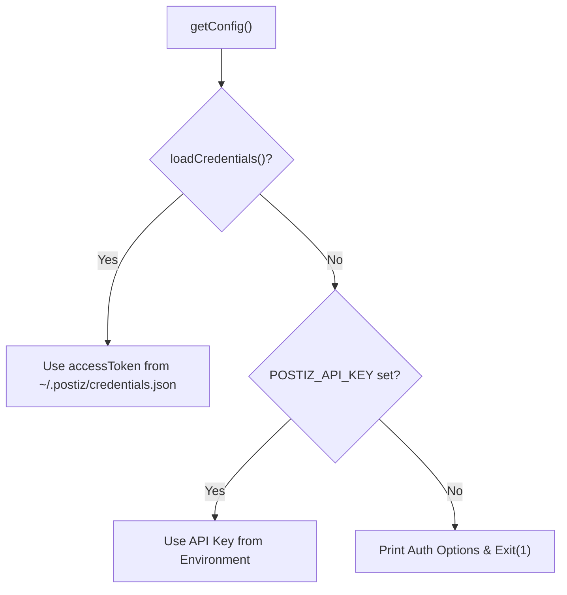
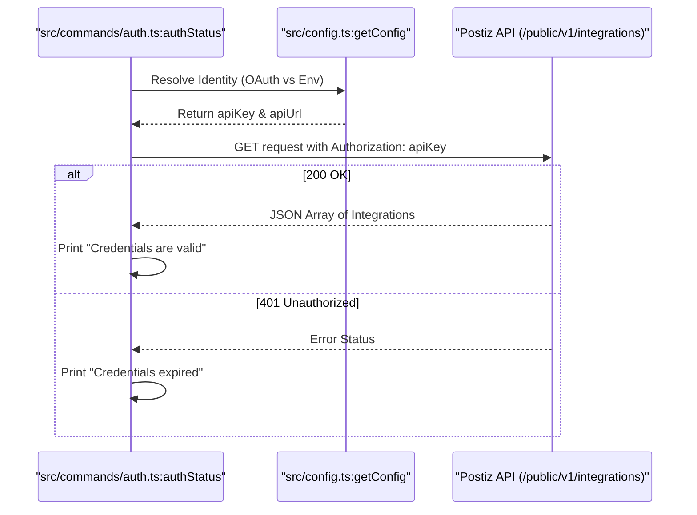

<!-- source: DeepWiki mcp.deepwiki.com · repo gitroomhq/postiz-agent · page 1.1 Getting Started · fetched 2026-10-26 -->

# Getting Started

<details>
<summary>Relevant source files</summary>

The following files were used as context for generating this wiki page:

- [HOW_TO_RUN.md](HOW_TO_RUN.md)
- [QUICK_START.md](QUICK_START.md)
- [src/commands/auth.ts](src/commands/auth.ts)
- [src/config.ts](src/config.ts)

</details>


This page provides a technical guide for installing, configuring, and verifying the Postiz CLI agent. It covers the two primary authentication methods (OAuth2 Device Flow and API Keys) and the internal configuration resolution logic.

## Installation and Build

The Postiz CLI is a TypeScript-based application located within the `apps/cli` directory of the monorepo. It must be compiled before execution.

### From Source (Development)
1. **Install Dependencies**: Run `pnpm install` from the monorepo root [QUICK_START.md:12-12]().
2. **Build**: Execute `pnpm run build:cli` [QUICK_START.md:15-15](). This triggers the build pipeline (typically `tsup`) to generate the executable bundle in `apps/cli/dist/index.js` [HOW_TO_RUN.md:7-7]().
3. **Execution Options**:
    * **Direct Node**: `node apps/cli/dist/index.js --help` [HOW_TO_RUN.md:11-11]().
    * **Global Link**: Run `pnpm link --global` inside `apps/cli` to make the `postiz` command available system-wide [HOW_TO_RUN.md:28-31]().
    * **Monorepo Filter**: `pnpm --filter postiz start -- --help` [HOW_TO_RUN.md:45-45]().

### Build and Link Workflow

The following diagram illustrates the relationship between the source code and the executable environment.

**CLI Build and Link Data Flow**

Sources: [QUICK_START.md:5-32](), [HOW_TO_RUN.md:5-39]()

---

## Authentication Options

The CLI supports two distinct authentication strategies. The `getConfig()` function in `src/config.ts` prioritizes stored OAuth2 credentials over environment variables [src/config.ts:4-30]().

### 1. OAuth2 Device Authorization Grant
This is the recommended flow for interactive users. It implements RFC 8628 to authenticate the CLI without requiring the user to manually handle API keys.

*   **Command**: `postiz auth:login` [src/commands/auth.ts:60-60]().
*   **Implementation**: 
    1.  The CLI requests a device code from the `authServer` (default: `https://cli-auth.postiz.com`) [src/commands/auth.ts:9-9](), [src/commands/auth.ts:73-76]().
    2.  The user is presented with a `userCode` and the CLI attempts to open the `verificationUri` in a browser [src/commands/auth.ts:98-103]().
    3.  The CLI enters a polling loop, calling `/device/token` every `interval` seconds until the user authorizes the request or the `deadline` is reached [src/commands/auth.ts:110-153]().
    4.  Upon success, credentials are saved to `~/.postiz/credentials.json` with `0o600` permissions [src/commands/auth.ts:7-7](), [src/commands/auth.ts:32-34]().

### 2. API Key (Environment Variables)
Ideal for CI/CD, headless servers, or AI agents.
*   **POSTIZ_API_KEY**: The primary secret used for `Authorization` headers [src/config.ts:15-15]().
*   **POSTIZ_API_URL**: (Optional) Overrides the default `https://api.postiz.com` [src/config.ts:16-16]().

**Authentication Logic Flow**

Sources: [src/config.ts:4-30](), [src/commands/auth.ts:17-26]()

---

## Configuration Module

The `src/config.ts` file acts as the central authority for the CLI's operational context.

### The `getConfig()` Function
This function resolves the `PostizConfig` object required by the `PostizAPI` client [src/config.ts:4-4]().

| Priority | Source | Key Logic |
| :--- | :--- | :--- |
| 1 | `~/.postiz/credentials.json` | Parsed via `loadCredentials()` [src/config.ts:6-7](). |
| 2 | `process.env.POSTIZ_API_KEY` | Read directly from environment [src/config.ts:15-15](). |

If no authentication is found, the CLI prints setup instructions and exits [src/config.ts:18-24]().

### Credential Storage Schema
Stored in `CREDENTIALS_FILE` (`~/.postiz/credentials.json`) [src/commands/auth.ts:7-7]():
```typescript
interface StoredCredentials {
  accessToken: string;    // Used as the Bearer/API Key
  apiUrl: string;         // The target Postiz instance
  organizationId?: string; // Optional context for enterprise users
}
```
Sources: [src/commands/auth.ts:11-15](), [src/config.ts:1-30]()

---

## First-Run Verification

To ensure the environment is correctly configured, users should run the `auth:status` command.

### `authStatus` Logic
The `authStatus` function in `src/commands/auth.ts` performs a live check:
1.  **Identity Resolution**: Identifies if the session is using OAuth2 or an Environment Variable [src/commands/auth.ts:177-192]().
2.  **API Verification**: Calls the `/public/v1/integrations` endpoint using the resolved credentials [src/commands/auth.ts:203-209]().
3.  **Result Reporting**:
    *   **Success (200 OK)**: Displays the number of connected social media integrations [src/commands/auth.ts:212-213]().
    *   **Failure (401/403)**: Informs the user that credentials have expired and suggests re-authentication via `auth:login` [src/commands/auth.ts:214-220]().

**Code Entity Mapping: Verification Sequence**

Sources: [src/commands/auth.ts:170-224](), [src/config.ts:4-30]()

---

