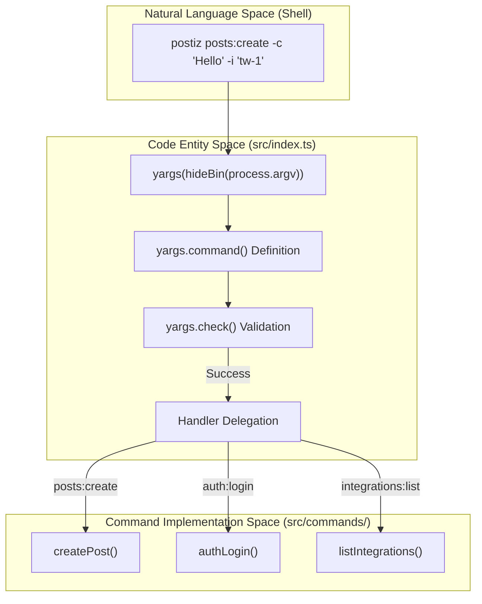
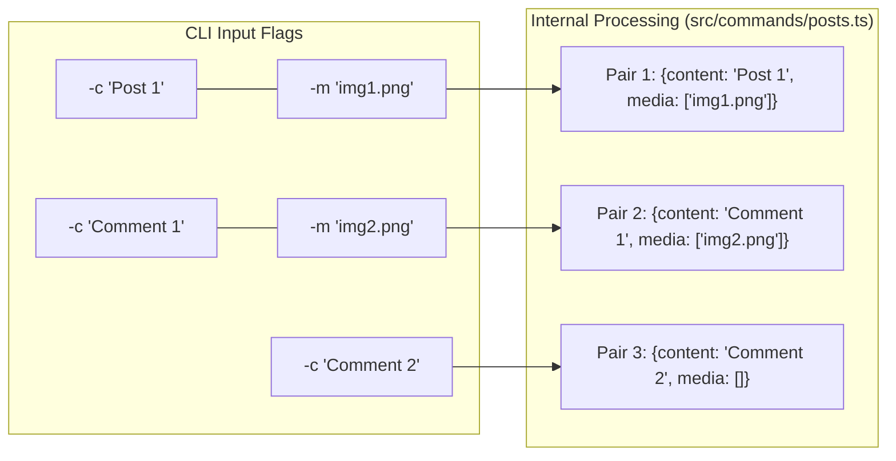

<!-- source: DeepWiki mcp.deepwiki.com · repo gitroomhq/postiz-agent · page 2.1 Entrypoint and Command Dispatch · fetched 2026-10-26 -->

# Entrypoint and Command Dispatch

<details>
<summary>Relevant source files</summary>

The following files were used as context for generating this wiki page:

- [SYNTAX_UPGRADE.md](SYNTAX_UPGRADE.md)
- [src/index.ts](src/index.ts)

</details>


The `postiz-agent` CLI is built on the `yargs` library, which handles command-line argument parsing, validation, and execution routing. The central hub for this logic is located in `src/index.ts`.

## Command Execution Flow

The CLI follows a standard dispatch pattern where `yargs` parses the process arguments and matches them against defined command namespaces. Once a command is matched, the execution is delegated to specific handler functions imported from the `src/commands/` directory.

### CLI Dispatch Architecture
The following diagram illustrates how a raw shell command is transformed into a call to a specific handler function.

**Diagram: Shell to Handler Mapping**

Sources: [src/index.ts:1-7](), [src/index.ts:10-13]()

## Command Namespaces and Flags

The CLI organizes functionality into distinct namespaces: `posts`, `integrations`, `analytics`, `auth`, and a standalone `upload` command.

### 1. Post Management (`posts:*`)
The `posts` namespace manages the lifecycle of social media content.

| Command | Flags | Purpose |
| :--- | :--- | :--- |
| `posts:create` | `-c`, `-m`, `-i`, `-s`, `-t`, `-d`, `-j`, `--settings` | Creates a new post or thread. Supports multiple `-c` (content) and `-m` (media) flags for threading. |
| `posts:list` | `--startDate`, `--endDate`, `--customer` | Retrieves a list of posts within a date range. |
| `posts:delete <id>` | N/A | Deletes a post by its unique ID. |
| `posts:status <id>` | `--status` | Switches a post between `draft` and `schedule` states. |
| `posts:missing <id>` | N/A | Finds provider-side content to reconnect to a missing post. |
| `posts:connect <id>` | `--releaseId` | Connects a post to a specific provider release ID. |

Sources: [src/index.ts:14-230](), [SYNTAX_UPGRADE.md:55-70]()

### 2. Integration Discovery (`integrations:*`)
These commands allow users and AI agents to discover available platforms and their requirements.

| Command | Flags | Purpose |
| :--- | :--- | :--- |
| `integrations:list` | N/A | Lists all connected social media accounts and their IDs. |
| `integrations:settings <id>` | N/A | Returns the JSON schema for platform-specific settings (e.g., Reddit flairs). |
| `integrations:trigger <id>` | `--tool`, `--data` | Executes a specific tool for an integration (e.g., fetching YouTube playlists). |

Sources: [src/index.ts:231-279]()

### 3. Authentication and Media
| Command | Namespace | Purpose |
| :--- | :--- | :--- |
| `auth:login` | `auth` | Initiates the OAuth2 device flow. |
| `auth:logout` | `auth` | Clears local credentials. |
| `auth:status` | `auth` | Checks current authentication state. |
| `upload <file>` | N/A | Uploads a local file to Postiz and returns a verified URL. |

Sources: [src/index.ts:312-355]()

## Argument Validation and Pairing Logic

### Strict Validation
The `posts:create` command implements a custom validation block using `yargs.check()`. It ensures that users provide either a `--json` file path or the minimum required flags (`--content`, `--integrations`, and `--date`).

```typescript
// Example of validation logic in src/index.ts
.check((argv) => {
  if (!argv.json && !argv.content) {
    throw new Error('Either --content or --json is required');
  }
  // ... further checks for integrations and date
  return true;
})
```
Sources: [src/index.ts:65-76]()

### The Multi-Flag Pairing Pattern
The CLI supports a sophisticated pairing logic for threads. When multiple `-c` (content) and `-m` (media) flags are provided, they are processed as ordered pairs.

**Diagram: Content and Media Pairing**

Sources: [SYNTAX_UPGRADE.md:55-70](), [src/index.ts:18-27]()

## Implementation Details in `src/index.ts`

The entrypoint utilizes `hideBin(process.argv)` to strip the node binary and script path before passing the remaining arguments to `yargs`. 

### Key Functions
- **`yargs.scriptName('postiz')`**: Sets the binary name used in help menus. [src/index.ts:11]()
- **`yargs.command()`**: Defines the command string, description, builder (for flags), and the handler function. [src/index.ts:13-119]()
- **`yargs.example()`**: Provides contextual usage examples that appear in the `--help` output. [src/index.ts:77-116]()

The handlers (e.g., `createPost`, `listPosts`) are cast as `any` during the `yargs.command` registration to bypass strict type mismatches between yargs' internal `Arguments` type and the custom DTOs used in the command implementations. [src/index.ts:118](), [src/index.ts:147]()

Sources: [src/index.ts:10-118]()

---

