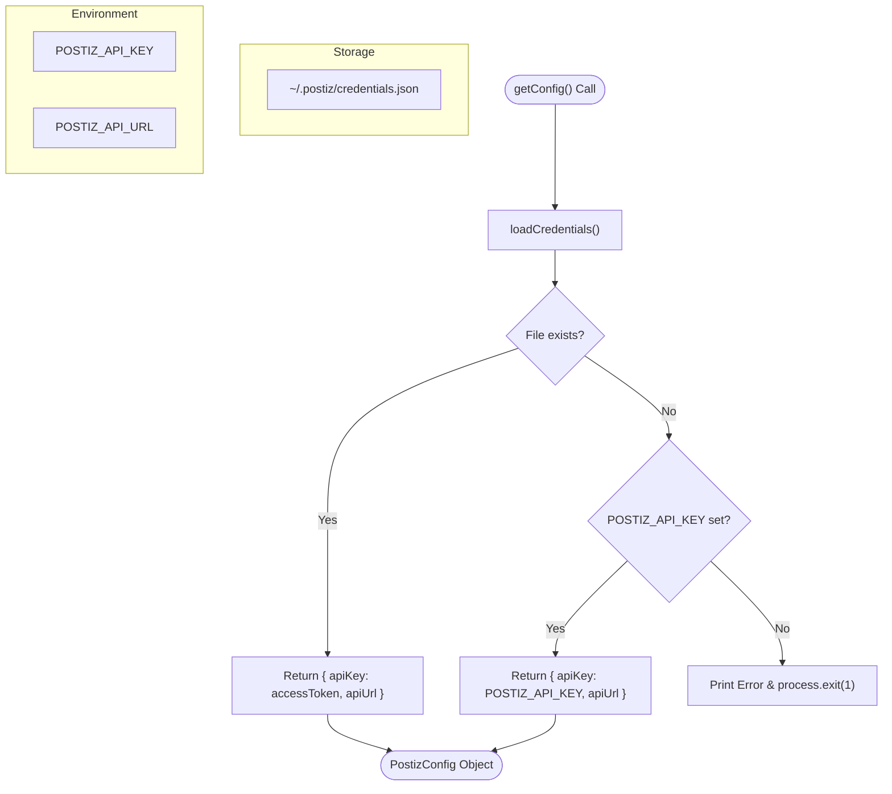
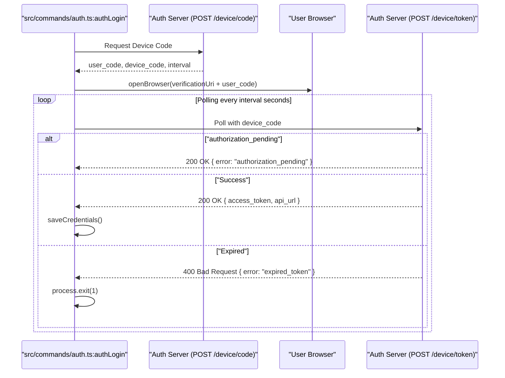

<!-- source: DeepWiki mcp.deepwiki.com · repo gitroomhq/postiz-agent · page 2.3 Configuration and Authentication Modules · fetched 2026-10-26 -->

# Configuration and Authentication Modules

Relevant source files

The following files were used as context for generating this wiki page:

- [src/commands/auth.ts](src/commands/auth.ts)
- [src/config.ts](src/config.ts)

The Postiz Agent supports two primary methods of authentication: **OAuth2 Device Authorization Grant** (recommended for interactive use) and **Static API Keys** (recommended for CI/CD or headless environments). This page details the configuration resolution logic, the credential storage mechanism, and the implementation of the device flow polling loop.

## Configuration Resolution

The `getConfig()` function serves as the central authority for retrieving authentication details. It follows a strict priority hierarchy where local stored credentials override environment variables.

### Credential Priority
1.  **Stored OAuth2 Credentials**: The system first attempts to load `accessToken` and `apiUrl` from the local filesystem via `loadCredentials()` [src/config.ts:6-12]().
2.  **Environment Variables**: If no local credentials exist, it falls back to `POSTIZ_API_KEY` and `POSTIZ_API_URL` [src/config.ts:15-16]().
3.  **Default/Failure**: If no key is found, the process logs an error and exits [src/config.ts:18-24]().

### Configuration Data Flow
The following diagram illustrates how `getConfig()` resolves the `PostizConfig` object used by the API client.

**Title: Configuration Resolution Logic**

**Sources:** [src/config.ts:4-30](), [src/commands/auth.ts:17-26]()

---

## Credential Storage

Local credentials are stored in the user's home directory. The system ensures strict file permissions to protect sensitive tokens.

*   **Directory**: `~/.postiz` (defined as `CREDENTIALS_DIR`) [src/commands/auth.ts:6]().
*   **File**: `credentials.json` (defined as `CREDENTIALS_FILE`) [src/commands/auth.ts:7]().
*   **Permissions**: 
    *   The directory is created with mode `0o700` (read/write/execute for owner only) [src/commands/auth.ts:30]().
    *   The file is saved and updated with mode `0o600` (read/write for owner only) [src/commands/auth.ts:32-34]().

### StoredCredentials Interface
The `StoredCredentials` interface defines the schema for the JSON file:
| Property | Type | Description |
| :--- | :--- | :--- |
| `accessToken` | `string` | The OAuth2 bearer token or API key. |
| `apiUrl` | `string` | The base URL for the Postiz API (defaults to `https://api.postiz.com`). |
| `organizationId` | `string` | (Optional) The specific organization context for the token. |

**Sources:** [src/commands/auth.ts:6-15](), [src/commands/auth.ts:28-35]()

---

## Authentication Flow (auth:login)

The `authLogin` function implements the OAuth2 Device Authorization Grant (RFC 8628). This allows the CLI to authenticate without requiring the user to type their password into the terminal.

### Step 1: Device Code Request
The CLI contacts the `authServer` (defaulting to `https://cli-auth.postiz.com`) to initiate the flow [src/commands/auth.ts:61-73](). It receives:
*   `device_code`: Used by the CLI to poll for the token.
*   `user_code`: A short code displayed to the user.
*   `verification_uri`: The URL where the user enters the code.

### Step 2: User Interaction
The CLI displays the `user_code` in a formatted box and automatically attempts to open the `verification_uri` in the system's default browser using `openBrowser()` [src/commands/auth.ts:96-103]().

### Step 3: Polling Loop
The CLI enters a `while` loop, polling the `/device/token` endpoint until the user completes the flow or the `expires_in` deadline is reached [src/commands/auth.ts:108-111]().

**Title: Device Flow Implementation**

**Sources:** [src/commands/auth.ts:60-157]()

---

## Authentication Status and Verification

The `authStatus()` function provides a diagnostic view of the current authentication state and actively verifies the validity of the credentials [src/commands/auth.ts:170]().

### Verification Logic
1.  **Identity Identification**: It checks both `loadCredentials()` and `process.env.POSTIZ_API_KEY` to determine which method is active [src/commands/auth.ts:171-192]().
2.  **API Verification**: It performs a `GET` request to the `${apiUrl}/public/v1/integrations` endpoint using the identified `apiKey` [src/commands/auth.ts:203-209]().
3.  **Response Handling**:
    *   **200 OK**: Reports success and the number of connected integrations [src/commands/auth.ts:211-213]().
    *   **401/403**: Reports that credentials have expired and suggests re-authentication [src/commands/auth.ts:214-220]().
    *   **Other Errors**: Displays the HTTP status and error message [src/commands/auth.ts:221-224]().

**Sources:** [src/commands/auth.ts:170-224]()

---

