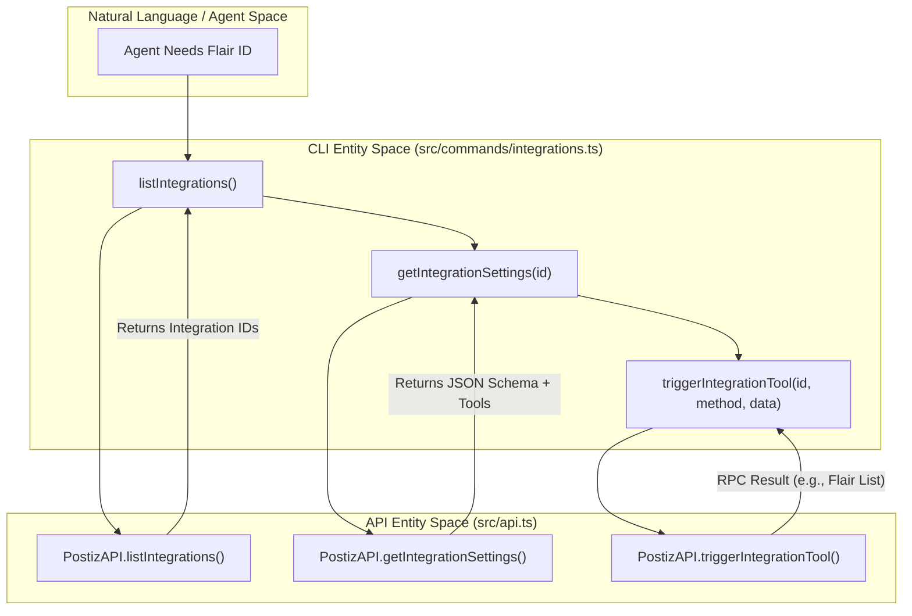
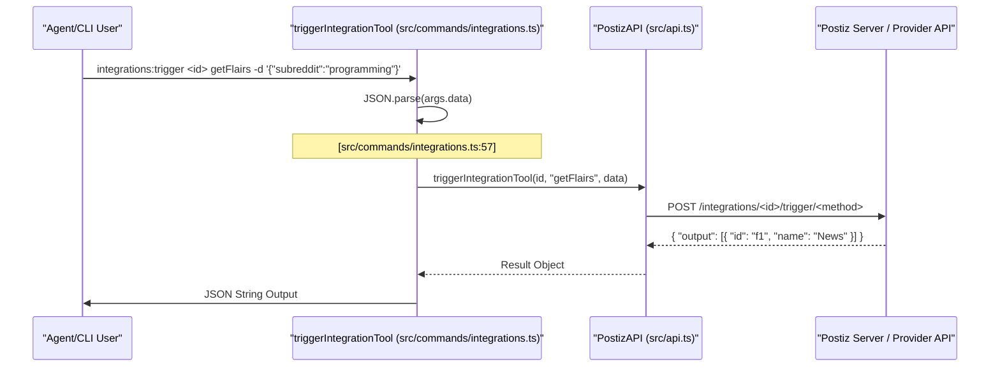

<!-- source: DeepWiki mcp.deepwiki.com · repo gitroomhq/postiz-agent · page 3.2 Integration Commands · fetched 2026-10-26 -->

# Integration Commands

Relevant source files

The following files were used as context for generating this wiki page:

- [INTEGRATION_SETTINGS_DISCOVERY.md](INTEGRATION_SETTINGS_DISCOVERY.md)
- [INTEGRATION_TOOLS_WORKFLOW.md](INTEGRATION_TOOLS_WORKFLOW.md)
- [src/commands/integrations.ts](src/commands/integrations.ts)

The `integrations` namespace provides the core mechanisms for the **Discovery Workflow**. This pattern allows AI agents and CLI users to dynamically inspect platform capabilities, validate content against provider-specific constraints (like character limits), and execute RPC-style tools to fetch required metadata (like Reddit flairs or YouTube playlists).

## Overview of the Discovery Workflow

The Discovery Workflow bridges the gap between a generic post and platform-specific requirements. Instead of hardcoding rules for 28+ providers, the CLI queries the Postiz API to retrieve JSON schemas and available methods.

### Data Flow Diagram: Discovery to Execution

This diagram illustrates how an agent moves from identifying an integration to executing a tool via `src/commands/integrations.ts`.

"Discovery Workflow Data Flow"

Sources: [src/commands/integrations.ts:4-73](), [src/api.ts:1-100]() (inferred from imports)

---

## Command Reference

### integrations:list
Lists all connected social media accounts associated with the current credentials. This is the entry point for finding the `id` required by all other integration commands.

*   **Function**: `listIntegrations()` [src/commands/integrations.ts:4-17]()
*   **API Endpoint**: `GET /integrations` [src/api.ts]()
*   **Output**: An array of objects containing `id`, `name`, `identifier`, and `provider`.

### integrations:settings
Retrieves the technical constraints and configuration schema for a specific integration. This is critical for AI agents to understand what fields are mandatory for a specific platform.

*   **Function**: `getIntegrationSettings(args)` [src/commands/integrations.ts:19-37]()
*   **Key Parameters**: `id` (Integration UUID).
*   **Returned Data Structure**:
    *   `maxLength`: Integer representing the platform's character limit (e.g., 280 for X, 40000 for Reddit). [INTEGRATION_SETTINGS_DISCOVERY.md:20]()
    *   `settings`: A JSON Schema object defining `properties` and `required` fields for the `--settings` flag in `posts:create`. [INTEGRATION_SETTINGS_DISCOVERY.md:21-33]()
    *   `tools`: An array of callable methods for dynamic data fetching. [INTEGRATION_TOOLS_WORKFLOW.md:24]()

### integrations:trigger
Executes a "tool" (RPC method) against a specific integration. This is used to fetch live data from the social platform that is required to populate settings.

*   **Function**: `triggerIntegrationTool(args)` [src/commands/integrations.ts:39-73]()
*   **Arguments**:
    *   `id`: The integration ID.
    *   `method`: The `methodName` discovered via `integrations:settings`.
    *   `-d, --data`: A JSON string containing parameters defined in the tool's `dataSchema`. [INTEGRATION_TOOLS_WORKFLOW.md:288-290]()

---

## Tool Execution Pattern

Tools are platform-specific functions. For example, Reddit requires a `subreddit` name to fetch available `flairs`. The `integrations:trigger` command facilitates this exchange.

### Interaction: Fetching Reddit Flairs

"Tool Execution Sequence"

Sources: [src/commands/integrations.ts:39-73](), [INTEGRATION_TOOLS_WORKFLOW.md:97-117]()

### Common Tools by Platform

| Platform | Method Name | Purpose |
| :--- | :--- | :--- |
| **Reddit** | `getFlairs` | Returns ID/Name pairs for subreddit flairs |
| **YouTube** | `getPlaylists` | Returns available playlists for the channel |
| **LinkedIn** | `getCompanies` | Lists companies the user has permission to post as |
| **Pinterest** | `getBoards` | Returns user boards for pin placement |
| **X (Twitter)** | `getCommunities` | Lists communities the user can post into |

Sources: [INTEGRATION_TOOLS_WORKFLOW.md:292-315]()

---

## Implementation Details

### JSON Schema Discovery
The `integrations:settings` command returns a standard JSON Schema. For platforms like Reddit, this schema is deeply nested, defining requirements for `subreddit`, `title`, and `type`. For simpler platforms (Threads, Mastodon), it returns a simplified message: `"No additional settings required"`.

Sources: [INTEGRATION_SETTINGS_DISCOVERY.md:81-127](), [INTEGRATION_SETTINGS_DISCOVERY.md:228-235]()

### Error Handling in Commands
All integration commands follow a strict error pattern:
1.  **Config Loading**: Calls `getConfig()` to retrieve API keys or tokens. [src/commands/integrations.ts:5]()
2.  **Validation**: Checks for mandatory arguments (e.g., `id` or `method`). [src/commands/integrations.ts:23-26]()
3.  **Try/Catch**: Wraps the API call. On failure, it logs the error and exits with `process.exit(1)` to signal failure to calling scripts or agents. [src/commands/integrations.ts:13-16]()

Sources: [src/commands/integrations.ts:1-74]()

---

