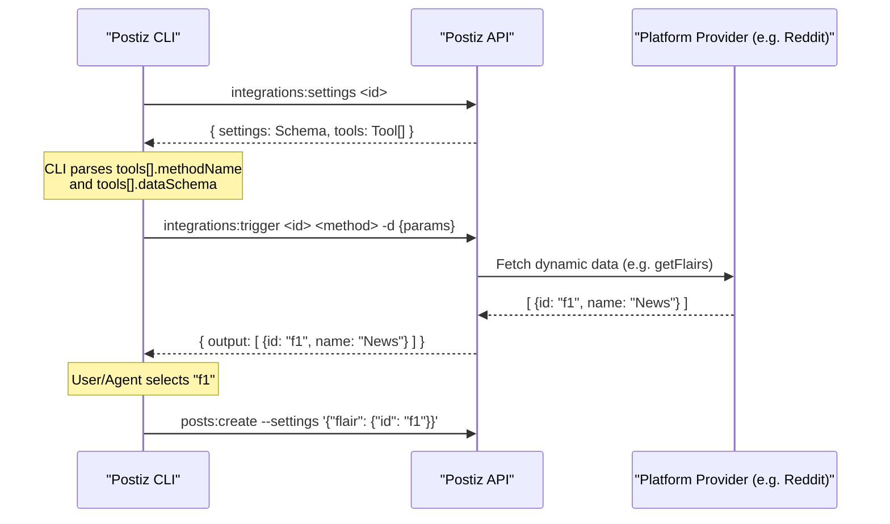
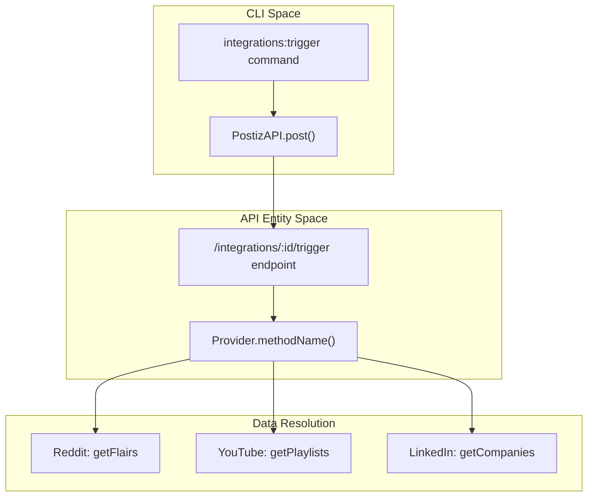

<!-- source: DeepWiki mcp.deepwiki.com · repo gitroomhq/postiz-agent · page 4.2 Integration Tools Workflow · fetched 2026-10-26 -->

# Integration Tools Workflow

<details>
<summary>Relevant source files</summary>

The following files were used as context for generating this wiki page:

- [INTEGRATION_TOOLS_WORKFLOW.md](INTEGRATION_TOOLS_WORKFLOW.md)
- [SKILL.md](SKILL.md)

</details>


The **Integration Tools Workflow** is a dynamic discovery pattern used to retrieve platform-specific metadata required for posting. While some platforms only require text and media, others (like Reddit, YouTube, or Pinterest) require specific IDs for subreddits, flairs, playlists, or boards. The Postiz CLI facilitates this through an RPC-style "trigger" mechanism.

## Overview of the Discovery Pattern

The workflow follows a four-step sequence that allows a technical user or an AI agent to determine what data is needed and how to fetch it without hardcoded platform logic [SKILL.md:50-58]().

1.  **List**: Identify the connected `integration-id` [INTEGRATION_TOOLS_WORKFLOW.md:7-13]().
2.  **Settings Discovery**: Inspect the `tools` and `settings` schema for that integration [INTEGRATION_TOOLS_WORKFLOW.md:15-24]().
3.  **Data Fetching**: Call specific `methodName` tools via `integrations:trigger` to get dynamic IDs [INTEGRATION_TOOLS_WORKFLOW.md:26-32]().
4.  **Composition**: Inject the retrieved IDs into the `settings` object during post creation [INTEGRATION_TOOLS_WORKFLOW.md:34-36]().

### Workflow Data Flow

The following diagram illustrates the interaction between the CLI commands and the Postiz API to resolve dynamic data.

**Discovery to Execution Sequence**

Sources: [INTEGRATION_TOOLS_WORKFLOW.md:5-36](), [SKILL.md:65-76]()

---

## Technical Implementation

### Discovery via `integrations:settings`
The `integrations:settings` command returns a JSON object containing a `tools` array. Each tool defines an executable method on the backend [INTEGRATION_TOOLS_WORKFLOW.md:262-280]().

| Property | Description |
| :--- | :--- |
| `methodName` | The string identifier passed to the trigger command. |
| `description` | Human/AI readable explanation of the tool's purpose. |
| `dataSchema` | An array of parameter objects (key, description, type) required by the tool. |

**Example Tool Schema (Reddit)**
```json
{
  "methodName": "getFlairs",
  "description": "Get available flairs for a subreddit",
  "dataSchema": [
    { "key": "subreddit", "type": "string" }
  ]
}
```
Sources: [INTEGRATION_TOOLS_WORKFLOW.md:47-94](), [INTEGRATION_TOOLS_WORKFLOW.md:264-275]()

### Execution via `integrations:trigger`
The `integrations:trigger` command acts as a proxy for provider-specific API calls. It takes an integration ID, a method name, and optional JSON data [SKILL.md:126-128]().

**Command Syntax:**
`postiz integrations:trigger <integration-id> <method-name> [-d '{"key":"value"}']` [INTEGRATION_TOOLS_WORKFLOW.md:31-31]()

**Internal Logic Mapping**

Sources: [SKILL.md:70-70](), [INTEGRATION_TOOLS_WORKFLOW.md:292-315]()

---

## Common Tool Methods by Platform

Different platforms expose different tools to satisfy their specific `settings` requirements [INTEGRATION_TOOLS_WORKFLOW.md:292-315]().

| Platform | Common Methods | Purpose |
| :--- | :--- | :--- |
| **Reddit** | `getFlairs`, `searchSubreddits` | Resolve flair IDs and find subreddit names. |
| **YouTube** | `getPlaylists`, `getCategories` | Assign video to playlist; set mandatory category ID. |
| **LinkedIn** | `getCompanies` | Retrieve URNs for organizations the user manages. |
| **Pinterest** | `getBoards`, `getBoardSections` | Find target board for a Pin. |
| **Twitter/X** | `getCommunities` | Post to a specific X Community. |

Sources: [INTEGRATION_TOOLS_WORKFLOW.md:292-315]()

---

## Practical Examples

### YouTube Playlist Workflow
YouTube requires a `playlistId` if you want the video to appear in a specific collection.

1.  **Trigger Tool**: `postiz integrations:trigger youtube-id getPlaylists` [INTEGRATION_TOOLS_WORKFLOW.md:172-172]()
2.  **Receive Result**: Returns `[{"id": "PL123", "title": "Tutorials"}]` [INTEGRATION_TOOLS_WORKFLOW.md:178-188]()
3.  **Create Post**:
    ```bash
    postiz posts:create -c "Desc" -i "youtube-id" --settings '{"playlistId": "PL123"}'
    ```
    Sources: [INTEGRATION_TOOLS_WORKFLOW.md:193-202]()

### Reddit Flair Workflow
Reddit often requires a flair ID for specific subreddits.

1.  **Trigger Tool**: `postiz integrations:trigger reddit-id getFlairs -d '{"subreddit":"programming"}'` [INTEGRATION_TOOLS_WORKFLOW.md:100-100]()
2.  **Receive Result**: Returns `[{"id": "flair-abc", "name": "Discussion"}]` [INTEGRATION_TOOLS_WORKFLOW.md:105-116]()
3.  **Create Post**:
    ```bash
    postiz posts:create -c "Content" -i "reddit-id" --settings '{"subreddit": [{"value": {"subreddit": "programming", "flair": {"id": "flair-abc"}}}]}'
    ```
    Sources: [INTEGRATION_TOOLS_WORKFLOW.md:121-140]()

## AI Agent Integration Pattern
For AI agents, the workflow is entirely automated by parsing the `dataSchema`. If a tool requires a parameter (like `subreddit`), the agent must prompt the user or search for the value before calling the tool [INTEGRATION_TOOLS_WORKFLOW.md:316-339]().

**Agent Automation Logic:**
1.  Call `integrations:settings`.
2.  Identify if any `settings` fields require IDs.
3.  Match `settings` requirements to available `tools`.
4.  Execute tools and map the `output` to the `posts:create --settings` payload.

Sources: [INTEGRATION_TOOLS_WORKFLOW.md:316-339](), [SKILL.md:50-58]()

---

