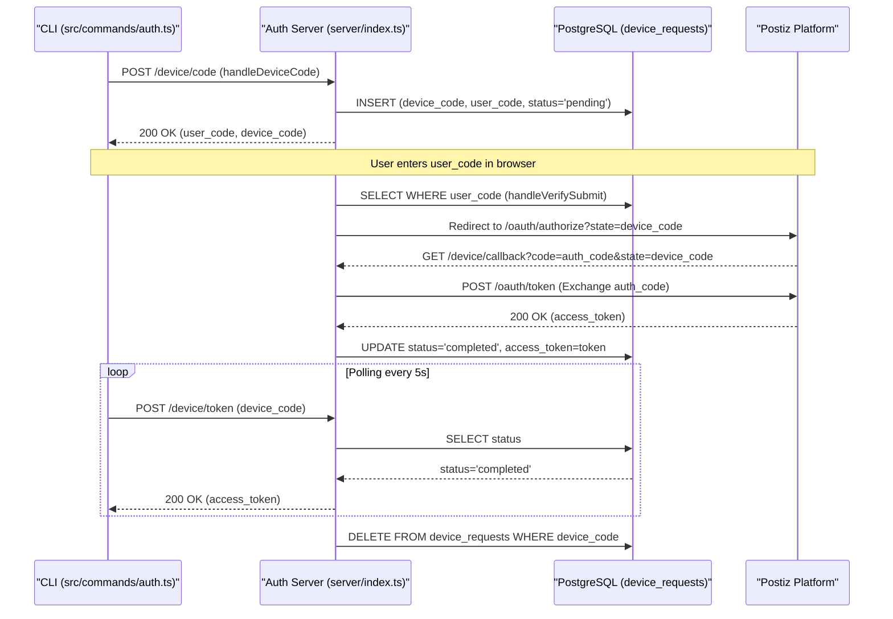
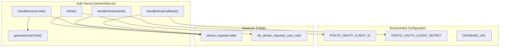

<!-- source: DeepWiki mcp.deepwiki.com · repo gitroomhq/postiz-agent · page 6.1 Device Flow Architecture · fetched 2026-10-26 -->

# Device Flow Architecture

Relevant source files

The following files were used as context for generating this wiki page:

- [server/SERVER.md](server/SERVER.md)
- [server/index.ts](server/index.ts)

The Postiz CLI utilizes the **OAuth2 Device Authorization Grant (RFC 8628)** to authenticate users without requiring them to handle client secrets or manual API key entry. The standalone Auth Server acts as a mediator between the CLI and the Postiz OAuth provider, managing the lifecycle of authorization requests and securely storing temporary tokens.

## Sequence of Operations

The authentication process follows a 6-step sequence that bridges the local CLI environment and the web-based OAuth flow.

### 1. Code Generation
The CLI initiates the flow by calling `POST /device/code`. The server generates a high-entropy `device_code` (for CLI polling) and a human-readable `user_code` (for display).
- **Function**: `handleDeviceCode` [server/index.ts:106-122]()
- **Data**: A new record is inserted into `device_requests` with status `pending`.

### 2. User Verification
The user is directed to the `/device/verify` URL. The server renders an HTML form where the user enters the `user_code` shown in their terminal.
- **Function**: `handleVerifyPage` [server/index.ts:125-140]()
- **Function**: `handleVerifySubmit` [server/index.ts:143-173]()

### 3. OAuth Redirect
Upon validating the `user_code`, the server redirects the user's browser to the Postiz Frontend OAuth authorize endpoint. The `device_code` is passed in the `state` parameter to maintain session continuity.
- **Implementation**: [server/index.ts:168-172]()

### 4. Token Exchange
After the user approves the request, Postiz redirects back to `/device/callback`. The server extracts the authorization `code` and exchanges it for an `access_token` by calling the Postiz API with its internal `CLIENT_SECRET`.
- **Function**: `handleOAuthCallback` [server/index.ts:176-180]()

### 5. Completion
The server updates the `device_requests` table, setting the status to `completed` and storing the retrieved `access_token`.
- **Logic**: [server/SERVER.md:15-19]()

### 6. CLI Retrieval
Throughout this process, the CLI polls `POST /device/token`. While the flow is active, the server returns `authorization_pending`. Once the status is `completed`, the server returns the token and immediately deletes the database record.
- **Logic**: [server/SERVER.md:87-87](), [server/SERVER.md:106-106]()

---

## Technical Data Flow

The following diagram illustrates the interaction between code entities across the CLI, Auth Server, and Postiz Platform.

### Entity Interaction Diagram

**Sources**: [server/SERVER.md:7-23](), [server/index.ts:106-180]()

---

## Database Schema and Lifecycle

The server relies on a single PostgreSQL table, `device_requests`, to track the state of active authentication attempts.

### Schema Definition
| Column | Type | Description |
| :--- | :--- | :--- |
| `device_code` | `TEXT` | Primary Key. High-entropy identifier used by CLI for polling. |
| `user_code` | `TEXT` | 8-character human-friendly code (e.g., `ABCD-EFGH`). |
| `status` | `TEXT` | Current state: `pending` or `completed`. |
| `access_token` | `TEXT` | The Postiz API token (populated after callback). |
| `api_url` | `TEXT` | The base URL for the Postiz API instance. |
| `organization_id` | `TEXT` | Associated Postiz organization ID. |
| `created_at` | `TIMESTAMPTZ` | Record creation timestamp for expiry logic. |

**Sources**: [server/index.ts:35-43](), [server/SERVER.md:95-104]()

### Expiry and Cleanup Logic
To maintain security and database performance, the server implements strict cleanup rules:
1.  **TTL Expiry**: Records are considered valid for 15 minutes (`EXPIRY_MINUTES`). [server/index.ts:29-29]()
2.  **Startup Cleanup**: Stale rows are deleted when the server starts. [server/index.ts:50-52]()
3.  **Consumption Cleanup**: Rows are deleted immediately after the CLI successfully retrieves the token via the `/device/token` endpoint. [server/SERVER.md:106-106]()
4.  **Verification Check**: During `handleVerifySubmit`, the server ensures the record is not older than 15 minutes. [server/index.ts:156-156]()

---

## Code Entity Mapping

This diagram maps the logical components of the Device Flow to specific functions and variables in the codebase.

### System to Code Mapping

**Sources**: [server/index.ts:8-14](), [server/index.ts:33-53](), [server/index.ts:64-72](), [server/index.ts:106-113]()

---

