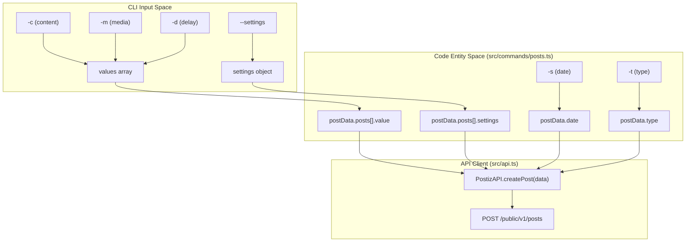
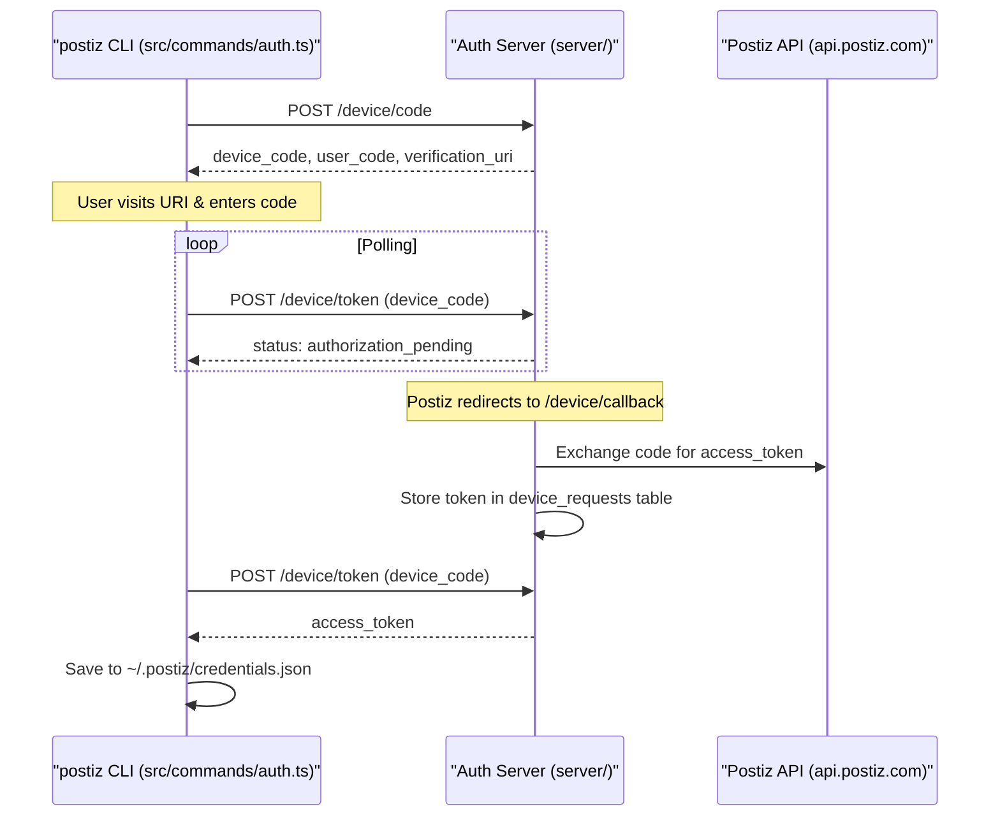

<!-- source: DeepWiki mcp.deepwiki.com · repo gitroomhq/postiz-agent · page 8 Glossary · fetched 2026-10-26 -->

# Glossary

Relevant source files

The following files were used as context for generating this wiki page:

- [INTEGRATION_TOOLS_WORKFLOW.md](INTEGRATION_TOOLS_WORKFLOW.md)
- [PROVIDER_SETTINGS.md](PROVIDER_SETTINGS.md)
- [README.md](README.md)
- [SKILL.md](SKILL.md)
- [SUPPORTED_FILE_TYPES.md](SUPPORTED_FILE_TYPES.md)
- [server/SERVER.md](server/SERVER.md)
- [src/api.ts](src/api.ts)
- [src/commands/analytics.ts](src/commands/analytics.ts)
- [src/commands/posts.ts](src/commands/posts.ts)
- [src/index.ts](src/index.ts)

This page provides technical definitions and code pointers for terms, abbreviations, and domain concepts specific to the `postiz-agent` codebase. It serves as a reference for onboarding engineers to understand how natural language concepts map to specific implementation details.

## Core System Entities

The following table defines the primary entities used throughout the CLI and its supporting services.

| Term | Definition | Code Pointer |
|:---|:---|:---|
| **Integration** | A connected social media account or platform (e.g., a specific X account or LinkedIn page). | [src/api.ts:172-176]() |
| **Provider** | The underlying platform type (e.g., `reddit`, `youtube`, `tiktok`). | [src/api.ts:79-115]() |
| **Post** | A top-level container for a publishing event, which can target multiple integrations. | [src/commands/posts.ts:125-135]() |
| **Release ID** | A unique identifier returned by a social provider after successful publishing. Used for analytics. | [src/api.ts:146-151]() |
| **Missing Release** | A state where a post was published, but the provider did not return an ID (common with TikTok). | [src/commands/posts.ts:5-22]() |
| **Device Flow** | An OAuth2 mechanism (RFC 8628) allowing the CLI to authenticate via a browser without local secrets. | [server/SERVER.md:7-23]() |
| **Tool** | An RPC-style method provided by an integration to fetch dynamic data (e.g., `getFlairs`). | [src/api.ts:184-193]() |

**Sources:** [src/api.ts](), [src/commands/posts.ts](), [server/SERVER.md]()

---

## Post Composition Logic

The composition of a post involves mapping CLI flags or JSON structures into a `CreatePostDto` compatible with the Postiz API.

### Data Flow: CLI to API
The diagram below illustrates how user input via `posts:create` is transformed into the internal `postData` object.

**Post Creation Transformation**

**Sources:** [src/commands/posts.ts:49-147](), [src/api.ts:42-47]()

---

## Authentication Concepts

The agent supports two primary authentication modes: `API Key` and `OAuth2 Device Flow`.

### OAuth2 Device Flow (RFC 8628)
This flow mediates between the CLI and the Postiz OAuth server using a standalone authentication server.

**Authentication Sequence**

**Sources:** [server/SERVER.md:7-23](), [src/commands/auth.ts](), [server/SERVER.md:92-104]()

---

## Integration Tools & Discovery

The "Discovery Workflow" is a pattern used by AI agents to interact with platforms that have complex requirements (like subreddits or YouTube categories).

| Code Entity | Purpose | Implementation |
|:---|:---|:---|
| `getIntegrationSettings` | Returns the schema of required settings and available tools. | [src/api.ts:178-182]() |
| `triggerIntegrationTool` | Executes a specific `methodName` on the provider (e.g., `getPlaylists`). | [src/api.ts:184-193]() |
| `dataSchema` | Part of the tool metadata defining what parameters the tool requires. | [INTEGRATION_TOOLS_WORKFLOW.md:263-280]() |

**Sources:** [src/api.ts](), [INTEGRATION_TOOLS_WORKFLOW.md]()

---

## Media & Uploads

The agent handles media by first uploading it to the Postiz storage service and then referencing the returned URL in post creation.

### MIME Type Detection
The `PostizAPI.upload` method performs extension-to-MIME mapping to ensure platforms like TikTok and Instagram process the files correctly.

| Extension | Detected MIME Type | Code Pointer |
|:---|:---|:---|
| `.mp4` | `video/mp4` | [src/api.ts:91]() |
| `.jpg` / `.jpeg` | `image/jpeg` | [src/api.ts:82-83]() |
| `.pdf` | `application/pdf` | [src/api.ts:112]() |
| (Default) | `application/octet-stream` | [src/api.ts:117]() |

**Sources:** [src/api.ts:74-138](), [SUPPORTED_FILE_TYPES.md]()

---

## Analytics & Resolution

When a post is published, it enters a state where analytics can be tracked. However, some platforms require a manual "Resolution" step.

*   **`analytics:post`**: Fetches metrics (likes, impressions) for a specific ID. If it returns `{"missing": true}`, the post lacks a `releaseId`. [src/commands/analytics.ts:26-46]()
*   **`posts:missing`**: Calls `api.getMissingContent` to list recent provider activity that hasn't been linked to a Postiz post. [src/commands/posts.ts:5-22]()
*   **`posts:connect`**: Calls `api.updateReleaseId` to manually link a `releaseId` from the provider to the Postiz `postId`. [src/commands/posts.ts:24-47]()

**Sources:** [src/commands/analytics.ts](), [src/commands/posts.ts](), [SKILL.md:200-218]()