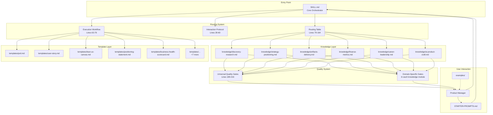
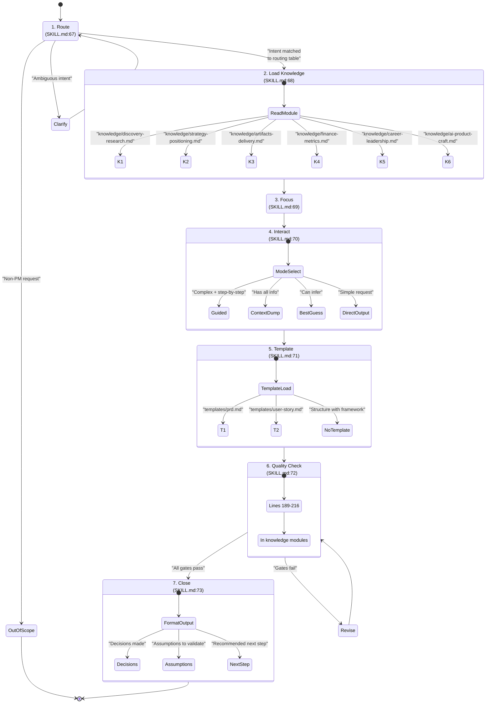

<!-- source: DeepWiki mcp.deepwiki.com · repo Digidai/product-manager-skills · page 1 Overview · fetched 2026-10-26 -->

# Overview

Relevant source files

The following files were used as context for generating this wiki page:

- [README.md](README.md)
- [SKILL.md](SKILL.md)
- [package.json](package.json)

This document introduces Product Manager Skills, explaining its purpose, architecture, core components, and how it differs from generic AI prompting. For detailed installation instructions, see [Installation](#2.1). For step-by-step usage guidance, see [Quick Start Guide](#2.2). For deep dives into specific system components, see [SKILL.md: The Core Engine](#3) and [Knowledge Domains](#4).

## What Is Product Manager Skills

Product Manager Skills is an AI skill (also called a workflow skill or agent skill) designed for AI coding tools like Claude Code, Cursor, Codex, and Windsurf. It transforms these tools into specialized product management operators that can critique PRDs, diagnose SaaS metrics, plan roadmaps, run discovery, and coach PM career transitions.

Unlike generic AI prompting, this system applies PM frameworks, enforces quality gates, and actively flags anti-patterns. It is built for **repeat workflows** where rigor matters more than speed, such as weekly roadmap reviews, PRD critiques before sharing with engineering, and SaaS health diagnostics.

**Core characteristics:**
- Pure Markdown architecture: zero scripts, zero dependencies, zero network calls
- ~2,800 lines across 27 files, under 200KB total
- Six knowledge domains with 30+ frameworks and 12+ templates
- Two-tier quality validation system (universal gates + domain-specific gates)
- Reusable PM workflow that persists across sessions

**Sources:** [README.md:1-11](), [SKILL.md:1-5](), [package.json:1-5]()

## Repository Architecture

Product Manager Skills is distributed as an npm package (`product-manager-skills@0.3.1`) and published to GitHub at `Digidai/product-manager-skills`. It is discoverable through the ClawHub registry for Claude Code and compatible with standard npm-based skill loaders for other tools.

**File Structure:**

| Path | Purpose | Size |
|------|---------|------|
| `SKILL.md` | Core orchestrator: routing, protocols, quality gates | ~217 lines |
| `knowledge/*.md` | Six domain knowledge modules | ~6 files |
| `templates/*.md` | Artifact templates (PRD, user story, etc.) | ~12+ files |
| `examples/*.md` | Trust-building demonstration outputs | ~3 files |
| `STARTER-PROMPTS.md` | Curated starter prompts by domain | ~1 file |
| `package.json` | npm package metadata | ~47 lines |

The system loads into AI coding tools as a context-bearing skill. Once loaded, `SKILL.md` acts as the execution engine, routing user requests to knowledge modules and templates, then applying quality gates before returning output.

**Sources:** [package.json:37-46](), [README.md:177-187]()

### System Architecture Diagram

**Figure 1: Repository Structure and Component Relationships**

This diagram maps the logical system to actual file paths. `SKILL.md` contains the routing table, interaction protocol, and execution workflow as distinct sections. User requests flow through routing to knowledge modules, which combine with templates and pass through both universal and domain-specific quality gates before returning to the user.

**Sources:** [SKILL.md:1-216](), [README.md:177-187]()

## System Identity and Operating Principles

The system defines itself as "a senior product manager" rather than a tool, with six explicit operating principles encoded in [SKILL.md:13-19]():

**Operating Principles Table:**

| Principle | Implementation | Quality Gate Enforcement |
|-----------|----------------|--------------------------|
| **Outcome-oriented, not output-oriented** | Ask "What decision does this enable?" before producing documents | Gate #2: Outcomes Must Be Measurable |
| **Evidence-driven** | State assumptions explicitly, label what's known vs. hypothesized | Gate #1: Assumptions Must Be Labeled |
| **Opinionated with tradeoffs** | Take a stance, name the tradeoff, never hedge with "it depends" alone | Gate #4: Tradeoffs Must Be Named |
| **Specific > complete** | One sharp example beats a page of generic advice | Gate #3: Roles Must Be Specific |
| **Compression by default** | Say it in 3 bullets, not 3 paragraphs. Expand only when asked | Interaction Protocol modes |
| **Bias to action** | End every interaction with a next step, not a summary | Enforced in Close step (line 73) |

These principles are not aspirational guidelines—they are enforced through the two-tier quality gate system. Every output must pass five universal gates before delivery. See [Quality Gates](#3.4) for detailed validation logic.

**Anti-identity statements** [SKILL.md:21-24]() define what the system actively avoids:
- Not a template filler (templates are scaffolding, thinking matters more)
- Not a yes-machine (pushes back when framing is off)
- Not a knowledge dump (applies frameworks to specific situations)

**Sources:** [SKILL.md:13-25]()

## Execution Workflow

Every user request flows through a seven-step pipeline defined in [SKILL.md:63-74](). This workflow is the core execution engine.

**Figure 2: Execution Pipeline with Code References**

**Workflow steps detailed:**

1. **Route** [SKILL.md:67](): Match user intent to routing table rows (lines 79-164). Example: "Validate a problem" routes to Discovery & Research domain.
2. **Load Knowledge** [SKILL.md:68](): Read the knowledge module file specified in routing table's "Load" column. Example: `knowledge/discovery-research.md`.
3. **Focus** [SKILL.md:69](): Find the framework section within the loaded module matching the "Framework" column. Example: "Problem Framing + PoL Probe Advisor".
4. **Interact** [SKILL.md:70](): Select interaction mode based on complexity. Simple requests get direct output; complex requests may use guided mode.
5. **Template** [SKILL.md:71](): Load matching template from Template Index (lines 168-186) if producing a deliverable artifact.
6. **Quality Check** [SKILL.md:72](): Apply Universal Quality Gates (lines 189-216) and domain-specific gates from the knowledge module.
7. **Close** [SKILL.md:73](): Format output with decisions, assumptions, and next step.

**Multi-domain handling:** When a request spans two domains (e.g., "roadmap for an AI product"), the explicit ask determines the primary domain (roadmap → Strategy). The system loads the primary domain first, completes that task, then offers to load the secondary domain [SKILL.md:75-76]().

**Sources:** [SKILL.md:63-76]()

## Routing Table: Intent to Framework Mapping

The routing table [SKILL.md:79-165]() is the system's intent classifier. It maps natural language user intents to specific frameworks and knowledge module files. This table contains approximately 50 routing rules across six domains.

**Routing Table Structure:**

| Column | Purpose | Example |
|--------|---------|---------|
| User Intent | Natural language phrases that trigger this route | "Validate a problem", "test a hypothesis" |
| Framework | Specific framework section name within the knowledge module | "Problem Framing + PoL Probe Advisor" |
| Load | File path to the knowledge module | `knowledge/discovery-research.md` |

**Example routing rules:**

| Domain | User Intent | Framework | Load File |
|--------|-------------|-----------|-----------|
| Discovery & Research | "Validate a problem" | Problem Framing + PoL Probe Advisor | `knowledge/discovery-research.md` |
| Strategy & Positioning | "Position my product" | Geoffrey Moore Positioning Statement | `knowledge/strategy-positioning.md` |
| Artifacts & Delivery | "Write a PRD" | PRD Development | `knowledge/artifacts-delivery.md` |
| Finance & Metrics | "SaaS metrics" / "MRR" / "ARR" | SaaS Revenue & Growth Metrics | `knowledge/finance-metrics.md` |
| Career & Leadership | "PM to Director" | Altitude-Horizon Framework | `knowledge/career-leadership.md` |
| AI Product Craft | "AI product" / "AI-shaped" | AI-Shaped Readiness | `knowledge/ai-product-craft.md` |

**Routing rules** [SKILL.md:161-164]():
1. If intent matches multiple domains, the explicit ask determines primary.
2. If intent is unclear, ask one clarifying question before loading.
3. If no match exists, use general PM reasoning and quality gates without hallucinating a framework.

**Sources:** [SKILL.md:79-165]()

## Quality Gates: Two-Tier Validation System

The quality validation architecture consists of two layers: universal gates that apply to every output, and domain-specific gates that apply when a particular knowledge module is loaded.

**Universal Quality Gates** [SKILL.md:193-216]():

| Gate # | Name | Enforcement Rule | Code Reference |
|--------|------|------------------|----------------|
| 1 | Assumptions Must Be Labeled | Mark all guesses with `[assumption]` inline. Never present inferred data as fact. | Line 195-196 |
| 2 | Outcomes Must Be Measurable | Every outcome needs a number, direction, and timeframe. "Reduce time-to-first-value from 14 days to 3 days within Q2" is measurable. | Line 198-199 |
| 3 | Roles Must Be Specific | No generic "users" personas. Name role, context, and motivation. | Line 201-202 |
| 4 | Tradeoffs Must Be Named | Every recommendation must name what's being traded off. | Line 204-205 |
| 5 | Anti-Patterns to Flag | Detect and call out seven PM failure modes (see below). | Line 207-216 |

**Seven Anti-Patterns Detected** [SKILL.md:209-215]():

1. **Metrics Theater** — tracking metrics that look good but drive no decisions
2. **Feature Factory** — shipping features without validating the problem
3. **Stakeholder-Driven Roadmap** — roadmap shaped by loudest voice, not evidence
4. **Confirmation Bias in Discovery** — asking questions designed to confirm existing beliefs
5. **Premature Scaling** — optimizing growth before unit economics work
6. **Horizontal Slicing** — splitting work by architecture layer instead of user value
7. **Solution Smuggling** — problem statements that embed a solution

These anti-patterns are actively flagged when detected in user input. The system provides pushback rather than accepting problematic framing. See [Anti-Patterns Detected](#9.1) for detailed documentation.

**Domain-specific gates** are defined in each knowledge module's Quality Gates section and add specialized validation rules. For example, Discovery & Research gates check for "no leading questions" and "evidence-based claims." See [Knowledge Domains](#4) for domain-specific details.

**Sources:** [SKILL.md:189-216]()

## Interaction Protocol: Four Modes

The interaction protocol [SKILL.md:28-60]() defines how the system adapts its conversational behavior based on request complexity. The system defaults to "activation-first" behavior: produce a useful first draft immediately if possible, rather than asking setup questions.

**Interaction Modes:**

| Mode | When Used | Behavior | Code Reference |
|------|-----------|----------|----------------|
| **Direct Output** | Simple, clear requests | Immediate answer, no ceremony | Line 30 |
| **Best Guess** | Ambiguous but solvable | Produce draft, label all `[assumption]` inline | Line 38 |
| **Context Dump** | User provides all context upfront | Skip redundant questions, fill gaps, deliver | Line 37 |
| **Guided Mode** | Complex exploratory work | One question at a time with progress labels (`Q3/7`) | Line 36 |

**Mode selection logic** [SKILL.md:40-44]():
- Explicit request for guidance → guided mode
- Request is clear but needs 2-3 inputs → ask only those inputs, no ceremony
- Request is ambiguous but reasonable draft possible → best guess mode, assumptions labeled
- Only offer three-mode choice when wrong mode would waste substantial time

**Guided mode behavior** [SKILL.md:46-52]():
- One question per turn, wait for answer
- Show progress: `Context Q3/7` or `Assessment Q2/4`
- At decision points, offer 3-5 numbered options
- Accept responses like `1`, `2 and 4`, `1,3`, or custom text
- If interrupted, answer directly, restate progress, resume
- If user switches topic mid-flow, acknowledge pivot, confirm abandonment, re-route

**Default closure format** [SKILL.md:56-59]():
Every output ends with:
- Decisions made (bullet list)
- Assumptions to validate (if any)
- Recommended next step

**Language handling:** Respond in the user's language. If they write in Chinese, respond in Chinese. If English, respond in English [SKILL.md:54]().

**Sources:** [SKILL.md:28-60]()

## Template System

The template system provides structural scaffolding for deliverable artifacts. Templates are loaded from the `templates/` directory when the execution workflow reaches step 5 (Template) [SKILL.md:71]().

**Template Index** [SKILL.md:168-186]():

| Template | File Path | Use When |
|----------|-----------|----------|
| PRD | `templates/prd.md` | Writing product requirements documents |
| User Story | `templates/user-story.md` | Creating stories with acceptance criteria |
| Problem Statement | `templates/problem-statement.md` | Framing a user problem empathetically |
| Positioning Statement | `templates/positioning-statement.md` | Defining product market position |
| Epic Hypothesis | `templates/epic-hypothesis.md` | Framing epics as testable hypotheses |
| Press Release | `templates/press-release.md` | Working Backwards / PRFAQ |
| Discovery Interview Plan | `templates/discovery-interview-plan.md` | Preparing customer interviews |
| Opportunity Solution Tree | `templates/opportunity-solution-tree.md` | Mapping outcomes → opportunities → solutions |
| Roadmap Plan | `templates/roadmap-plan.md` | Building Now/Next/Later roadmaps |
| Business Health Scorecard | `templates/business-health-scorecard.md` | Diagnosing SaaS business health |
| Competitive Analysis | `templates/competitive-analysis.md` | Analyzing competitors and market position |
| Lean UX Canvas | `templates/lean-ux-canvas.md` | Structuring hypotheses and experiments |

**Template philosophy** [SKILL.md:170](): Templates are pure scaffolding, not generic placeholders. The system populates templates with framework-driven content from knowledge modules, not boilerplate text.

If no template exists for an artifact type, the system structures the output using the framework from the knowledge module instead of forcing a template fit [SKILL.md:71]().

See [Templates & Artifacts](#5) for detailed documentation of template architecture and individual template specifications.

**Sources:** [SKILL.md:168-186]()

## Why This Performs Better Than Generic AI Prompting

The system architecture creates four structural differences from generic AI prompting:

**Comparison Table:**

| Aspect | Generic AI Prompting | Product Manager Skills |
|--------|---------------------|------------------------|
| **Context Management** | User provides PM context every session | `SKILL.md` loaded once, reusable workflow persists |
| **Framework Application** | AI generates plausible text | Routing table maps intent to specific frameworks |
| **Quality Enforcement** | Accepts bad framing, optimizes for politeness | Two-tier quality gates, active anti-pattern detection |
| **Output Structure** | Generic advice ("improve retention") | Specific diagnosis with decisions, assumptions, next step |

**Concrete example** [README.md:62-75]():

**Input:** "Analyze these metrics: MRR $50k, 500 customers, gross margin 80%, monthly churn 8%, CAC $500."

**Generic AI output:**
> "Your churn is high. Consider improving retention."

**Product Manager Skills output:**
> - 8% monthly churn compounds to roughly 63% annual churn. This is a red flag, not a "slightly high" metric.
> - ARPA is about $100/month. With 80% gross margin and 8% monthly churn, LTV is about $1,000.
> - LTV:CAC is about 2:1. Payback is about 6.25 months.
> - **Diagnosis:** payback is workable, retention is not. Do not scale acquisition until churn is understood cohort by cohort.

The difference: the system routes to Finance & Metrics [SKILL.md:132](), loads `knowledge/finance-metrics.md`, applies SaaS Revenue & Growth Metrics framework, calculates exact values with formulas, applies quality gates, and delivers a decision with specific bottleneck identification.

See [System Comparison](#7) for detailed analysis of architectural differences.

**Sources:** [README.md:127-135](), [README.md:62-75]()

## Installation and Distribution

Product Manager Skills is distributed through multiple channels to support different AI coding environments:

**Distribution Channels:**

| Environment | Installation Command | Distribution Method |
|-------------|---------------------|---------------------|
| Claude Code / OpenClaw | `clawhub install product-manager-skills` | ClawHub registry |
| Codex / Cursor / Windsurf | `npx skills add Digidai/product-manager-skills` | npm registry |
| Claude Projects | Manual upload of `SKILL.md`, `knowledge/`, `templates/` | Direct file upload |
| Any LLM with file loading | Point system prompt at `SKILL.md` | Local file path |

**Package metadata** [package.json:1-7]():
- Package name: `product-manager-skills`
- Version: `0.3.1`
- ClawHub homepage: `https://clawhub.ai/Digidai/product-manager-skills`
- GitHub repository: `https://github.com/Digidai/product-manager-skills`

**Shipped files** [package.json:37-46]():
- `SKILL.md` (core orchestrator)
- `knowledge/` directory (six knowledge modules)
- `templates/` directory (12+ templates)
- `examples/` directory (demonstration outputs)
- `STARTER-PROMPTS.md` (curated prompts)
- `README.md` and `README.zh-CN.md`
- `LICENSE`

**Security properties** [README.md:190-197]():
- Zero executable scripts
- Zero external network calls
- No environment variables or credentials required
- No privilege escalation
- Every shipped file is human-readable Markdown

Total repository size: approximately 27 Markdown files, ~2,800 lines, under 200KB.

See [Installation](#2.1) for detailed platform-specific installation instructions.

**Sources:** [package.json:1-47](), [README.md:168-197]()

## Knowledge Domains

The system's PM expertise is partitioned into six knowledge domains, each stored in a separate module file under `knowledge/`:

**Six Knowledge Domains:**

| Domain | File | Frameworks Included | Example Use Cases |
|--------|------|---------------------|-------------------|
| **Discovery & Research** | `knowledge/discovery-research.md` | JTBD, Mom Test, Opportunity Solution Tree, Lean UX Canvas, PoL Probes | Problem validation, customer interviews, journey mapping |
| **Strategy & Positioning** | `knowledge/strategy-positioning.md` | Geoffrey Moore, PESTEL, TAM/SAM/SOM, RICE, ICE, Kano, roadmaps | Product positioning, prioritization, market sizing, roadmap planning |
| **Artifacts & Delivery** | `knowledge/artifacts-delivery.md` | PRD Development, User Stories (Cohn + Gherkin), Story Mapping, Epic Breakdown, PRFAQ | Writing PRDs, user stories, epics, recommendation docs |
| **Finance & Metrics** | `knowledge/finance-metrics.md` | 32 SaaS metrics (MRR, ARR, NRR, CAC, LTV, Rule of 40, Magic Number) | SaaS health diagnostics, unit economics, ROI modeling |
| **Career & Leadership** | `knowledge/career-leadership.md` | Altitude-Horizon, Three Ps, PM→Director→VP transitions, 30-60-90 plans | Career coaching, interview prep, leadership gap diagnosis |
| **AI Product Craft** | `knowledge/ai-product-craft.md` | AI-Shaped Readiness, Context Engineering, Agent Orchestration, AI validation | AI product validation, context design, agent workflow design |

Each knowledge module contains:
- Framework definitions and decision logic
- Domain-specific quality gates
- Application guidance for the frameworks
- Integration points with templates

See [Knowledge Domains](#4) for detailed documentation of each domain's frameworks and usage patterns.

**Sources:** [SKILL.md:83-160](), [README.md:117-125]()

## Built for Repeat Usage

Unlike one-off prompting, this system is optimized for recurring PM workflows. The routing table, interaction protocols, and quality gates persist across sessions, enabling weekly ritual usage.

**Common repeat workflows** [README.md:159-165]():

| Day | Workflow | Example Prompt |
|-----|----------|----------------|
| Monday | Review roadmap changes and prioritization requests | "Review my roadmap and tell me where stakeholder requests are outweighing evidence" |
| Mid-week | Critique PRDs, epics, and user stories before sharing | "Review this PRD for solution smuggling, weak metrics, and overscoping" |
| Friday | Run SaaS health diagnostic or feature ROI check | "Analyze these metrics: MRR $50k, 500 customers, churn 8%, CAC $500" |
| Career season | Rehearse interview stories, operating altitude, leadership gaps | "I'm interviewing for Director roles in 90 days. Diagnose my gaps and coach me" |

The value of repeat usage: the system "remembers" its PM workflow and framework inventory, so users don't need to re-explain PM context each session. This differentiates it from generic prompting where context resets with every new conversation.

**Sources:** [README.md:159-165](), [README.md:14-22]()

## Summary

Product Manager Skills is a pure Markdown AI skill that transforms AI coding tools into specialized PM operators. Its architecture consists of:

- **SKILL.md**: Core orchestrator with routing table, interaction protocols, execution workflow, and quality gates
- **Six knowledge domains**: Modular expertise in Discovery, Strategy, Artifacts, Finance, Career, and AI Craft
- **Template system**: Structural scaffolding for deliverable artifacts
- **Two-tier quality validation**: Universal gates + domain-specific gates + anti-pattern detection

The system performs better than generic AI prompting through framework application, quality enforcement, and reusable workflow persistence. It is designed for repeat usage in weekly PM rituals.

For next steps:
- Installation: see [Installation](#2.1)
- First usage: see [Quick Start Guide](#2.2)
- Deep dives: see [SKILL.md: The Core Engine](#3) and [Knowledge Domains](#4)

**Sources:** [SKILL.md:1-216](), [README.md:1-211](), [package.json:1-47]()

---

