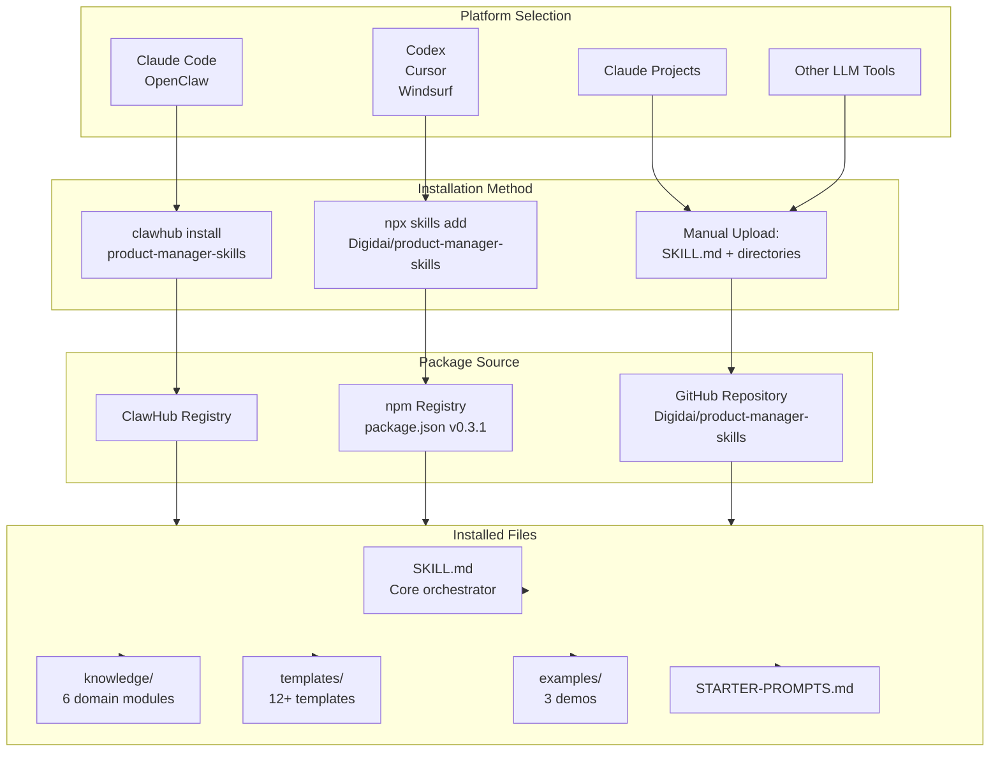
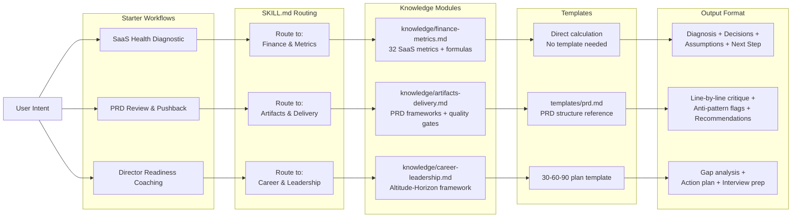
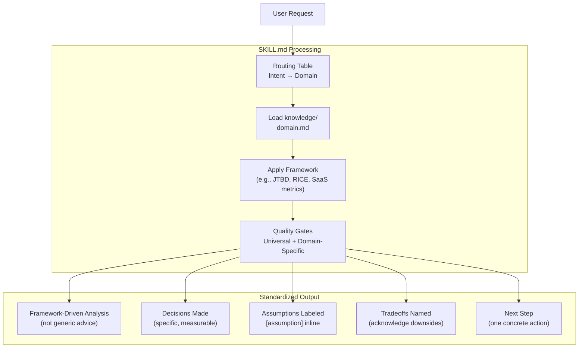

<!-- source: DeepWiki mcp.deepwiki.com · repo Digidai/product-manager-skills · page 2 Getting Started · fetched 2026-10-26 -->

# Getting Started

<details>
<summary>Relevant source files</summary>

The following files were used as context for generating this wiki page:

- [README.md](README.md)
- [package.json](package.json)

</details>


This page guides you through installing Product Manager Skills and running your first workflows. You will install the skill into an AI coding tool (Claude Code, Cursor, Codex, Windsurf, or Claude Projects), verify it loaded correctly, and run three starter prompts to understand the system's output format.

**Scope**: This page covers the complete installation-to-first-use journey. For detailed installation instructions by platform, see [Installation](#2.1). For comprehensive starter prompts and interaction patterns, see [Quick Start Guide](#2.2). For understanding how the system processes requests, see [SKILL.md: The Core Engine](#3).

---

## Prerequisites

Before installing, verify you have one of the following:

| Platform | Requirement | Verification |
|----------|-------------|--------------|
| **Claude Code / OpenClaw** | ClawHub CLI installed | Run `clawhub --version` |
| **Codex / Cursor / Windsurf** | npm installed | Run `npx --version` |
| **Claude Projects** | Manual upload capability | Access to Claude.ai Projects interface |
| **Other LLM tools** | Local file loading support | Ability to point system prompt at `SKILL.md` |

**System Requirements**:
- No executable scripts required
- No network calls during execution
- No environment variables or credentials needed
- Approximately 200 KB of disk space for all files

**Sources**: [README.md:167-174](), [README.md:189-198]()

---

## Installation Flow

The installation process differs by platform but follows the same core pattern: download the package, load `SKILL.md` as the orchestrator, and make the `knowledge/` and `templates/` directories accessible to the AI tool.

### Installation Architecture



**Sources**: [README.md:34-56](), [README.md:167-174](), [package.json:1-47]()

---

## Installation Instructions by Platform

### Claude Code / OpenClaw

```bash
clawhub install product-manager-skills
```

The ClawHub CLI downloads the skill from the ClawHub registry and registers it with your Claude Code environment. The skill becomes available in all new chats.

**Verification**: Open Claude Code and type:
```text
What skill version are you using?
```

Expected response: Reference to `product-manager-skills` version 0.3.1.

---

### Codex / Cursor / Windsurf

```bash
npx skills add Digidai/product-manager-skills
```

This command uses npm to download version 0.3.1 from the npm registry, which includes the files defined in [package.json:37-46]():
- `SKILL.md` (core orchestrator)
- `knowledge/` (6 domain modules)
- `templates/` (12+ artifact templates)
- `examples/` (3 demonstration outputs)
- `STARTER-PROMPTS.md` (starter prompts collection)

**Verification**: The skill loader should display confirmation. Start a new session and type:
```text
Load the product manager skills context.
```

The AI should acknowledge access to the PM skill system.

---

### Claude Projects (Manual Upload)

1. Create a new Claude Project
2. Upload these items from the repository:
   - `SKILL.md`
   - `knowledge/` directory (all `.md` files)
   - `templates/` directory (all `.md` files)
   - `STARTER-PROMPTS.md` (optional, for reference)

3. In Project Instructions, add:
```text
You are a product manager operator. Follow the instructions in SKILL.md.
```

**Verification**: In the project chat, type:
```text
What frameworks are available in the Discovery & Research domain?
```

Expected response: JTBD, Mom Test, Opportunity Solution Tree, Lean UX Canvas, PoL Probes.

**Sources**: [README.md:173]()

---

### Other LLM Tools with Local File Loading

1. Clone the repository or download the release
2. Point your LLM's system prompt at `SKILL.md`
3. Ensure `knowledge/` and `templates/` are accessible in the same directory structure

**Directory Structure Required**:
```text
SKILL.md              (root orchestrator)
knowledge/            (sibling directory)
  discovery-research.md
  strategy-positioning.md
  artifacts-delivery.md
  finance-metrics.md
  career-leadership.md
  ai-product-craft.md
templates/            (sibling directory)
  prd.md
  user-story.md
  lean-ux-canvas.md
  [9+ more templates]
```

**Sources**: [README.md:174](), [README.md:177-186]()

---

## First Interaction: System Handshake

After installation, run a system handshake to verify the skill loaded correctly and understand the output format.

### Verification Prompt

```text
What PM domains and frameworks are available in this skill?
```

### Expected Response Structure

The system should enumerate:

| Domain | Framework Examples |
|--------|-------------------|
| **Discovery & Research** | JTBD, Mom Test, Opportunity Solution Tree, Lean UX Canvas, PoL Probes |
| **Strategy & Positioning** | Geoffrey Moore, PESTEL, TAM/SAM/SOM, RICE, ICE, Kano |
| **Artifacts & Delivery** | PRD, User Story (Cohn + Gherkin), Story Mapping, Epic Breakdown, PRFAQ |
| **Finance & Metrics** | 32 SaaS metrics: MRR, ARR, NRR, CAC, LTV, Rule of 40, Magic Number |
| **Career & Leadership** | Altitude-Horizon, Three Ps, IC to Director transitions, 30-60-90 plans |
| **AI Product Craft** | AI-Shaped Readiness, Context Engineering, Agent Orchestration |

If the system cannot enumerate these domains, the `knowledge/` directory was not loaded correctly. Re-check the installation.

**Sources**: [README.md:116-125]()

---

## Three Starter Workflows

The system is designed for three high-value workflows that demonstrate its core capabilities: framework application, quality gates, and anti-pattern detection.

### Workflow Selection Map



**Sources**: [README.md:23-31]()

---

### Workflow 1: SaaS Health Diagnostic

**Prompt**:
```text
Analyze these metrics: MRR $50k, 500 customers, gross margin 80%, monthly churn 8%, CAC $500.
```

**What the System Does**:
1. Routes to Finance & Metrics domain
2. Loads `knowledge/finance-metrics.md` (32 SaaS metrics with formulas)
3. Calculates ARPA, LTV, LTV:CAC ratio, payback period
4. Applies finance quality gates (formulas shown, benchmarks cited)
5. Outputs diagnosis with specific bottleneck identification

**Expected Output Structure**:
```text
Calculations:
- ARPA = $50k / 500 = $100/month
- Monthly churn 8% = ~63% annual churn [RED FLAG]
- LTV (simplified) = $100 / 0.08 × 0.80 = $1,000
- LTV:CAC = $1,000 / $500 = 2:1
- Payback = $500 / ($100 × 0.80) = 6.25 months

Diagnosis:
- Payback is workable (6.25 months < 12 months benchmark)
- Retention is NOT workable (63% annual churn vs. <5% best-in-class)
- Bottleneck: Retention, not acquisition efficiency

Decision: Do not scale acquisition until churn is understood cohort by cohort.

Assumptions:
- [assumption] Gross margin applies uniformly across customer base
- [assumption] Churn is evenly distributed, not cohort-driven

Next Step: Run cohort retention analysis to identify if churn is early-life (onboarding issue) or late-life (product-market fit issue).
```

**Anti-Patterns Detected**: Metrics Theater (if metrics were presented without context or action)

**Full Example**: See `examples/saas-health-diagnostic.md`

**Sources**: [README.md:60-77](), [README.md:25-27]()

---

### Workflow 2: PRD Review & Pushback

**Prompt**:
```text
Review this PRD for a notification preferences center. Flag solution smuggling, weak metrics, overscoping, and delivery risk.
```

**What the System Does**:
1. Routes to Artifacts & Delivery domain
2. Loads `knowledge/artifacts-delivery.md` and `templates/prd.md`
3. Checks for solution smuggling (problem statement assumes solution)
4. Validates success metrics (baseline, target, guardrail)
5. Flags scope creep and horizontal slicing
6. Applies artifacts quality gates (acceptance criteria testable, vertical slices enforced)

**Expected Output Structure**:
```text
Problem Statement [SOLUTION SMUGGLING DETECTED]:
- Current: "Users need a preferences dashboard to manage notifications"
- Issue: This assumes the solution (dashboard) in the problem statement
- Reframe: "Users unsubscribe from all emails when they only want to reduce email volume, resulting in lost re-engagement opportunities"

Success Metrics [WEAK]:
- Current: "Increase user satisfaction"
- Issue: No baseline, no target, no guardrail, not measurable
- Recommendation: 
  * Baseline: Current unsubscribe rate = X%
  * Target: Reduce unsubscribe rate to Y% within 90 days
  * Guardrail: Email open rate must not drop below Z%

Scope [OVERSCOPED]:
- Current scope includes: Email preferences, push preferences, SMS preferences, digest scheduling, quiet hours, admin override rules, and migration from legacy system
- Issue: This is 3-4 releases, not one. Horizontal slicing across channels.
- Recommendation: Thin vertical slice: Email opt-out + account-level preferences + measurable reduction in unsubscribe-driven churn. Ship this first, validate impact, then extend to other channels.

Next Step: Rewrite problem statement to describe user behavior and business impact without assuming the solution. Define one measurable success metric with baseline and target.
```

**Anti-Patterns Detected**: Solution Smuggling, Metrics Theater, Horizontal Slicing

**Full Example**: See `examples/prd-review.md`

**Sources**: [README.md:79-96](), [README.md:28]()

---

### Workflow 3: Director Readiness Coaching

**Prompt**:
```text
I'm a senior PM managing two PMs, strong on execution, weak on org influence, and interviewing for Director roles in 3 months. Coach me.
```

**What the System Does**:
1. Routes to Career & Leadership domain
2. Loads `knowledge/career-leadership.md` (Altitude-Horizon framework)
3. Diagnoses current altitude (team) vs. target altitude (org)
4. Identifies specific skill gaps (e.g., portfolio tradeoffs, cross-functional influence)
5. Generates 30-60-90 action plan with concrete milestones
6. Applies career quality gates (altitude-appropriate advice, concrete action items)

**Expected Output Structure**:
```text
Current State:
- Altitude: Team (managing 2 PMs, strong execution)
- Horizon: Delivery-focused (shipping features well)

Target State:
- Altitude: Org (Director = managing 3-8 PMs, influencing cross-functional roadmap)
- Horizon: Strategy + Delivery (portfolio tradeoffs, not just feature execution)

Gap Analysis:
- Strong: Team execution, delivery velocity, PM coaching
- Weak: Org-level influence, portfolio tradeoffs, cross-functional storytelling
- Missing: Stories that demonstrate org-level impact (not just team wins)

Action Plan (30-60-90):
- Days 1-30: Collect 3 stories showing org-level impact using this format: "I influenced [cross-functional stakeholder group] to [deprioritize X / invest in Y] by [specific evidence], which resulted in [business outcome]"
- Days 31-60: Build weekly visibility loop with Director/VP (share roadmap tradeoffs, not just progress updates)
- Days 61-90: Practice decision framing with explicit tradeoffs in 5 real scenarios. Record yourself and refine.

Interview Prep:
- Expect: "Tell me about a time you influenced a decision outside your team"
- Expect: "How do you prioritize across multiple products or teams?"
- Expect: "Describe a strategic bet you made and what you would do differently"

Next Step: Draft one org-level impact story this week using the format above. Send to a Director-level mentor for feedback.
```

**Anti-Patterns Detected**: None in the input, but the system would flag if the user described only execution wins without strategic framing.

**Full Example**: See `examples/director-coaching.md`

**Sources**: [README.md:98-114](), [README.md:29]()

---

## Understanding Output Format

Every output from the system follows a standardized structure enforced by the quality gates in `SKILL.md`.

### Standard Output Components

| Component | Purpose | Validation Gate |
|-----------|---------|-----------------|
| **Calculations / Analysis** | Framework-driven content (not generic advice) | Framework correctly applied |
| **Decisions Made** | Specific, actionable choices with rationale | Outcomes measurable |
| **Assumptions Labeled** | Explicit uncertainties marked `[assumption]` | Assumptions must be labeled |
| **Tradeoffs Named** | Downsides and alternatives acknowledged | Tradeoffs must be named |
| **Next Step** | One concrete action to take immediately | Bias to action |

### Output Format Diagram



**Sources**: [README.md:149-157]()

---

## Common Installation Issues

| Issue | Symptom | Solution |
|-------|---------|----------|
| **`knowledge/` not loaded** | System cannot enumerate domains or frameworks | Verify directory structure; `knowledge/` must be sibling to `SKILL.md` |
| **`templates/` not loaded** | System cannot generate structured PRDs or user stories | Verify `templates/` directory is accessible; re-upload if using Claude Projects |
| **Version mismatch** | System references outdated frameworks or templates | Check `npx skills list` or ClawHub registry; current version is 0.3.1 |
| **Generic responses** | Output lacks framework application or quality gates | System may not have loaded `SKILL.md`; verify with "What skill are you using?" prompt |

**Sources**: [package.json:2]()

---

## Next Steps

After completing your first three workflows:

1. **Explore More Prompts**: See [Quick Start Guide](#2.2) for 20+ starter prompts across all six domains
2. **Understand the Engine**: Read [SKILL.md: The Core Engine](#3) to learn how routing, interaction protocols, and quality gates work
3. **Deep Dive into Domains**: Explore individual knowledge domains:
   - [Discovery & Research](#4.1)
   - [Strategy & Positioning](#4.2)
   - [Artifacts & Delivery](#4.3)
   - [Finance & Metrics](#4.4)
   - [Career & Leadership](#4.5)
   - [AI Product Craft](#4.6)
4. **Build Weekly Workflows**: See [Weekly PM Workflows](#6.1) for recurring usage patterns like Monday roadmap reviews and Friday metrics diagnostics
5. **Compare to Generic Prompting**: See [System Comparison](#7) to understand why this performs better than standard AI interactions

**Sources**: [README.md:159-166]()

---

## Security and Trust

This system is instruction-only:
- **No executable scripts**: All files are human-readable Markdown
- **No network calls**: Zero external dependencies during execution
- **No credentials**: No environment variables or API keys required
- **No privilege escalation**: Pure text-based knowledge transfer

**Total size**: ~2,800 lines across 27 Markdown files, under 200 KB

You can inspect every line before installation. See `SKILL.md`, `knowledge/*.md`, and `templates/*.md` in the repository.

**Sources**: [README.md:189-198](), [README.md:187]()

---

