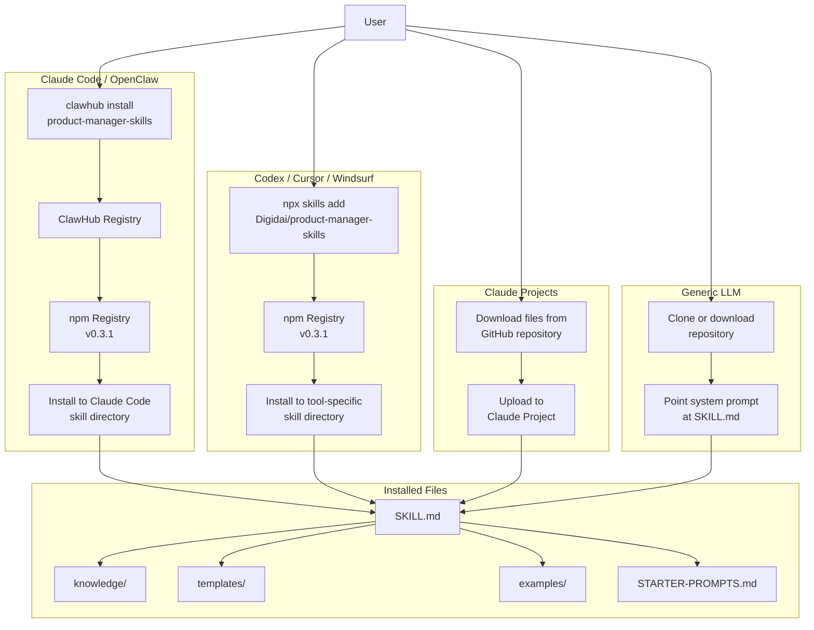
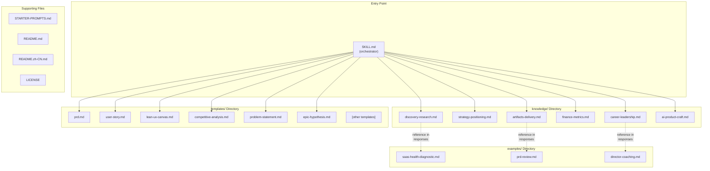

<!-- source: DeepWiki mcp.deepwiki.com · repo Digidai/product-manager-skills · page 2.1 Installation · fetched 2026-10-26 -->

# Installation

<details>
<summary>Relevant source files</summary>

The following files were used as context for generating this wiki page:

- [README.md](README.md)
- [package.json](package.json)

</details>


This page documents the installation procedures for the Product Manager Skills system across different AI coding tool environments. Installation is platform-specific, with each AI coding tool using its own package loading mechanism. All installation methods are zero-script and dependency-free, installing only Markdown files that can be inspected before use.

For usage patterns and first prompts after installation, see [Quick Start Guide](#2.2). For understanding what gets loaded and how the core engine works, see [SKILL.md: The Core Engine](#3).

---

## Prerequisites

Before installing, verify you have one of the supported AI coding environments:

| Environment | Version Requirement | Package Manager |
|-------------|---------------------|-----------------|
| Claude Code / OpenClaw | Latest stable | ClawHub registry |
| Codex | Latest stable | npm-based skill loader |
| Cursor | Latest stable | npm-based skill loader |
| Windsurf | Latest stable | npm-based skill loader |
| Claude Projects | Any version | Manual file upload |
| Any LLM with file loading | Supports local file context | Manual file placement |

**Network Access**: Installation methods using ClawHub or npm require network access to download the package. Manual installation requires only file system access.

**File System**: The installation requires write access to the AI tool's skill storage directory. Typical installation size is under 200 KB for all files.

Sources: [README.md:167-175](), [README.md:12]()

---

## Installation Methods

### Diagram: Installation Flow by Platform



Sources: [README.md:34-56](), [README.md:167-175]()

---

### Method 1: Claude Code / OpenClaw

Claude Code and OpenClaw use the ClawHub registry for skill discovery and installation.

**Installation Command**:
```bash
clawhub install product-manager-skills
```

**Process**:
1. The `clawhub` CLI fetches skill metadata from the ClawHub registry
2. ClawHub retrieves the package from npm registry at version specified in [package.json:3]()
3. Files listed in [package.json:37-46]() are installed to Claude Code's skill directory
4. Claude Code loads `SKILL.md` into context on next activation

**Post-Installation**:
The skill is available immediately in Claude Code sessions. The AI tool reads [SKILL.md:1-end]() as the entry point, which contains routing logic that references files in `knowledge/` and `templates/` directories.

**Verification Command**:
```text
List installed skills
```

Expected output should include `product-manager-skills` at version `0.3.1`.

Sources: [README.md:36-40](), [package.json:1-47]()

---

### Method 2: Codex / Cursor / Windsurf

Codex, Cursor, and Windsurf use npm-based skill loaders that reference GitHub repositories.

**Installation Command**:
```bash
npx skills add Digidai/product-manager-skills
```

**Process**:
1. The `skills` npm package resolves `Digidai/product-manager-skills` to the GitHub repository
2. Files are downloaded from the latest release or main branch
3. Files specified in [package.json:37-46]() are installed to the tool's skill storage location
4. The AI tool loads `SKILL.md` on next prompt

**Directory Structure After Installation**:
```text
<tool-skill-directory>/
└── product-manager-skills/
    ├── SKILL.md
    ├── knowledge/
    ├── templates/
    ├── examples/
    ├── STARTER-PROMPTS.md
    ├── README.zh-CN.md
    ├── README.md
    └── LICENSE
```

**Verification**:
Test with a simple prompt:
```text
List the PM domains you have knowledge about
```

Expected response should reference the six domains defined in the routing table within [SKILL.md]().

Sources: [README.md:42-46](), [package.json:37-46]()

---

### Method 3: Claude Projects (Manual Upload)

Claude Projects require manual file upload through the web interface.

**Download Files**:
1. Navigate to https://github.com/Digidai/product-manager-skills
2. Download the repository as ZIP or clone via Git
3. Extract files if using ZIP

**Upload to Claude Project**:
1. Create a new Claude Project or open an existing one
2. Upload the following files and directories:
   - `SKILL.md` (required - core engine)
   - `knowledge/` directory (required - framework content)
   - `templates/` directory (required - artifact templates)
   - `examples/` directory (optional - reference outputs)
   - `STARTER-PROMPTS.md` (optional - prompt library)

**File Upload Order**:
Upload `SKILL.md` first. The routing logic in [SKILL.md]() expects sibling directories `knowledge/` and `templates/` to be present in the project context.

**Verification**:
In the project chat, enter:
```text
What is your primary function according to SKILL.md?
```

Expected response should describe the PM workflow orchestration and routing system.

Sources: [README.md:173]()

---

### Method 4: Generic LLM with Local File Loading

Any LLM that supports local file context can use this skill.

**Setup Process**:
1. Clone or download the repository from https://github.com/Digidai/product-manager-skills
2. Place files in a directory accessible to your LLM environment
3. Configure the system prompt to load `SKILL.md` as the primary instruction file
4. Ensure `knowledge/` and `templates/` directories are in the same parent directory as `SKILL.md`

**System Prompt Configuration**:
Point the LLM's system prompt at `SKILL.md` with this structure:
```text
You are a product management assistant. Load and follow instructions from SKILL.md.
The knowledge/ and templates/ directories are sibling directories to SKILL.md.
```

**Directory Integrity**:
The system assumes this file structure:
```text
<base-directory>/
├── SKILL.md
├── knowledge/
│   ├── discovery-research.md
│   ├── strategy-positioning.md
│   ├── artifacts-delivery.md
│   ├── finance-metrics.md
│   ├── career-leadership.md
│   └── ai-product-craft.md
└── templates/
    ├── prd.md
    ├── user-story.md
    ├── lean-ux-canvas.md
    └── [other templates]
```

Do not separate `SKILL.md` from its sibling directories, as the routing table references these paths.

Sources: [README.md:174](), [README.md:178-186]()

---

## Installed File Structure

### Diagram: File Organization and Dependencies



Sources: [package.json:37-46](), [README.md:178-186]()

---

### File Manifest

The following table lists all files included in the installation package as defined in [package.json:37-46]():

| File/Directory | Type | Purpose | Required |
|----------------|------|---------|----------|
| `SKILL.md` | File | Core orchestrator with routing table, interaction protocols, and quality gates | Yes |
| `knowledge/` | Directory | Six domain-specific Markdown files containing PM frameworks and methodologies | Yes |
| `templates/` | Directory | 12+ artifact templates (PRDs, user stories, canvases, etc.) | Yes |
| `examples/` | Directory | Reference outputs demonstrating expected quality and format | No |
| `STARTER-PROMPTS.md` | File | Library of example prompts for common PM workflows | No |
| `README.zh-CN.md` | File | Chinese language documentation | No |
| `README.md` | File | Repository documentation and usage guide | No |
| `LICENSE` | File | CC BY-NC-SA 4.0 license terms | No |

**Total Size**: Approximately 27 Markdown files, ~2,800 lines, under 200 KB.

Sources: [README.md:187](), [package.json:37-46]()

---

## Verification Steps

After installation, verify the system is properly loaded and accessible.

### Step 1: Confirm File Presence

Depending on your AI tool, check that files are present:

**Claude Code**:
```bash
clawhub list
```

**Cursor/Codex/Windsurf**:
Check the skill directory for the `product-manager-skills` folder.

**Claude Projects**:
Verify uploaded files appear in the project's "Knowledge" section.

### Step 2: Test Routing System

Send a test prompt that requires routing to a specific domain:

```text
What SaaS metrics should I track for a B2B product?
```

**Expected Behavior**:
- The AI should load knowledge from `knowledge/finance-metrics.md`
- Response should reference specific metrics like MRR, ARR, NRR, CAC, LTV
- Response should include formulas and benchmarks

**Failure Symptoms**:
- Generic advice without specific metric formulas
- No mention of the 32 SaaS metrics framework
- No domain-specific terminology

### Step 3: Test Template Loading

Request an artifact that requires template loading:

```text
Help me write a PRD for a notification preferences feature
```

**Expected Behavior**:
- The AI should load `templates/prd.md`
- Output structure should match the template sections
- Quality gates should apply (assumptions labeled, metrics defined, etc.)

**Failure Symptoms**:
- Generic document structure
- No standardized section headers
- Missing template-specific sections like "Success Metrics" or "Out of Scope"

### Step 4: Test Quality Gates

Request a review that should trigger anti-pattern detection:

```text
Review this problem statement: "Users need a dashboard to manage their settings"
```

**Expected Behavior**:
- The AI should flag "solution smuggling" (anti-pattern #7)
- Response should challenge the framing: what problem does the dashboard solve?
- Response should reference the quality gate for assumptions

**Failure Symptoms**:
- AI accepts the framing without pushback
- No mention of solution smuggling or anti-patterns
- Generic suggestions to "improve clarity"

Sources: [README.md:58-115]()

---

## Troubleshooting

### Issue: "Skill not found" or "Cannot load SKILL.md"

**Cause**: Installation did not complete or files are in wrong location.

**Resolution**:
1. Re-run installation command
2. For manual installations, verify `SKILL.md` is at the root of the uploaded directory
3. Check that `knowledge/` and `templates/` are sibling directories to `SKILL.md`

### Issue: Generic responses without framework application

**Cause**: `SKILL.md` is present but `knowledge/` directory is missing or inaccessible.

**Resolution**:
1. Verify all files from [package.json:37-46]() are present
2. Check directory structure matches the expected layout
3. For manual installations, ensure entire directories were uploaded, not just individual files

### Issue: Templates not loading

**Cause**: `templates/` directory missing or AI tool cannot access sibling directories.

**Resolution**:
1. Confirm `templates/` directory exists in same parent as `SKILL.md`
2. Check file permissions allow read access
3. For Claude Projects, re-upload the templates directory if needed

### Issue: No quality gate enforcement

**Cause**: Older version of skill installed or partial installation.

**Resolution**:
1. Verify installed version is `0.3.1` from [package.json:3]()
2. For npm-based installations, update: `npx skills update Digidai/product-manager-skills`
3. For manual installations, download latest version from GitHub

### Issue: Different behavior across AI tools

**Cause**: AI tools have different context window sizes and file loading behaviors.

**Expected Behavior**:
- Claude Code and Claude Projects: Full context loading, best performance
- Cursor/Codex/Windsurf: May have context limits affecting large requests
- Generic LLMs: Performance depends on system prompt configuration

**Resolution**:
1. For complex multi-domain requests, break into smaller prompts
2. Reference specific domain or template explicitly if needed
3. Use [STARTER-PROMPTS.md]() examples which are tested across platforms

Sources: [README.md:167-175](), [package.json:1-47]()

---

## Security Considerations

The Product Manager Skills system adheres to zero-script security principles:

| Security Property | Implementation |
|-------------------|----------------|
| **No executable code** | All files are Markdown (`.md` extension) |
| **No network calls** | No URLs, APIs, or external service references in SKILL.md or knowledge files |
| **No credentials** | No environment variables, API keys, or authentication required |
| **No privilege escalation** | No file system writes, shell commands, or system modifications |
| **Full transparency** | Every file is human-readable before installation |

**Inspection Before Installation**:
For manual installations, inspect `SKILL.md` before uploading. The file contains:
- Routing table (pure data structure)
- Interaction protocol definitions (text instructions)
- Quality gate criteria (validation rules as text)
- No JavaScript, Python, or other executable code

Sources: [README.md:189-198]()

---

## Next Steps

After successful installation and verification:

1. **Try starter prompts**: See [Quick Start Guide](#2.2) for tested first prompts
2. **Understand the workflow**: Read [SKILL.md: The Core Engine](#3) to understand routing and quality gates
3. **Explore domains**: Review [Knowledge Domains](#4) to see available frameworks
4. **Review examples**: Check [Usage Patterns](#6) for real PM workflow scenarios

For installation issues not covered here, open an issue at https://github.com/Digidai/product-manager-skills/issues.

Sources: [README.md:199-204]()

---

