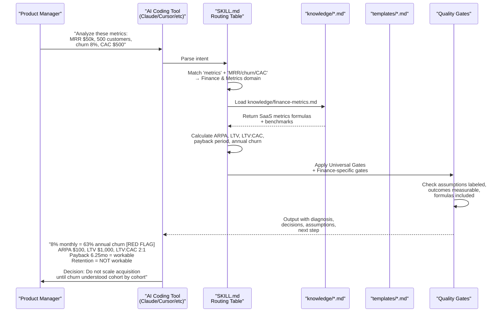
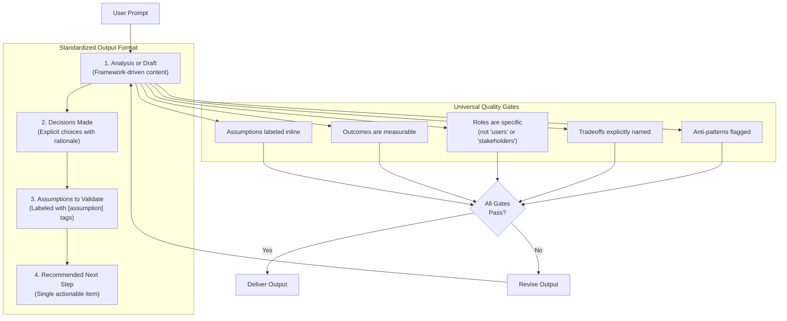
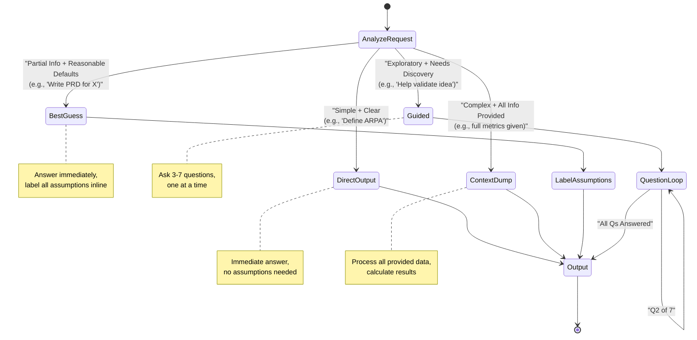

<!-- source: DeepWiki mcp.deepwiki.com · repo Digidai/product-manager-skills · page 2.2 Quick Start Guide · fetched 2026-10-26 -->

# Quick Start Guide

Relevant source files

The following files were used as context for generating this wiki page:

- [README.md](README.md)
- [STARTER-PROMPTS.md](STARTER-PROMPTS.md)

This page guides you through your first interactions with the Product Manager Skills system after installation. It provides starter prompts, explains expected outputs, and introduces basic interaction patterns.

For installation instructions, see [Installation](#2.1). For detailed workflow examples, see [Weekly PM Workflows](#6.1) and [Example Sessions](#6.2).

---

## Purpose and Scope

After installing the Product Manager Skills system, this guide helps you:

- Verify the installation works correctly
- Submit your first prompts and interpret the outputs
- Understand the standardized output format (decisions, assumptions, next steps)
- Learn which prompts route to which knowledge domains
- Recognize the four interaction modes the system uses

This is a practical guide focused on immediate usage. For architectural details about how routing and quality gates work internally, see [SKILL.md: The Core Engine](#3).

---

## Your First Interaction

Once installed, the system loads `SKILL.md` into your AI coding tool's context. When you submit a prompt, the following execution flow occurs:

**Sources:** [README.md:60-76](), [SKILL.md]() (referenced in architectural diagrams)

---

## Starter Prompts by Domain

The system routes prompts to six knowledge domains. Below are recommended first prompts for each domain, organized by complexity.

### First-Run Prompts (Simplest)

These three prompts demonstrate the core workflows with minimal context required:

| Prompt | Domain Routed | Expected Behavior |
|--------|---------------|-------------------|
| `Help me write a PRD for a notification preferences feature. Make reasonable assumptions and label them.` | Artifacts & Delivery | Generates structured PRD using `templates/prd.md`, labels assumptions inline with `[assumption]` tags |
| `Analyze these metrics: MRR $50k, 500 customers, gross margin 80%, monthly churn 8%, CAC $500.` | Finance & Metrics | Calculates ARPA, LTV, LTV:CAC, payback, annual churn; diagnoses bottlenecks |
| `Review this roadmap and tell me where evidence is weak, where tradeoffs are missing, and where stakeholder pressure is dominating.` | Strategy & Positioning | Applies prioritization frameworks, flags stakeholder-driven roadmap anti-pattern |

**Sources:** [STARTER-PROMPTS.md:5-17](), [README.md:23-31]()

### Discovery & Research Prompts

| Prompt | Frameworks Applied |
|--------|-------------------|
| `I think customers need a dashboard. Push back on this framing and help me write the actual problem statement.` | Jobs-to-be-Done, Problem Framing, flags Solution Smuggling anti-pattern |
| `Help me prepare 10 discovery interview questions for ops managers at mid-market SaaS companies. Avoid confirmation bias.` | Mom Test, avoids leading questions |
| `Build an opportunity solution tree for improving activation in our first 14 days.` | Opportunity Solution Tree (OST) structure |

**Sources:** [STARTER-PROMPTS.md:19-31]()

### Strategy & Prioritization Prompts

| Prompt | Frameworks Applied |
|--------|-------------------|
| `We have 6 candidate features and limited engineering capacity. Recommend a prioritization framework and apply it.` | RICE, ICE, or Kano (context-dependent selection) |
| `Write a positioning statement for a B2B analytics tool that helps RevOps teams spot pipeline risk earlier.` | Geoffrey Moore positioning template |
| `Help me draft a Now / Next / Later roadmap for an AI meeting assistant. Name the tradeoffs explicitly.` | Now/Next/Later structure + explicit tradeoff requirement |

**Sources:** [STARTER-PROMPTS.md:33-45]()

### Artifacts & Delivery Prompts

| Prompt | Frameworks Applied |
|--------|-------------------|
| `Review this PRD draft like a strong PM peer. Flag solution smuggling, missing metrics, overscoping, weak evidence, and delivery risks.` | PRD quality gates, anti-pattern detection |
| `Turn this feature idea into 5 user stories with testable Gherkin acceptance criteria.` | User story template (`templates/user-story.md`), Cohn + Gherkin format |
| `This epic is too big for one sprint. Split it vertically and explain the logic.` | Vertical slicing, epic breakdown framework |

**Sources:** [STARTER-PROMPTS.md:47-59]()

### Finance & Metrics Prompts

| Prompt | Frameworks Applied |
|--------|-------------------|
| `Our SaaS has ARR $3.2M, NRR 92%, gross margin 72%, burn $180k/month, runway 11 months. Diagnose business health and tell me what not to ignore.` | 32 SaaS metrics from `knowledge/finance-metrics.md`, Rule of 40, burn multiple |
| `Should we build this retention feature? Assume dev cost is $60k and estimate ROI from churn reduction.` | LTV impact modeling, payback ROI calculation |
| `Compare these two acquisition channels on payback, LTV:CAC, and strategic fit.` | Unit economics comparison |

**Sources:** [STARTER-PROMPTS.md:61-73]()

### Career & Leadership Prompts

| Prompt | Frameworks Applied |
|--------|-------------------|
| `I'm a senior PM managing two PMs and preparing for Director interviews in 90 days. Diagnose my readiness and give me a focused plan.` | Altitude-Horizon framework, IC to Director transitions |
| `I just became Head of Product. Build a 30-60-90 day plan with the right altitude for the role.` | 30-60-90 template, altitude-appropriate focus |
| `Review these 4 interview stories and tell me which ones actually show org-level influence.` | Three Ps framework, altitude assessment |

**Sources:** [STARTER-PROMPTS.md:75-87]()

### AI Product Craft Prompts

| Prompt | Frameworks Applied |
|--------|-------------------|
| `Pressure-test this AI product idea. What context, orchestration, and validation risks are we underestimating?` | AI-Shaped Readiness, context engineering risks |
| `Our AI assistant works in demos but fails in production. Diagnose likely context engineering issues.` | Context engineering failure patterns |
| `Recommend an agent workflow for triaging support tickets, but call out where humans should stay in the loop.` | Agent orchestration, human-in-loop design |

**Sources:** [STARTER-PROMPTS.md:89-101]()

---

## Understanding Output Structure

Every output from the system follows a standardized format enforced by quality gates. This format ensures actionability and transparency.

**Sources:** [README.md:149-156](), quality gates referenced in architectural diagrams

### Example: SaaS Diagnostic Output

For the prompt `Analyze these metrics: MRR $50k, 500 customers, gross margin 80%, monthly churn 8%, CAC $500`:

| Output Section | Content |
|----------------|---------|
| **Analysis** | `8% monthly churn compounds to roughly 63% annual churn. This is a red flag, not a "slightly high" metric.` `ARPA is about $100/month. With 80% gross margin and 8% monthly churn, better LTV is about $1,000.` `LTV:CAC is about 2:1. Payback is about 6.25 months.` |
| **Diagnosis** | `Payback is workable, retention is not.` |
| **Decision** | `Do not scale acquisition until churn is understood cohort by cohort.` |
| **Assumptions** | `[assumption: churn is evenly distributed across cohorts]` `[assumption: gross margin calculation excludes support costs]` |
| **Next Step** | `Segment churn by acquisition cohort, customer segment, and contract value to find retention bottleneck.` |

**Sources:** [README.md:62-75]()

---

## Four Interaction Modes

The system adapts its interaction style based on request complexity and available context. Understanding these modes helps you predict whether the system will ask follow-up questions or provide immediate output.

**Sources:** [README.md:149-156](), interaction protocol referenced in architectural diagrams

### Mode Selection Logic

| Mode | When Used | Example Prompt | Expected Behavior |
|------|-----------|----------------|-------------------|
| **Direct Output** | Definition requests, simple lookups | `What is Net Revenue Retention?` | Single-paragraph answer with formula and benchmark |
| **Context Dump** | All required data provided | `Analyze these metrics: MRR $50k, 500 customers, churn 8%, CAC $500` | Immediate calculation and diagnosis |
| **Best Guess** | Partial context, reasonable defaults exist | `Help me write a PRD for a notification preferences feature` | Draft PRD with `[assumption]` tags for missing context |
| **Guided** | Exploratory work requiring discovery | `Help me validate this product idea` | Question 1 of 5: "What job is this solving for which specific user?" |

**Sources:** [README.md:149-156]()

---

## Validating Installation Success

After submitting your first prompt, check for these indicators that the system is working correctly:

### Checklist: Successful Installation

| Indicator | What to Look For | Example |
|-----------|------------------|---------|
| **Framework Application** | Output references specific PM frameworks by name | "Applying RICE prioritization..." or "Using Mom Test principles..." |
| **Inline Assumptions** | Assumptions tagged with `[assumption]` | `[assumption: monthly churn is evenly distributed]` |
| **Quality Gate Enforcement** | Output includes measurable outcomes, specific roles, named tradeoffs | "Reduce unsubscribe-driven churn from 8% to 5% within 60 days (not 'improve retention')" |
| **Standardized Sections** | Every output ends with Decisions + Assumptions + Next Step | See structure diagram above |
| **Anti-Pattern Detection** | System flags common PM mistakes when present | "This problem statement is solution-smuggled" or "Success metrics lack baseline and target (Metrics Theater)" |
| **Domain Routing** | Prompts about metrics load `knowledge/finance-metrics.md`, PRDs load `templates/prd.md` | Visible in output or can be inferred from framework names |

**Sources:** [README.md:127-135]()

### Troubleshooting: Installation Not Working

If outputs are generic and lack framework references:

1. **Verify file structure**: Ensure `SKILL.md`, `knowledge/`, and `templates/` directories are present and readable
2. **Check tool compatibility**: Confirm your AI coding tool supports loading skill files (see [Installation](#2.1))
3. **Retry prompt**: Some tools require restarting the session after installation
4. **Use explicit routing**: Add "using Product Manager Skills" to your prompt to force activation

---

## Next Steps

After validating installation with starter prompts:

1. **Explore domain-specific workflows**: See [Weekly PM Workflows](#6.1) for recurring usage patterns
2. **Review detailed examples**: See [Example Sessions](#6.2) for full walkthroughs with screenshots
3. **Understand the engine**: See [SKILL.md: The Core Engine](#3) to learn how routing and quality gates work
4. **Customize for your context**: See [Contributing](#8) to add team-specific frameworks or templates

**Sources:** [README.md:159-165]()

---

