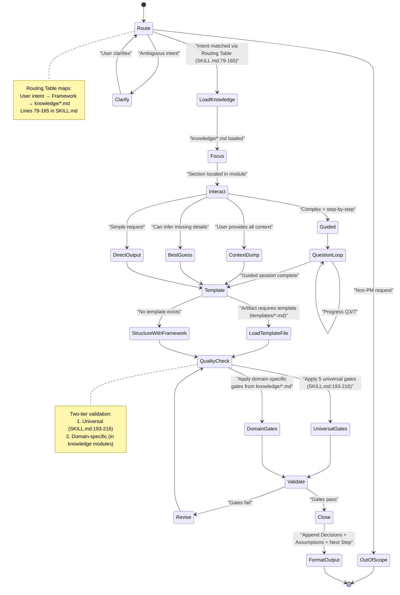
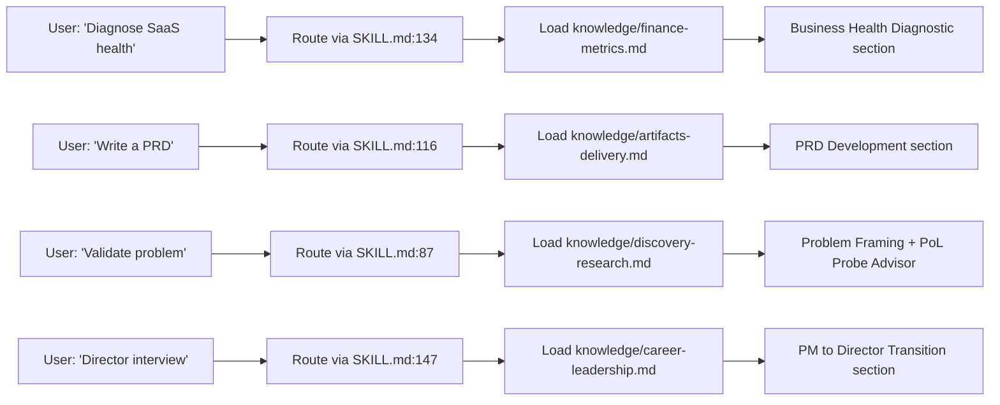
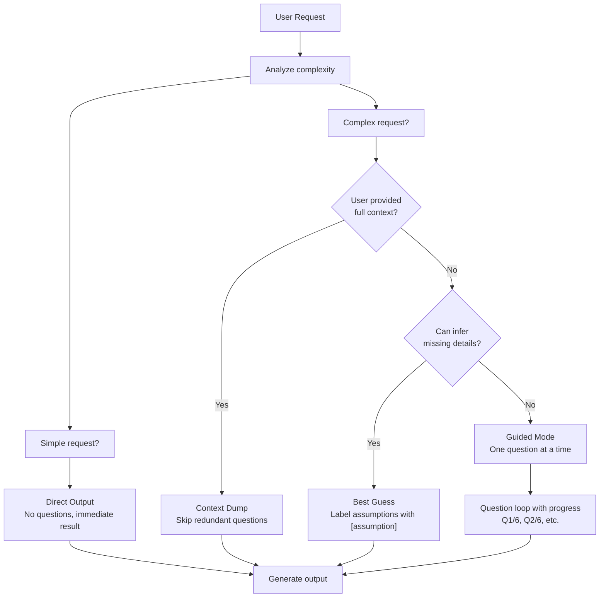
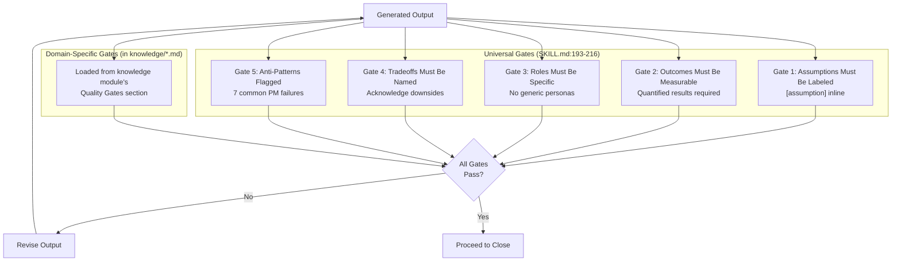
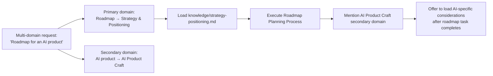
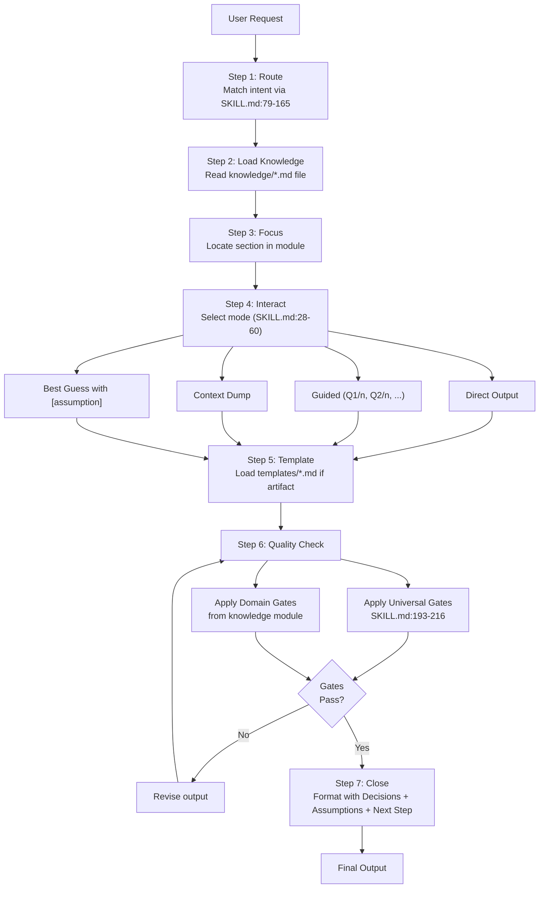

<!-- source: DeepWiki mcp.deepwiki.com · repo Digidai/product-manager-skills · page 3.1 Execution Workflow · fetched 2026-10-26 -->

# Execution Workflow

<details>
<summary>Relevant source files</summary>

The following files were used as context for generating this wiki page:

- [SKILL.md](SKILL.md)

</details>


## Purpose and Scope

This document describes the seven-step execution pipeline that processes every user request in the Product Manager Skills system. The workflow transforms user intent into structured, framework-driven output by routing through knowledge modules, applying templates, and enforcing quality gates.

For details on how user intent maps to specific frameworks, see [Routing System](#3.2). For interaction mode selection logic, see [Interaction Protocols](#3.3). For quality validation rules, see [Quality Gates](#3.4).

**Sources:** [SKILL.md:63-76]()

---

## Pipeline Overview

Every user request flows through a sequential seven-step pipeline defined in `SKILL.md`. The workflow is deterministic: each step feeds the next, with validation loops at the quality check phase.

| Step | Name | Purpose | Input | Output |
|------|------|---------|-------|--------|
| 1 | Route | Match user intent to framework | User request text | Domain + framework identifier |
| 2 | Load Knowledge | Read relevant knowledge module | Framework identifier | Loaded framework content |
| 3 | Focus | Locate specific section in module | Framework content | Section-specific logic |
| 4 | Interact | Select and execute interaction mode | User context + request type | Raw output content |
| 5 | Template | Apply structural scaffolding | Output content + artifact type | Structured artifact |
| 6 | Quality Check | Validate against gates | Artifact | Validated artifact or revision request |
| 7 | Close | Format final output | Validated artifact | Decisions + Assumptions + Next Step |

**Sources:** [SKILL.md:63-76]()

---

## Pipeline State Machine

The following state machine shows the complete execution flow, including conditional branches and revision loops:



**Sources:** [SKILL.md:63-76](), [SKILL.md:79-165](), [SKILL.md:189-216]()

---

## Step 1: Route

### Intent Matching

The routing step maps user intent phrases to specific frameworks using the Routing Table defined at [SKILL.md:79-165](). The table is organized by six knowledge domains:

| Domain | Intent Examples | Framework Loaded | Knowledge Module |
|--------|----------------|------------------|------------------|
| Discovery & Research | "Validate a problem", "customer interview" | Problem Framing, Mom Test | `knowledge/discovery-research.md` |
| Strategy & Positioning | "Position my product", "roadmap" | Geoffrey Moore, Now/Next/Later | `knowledge/strategy-positioning.md` |
| Artifacts & Delivery | "Write a PRD", "user story" | PRD Development, Cohn + Gherkin | `knowledge/artifacts-delivery.md` |
| Finance & Metrics | "SaaS metrics", "unit economics" | 32 SaaS Metrics, LTV/CAC | `knowledge/finance-metrics.md` |
| Career & Leadership | "PM to Director", "first 90 days" | Altitude-Horizon, 30-60-90 | `knowledge/career-leadership.md` |
| AI Product Craft | "AI product", "context engineering" | AI-Shaped Readiness | `knowledge/ai-product-craft.md` |

### Routing Logic

The routing algorithm follows these rules ([SKILL.md:161-164]()):

1. **Direct match**: If intent matches a single row, load that framework immediately
2. **Ambiguous intent**: Ask one clarifying question before loading
3. **Multi-domain**: Explicit ask determines primary domain (see Multi-Domain Handling below)
4. **No match**: Use general PM reasoning with quality gates only

### Example Routing Paths



**Sources:** [SKILL.md:67](), [SKILL.md:79-165](), [SKILL.md:161-164]()

---

## Step 2: Load Knowledge

### Module Loading

Once the framework is identified, the system loads the corresponding knowledge module file. The `Load` column in the Routing Table ([SKILL.md:79-165]()) specifies which file to read:

| Module File | Domain | Typical Content |
|-------------|--------|----------------|
| `knowledge/discovery-research.md` | Discovery & Research | JTBD, Mom Test, OST, PoL Probes, Lean UX Canvas |
| `knowledge/strategy-positioning.md` | Strategy & Positioning | Geoffrey Moore, PESTEL, TAM/SAM/SOM, RICE/ICE/Kano |
| `knowledge/artifacts-delivery.md` | Artifacts & Delivery | PRD Development, User Stories, Story Mapping, PRFAQ |
| `knowledge/finance-metrics.md` | Finance & Metrics | 32 SaaS metrics, formulas, benchmarks, diagnostics |
| `knowledge/career-leadership.md` | Career & Leadership | Altitude-Horizon, Three Ps, IC→Director transitions |
| `knowledge/ai-product-craft.md` | AI Product Craft | AI-Shaped Readiness, Context Engineering, Validation |

### Loading Behavior

Per [SKILL.md:68-69]():

- **Pre-loaded environments** (e.g., Claude Projects): Content already in context; search by section name
- **On-demand environments** (e.g., file-based tools): Read file from sibling directory `knowledge/`
- **File structure**: Knowledge modules are siblings of `SKILL.md` in the repository root

**Sources:** [SKILL.md:68-69]()

---

## Step 3: Focus

### Section Location

After loading the knowledge module, the system locates the specific section matching the Framework column from the Routing Table ([SKILL.md:69-70]()).

### Multi-Section Loading

When the route maps to multiple sections (e.g., "A + B"), the system reads both sections and applies combined logic. Example from [SKILL.md:87]():

```
User Intent: "Validate a problem"
Framework: Problem Framing + PoL Probe Advisor
Action: Read both sections in knowledge/discovery-research.md
```

### Domain-Specific Logic Application

Each section contains:
- **Framework description**: Conceptual model and when to use it
- **Decision logic**: Step-by-step application rules
- **Domain-specific quality gates**: Validation rules for outputs from this framework

**Sources:** [SKILL.md:69-70]()

---

## Step 4: Interact

### Mode Selection

The Interaction Protocol ([SKILL.md:28-60]()) defines four modes. The system selects based on request complexity and available context:



### Mode Selection Rules

From [SKILL.md:40-44]():

| Condition | Mode | Rationale |
|-----------|------|-----------|
| User explicitly requests guidance | Guided | Explicit request overrides defaults |
| Request clear + <3 missing inputs | Ask only those inputs | No mode ceremony overhead |
| Request ambiguous but draftable | Best Guess | Activation-first default |
| User pastes extensive context | Context Dump | Avoid redundant questions |

### Guided Mode Mechanics

During guided sessions ([SKILL.md:46-52]()):

1. **One question per turn**: Wait for answer before continuing
2. **Progress labels**: Show `Context Q3/7` or `Assessment Q2/4`
3. **Decision points**: Offer 3-5 numbered options; accept `1`, `2 and 4`, `1,3`, or custom text
4. **Interruptions**: Answer directly, restate progress, resume
5. **Topic switches**: Acknowledge pivot, confirm abandoning current flow, re-route

**Sources:** [SKILL.md:28-60](), [SKILL.md:40-44](), [SKILL.md:46-52]()

---

## Step 5: Template

### Template Loading Decision

The system loads a template when producing a deliverable artifact ([SKILL.md:71]()). The Template Index ([SKILL.md:168-186]()) maps artifact types to template files:

| Artifact Type | Template File | Triggered By |
|---------------|---------------|--------------|
| PRD | `templates/prd.md` | "Write a PRD" intent |
| User Story | `templates/user-story.md` | "Write a user story" intent |
| Problem Statement | `templates/problem-statement.md` | Problem framing output |
| Positioning Statement | `templates/positioning-statement.md` | Geoffrey Moore positioning |
| Epic Hypothesis | `templates/epic-hypothesis.md` | Epic framing output |
| Press Release | `templates/press-release.md` | PRFAQ / Working Backwards |
| Discovery Interview Plan | `templates/discovery-interview-plan.md` | Interview prep |
| Opportunity Solution Tree | `templates/opportunity-solution-tree.md` | OST mapping |
| Roadmap Plan | `templates/roadmap-plan.md` | Roadmap planning |
| Business Health Scorecard | `templates/business-health-scorecard.md` | SaaS diagnostics |
| Competitive Analysis | `templates/competitive-analysis.md` | Competitive research |
| Lean UX Canvas | `templates/lean-ux-canvas.md` | Hypothesis structuring |

### Template vs. Framework Structure

Per [SKILL.md:71]():

- **Template exists**: Load from `templates/` directory and populate with framework-driven content
- **No template**: Structure output using framework logic from knowledge module

### Template Philosophy

From [SKILL.md:170](): "Templates are pure scaffolding — not generic placeholders." The system fills templates with specific content from the Focus step, not boilerplate text.

**Sources:** [SKILL.md:71](), [SKILL.md:168-186](), [SKILL.md:170]()

---

## Step 6: Quality Check

### Two-Tier Validation

The quality check applies two layers of gates ([SKILL.md:72](), [SKILL.md:189-216]()):



### Universal Gates Details

From [SKILL.md:193-216]():

| Gate | Rule | Example Violation | Correct Approach |
|------|------|-------------------|------------------|
| 1. Assumptions Labeled | Mark guesses with `[assumption]` | "Users will adopt this in 30 days" | "Users will adopt this in 30 days [assumption]" |
| 2. Outcomes Measurable | Quantify results with number, direction, timeframe | "Improve the experience" | "Reduce time-to-first-value from 14 days to 3 days within Q2" |
| 3. Roles Specific | Name role, context, motivation | "Users" | "A mid-market ops manager running 3 product lines with no dedicated analytics support" |
| 4. Tradeoffs Named | State what's being traded off | "Recommend Option A" | "Recommend Option A (faster to market, lower initial quality) over Option B (more robust, 6-week delay)" |
| 5. Anti-Patterns Detected | Flag 7 common PM failures | Accepting "We need a dashboard" | "This is solution smuggling. Reframe: 'Managers can't see team velocity'" |

### Anti-Patterns Detected

The system actively flags seven anti-patterns ([SKILL.md:208-216]()):

1. **Metrics Theater**: Tracking metrics that look good but drive no decisions
2. **Feature Factory**: Shipping features without validating the problem
3. **Stakeholder-Driven Roadmap**: Roadmap shaped by loudest voice, not evidence
4. **Confirmation Bias in Discovery**: Questions designed to confirm existing beliefs
5. **Premature Scaling**: Optimizing growth before unit economics work
6. **Horizontal Slicing**: Splitting work by architecture layer instead of user value
7. **Solution Smuggling**: Problem statements that embed a solution

### Domain Gates

Each knowledge module contains a "Quality Gates" section with domain-specific validation rules. These apply in addition to universal gates when that domain is loaded.

**Sources:** [SKILL.md:72](), [SKILL.md:189-216](), [SKILL.md:193-216](), [SKILL.md:208-216]()

---

## Step 7: Close

### Standardized Output Format

Every output ends with three required sections ([SKILL.md:56-59](), [SKILL.md:73]()):

1. **Decisions made**: Bullet list of concrete decisions
2. **Assumptions to validate**: List of labeled assumptions that need validation
3. **Recommended next step**: Single action to take next

### Format Example

```
## Decisions Made
- Focus retention before scaling acquisition
- Investigate churn cohort-by-cohort, starting with Q3 signups
- Defer new acquisition channels until monthly churn < 5%

## Assumptions to Validate
- 8% monthly churn is evenly distributed across customer segments [assumption]
- CAC can be maintained at $500 with current channels [assumption]

## Recommended Next Step
Run a churn analysis segmented by signup cohort, industry vertical, and contract size to identify highest-risk segment.
```

### Bias to Action

From [SKILL.md:19](): "Bias to action. End every interaction with a next step, not a summary." The recommended next step must be:
- **Specific**: Not "improve retention" but "run churn analysis segmented by X, Y, Z"
- **Actionable**: User knows what to do tomorrow
- **Single**: One clear action, not a list of possibilities

**Sources:** [SKILL.md:56-59](), [SKILL.md:73](), [SKILL.md:19]()

---

## Multi-Domain Handling

### Primary-Secondary Domain Logic

When a request spans multiple domains ([SKILL.md:75-76]()), the explicit ask determines the primary domain:



### Multi-Domain Routing Examples

| User Intent | Primary Domain | Secondary Domain | Handling |
|-------------|----------------|------------------|----------|
| "Roadmap for an AI product" | Strategy (roadmap) | AI Product Craft (AI) | Load Strategy first, mention AI considerations |
| "PRD for SaaS metrics dashboard" | Artifacts (PRD) | Finance (metrics) | Load Artifacts first, reference metrics knowledge |
| "Discovery for Director role" | Discovery (research) | Career (Director) | Load Discovery first, offer Career after |

**Sources:** [SKILL.md:75-76]()

---

## Error Handling and Edge Cases

### Out of Scope Requests

From [SKILL.md:67](): If a request is "clearly outside PM scope," the system says so and offers to redirect.

### Ambiguous Intent

When intent is unclear ([SKILL.md:67](), [SKILL.md:162]()):
1. Ask **one** clarifying question
2. Do not load any knowledge module yet
3. Resume routing after user clarifies

### No Framework Match

From [SKILL.md:164](): "If no match, use general PM reasoning and the Quality Gates below. Don't hallucinate a framework."

### Interrupted Guided Sessions

Per [SKILL.md:50-52]():
- **"How many questions left?"**: Answer directly, restate progress, resume
- **"Stop/pause"**: Halt immediately, resume on explicit request
- **Topic switch**: Acknowledge pivot, confirm abandoning current flow, re-route

**Sources:** [SKILL.md:67](), [SKILL.md:162](), [SKILL.md:164](), [SKILL.md:50-52]()

---

## Workflow Execution Flow Diagram

The following diagram shows the complete execution path with file references:



**Sources:** [SKILL.md:63-76](), [SKILL.md:28-60](), [SKILL.md:79-165](), [SKILL.md:193-216]()

---

