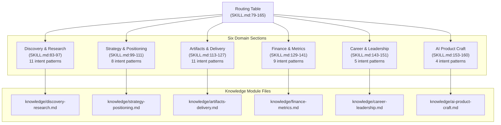
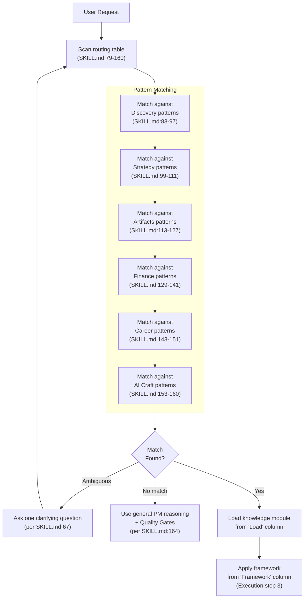
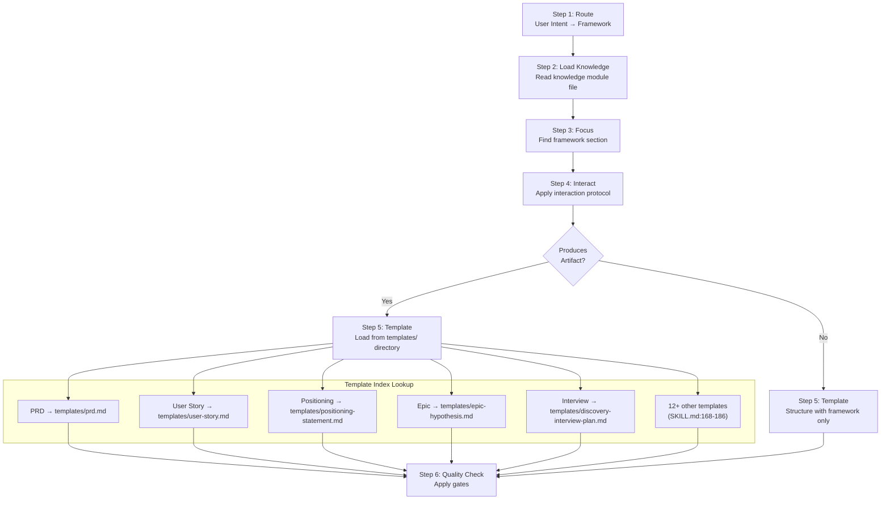
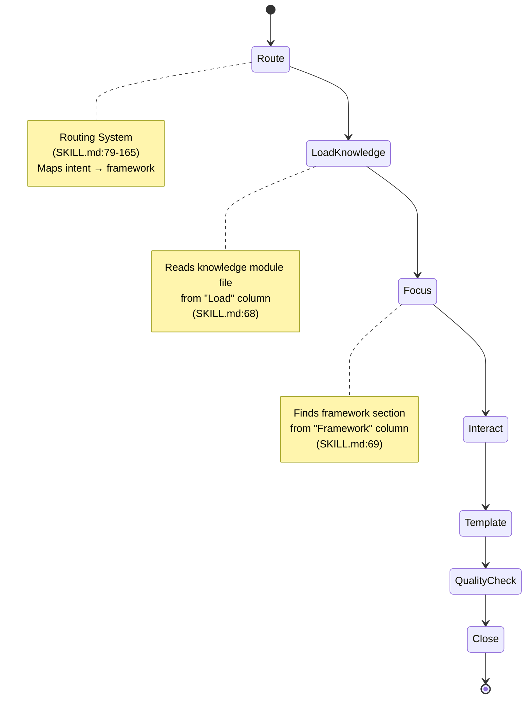

<!-- source: DeepWiki mcp.deepwiki.com · repo Digidai/product-manager-skills · page 3.2 Routing System · fetched 2026-10-26 -->

# Routing System

<details>
<summary>Relevant source files</summary>

The following files were used as context for generating this wiki page:

- [SKILL.md](SKILL.md)

</details>


## Purpose and Scope

The Routing System is the intent classification mechanism in SKILL.md that maps natural language user requests to specific PM frameworks and knowledge modules. It functions as step 1 in the 7-step Execution Workflow (see [Execution Workflow](#3.1)), determining which domain-specific content to load before the system applies frameworks, interaction protocols, and quality gates.

This page documents the routing table structure, intent matching algorithm, multi-domain handling, and routing rules. For details on what happens after routing (guided mode, context dump, etc.), see [Interaction Protocols](#3.3). For the content of each knowledge domain, see [Knowledge Domains](#4).

**Sources:** [SKILL.md:63-165]()

---

## Routing Table Architecture

The routing system consists of a single consolidated table partitioned into six domain sections. Each row maps a user intent phrase to a target framework and knowledge module file path.

### Table Structure

The routing table has three columns per domain:

| Column | Purpose | Example Value |
|--------|---------|---------------|
| **User Intent** | Natural language phrases that trigger this route | `"Validate a problem"` / `"test a hypothesis"` |
| **Framework** | Specific framework section name within the knowledge module | `Problem Framing + PoL Probe Advisor` |
| **Load** | File path to the knowledge module (relative to SKILL.md) | `knowledge/discovery-research.md` |

The Framework column specifies the exact section heading within the loaded knowledge module. When the value contains a `+` (e.g., `A + B`), the system loads both sections per the Focus step in the execution workflow.

**Sources:** [SKILL.md:79-165]()

---

## Domain Partition Structure



**Diagram: Routing Table Domain Partitions and Knowledge Module Mapping**

The table contains 48 total intent patterns across six domains. Each domain section routes to a single knowledge module file, but different intent patterns within the same domain may target different framework sections within that file.

**Sources:** [SKILL.md:79-165]()

---

## Intent Matching Algorithm

### Matching Process

When a user makes a request, the system scans all 48 intent patterns sequentially, top to bottom within each domain section. The first match determines the route.



**Diagram: Intent Matching and Routing Decision Flow**

**Sources:** [SKILL.md:63-68](), [SKILL.md:161-165]()

---

## Intent Pattern Examples by Domain

### Discovery & Research Domain

| User Intent | Framework | File Section |
|-------------|-----------|--------------|
| `"Validate a problem"` / `"test a hypothesis"` | Problem Framing + PoL Probe Advisor | Problem Framing, PoL Probe Advisor |
| `"Customer interview"` / `"discovery interview"` | Interview Prep | Interview Prep |
| `"Jobs to be done"` / `"JTBD"` / `"customer needs"` | JTBD Framework | JTBD Framework |
| `"PoL probe"` / `"proof of life"` / `"validation experiment"` | PoL Probe Advisor | PoL Probe Advisor |

**Sources:** [SKILL.md:83-97]()

### Strategy & Positioning Domain

| User Intent | Framework | File Section |
|-------------|-----------|--------------|
| `"Position my product"` / `"positioning statement"` | Geoffrey Moore Positioning Statement | Geoffrey Moore Positioning Statement |
| `"Prioritize"` / `"prioritization framework"` / `"what to build next"` | Prioritization > Framework Selection Matrix | Framework Selection Matrix |
| `"Roadmap"` / `"roadmap planning"` / `"release plan"` | Roadmap Planning Process | Roadmap Planning Process |
| `"TAM SAM SOM"` / `"market size"` / `"addressable market"` | TAM/SAM/SOM Calculation | TAM/SAM/SOM Calculation |

**Sources:** [SKILL.md:99-111]()

### Artifacts & Delivery Domain

| User Intent | Framework | File Section |
|-------------|-----------|--------------|
| `"Write a PRD"` / `"product requirements"` | PRD Development | PRD Development |
| `"Write a user story"` / `"acceptance criteria"` | User Story (Cohn + Gherkin) | User Story |
| `"Epic"` / `"epic hypothesis"` / `"frame this epic"` | Epics > Epic Hypothesis | Epic Hypothesis |
| `"Break down this epic"` / `"epic breakdown"` | Epics > Epic Breakdown (9 Patterns) | Epic Breakdown |

**Sources:** [SKILL.md:113-127]()

### Finance & Metrics Domain

| User Intent | Framework | File Section |
|-------------|-----------|--------------|
| `"SaaS metrics"` / `"revenue metrics"` / `"MRR"` / `"ARR"` | SaaS Revenue & Growth Metrics | SaaS Revenue & Growth Metrics |
| `"Unit economics"` / `"CAC"` / `"LTV"` / `"payback"` | Unit Economics & Efficiency | Unit Economics & Efficiency |
| `"Business health"` / `"diagnostic"` / `"board meeting prep"` | Business Health Diagnostic | Business Health Diagnostic |
| `"Retention"` / `"churn"` / `"why are users leaving"` | Retention & Expansion Metrics + Business Health Diagnostic | Both sections loaded |

**Sources:** [SKILL.md:129-141]()

### Career & Leadership Domain

| User Intent | Framework | File Section |
|-------------|-----------|--------------|
| `"PM to Director"` / `"director transition"` / `"altitude horizon"` | Altitude-Horizon Framework | Altitude-Horizon Framework |
| `"Director interview"` / `"director readiness"` / `"preparing for Director"` | PM to Director Transition | PM to Director Transition |
| `"New role"` / `"first 90 days"` / `"onboarding as VP"` / `"onboarding as CPO"` | Executive Onboarding (30-60-90) | Executive Onboarding (30-60-90) |

**Sources:** [SKILL.md:143-151]()

### AI Product Craft Domain

| User Intent | Framework | File Section |
|-------------|-----------|--------------|
| `"AI product"` / `"AI-shaped"` / `"AI readiness"` | AI-Shaped Readiness | AI-Shaped Readiness |
| `"Context engineering"` / `"context stuffing"` / `"prompt design"` | Context Engineering | Context Engineering |
| `"Agent workflow"` / `"multi-agent"` / `"AI orchestration"` | Agent Orchestration | Agent Orchestration |
| `"AI validation"` / `"test my AI feature"` | AI Validation (PoL Probes) | AI Validation |

**Sources:** [SKILL.md:153-160]()

---

## Multi-Domain Routing

### Multi-Domain Request Handling

When a user request contains intent patterns from multiple domains, the routing system applies a primary-secondary precedence rule.

**Rule:** The explicit artifact or task name determines the primary domain. Load primary first, then offer to load secondary after completion.

**Sources:** [SKILL.md:75-76](), [SKILL.md:161-163]()

### Example Multi-Domain Routes

```mermaid
flowchart LR
    subgraph "Example 1: 'Roadmap for an AI product'"
        EX1_IN["User: Roadmap for an AI product"]
        EX1_PRIMARY["Primary: Strategy & Positioning<br/>(explicit ask: roadmap)"]
        EX1_FILE1["Load: knowledge/strategy-positioning.md"]
        EX1_SECONDARY["Secondary: AI Product Craft<br/>(context: AI product)"]
        EX1_OFFER["Offer to load AI-Shaped Readiness<br/>after roadmap completes"]
    end
    
    subgraph "Example 2: 'PRD for a SaaS feature'"
        EX2_IN["User: PRD for a SaaS feature"]
        EX2_PRIMARY["Primary: Artifacts & Delivery<br/>(explicit ask: PRD)"]
        EX2_FILE2["Load: knowledge/artifacts-delivery.md"]
        EX2_SECONDARY["Secondary: Finance & Metrics<br/>(context: SaaS)"]
        EX2_OFFER["May reference SaaS metrics<br/>in success criteria section"]
    end
    
    subgraph "Example 3: 'Validate problem with interviews'"
        EX3_IN["User: Validate problem with interviews"]
        EX3_PRIMARY["Primary: Discovery & Research<br/>(dual match: validate + interviews)"]
        EX3_FILE3["Load: knowledge/discovery-research.md"]
        EX3_BOTH["Load both:<br/>Problem Framing + Interview Prep"]
    end
    
    EX1_IN --> EX1_PRIMARY
    EX1_PRIMARY --> EX1_FILE1
    EX1_FILE1 --> EX1_SECONDARY
    EX1_SECONDARY --> EX1_OFFER
    
    EX2_IN --> EX2_PRIMARY
    EX2_PRIMARY --> EX2_FILE2
    EX2_FILE2 --> EX2_SECONDARY
    EX2_SECONDARY --> EX2_OFFER
    
    EX3_IN --> EX3_PRIMARY
    EX3_PRIMARY --> EX3_FILE3
    EX3_FILE3 --> EX3_BOTH
```



**Diagram: Multi-Domain Routing Examples**

When both patterns match within the same domain (Example 3), the system loads both framework sections per the Focus step. When patterns span domains (Examples 1-2), the explicit task determines primary routing.

**Sources:** [SKILL.md:75-76](), [SKILL.md:161-163]()

---

## Routing Rules and Edge Cases

### Routing Rule Set

The system applies three explicit routing rules defined at [SKILL.md:161-165]():

#### Rule 1: Multi-Domain Precedence
**Code reference:** [SKILL.md:162]()

"If intent matches multiple domains, the explicit ask determines primary."

The user's explicit artifact request (PRD, roadmap, positioning statement) overrides contextual cues (AI, SaaS, B2B). Load primary domain first, mention secondary, offer to load after completion.

#### Rule 2: Ambiguity Clarification
**Code reference:** [SKILL.md:163]()

"If intent is unclear, ask one clarifying question before loading."

When multiple patterns could match and the best route is ambiguous, ask a single targeted question to disambiguate. Do not present the full routing table or mode-selection ceremony. Examples:
- "help with discovery" → Ask: "Are you preparing for interviews, or validating a specific problem?"
- "product strategy" → Ask: "Are you positioning a new product, planning a roadmap, or analyzing competitors?"

#### Rule 3: No-Match Fallback
**Code reference:** [SKILL.md:164]()

"If no match, use general PM reasoning and the Quality Gates below. Don't hallucinate a framework."

When the request is clearly outside PM scope (e.g., "write a Python script") or genuinely has no framework match, say so explicitly. Offer to redirect or apply general PM reasoning with quality gates but no domain-specific knowledge. Do not force a route.

**Sources:** [SKILL.md:161-165]()

---

## Routing to Template Integration

When the matched framework produces a deliverable artifact, the routing decision also triggers template loading in step 5 of the Execution Workflow.



**Diagram: Routing to Template Integration in Execution Workflow**

The Template Index at [SKILL.md:168-186]() maps artifact types to template file paths. The routing decision indirectly determines which template (if any) gets loaded. For example:
- Route to `PRD Development` → Template `templates/prd.md`
- Route to `User Story (Cohn + Gherkin)` → Template `templates/user-story.md`
- Route to `Geoffrey Moore Positioning Statement` → Template `templates/positioning-statement.md`

**Sources:** [SKILL.md:68-74](), [SKILL.md:168-186]()

---

## Intent Pattern Coverage Summary

### Coverage Statistics

| Domain | Intent Patterns | Knowledge Module File | Template Count |
|--------|----------------|----------------------|----------------|
| Discovery & Research | 11 | `knowledge/discovery-research.md` | 3 (Problem Statement, Interview Plan, Lean UX Canvas, OST) |
| Strategy & Positioning | 8 | `knowledge/strategy-positioning.md` | 3 (Positioning Statement, Roadmap Plan, Competitive Analysis) |
| Artifacts & Delivery | 11 | `knowledge/artifacts-delivery.md` | 4 (PRD, User Story, Epic Hypothesis, Press Release) |
| Finance & Metrics | 9 | `knowledge/finance-metrics.md` | 1 (Business Health Scorecard) |
| Career & Leadership | 5 | `knowledge/career-leadership.md` | 0 (framework-structured only) |
| AI Product Craft | 4 | `knowledge/ai-product-craft.md` | 0 (framework-structured only) |
| **Total** | **48** | **6 files** | **12+ templates** |

The routing system achieves broad coverage across PM disciplines while maintaining a compact implementation. Each intent pattern maps to 1-2 framework sections, and approximately 25% of patterns also trigger template loading.

**Sources:** [SKILL.md:79-186]()

---

## Routing System Implementation Details

### File Location and Context

The routing table is embedded directly in [SKILL.md:79-165](). It exists as Markdown tables, not as executable code. AI coding tools parse this structure when SKILL.md is loaded into their context.

### Pre-Loaded Environment Behavior

When knowledge modules are pre-loaded (e.g., Claude Projects with all files uploaded), the routing system instructs the AI to "search by section name" rather than re-reading files. The Load column still specifies the file path for reference, but the content is already in context.

**Code reference:** [SKILL.md:68]()

> "In pre-loaded environments (e.g., Claude Projects), the content is already in context — search by section name."

### Knowledge Module File Paths

All knowledge modules and templates use relative paths from the SKILL.md file location:

```
repository-root/
├── SKILL.md                          (routing table lines 79-165)
├── knowledge/
│   ├── discovery-research.md         (routes from lines 83-97)
│   ├── strategy-positioning.md       (routes from lines 99-111)
│   ├── artifacts-delivery.md         (routes from lines 113-127)
│   ├── finance-metrics.md            (routes from lines 129-141)
│   ├── career-leadership.md          (routes from lines 143-151)
│   └── ai-product-craft.md           (routes from lines 153-160)
└── templates/
    ├── prd.md
    ├── user-story.md
    ├── positioning-statement.md
    └── ... (12+ total templates)
```

**Sources:** [SKILL.md:68](), [SKILL.md:79-186]()

---

## Routing System Design Rationale

### Why a Static Table Instead of Dynamic Classification

The routing table is intentionally static rather than using AI-based intent classification for three reasons:

1. **Transparency:** Users can inspect exactly how their requests will be routed by reading the table at [SKILL.md:79-165](). No hidden logic.

2. **Consistency:** The same intent phrase always routes to the same framework. No model drift or session-to-session variation.

3. **Framework Enforcement:** The system forces explicit mapping of intents to named frameworks rather than allowing generic responses. If no pattern matches, the system acknowledges this per [SKILL.md:164]() rather than inventing a route.

### Pattern Phrase Design

Intent patterns use forward-slash separators (`/`) to indicate synonyms:

```
"Validate a problem" / "test a hypothesis"
"Customer interview" / "discovery interview"
"Jobs to be done" / "JTBD" / "customer needs"
```

This notation makes the table human-readable while enabling straightforward pattern matching. The AI tool treats each phrase variant as equivalent for routing purposes.

**Sources:** [SKILL.md:79-165]()

---

## Integration with Execution Workflow

The routing system functions as step 1 in the 7-step Execution Workflow defined at [SKILL.md:63-74](). The complete sequence:



**Diagram: Routing System Position in Execution Workflow**

After routing completes, the Load step reads the specified knowledge module file, and the Focus step navigates to the specific framework section name. Subsequent steps (Interact, Template, Quality Check, Close) operate on the loaded framework content.

**Sources:** [SKILL.md:63-74](), [SKILL.md:79-165]()

---

