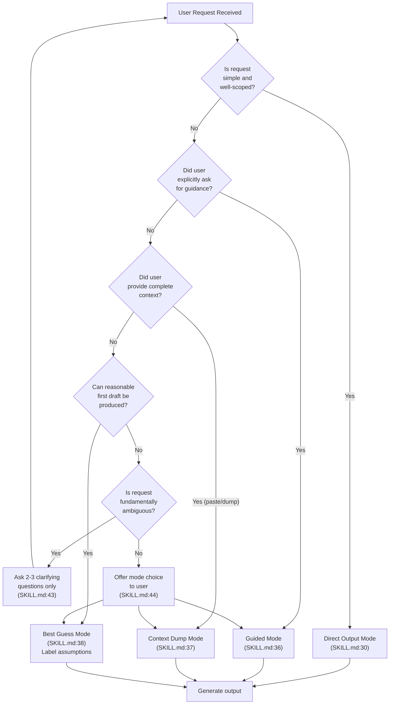
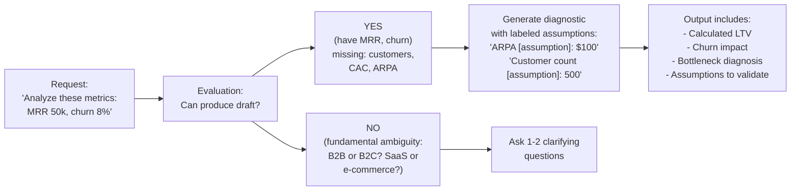
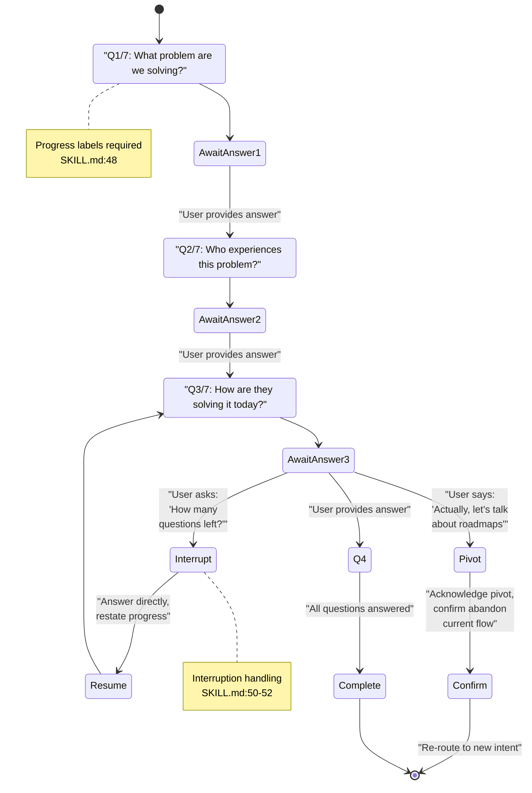
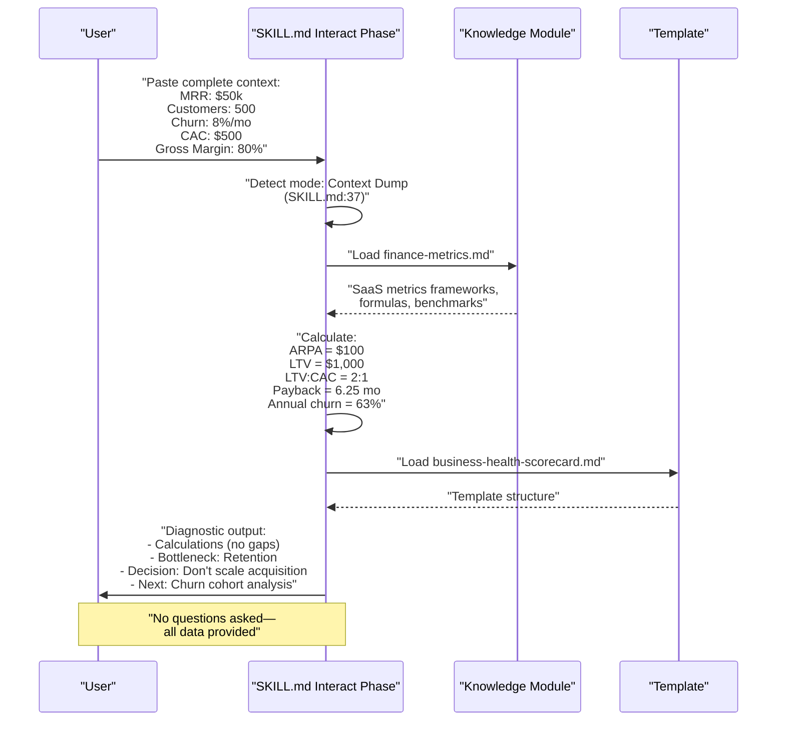
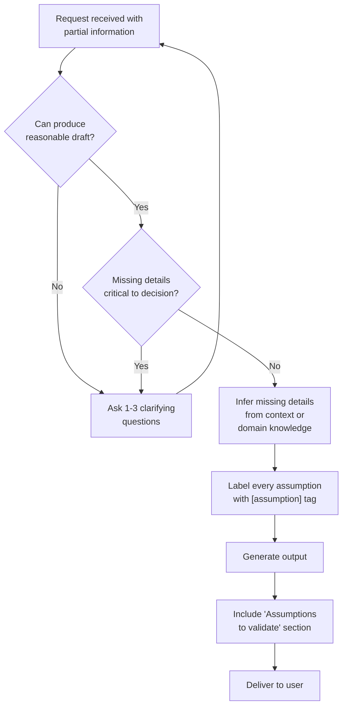
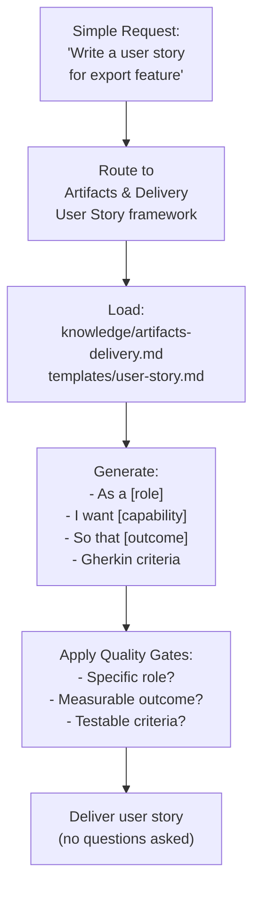
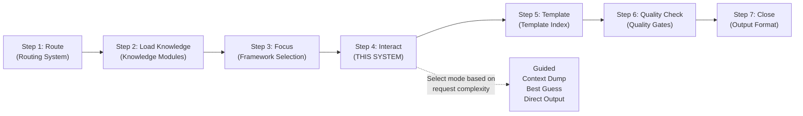

<!-- source: DeepWiki mcp.deepwiki.com · repo Digidai/product-manager-skills · page 3.3 Interaction Protocols · fetched 2026-10-26 -->

# Interaction Protocols

<details>
<summary>Relevant source files</summary>

The following files were used as context for generating this wiki page:

- [SKILL.md](SKILL.md)

</details>


## Purpose and Scope

This document details the interaction protocol system defined in [SKILL.md:28-60](), which determines how the AI skill communicates with users. The protocol defines four interaction modes (Guided, Context Dump, Best Guess, Direct Output) and the logic for selecting between them based on request complexity and available context.

For information about the overall execution pipeline that invokes these protocols, see [Execution Workflow](#3.1). For the routing logic that precedes interaction mode selection, see [Routing System](#3.2). For the output validation applied after interaction, see [Quality Gates](#3.4).

---

## Interaction Mode Architecture

The system implements four distinct interaction modes, each optimized for different request characteristics. Mode selection occurs during the **Interact** step of the execution workflow (after routing and knowledge loading, before template application).

### Mode Comparison Table

| Mode | Use Case | Question Count | Assumption Handling | Example Request |
|------|----------|----------------|---------------------|-----------------|
| **Direct Output** | Simple, well-scoped requests | 0 | Minimal assumptions needed | "Write a user story for export feature" |
| **Guided** | Complex, step-by-step collaboration | 3-10 questions, one at a time | User provides all context through dialogue | "Help me plan a discovery sprint" |
| **Context Dump** | User has complete context ready | 0 (context provided upfront) | Fill gaps, skip redundant questions | *Pastes full product spec, metrics, customer data* |
| **Best Guess** | Reasonable draft possible despite gaps | 0 | Label every assumption with `[assumption]` | "Diagnose these metrics: MRR $50k, churn 8%" |

**Sources:** [SKILL.md:28-44]()

---

## Mode Selection Decision Tree

The following diagram maps request characteristics to the appropriate interaction mode:



**Sources:** [SKILL.md:30-44]()

---

## Activation-First Default

The system prioritizes action over ceremony. When a reasonable first draft can be produced with labeled assumptions, the system generates output immediately rather than entering a mode-selection dialogue.

### Principle Statement

> "On the first response, prefer the fastest useful draft over a mode-selection ceremony. If you can produce a solid first version with reasonable assumptions, do that and label the assumptions inline." — [SKILL.md:32-33]()

### Implementation Logic



This approach reduces friction in the **Interact** phase of the [Execution Workflow](#3.1) by defaulting to productive output rather than meta-conversation about modes.

**Sources:** [SKILL.md:32-33](), [SKILL.md:41-44]()

---

## Guided Mode Mechanics

Guided mode implements a structured question-and-answer flow for complex requests requiring step-by-step collaboration. This mode is most commonly used for discovery sessions, diagnostics, and strategy planning.

### Question Flow Protocol



### Guided Session Rules

The following rules govern guided mode behavior, as specified in [SKILL.md:46-52]():

| Rule | Implementation | Line Reference |
|------|----------------|----------------|
| **One question per turn** | Wait for user answer before proceeding to next question | [SKILL.md:47]() |
| **Progress labels** | Display `Context Q3/7` or `Assessment Q2/4` with each question | [SKILL.md:48]() |
| **Numbered options** | At decision points, offer 3-5 numbered choices | [SKILL.md:49]() |
| **Flexible input** | Accept `1`, `2 and 4`, `1,3`, or custom text as answers | [SKILL.md:49]() |
| **Interruption transparency** | If interrupted, answer directly, restate progress, resume | [SKILL.md:50]() |
| **Explicit pause/stop** | Halt immediately when user says stop/pause; resume only on explicit request | [SKILL.md:51]() |
| **Topic switching** | Acknowledge pivot, confirm abandoning current flow, re-route to new intent | [SKILL.md:52]() |

### Progress Labeling Examples

```
Context Q1/6: What is the user's primary goal when using this feature?
Context Q2/6: What obstacles prevent them from achieving this goal today?
Context Q3/6: How are they currently working around these obstacles?
```

```
Assessment Q1/4: What is your current monthly recurring revenue (MRR)?
Assessment Q2/4: How many active customers do you have?
Assessment Q3/4: What is your month-over-month MRR growth rate?
```

The format `[Type] Q[Current]/[Total]` provides:
- **Type**: Context, Assessment, Discovery, Strategy, etc.
- **Current**: Question number being asked
- **Total**: Total questions in this guided session

**Sources:** [SKILL.md:46-52]()

---

## Context Dump Mode

Context dump mode handles scenarios where users provide all necessary information upfront (e.g., pasting complete specifications, metrics dashboards, or interview notes). The system skips redundant information gathering and proceeds directly to analysis or artifact generation.

### Context Dump Flow



**Key characteristic:** The system "fills gaps" by performing calculations or inferences from provided data, but does not ask for missing information if analysis can proceed without it.

**Sources:** [SKILL.md:37]()

---

## Best Guess Mode

Best guess mode generates immediate output when partial information allows for a reasonable first draft. Every inferred detail is labeled with `[assumption]` inline, enabling rapid iteration followed by user validation.

### Assumption Labeling Pattern

When producing output in best guess mode, assumptions must be marked using the `[assumption]` tag as specified in [SKILL.md:38]() and enforced by Quality Gate 1 in [SKILL.md:195-196]().

**Example: PRD Draft with Labeled Assumptions**

```markdown
## Success Metrics

- Reduce customer onboarding time from 14 days [assumption] to 3 days within Q2
- Increase trial-to-paid conversion from 12% [assumption] to 18%
- Support tier: Mid-market customers (10-200 employees) [assumption]

## User Persona

**Role:** Operations Manager [assumption: primary user]
**Context:** Managing 3 product lines [assumption] with no dedicated analytics support [assumption]
**Pain point:** Manually consolidating data across 5 tools [assumption: tool count]
```

### Best Guess Decision Logic



**When to use Best Guess over asking questions:**

| Scenario | Action | Rationale |
|----------|--------|-----------|
| User says "draft a PRD for export feature" | Use Best Guess | Can draft structure with industry-standard assumptions about export use cases |
| User says "should we build feature X?" | Ask 2-3 questions | Decision requires specific context (market, resources, strategy) |
| User provides metrics: "MRR $50k, churn 8%" | Use Best Guess | Can calculate unit economics with reasonable ARPA/customer count assumptions |
| User says "help me prioritize" | Ask clarifying questions | Prioritization framework depends on stage, constraints, goals |

**Sources:** [SKILL.md:38](), [SKILL.md:41-44]()

---

## Direct Output Mode

Direct output mode handles simple, well-scoped requests that require no clarifying questions or assumption labeling. This is the fastest path from request to deliverable.

### Eligibility Criteria

A request qualifies for direct output when:

1. **Intent is unambiguous** — One clear framework match in the [Routing Table](#3.2)
2. **Scope is bounded** — User specifies the artifact type (e.g., "write a user story")
3. **Context is sufficient** — Minimum information present to generate useful output
4. **No strategic decisions required** — Output is execution-focused, not strategic

### Direct Output Examples

| Request | Mode | Output Type | Questions Asked |
|---------|------|-------------|-----------------|
| "Write a user story for CSV export" | Direct Output | User Story with Gherkin acceptance criteria | 0 |
| "Give me the formula for LTV" | Direct Output | Formula with variable definitions | 0 |
| "Format this as a problem statement: [text]" | Direct Output | Structured problem statement | 0 |
| "Explain RICE prioritization" | Direct Output | Framework explanation with example | 0 |

### Direct Output Flow



**Key principle from [SKILL.md:30]():**
> "If the user asks for a user story, write one. Don't ask 10 setup questions."

This principle prevents unnecessary ceremony for straightforward requests.

**Sources:** [SKILL.md:30](), [SKILL.md:41-44]()

---

## Language Handling

The system responds in the language used by the user, as specified in [SKILL.md:54]():

> "Respond in the user's language. If they write in Chinese, respond in Chinese. If English, respond in English."

This applies across all interaction modes. Progress labels, assumption tags, and output format requirements remain consistent regardless of language.

**Sources:** [SKILL.md:54]()

---

## Standardized Output Format

Every output, regardless of interaction mode, must end with three specific elements as defined in [SKILL.md:56-59]():

### Required Output Components

```markdown
## [Output content generated by the system]

---

**Decisions made:**
- [Decision 1]
- [Decision 2]
- [Decision 3]

**Assumptions to validate:**
- [Assumption 1]
- [Assumption 2]

**Recommended next step:**
[Specific, actionable next step]
```

### Component Specifications

| Component | Purpose | Format | Example |
|-----------|---------|--------|---------|
| **Decisions made** | Explicit record of choices embedded in the output | Bullet list | "Recommended RICE over ICE for prioritization" |
| **Assumptions to validate** | List of inferred details that need user confirmation | Bullet list (omit if none) | "Assumed mid-market segment (10-200 employees)" |
| **Recommended next step** | Single actionable next action | One sentence or short paragraph | "Run 5 customer interviews using the Mom Test questions above" |

### Output Format Examples

**Example 1: Direct Output (User Story)**

```markdown
## User Story: CSV Export

**As a** data analyst at a mid-market SaaS company
**I want** to export customer cohort data as CSV
**So that** I can perform churn analysis in Excel without manual data entry

**Acceptance Criteria:**
```gherkin
Given I am viewing the cohort analysis dashboard
When I click "Export to CSV"
Then a CSV file downloads containing:
  - Customer ID
  - Cohort month
  - MRR at cohort start
  - Current MRR
  - Months retained
```

---

**Decisions made:**
- Scoped to cohort analysis (not all dashboard exports)
- CSV format chosen over Excel/JSON for analyst flexibility

**Assumptions to validate:**
- Primary user is data analyst (not executive or customer success)
- Excel is the primary analysis tool

**Recommended next step:**
Validate with 2-3 data analysts whether CSV format and included fields match their actual workflow.
```

**Example 2: Best Guess Mode (SaaS Diagnostic)**

```markdown
## SaaS Health Diagnostic

**Calculated Metrics:**
- ARPA: $100 [assumption: 500 customers]
- LTV: $1,000 (based on $100 ARPA, 8% monthly churn)
- LTV:CAC: 2:1
- Payback Period: 6.25 months
- Annual Churn: 63%

**Assessment:**
- **Retention:** RED FLAG — 63% annual churn is unsustainable
- **Unit Economics:** WORKABLE — 2:1 LTV:CAC and 6.25 month payback are within acceptable range
- **Bottleneck:** Retention, not acquisition efficiency

---

**Decisions made:**
- Do not scale acquisition until churn is understood
- Prioritize cohort analysis over growth optimization

**Assumptions to validate:**
- Customer count: 500 [assumption]
- Churn rate applies uniformly across customer segments [assumption]
- CAC of $500 includes fully-loaded costs [assumption]

**Recommended next step:**
Segment churn by cohort (month of acquisition) and customer tier to identify if specific segments are churning at different rates.
```

**Example 3: Guided Mode (Discovery Session)**

```markdown
## Discovery Interview Plan

[... generated interview questions ...]

---

**Decisions made:**
- Focus interviews on operations managers, not executives
- Use Mom Test approach (evidence-based, not hypothetical questions)
- Limit to 5 interviews before synthesis

**Assumptions to validate:**
- None (context provided through guided questions)

**Recommended next step:**
Schedule 5 customer interviews within the next 2 weeks. After each interview, document evidence in the Opportunity Solution Tree format.
```

These three components enable the "bias to action" principle from [SKILL.md:19]() by ensuring every interaction concludes with a clear next step, not just a summary.

**Sources:** [SKILL.md:56-59](), [SKILL.md:19]()

---

## Integration with Execution Workflow

Interaction protocols execute during Step 4 of the [Execution Workflow](#3.1), after routing and knowledge loading but before template application:



The interaction mode selected in Step 4 determines:
- **How information is gathered** (questions vs. inference vs. user-provided)
- **What gets labeled as assumptions** (Best Guess labels more than Direct Output)
- **When to proceed to Step 5** (Guided waits for all answers; Direct Output proceeds immediately)

**Sources:** [SKILL.md:64-74](), [SKILL.md:28-60]()

---

## Code Location Map

The interaction protocol system is implemented entirely within the "Interaction Protocol" section of SKILL.md. The following table maps concepts to specific line ranges:

| Concept | Line Range | Description |
|---------|------------|-------------|
| Simple request → direct output | [SKILL.md:30]() | Direct output principle |
| Activation-first default | [SKILL.md:32-33]() | Prefer draft over ceremony |
| Mode definitions | [SKILL.md:36-38]() | Guided, Context Dump, Best Guess |
| Mode selection logic | [SKILL.md:40-44]() | Decision tree for picking mode |
| Guided session rules | [SKILL.md:46-52]() | Question flow, progress labels, interruptions |
| Language handling | [SKILL.md:54]() | Respond in user's language |
| Output format requirements | [SKILL.md:56-59]() | Decisions, assumptions, next step |
| Integration with workflow | [SKILL.md:64-74]() | Step 4 of execution pipeline |

**Sources:** [SKILL.md:28-74]()

---

