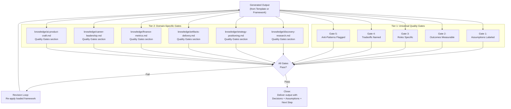
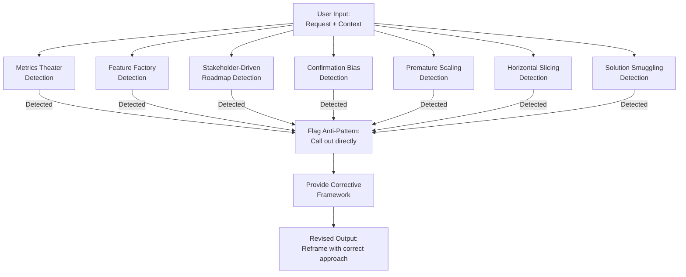
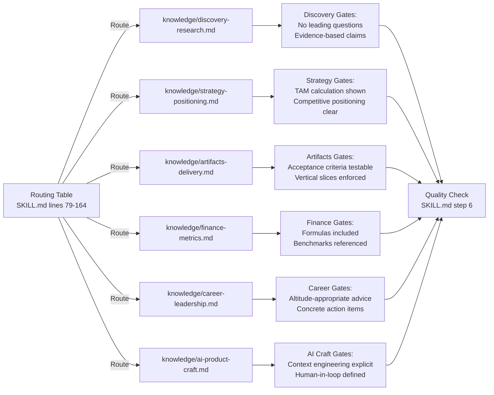
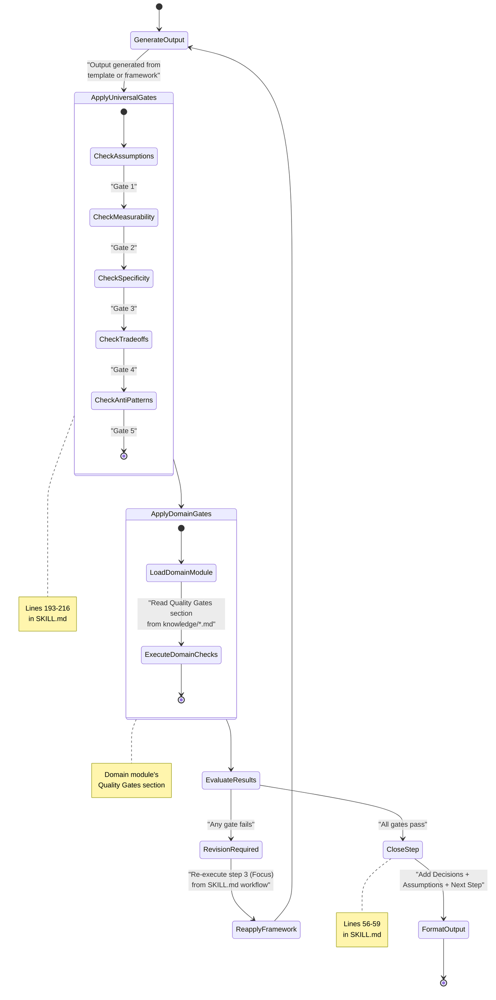

<!-- source: DeepWiki mcp.deepwiki.com · repo Digidai/product-manager-skills · page 3.4 Quality Gates · fetched 2026-10-26 -->

# Quality Gates

<details>
<summary>Relevant source files</summary>

The following files were used as context for generating this wiki page:

- [SKILL.md](SKILL.md)

</details>


## Purpose and Scope

This document describes the two-tier quality validation system that ensures all outputs meet rigorous product management standards. Quality Gates are validation checkpoints applied at step 6 of the execution workflow (see [Execution Workflow](#3.1)) after content generation but before delivery to the user.

The system consists of **Universal Quality Gates** that apply to every output regardless of domain, and **Domain-Specific Quality Gates** that enforce specialized standards for each knowledge area (see [Knowledge Domains](#4) for domain details). Additionally, the system includes **Anti-Pattern Detection** that actively identifies and flags common PM failure modes.

For information about how Quality Gates integrate with the overall execution pipeline, see [Execution Workflow](#3.1). For details on specific frameworks that gates validate against, see individual domain pages under [Knowledge Domains](#4).

---

## Architecture Overview

The Quality Gates system implements a two-tier validation architecture that differentiates this skill from generic AI prompting by enforcing rigor rather than accepting all plausible outputs.

### Two-Tier Validation Model



**Sources:** [SKILL.md:189-216]()

The validation sequence operates as follows:

1. **Universal Gates Execute First**: All five universal gates evaluate the output against operating principles defined in [SKILL.md:13-19]()
2. **Domain Gates Execute in Parallel**: The loaded knowledge module (determined by routing, see [Routing System](#3.2)) provides additional domain-specific validation criteria
3. **Decision Point**: If any gate fails, the output enters a revision loop that re-applies the loaded framework
4. **Close**: Passing outputs proceed to the Close step with standardized structure

### Gate Hierarchy

| Tier | Scope | Enforcement | Defined In |
|------|-------|-------------|------------|
| **Universal** | All outputs, all domains | Mandatory on every request | [SKILL.md:193-216]() |
| **Domain-Specific** | Outputs within specific domains | Mandatory when domain module loaded | Individual `knowledge/*.md` files |
| **Anti-Pattern Detection** | Subset of Universal Gate 5 | Active flagging of user input | [SKILL.md:208-215]() |

**Sources:** [SKILL.md:189-191]()

---

## Universal Quality Gates

Five gates apply to every output regardless of domain or request type. These gates enforce the operating principles defined in [SKILL.md:13-19]() and ensure transparency, measurability, specificity, honesty, and rigor.

### Gate 1: Assumptions Must Be Labeled

**Enforcement Rule**: Any inferred, hypothesized, or uncertain data point must be marked with `[assumption]` inline.

**Implementation**:
```
Correct:   "Assuming an 8% monthly churn rate [assumption], annual churn is 63%."
Incorrect: "With an 8% monthly churn rate, annual churn is 63%."
```

**Rationale**: This gate enforces the "Evidence-driven" operating principle from [SKILL.md:15](). Users must know which elements require validation vs. which are factual.

**Code Reference**: [SKILL.md:195-196]()

---

### Gate 2: Outcomes Must Be Measurable

**Enforcement Rule**: Every success metric, outcome, or goal must include:
- A quantified target (number)
- A direction (increase/decrease/maintain)
- A timeframe (when)

**Implementation**:

| ❌ Generic Outcome | ✅ Measurable Outcome |
|-------------------|----------------------|
| "Improve retention" | "Reduce monthly churn from 8% to 5% by Q3" |
| "Faster onboarding" | "Reduce time-to-first-value from 14 days to 3 days within 60 days" |
| "Better engagement" | "Increase DAU/MAU from 0.32 to 0.45 within Q2" |

**Rationale**: This gate enforces the "Outcome-oriented, not output-oriented" principle from [SKILL.md:14](). Vague goals enable no decisions.

**Code Reference**: [SKILL.md:198-199]()

---

### Gate 3: Roles Must Be Specific

**Enforcement Rule**: Generic personas ("users", "customers", "stakeholders") are rejected. Every role reference must include:
- Job title or function
- Context or constraint
- Motivation or goal

**Implementation**:
```
Correct:   "A mid-market ops manager running 3 product lines with no 
            dedicated analytics support, seeking to reduce reporting 
            time by 50%."

Incorrect: "Operations users who want better reporting."
```

**Rationale**: This gate enforces the "Specific > complete" principle from [SKILL.md:17](). Generic personas produce generic solutions.

**Code Reference**: [SKILL.md:201-202]()

---

### Gate 4: Tradeoffs Must Be Named

**Enforcement Rule**: Every recommendation, decision, or option comparison must explicitly state what is being sacrificed or deprioritized.

**Implementation**:
```
Correct:   "Recommend Option A (faster to market, accepts 20% lower initial 
            quality) over Option B (production-ready, 6-week delay)."

Incorrect: "Option A is better because it ships faster."
```

**Rationale**: This gate enforces the "Opinionated with tradeoffs" principle from [SKILL.md:16](). All decisions have costs; hiding them creates false confidence.

**Code Reference**: [SKILL.md:204-205]()

---

### Gate 5: Anti-Patterns Must Be Flagged

**Enforcement Rule**: When user input exhibits any of seven common PM failure modes, the system must actively call out the anti-pattern and provide corrective guidance. This is "pushback", not acceptance.

See [Anti-Pattern Detection](#anti-pattern-detection) below for the complete detection logic.

**Code Reference**: [SKILL.md:207-215]()

---

## Anti-Pattern Detection

Gate 5 implements active detection of seven PM failure modes. This subsystem provides the "pushback" capability that distinguishes this skill from yes-machine AI responses.

### Detection Architecture



**Sources:** [SKILL.md:207-215]()

### Seven Anti-Patterns

| Anti-Pattern | Detection Trigger | Corrective Action |
|--------------|------------------|-------------------|
| **Metrics Theater** | Tracking metrics that drive no decisions or actions | Redirect to outcome-oriented metrics that enable specific decisions |
| **Feature Factory** | Shipping features without validating underlying problem | Force problem framing before solution discussion (see [Discovery & Research](#4.1)) |
| **Stakeholder-Driven Roadmap** | Roadmap shaped by loudest voice rather than evidence | Apply prioritization frameworks (RICE, ICE, see [Strategy & Positioning](#4.2)) |
| **Confirmation Bias in Discovery** | Interview questions designed to confirm existing beliefs | Rewrite questions using Mom Test principles (see [Discovery & Research](#4.1)) |
| **Premature Scaling** | Optimizing growth before unit economics work | Redirect to unit economics validation (see [Finance & Metrics](#4.4)) |
| **Horizontal Slicing** | Work split by architecture layer instead of user value | Apply vertical slicing patterns (see [Artifacts & Delivery](#4.3)) |
| **Solution Smuggling** | Problem statements that embed a solution | Reframe problem without assuming solution (see [Discovery & Research](#4.1)) |

**Example Detection**:
```
User Input: "We need a dashboard to solve our reporting problem."

Detection: Solution Smuggling (assumes dashboard is the solution)

Corrective Response:
"This problem statement embeds a solution. Let's reframe:
- Current: 'We need a dashboard'
- Reframed: 'Ops managers spend 6 hours/week manually compiling reports 
  across 3 systems, delaying weekly planning by 48 hours'

Now we can evaluate whether a dashboard, automated reports, or better 
integrations solve the actual problem."
```

**Sources:** [SKILL.md:208-215]()

For detailed explanations of each anti-pattern, see [Anti-Patterns Detected](#9.1).

---

## Domain-Specific Quality Gates

Each knowledge module defines additional validation criteria that apply when that module is loaded. Domain gates complement universal gates by enforcing specialized standards for each PM discipline.

### Domain Gate Implementation Map



**Sources:** [SKILL.md:69-73](), [SKILL.md:79-164](), [SKILL.md:191]()

### Domain Gate Examples

Each domain module contains a "Quality Gates" section with specialized validation criteria. Examples:

#### Discovery & Research Domain
- **No Leading Questions**: Interview questions must not guide respondents toward desired answers
- **Evidence-Based Claims**: Every problem statement must cite specific user evidence or research data
- **PoL Probe Validity**: Validation experiments must test assumptions, not confirm beliefs

#### Strategy & Positioning Domain
- **TAM Calculation Shown**: Market sizing must show work, not just cite final numbers
- **Competitive Positioning Clear**: Positioning statements must name specific competitors and differentiation
- **Prioritization Transparency**: Framework scores must show individual criteria, not just totals

#### Artifacts & Delivery Domain
- **Acceptance Criteria Testable**: Gherkin criteria must be binary pass/fail with no ambiguity
- **Vertical Slices Enforced**: Epic breakdowns must deliver end-to-end user value, not technical layers
- **Solution Context Included**: Every artifact must explain why this solution addresses the problem

#### Finance & Metrics Domain
- **Formulas Included**: Metric calculations must show formulas, not just results
- **Benchmarks Referenced**: Diagnostic assessments must compare against industry standards
- **Unit Economics Complete**: LTV, CAC, and payback period must all be calculated together

#### Career & Leadership Domain
- **Altitude-Appropriate Advice**: Recommendations must match the user's current level (IC, Manager, Director, VP)
- **Concrete Action Items**: Career guidance must provide specific next steps, not generic advice
- **Skill Gaps Named**: Readiness assessments must identify specific competency gaps

#### AI Product Craft Domain
- **Context Engineering Explicit**: AI product designs must specify what context is needed and how it's obtained
- **Human-in-Loop Defined**: AI workflows must specify where humans review, approve, or intervene
- **Failure Modes Addressed**: AI validation plans must anticipate and test failure scenarios

**Sources:** Individual `knowledge/*.md` files (referenced via routing table)

---

## Validation Execution Flow

This section documents how Quality Gates integrate into the execution workflow defined in [Execution Workflow](#3.1).

### Step-by-Step Validation Process



**Sources:** [SKILL.md:63-74](), [SKILL.md:189-216]()

### Validation Sequence Detail

1. **Output Generation** (Steps 4-5 of execution workflow)
   - Interaction protocol produces draft content
   - Template loaded if applicable
   - Framework applied from knowledge module

2. **Universal Gate Evaluation** (Step 6a)
   - Execute all five universal gates sequentially
   - Each gate operates independently
   - Failures accumulate; no short-circuit

3. **Domain Gate Evaluation** (Step 6b)
   - Read "Quality Gates" section from loaded knowledge module (determined in step 2 of workflow)
   - Apply all domain-specific criteria
   - Examples: formula validation for Finance domain, vertical slice enforcement for Artifacts domain

4. **Decision Point**
   - **If any gate fails**: Enter revision loop
     - Return to step 3 (Focus) of execution workflow
     - Re-apply framework with gate failure context
     - Regenerate output
     - Re-evaluate gates
   - **If all gates pass**: Proceed to Close step

5. **Close** (Step 7 of execution workflow)
   - Add standardized closing structure per [SKILL.md:56-59]()
   - Output includes: Decisions made, Assumptions to validate, Recommended next step

**Sources:** [SKILL.md:63-74]()

---

## Quality Gates vs. Generic AI Prompting

The Quality Gates system differentiates this skill from generic AI interactions by enforcing rigor rather than accepting all plausible outputs.

### Comparison Table

| Aspect | Generic AI Prompting | Product Manager Skills Quality Gates |
|--------|---------------------|--------------------------------------|
| **Assumption Handling** | Presents inferred data as fact | Requires `[assumption]` inline labels |
| **Outcome Specification** | Accepts vague goals ("improve retention") | Enforces measurable targets with timeframes |
| **Role Specificity** | Accepts generic personas ("users") | Requires job title + context + motivation |
| **Tradeoff Transparency** | Omits downsides and costs | Mandates explicit tradeoff naming |
| **Anti-Pattern Response** | Accepts problematic framing | Actively flags and corrects failure modes |
| **Domain Rigor** | No specialized validation | Applies domain-specific standards |
| **Revision Mechanism** | One-shot generation | Iterative validation with revision loops |

**Example Comparison**:

**Generic AI Output**:
```
"Your churn rate is high. Consider improving your retention strategy 
and enhancing the customer experience to reduce churn."
```

**Quality Gates-Validated Output**:
```
8% monthly churn = 63% annual churn [RED FLAG]

Current unit economics:
- ARPA: $100/month
- LTV: $1,000 (at 8% churn)
- CAC: $500
- LTV:CAC ratio: 2:1
- Payback period: 6.25 months

Assessment:
- Payback = workable (< 12 months)
- Retention = NOT workable (63% annual churn unsustainable)

Decision: Do not scale acquisition until churn is understood cohort by cohort.

Assumptions to validate:
- [assumption] Churn is evenly distributed across cohorts
- [assumption] No seasonality in churn pattern

Next step: Run cohort analysis segmented by signup month, feature adoption, 
and customer segment to identify churn drivers.
```

The second output passes all five universal gates and Finance domain gates (formulas shown, benchmarks referenced, unit economics complete).

**Sources:** [SKILL.md:13-25](), [SKILL.md:189-216]()

---

## Implementation Notes

### Gate Enforcement Mechanism

Quality Gates are **declarative validation criteria** embedded in the prompt architecture, not executable code. The AI coding tool (Claude Code, Cursor, etc.) interprets gate requirements from:

1. **SKILL.md lines 189-216**: Universal gate definitions
2. **Knowledge module "Quality Gates" sections**: Domain-specific criteria
3. **Operating principles (lines 13-19)**: Foundational behavioral constraints

The system relies on the AI's instruction-following capability to self-validate outputs against these criteria before delivery.

### Multi-Domain Validation

When a request spans multiple domains (see [Routing System](#3.2) for multi-domain handling), gates from all loaded modules apply. Example:

```
Request: "Write a roadmap for an AI product"
Loaded Modules: strategy-positioning.md (primary), ai-product-craft.md (secondary)
Applied Gates: Universal + Strategy Gates + AI Craft Gates
```

**Sources:** [SKILL.md:75-76]()

### Revision Loop Limits

The system does not specify a maximum number of revision iterations. In practice, the revision loop terminates when:
- All gates pass (success path)
- The framework cannot be further improved (pragmatic termination)
- The user interrupts (manual termination)

**Sources:** [SKILL.md:72]()

---

## Related Pages

- [Execution Workflow](#3.1) — Quality Gates are step 6 in the 7-step pipeline
- [Routing System](#3.2) — Routing determines which domain gates apply
- [Operating Principles](#3.5) — Gates enforce the six operating principles
- [Knowledge Domains](#4) — Each domain defines specialized quality gates
- [Anti-Patterns Detected](#9.1) — Detailed explanation of all seven failure modes

---

**Sources:** [SKILL.md:1-216](), high-level architecture diagrams

---

