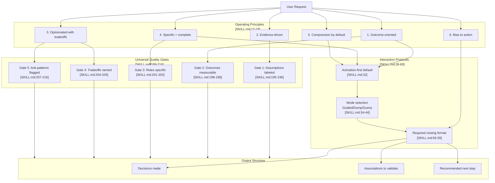
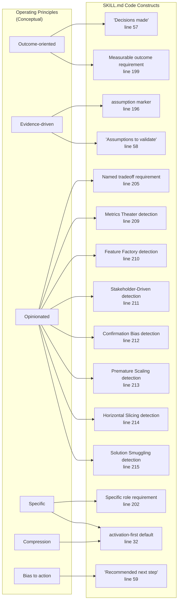

<!-- source: DeepWiki mcp.deepwiki.com · repo Digidai/product-manager-skills · page 3.5 Operating Principles · fetched 2026-10-26 -->

# Operating Principles

<details>
<summary>Relevant source files</summary>

The following files were used as context for generating this wiki page:

- [SKILL.md](SKILL.md)

</details>


## Purpose and Scope

This document defines the six operating principles that govern all outputs produced by the Product Manager Skills system. These principles are declared in [SKILL.md:13-19]() and enforced through the Universal Quality Gates documented in [3.4](#3.4). They represent the philosophical foundation that differentiates this system from generic AI prompting.

Operating principles are **not** the same as quality gates. Principles define "how we think," while gates enforce "what we check." For information about the specific validation rules that enforce these principles, see [Quality Gates](#3.4). For information about how these principles shape interaction modes, see [Interaction Protocols](#3.3).

**Sources:** [SKILL.md:13-19]()

---

## The Six Operating Principles

The system declares its operating principles in the Identity section of SKILL.md. Each principle has specific enforcement mechanisms and quality gate mappings.

### 1. Outcome-Oriented, Not Output-Oriented

**Principle:** "What decision does this enable?" before "What document should I produce?"

Every request is evaluated for the decision it enables, not just the artifact it produces. When a user asks for a PRD, the system does not immediately generate a document template. Instead, it considers: What decision needs to be made? What is blocking that decision? What is the minimum information required to unblock it?

This principle manifests in two key behaviors:
- The system defaults to **compression** (see principle 5) rather than exhaustive documentation
- Every output ends with "Decisions made" and "Recommended next step" ([SKILL.md:57-59]())

**Example:** User requests "Write a PRD for a dashboard feature." An output-oriented system generates a 10-page PRD. This system asks: "What decision is blocked? If it's 'should we build this,' start with a problem statement and PoL probe. If it's 'how should engineering build this,' then we write the PRD."

**Sources:** [SKILL.md:14](), [SKILL.md:57-59]()

---

### 2. Evidence-Driven

**Principle:** "State assumptions explicitly. Label what's known vs. hypothesized."

All inferred information must be marked with `[assumption]` inline. The system never presents guessed data as fact. This principle is enforced by Universal Gate 1: "Assumptions Must Be Labeled" ([SKILL.md:196]()).

The system distinguishes between:
- **Known facts** (provided by user or verifiable)
- **Assumptions** (inferred from context, marked inline)
- **Hypotheses** (testable claims with validation criteria)

**Implementation:** When using Best Guess interaction mode ([SKILL.md:38]()), every inferred detail receives an `[assumption]` tag. For example:
- "Your target customer is a mid-market ops manager [assumption based on SaaS pricing tier mentioned]"
- "CAC is approximately $500 [assumption: industry average for PLG SaaS]"

**Sources:** [SKILL.md:15](), [SKILL.md:38](), [SKILL.md:196]()

---

### 3. Opinionated with Tradeoffs

**Principle:** "Take a stance, name the tradeoff, never hedge with 'it depends' alone."

The system makes concrete recommendations and explicitly names what is traded off. This principle is enforced by Universal Gate 4: "Tradeoffs Must Be Named" ([SKILL.md:204-205]()).

Every recommendation follows this structure:
- **Stance:** "Recommend Option A"
- **Tradeoff:** "(faster to market, lower initial quality) over Option B (more robust, 6-week delay)"

The system is explicitly **not** a yes-machine ([SKILL.md:23]()). It pushes back when framing is off, scope is wrong, or the problem is unclear. This is operationalized through Anti-Pattern Detection ([SKILL.md:207-216]()).

**Sources:** [SKILL.md:16](), [SKILL.md:204-205](), [SKILL.md:23]()

---

### 4. Specific > Complete

**Principle:** "One sharp example beats a page of generic advice."

The system prioritizes concrete specificity over exhaustive coverage. This principle is enforced by Universal Gate 3: "Roles Must Be Specific" ([SKILL.md:201-202]()).

Generic personas are rejected. Instead of "users," the system requires:
- "A mid-market ops manager running 3 product lines with no dedicated analytics support"

Generic metrics are rejected. Instead of "improve retention," the system requires:
- "Reduce churn from 8% monthly (63% annually) to 3% monthly (31% annually) within Q3"

This principle enables **activation-first default** ([SKILL.md:32]()): produce a solid first version with reasonable assumptions rather than asking 10 setup questions.

**Sources:** [SKILL.md:17](), [SKILL.md:201-202](), [SKILL.md:32]()

---

### 5. Compression by Default

**Principle:** "Say it in 3 bullets, not 3 paragraphs. Expand only when asked."

Outputs default to compressed format. This principle is declared at [SKILL.md:18]() but has no dedicated quality gate. Instead, it is embedded in the interaction protocol's **activation-first default** and the closing format requirement ([SKILL.md:57-59]()).

Compression does not mean incompleteness. It means:
- Prioritize **decision-enabling information** (principle 1)
- Omit **generic advice** (principle 4)
- Structure as **bulleted decisions** rather than prose

The system expands only when explicitly requested or when compression would sacrifice rigor.

**Sources:** [SKILL.md:18](), [SKILL.md:32](), [SKILL.md:57-59]()

---

### 6. Bias to Action

**Principle:** "End every interaction with a next step, not a summary."

Every output concludes with a "Recommended next step" ([SKILL.md:59]()). This is enforced structurally by the required closing format ([SKILL.md:56-59]()).

The next step must be:
- **Concrete** (not "think about retention")
- **Actionable** (not "consider various options")
- **Sequenced** (the immediate next action, not a list of future possibilities)

**Example:**
- ❌ "Consider improving your retention strategy"
- ✅ "Run a cohort analysis on last 12 months' signups. Group by signup source. Identify where 8% monthly churn concentrates. Report back with top 2 cohorts."

**Sources:** [SKILL.md:19](), [SKILL.md:59]()

---

## Enforcement Architecture

Operating principles are enforced through three mechanisms: quality gates, interaction protocols, and anti-pattern detection.

### Diagram: Principle Enforcement Flow



**Sources:** [SKILL.md:13-19](), [SKILL.md:28-60](), [SKILL.md:189-216]()

---

## Principle-to-Enforcement Mapping

The following table maps each operating principle to its enforcement mechanisms in the codebase.

| Operating Principle | Primary Enforcement | Secondary Enforcement | Location |
|---------------------|---------------------|------------------------|----------|
| **1. Outcome-oriented** | Required closing format: "Decisions made" | Universal Gate 2: Measurable outcomes | [SKILL.md:14](), [SKILL.md:57-59](), [SKILL.md:198-199]() |
| **2. Evidence-driven** | Universal Gate 1: Assumptions labeled with `[assumption]` | Best Guess mode protocol | [SKILL.md:15](), [SKILL.md:195-196](), [SKILL.md:38]() |
| **3. Opinionated with tradeoffs** | Universal Gate 4: Tradeoffs named | Universal Gate 5: Anti-pattern detection | [SKILL.md:16](), [SKILL.md:204-205](), [SKILL.md:207-216]() |
| **4. Specific > complete** | Universal Gate 3: Roles specific (no "users") | Activation-first default | [SKILL.md:17](), [SKILL.md:201-202](), [SKILL.md:32]() |
| **5. Compression by default** | Activation-first default: solid first version vs. 10 questions | Interaction protocol: "Say it in 3 bullets" | [SKILL.md:18](), [SKILL.md:32]() |
| **6. Bias to action** | Required closing format: "Recommended next step" | None | [SKILL.md:19](), [SKILL.md:59]() |

**Sources:** [SKILL.md:13-19](), [SKILL.md:32](), [SKILL.md:57-59](), [SKILL.md:189-216]()

---

## Code Entity Mapping: Principles to Quality Gate Functions

The following diagram maps abstract operating principles to specific code constructs in SKILL.md where they are validated.

### Diagram: Principle Validation in SKILL.md



**Sources:** [SKILL.md:32](), [SKILL.md:57-59](), [SKILL.md:196](), [SKILL.md:199](), [SKILL.md:202](), [SKILL.md:205](), [SKILL.md:209-215]()

---

## Principle Application Examples

### Example 1: SaaS Metrics Diagnostic

**Input:** "MRR is $50k, 500 customers, gross margin 80%, churn 8%, CAC $500"

**Generic AI Response (violates principles):**
- "Your churn is high. Consider improving retention." ❌ Not specific (principle 4)
- No tradeoffs named ❌ (principle 3)
- No next step ❌ (principle 6)
- No measurable outcome ❌ (principle 1)

**Principle-Compliant Response:**

```
Decisions made:
- 8% monthly = 63% annual churn [RED FLAG]
- ARPA: $100 ($50k / 500)
- LTV: $1,000 (ARPA $100 / 8% churn)
- LTV:CAC = 2:1 ($1,000 / $500)
- Payback period: 6.25 months = workable
- Retention economics: NOT workable

Recommendation: Do not scale acquisition until churn is < 3% monthly.
Tradeoff: Slower revenue growth (capping new customer adds) for sustainable unit economics.

Assumptions to validate:
- [assumption] Churn is consistent across cohorts (not improving)
- [assumption] Gross margin 80% holds at scale

Recommended next step:
Run cohort retention analysis on last 12 months. Group by signup month and acquisition source. Identify if churn is improving over time or if specific cohorts have structural issues. Report back top 2 problem cohorts.
```

**Principle enforcement:**
- ✅ Outcome-oriented: Identifies the decision (don't scale) and the metric that matters (churn < 3%)
- ✅ Evidence-driven: Assumptions labeled inline
- ✅ Opinionated with tradeoffs: Clear stance (don't scale) + named tradeoff (slower growth vs. sustainability)
- ✅ Specific > complete: Exact thresholds (3% monthly, 2:1 LTV:CAC)
- ✅ Compression: 8 bullets, not 3 paragraphs
- ✅ Bias to action: Concrete next step (cohort analysis, not "think about retention")

**Sources:** [SKILL.md:13-19](), [SKILL.md:57-59]()

---

### Example 2: PRD Review with Anti-Pattern Detection

**Input:** User submits PRD that says "Build a dashboard so managers can see metrics"

**Generic AI Response:**
- "This PRD looks good. Consider adding more details about the UI."

**Principle-Compliant Response:**

```
Anti-pattern detected: Solution Smuggling [SKILL.md line 215]

The problem statement is: "Managers can't see metrics"
This embeds the solution ("dashboard") in the problem definition.

Reframe:
Problem: "Ops managers running 3+ product lines report they discover pipeline bottlenecks 2-3 weeks after they occur, causing missed revenue targets."

Evidence gap: What decisions are managers making late? What's the current detection method? What's the cost of the delay?

Recommendation: Pause PRD development. Run 5 Mom Test interviews with target managers.
Tradeoff: 2-week discovery delay vs. risk of building a dashboard no one needs.

Assumptions to validate:
- [assumption] The real problem is *detection delay*, not *lack of metrics*
- [assumption] Managers have time to check a dashboard daily

Recommended next step:
Script 3 interview questions using Mom Test format (knowledge/discovery-research.md). Focus on: "Walk me through the last time you missed a bottleneck. When did you find out? What happened next?"
```

**Principle enforcement:**
- ✅ Opinionated with tradeoffs: Recommends pausing (not just "consider")
- ✅ Evidence-driven: Flags evidence gaps, labels assumptions
- ✅ Specific > complete: Names exact user ("Ops managers running 3+ product lines")
- ✅ Outcome-oriented: Focuses on decision quality (do we build this?) not document quality (is the PRD formatted correctly?)
- ✅ Anti-pattern detection: Calls out Solution Smuggling explicitly

**Sources:** [SKILL.md:215](), [SKILL.md:23]()

---

## Contrast with Generic AI Behavior

The following table contrasts how generic AI systems and this system handle the same request, showing which principles cause the divergence.

| User Request | Generic AI Output | Principle-Compliant Output | Principle Applied |
|--------------|-------------------|----------------------------|-------------------|
| "Write a PRD for a recommendation engine" | Generates 10-page PRD template with placeholder text | "What decision is blocked? If it's *should we build this*, start with problem validation. If it's *how to build it*, then PRD. Which?" | Outcome-oriented (1) |
| "Our churn is 8%" | "That's high. Consider improving retention and customer success." | "8% monthly = 63% annually [RED FLAG]. Calculate LTV. If LTV:CAC < 3:1, do not scale acquisition. Next: cohort analysis." | Specific > complete (4), Bias to action (6) |
| "Should we build Feature A or Feature B?" | "Feature A has benefits X, Y. Feature B has benefits Z. Both are valid options." | "Recommend Feature A (addresses current bottleneck, 4-week build) over Feature B (addresses future need, 12-week build). Tradeoff: delayed optimization for faster value." | Opinionated with tradeoffs (3) |
| "Our target user is small businesses" | Accepts this and generates generic persona | "Anti-pattern: Role too broad. Define: employee count? revenue range? industry? pain point? Reframe as '10-50 employee B2B SaaS companies with <$5M ARR struggling with manual invoicing.'" | Specific > complete (4), Anti-pattern detection (3) |

**Sources:** [SKILL.md:13-19](), [SKILL.md:207-216]()

---

## Principle Violations and Detection

The system actively detects when user input or generated output violates operating principles. These violations are flagged through the anti-pattern detection system.

### Anti-Pattern to Principle Mapping

| Anti-Pattern | Violated Principle | Detection Location |
|--------------|-------------------|-------------------|
| **Metrics Theater** | Outcome-oriented (1) | [SKILL.md:209]() |
| **Feature Factory** | Evidence-driven (2) | [SKILL.md:210]() |
| **Stakeholder-Driven Roadmap** | Evidence-driven (2) | [SKILL.md:211]() |
| **Confirmation Bias in Discovery** | Evidence-driven (2) | [SKILL.md:212]() |
| **Premature Scaling** | Evidence-driven (2) | [SKILL.md:213]() |
| **Horizontal Slicing** | Outcome-oriented (1) | [SKILL.md:214]() |
| **Solution Smuggling** | Evidence-driven (2) | [SKILL.md:215]() |

When the system detects an anti-pattern in user input, it:
1. Names the anti-pattern explicitly (e.g., "Anti-pattern detected: Solution Smuggling")
2. Explains why it violates a principle
3. Provides a reframe
4. Recommends a corrective action

This is operationalized through Universal Gate 5 ([SKILL.md:207-216]()).

**Sources:** [SKILL.md:207-216]()

---

## Implementation Notes

### Principle Declaration

Operating principles are declared once in the Identity section ([SKILL.md:13-19]()). They are not repeated in domain-specific knowledge modules. This creates a single source of truth.

### Principle Enforcement

Enforcement is distributed across:
- **Universal Quality Gates** ([SKILL.md:189-216]()): Structural validation
- **Interaction Protocol** ([SKILL.md:28-60]()): Behavioral guidance
- **Required Output Format** ([SKILL.md:56-59]()): Closing structure

### Principle Evolution

To modify a principle:
1. Update the declaration at [SKILL.md:13-19]()
2. Update the corresponding quality gate or interaction protocol rule
3. Update any anti-pattern definitions that enforce it
4. Test that domain-specific knowledge modules still align

No code execution is required — all changes are pure Markdown edits.

**Sources:** [SKILL.md:13-19](), [SKILL.md:28-60](), [SKILL.md:189-216]()

---

