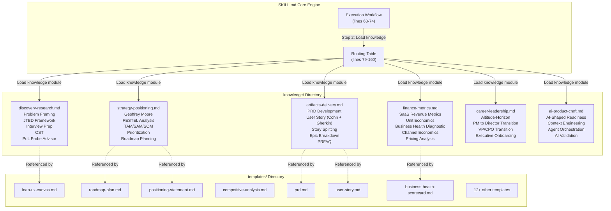
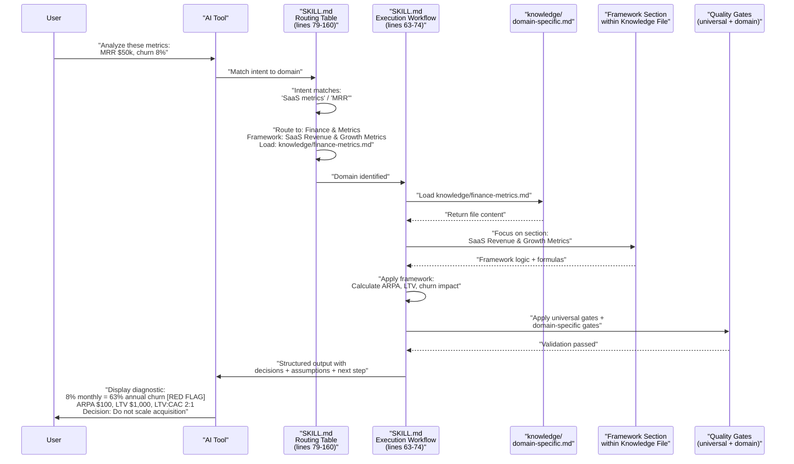
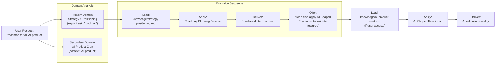

<!-- source: DeepWiki mcp.deepwiki.com · repo Digidai/product-manager-skills · page 4 Knowledge Domains · fetched 2026-10-26 -->

# Knowledge Domains

<details>
<summary>Relevant source files</summary>

The following files were used as context for generating this wiki page:

- [README.md](README.md)
- [SKILL.md](SKILL.md)

</details>


This document explains the knowledge domain architecture that partitions product management expertise into six distinct areas. Each domain contains specialized frameworks, templates, and quality gates that are loaded on-demand based on user intent.

For detailed information about individual domains and their frameworks, see pages [4.1](#4.1) through [4.6](#4.6). For information about how user requests are routed to these domains, see [3.2 Routing System](#3.2). For information about domain-specific quality gates, see [3.4 Quality Gates](#3.4).

---

## Domain Partitioning Strategy

The system divides product management knowledge into six non-overlapping domains. Each domain:

1. Maps to a dedicated knowledge file in the `knowledge/` directory
2. Contains 5-30+ frameworks and methodologies specific to that domain
3. Declares domain-specific quality gates beyond the universal five gates
4. Links to relevant templates in the `templates/` directory

The partitioning follows the natural phases and responsibilities of PM work: problem discovery, strategic positioning, artifact creation, financial analysis, career progression, and AI product specialization.

**Sources:** [SKILL.md:63-74](), [README.md:117-125]()

---

## Six Knowledge Domains

| Domain | Knowledge File | Primary Focus | Example Frameworks |
|--------|---------------|---------------|-------------------|
| **Discovery & Research** | `knowledge/discovery-research.md` | Problem validation, customer research, opportunity mapping | JTBD, Mom Test, Opportunity Solution Tree, Lean UX Canvas, PoL Probes |
| **Strategy & Positioning** | `knowledge/strategy-positioning.md` | Market positioning, prioritization, roadmap planning | Geoffrey Moore, PESTEL, TAM/SAM/SOM, RICE, ICE, Kano |
| **Artifacts & Delivery** | `knowledge/artifacts-delivery.md` | PRDs, user stories, epics, execution documents | Cohn + Gherkin, Story Mapping, Epic Breakdown, PRFAQ |
| **Finance & Metrics** | `knowledge/finance-metrics.md` | SaaS metrics calculation, business health diagnostics | MRR/ARR/NRR, CAC/LTV/Payback, Rule of 40, Magic Number |
| **Career & Leadership** | `knowledge/career-leadership.md` | PM career transitions, leadership development | Altitude-Horizon, Three Ps, 30-60-90 plans |
| **AI Product Craft** | `knowledge/ai-product-craft.md` | AI-native product decisions, context engineering | AI-Shaped Readiness, Context Engineering, Agent Orchestration |

**Sources:** [SKILL.md:83-160](), [README.md:117-125]()

---

## Domain Architecture and File Structure



**Domain-to-File Mapping**

Each domain in the routing table specifies exactly which knowledge file to load. The AI tool reads the file path from the "Load" column and retrieves the content from the `knowledge/` directory, which is a sibling directory to `SKILL.md`.

**Sources:** [SKILL.md:68-69](), [SKILL.md:79-160](), [SKILL.md:172-186]()

---

## Intent-Based Routing to Domains

The routing table maps natural language user intents to specific frameworks within domains. The matching algorithm uses exact phrase matching and semantic similarity.

### Discovery & Research Domain Routing

| User Intent | Framework | Load Path |
|------------|-----------|-----------|
| "Validate a problem" / "test a hypothesis" | Problem Framing + PoL Probe Advisor | `knowledge/discovery-research.md` |
| "Customer interview" / "discovery interview" | Interview Prep | `knowledge/discovery-research.md` |
| "Map the customer journey" | Customer Journey > Journey Map / Journey Mapping Workshop | `knowledge/discovery-research.md` |
| "Opportunity mapping" / "solution tree" | Opportunity Solution Tree | `knowledge/discovery-research.md` |
| "Jobs to be done" / "JTBD" / "customer needs" | JTBD Framework | `knowledge/discovery-research.md` |
| "PoL probe" / "proof of life" / "validation experiment" | PoL Probe Advisor | `knowledge/discovery-research.md` |

**Sources:** [SKILL.md:83-97]()

### Strategy & Positioning Domain Routing

| User Intent | Framework | Load Path |
|------------|-----------|-----------|
| "Position my product" / "positioning statement" | Geoffrey Moore Positioning Statement | `knowledge/strategy-positioning.md` |
| "Product strategy" / "strategy session" / "GTM strategy" | Strategy Session Phases | `knowledge/strategy-positioning.md` |
| "Prioritize" / "prioritization framework" / "what to build next" | Prioritization > Framework Selection Matrix | `knowledge/strategy-positioning.md` |
| "Roadmap" / "roadmap planning" / "release plan" | Roadmap Planning Process | `knowledge/strategy-positioning.md` |
| "TAM SAM SOM" / "market size" / "addressable market" | TAM/SAM/SOM Calculation | `knowledge/strategy-positioning.md` |

**Sources:** [SKILL.md:99-111]()

### Artifacts & Delivery Domain Routing

| User Intent | Framework | Load Path |
|------------|-----------|-----------|
| "Write a PRD" / "product requirements" | PRD Development | `knowledge/artifacts-delivery.md` |
| "Write a user story" / "acceptance criteria" | User Story (Cohn + Gherkin) | `knowledge/artifacts-delivery.md` |
| "Split this story" / "story too big" | User Story Splitting (8 patterns) | `knowledge/artifacts-delivery.md` |
| "Epic" / "epic hypothesis" / "frame this epic" | Epics > Epic Hypothesis | `knowledge/artifacts-delivery.md` |
| "Break down this epic" / "epic breakdown" | Epics > Epic Breakdown (9 Patterns) | `knowledge/artifacts-delivery.md` |
| "Press release" / "PRFAQ" / "working backwards" | Press Release / PRFAQ | `knowledge/artifacts-delivery.md` |

**Sources:** [SKILL.md:113-127]()

### Finance & Metrics Domain Routing

| User Intent | Framework | Load Path |
|------------|-----------|-----------|
| "SaaS metrics" / "revenue metrics" / "MRR" / "ARR" | SaaS Revenue & Growth Metrics | `knowledge/finance-metrics.md` |
| "Unit economics" / "CAC" / "LTV" / "payback" | Unit Economics & Efficiency | `knowledge/finance-metrics.md` |
| "Business health" / "diagnostic" / "board meeting prep" | Business Health Diagnostic | `knowledge/finance-metrics.md` |
| "Feature ROI" / "should we build this" / "investment case" | Feature Investment Analysis | `knowledge/finance-metrics.md` |
| "Rule of 40" / "magic number" / "burn rate" | Capital Efficiency (Unit Economics) | `knowledge/finance-metrics.md` |
| "Retention" / "churn" / "why are users leaving" | Retention & Expansion Metrics + Business Health Diagnostic | `knowledge/finance-metrics.md` |

**Sources:** [SKILL.md:129-141]()

### Career & Leadership Domain Routing

| User Intent | Framework | Load Path |
|------------|-----------|-----------|
| "PM to Director" / "director transition" / "altitude horizon" | Altitude-Horizon Framework | `knowledge/career-leadership.md` |
| "Director interview" / "director readiness" / "preparing for Director" | PM to Director Transition | `knowledge/career-leadership.md` |
| "VP" / "CPO" / "executive transition" | Director to VP/CPO Transition | `knowledge/career-leadership.md` |
| "New role" / "first 90 days" / "onboarding as VP" / "onboarding as CPO" | Executive Onboarding (30-60-90) | `knowledge/career-leadership.md` |

**Sources:** [SKILL.md:143-151]()

### AI Product Craft Domain Routing

| User Intent | Framework | Load Path |
|------------|-----------|-----------|
| "AI product" / "AI-shaped" / "AI readiness" | AI-Shaped Readiness | `knowledge/ai-product-craft.md` |
| "Context engineering" / "context stuffing" / "prompt design" | Context Engineering | `knowledge/ai-product-craft.md` |
| "Agent workflow" / "multi-agent" / "AI orchestration" | Agent Orchestration | `knowledge/ai-product-craft.md` |
| "AI validation" / "test my AI feature" | AI Validation (PoL Probes) | `knowledge/ai-product-craft.md` |

**Sources:** [SKILL.md:153-160]()

---

## Domain Loading Execution Flow



**Step-by-Step Loading Process**

1. **Route (line 67):** The routing table matches user intent to a domain and framework
2. **Load knowledge (line 68):** The system reads the file path from the "Load" column and retrieves the knowledge file from the `knowledge/` directory
3. **Focus (line 69):** Within the loaded file, the system locates the section matching the framework name
4. **Apply framework:** The framework's decision logic, formulas, and methodologies are applied to the user's specific context
5. **Quality check (line 72):** Both universal gates (lines 189-216) and domain-specific gates are applied

**Sources:** [SKILL.md:63-74](), [SKILL.md:67-73]()

---

## Multi-Domain Request Handling

Some user requests span multiple domains. The system uses an explicit primary domain rule to determine the execution sequence.



**Multi-Domain Routing Rules**

From [SKILL.md:75-76]():

> **Multi-domain requests:** When intent spans two domains (e.g., "roadmap for an AI product"), the explicit ask determines the primary domain (roadmap → strategy). Load primary first. Mention secondary and offer to load it after the primary task completes.

From [SKILL.md:161-164]():

> **Routing rules:**
> 1. If intent matches multiple domains, the explicit ask determines primary (see Execution Workflow above).
> 2. If intent is unclear, ask one clarifying question before loading.
> 3. If no match, use general PM reasoning and the Quality Gates below. Don't hallucinate a framework.

**Sources:** [SKILL.md:75-76](), [SKILL.md:161-164]()

---

## Domain-Specific Components

Each domain includes three categories of components beyond the core frameworks:

### 1. Templates Linked to Domains

Templates in the `templates/` directory are referenced by specific domains but are loaded separately during the template application phase (step 5 of the execution workflow).

| Domain | Associated Templates |
|--------|---------------------|
| Discovery & Research | `discovery-interview-plan.md`, `opportunity-solution-tree.md`, `lean-ux-canvas.md` |
| Strategy & Positioning | `positioning-statement.md`, `roadmap-plan.md`, `competitive-analysis.md` |
| Artifacts & Delivery | `prd.md`, `user-story.md`, `epic-hypothesis.md`, `press-release.md` |
| Finance & Metrics | `business-health-scorecard.md` |
| Career & Leadership | None (coaching outputs are unstructured) |
| AI Product Craft | None (validation outputs are analysis-driven) |

**Sources:** [SKILL.md:168-186]()

### 2. Domain-Specific Quality Gates

Beyond the five universal quality gates (lines 189-216), each domain declares additional validation rules. These are documented within each knowledge file's "Quality Gates" section.

**Examples of domain-specific gates:**

- **Discovery Gates:** No leading questions, evidence-based claims
- **Strategy Gates:** TAM calculation shown, competitive positioning clear
- **Artifacts Gates:** Acceptance criteria testable, vertical slices enforced
- **Finance Gates:** Formulas included, benchmarks referenced
- **Career Gates:** Altitude-appropriate advice, concrete action items
- **AI Craft Gates:** Context engineering explicit, human-in-loop defined

**Sources:** [SKILL.md:189-216](), High-level diagram 4 (Quality Gates Validation Architecture)

### 3. Anti-Pattern Detection Per Domain

The universal quality gates include seven anti-patterns (lines 207-216) that are checked across all domains:

1. **Metrics Theater** — tracking metrics that look good but drive no decisions
2. **Feature Factory** — shipping features without validating the problem
3. **Stakeholder-Driven Roadmap** — roadmap shaped by loudest voice, not evidence
4. **Confirmation Bias in Discovery** — asking questions designed to confirm existing beliefs
5. **Premature Scaling** — optimizing growth before unit economics work
6. **Horizontal Slicing** — splitting work by architecture layer instead of user value
7. **Solution Smuggling** — problem statements that embed a solution

Certain anti-patterns are more relevant to specific domains (e.g., Solution Smuggling in Discovery & Research, Horizontal Slicing in Artifacts & Delivery).

**Sources:** [SKILL.md:207-216]()

---

## Domain Knowledge Depth

Each knowledge file contains:

- **5-30+ frameworks and methodologies** specific to that domain
- **Decision trees and selection matrices** for choosing the right framework
- **Formulas and calculations** (especially in Finance & Metrics)
- **Step-by-step processes** for complex workflows
- **Real-world examples** to illustrate framework application
- **Domain-specific quality gates** for output validation

The total system contains approximately 2,800 lines of structured PM knowledge across 27 files, totaling under 200KB.

**Sources:** [README.md:187](), [README.md:117-125]()

---

## Example: Domain Selection in Action

**User Input:**
```text
"Review this PRD for a notification preferences center. Flag solution smuggling, weak metrics, overscoping, and delivery risk."
```

**Routing Logic:**

1. **Intent matching:** "Review this PRD" matches "Write a PRD" / "product requirements" in the Artifacts & Delivery routing table
2. **Domain selected:** Artifacts & Delivery
3. **Framework selected:** PRD Development
4. **Knowledge file loaded:** `knowledge/artifacts-delivery.md`
5. **Section focused:** PRD Development section within the file
6. **Template loaded:** `templates/prd.md` (from Template Index, line 174)
7. **Quality gates applied:**
   - Universal gates: assumptions labeled, outcomes measurable, roles specific, tradeoffs named, anti-patterns flagged
   - Domain-specific gates: acceptance criteria testable, vertical slices enforced
   - Anti-pattern detection: solution smuggling (line 216), feature factory (line 210), horizontal slicing (line 215)

**Expected Output Characteristics:**

- Flags solution-smuggled problem statements
- Identifies missing success metrics baselines and targets
- Highlights scope that mixes multiple releases
- Recommends thinner first slices with measurable outcomes

**Sources:** [SKILL.md:116](), [SKILL.md:174](), [SKILL.md:207-216](), [README.md:79-94]()

---

## Summary: Domain Architecture Benefits

The domain partitioning achieves three key system goals:

1. **Precision:** User intents route to specialized frameworks rather than generic PM advice
2. **Modularity:** Each domain can evolve independently while maintaining consistent quality gates
3. **Discoverability:** The routing table makes explicit which frameworks apply to which problems

This architecture differentiates the system from generic AI prompting by applying the *right* framework to each request, not just providing plausible-sounding output.

**Sources:** [SKILL.md:79-164](), [README.md:127-135]()

---

