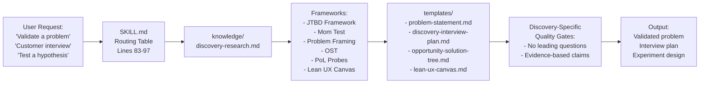
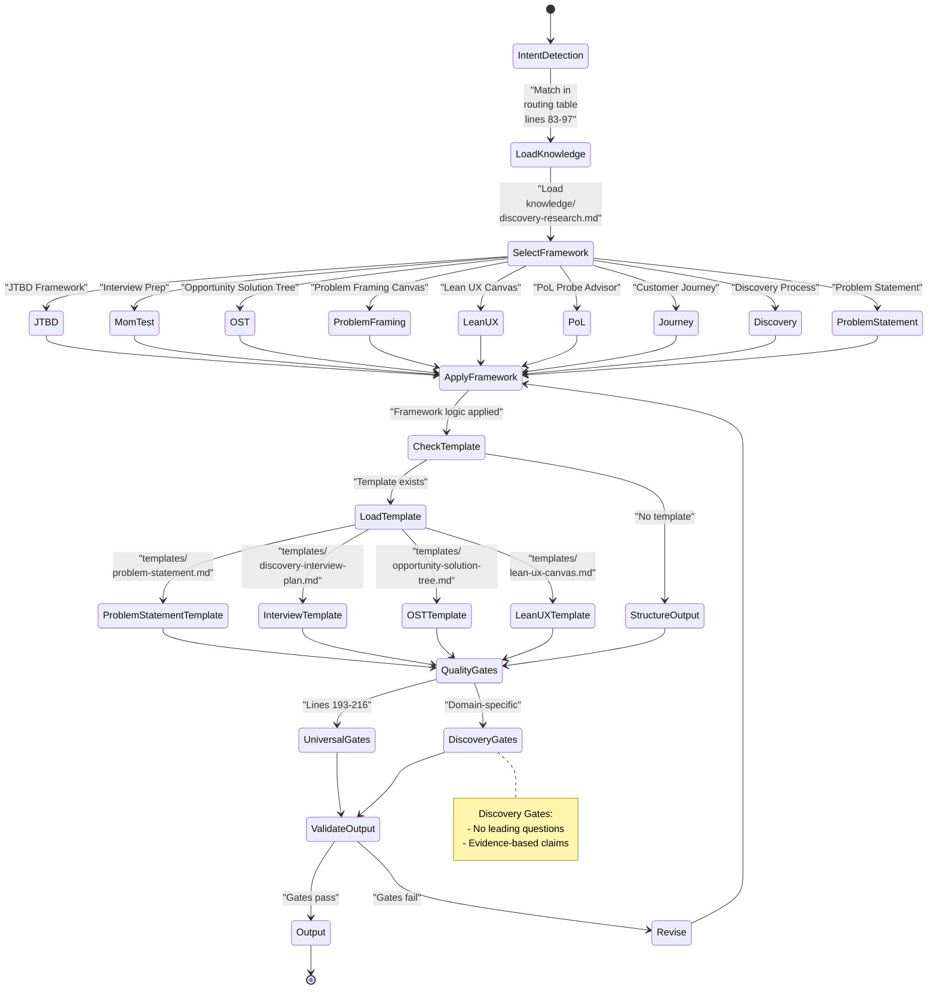
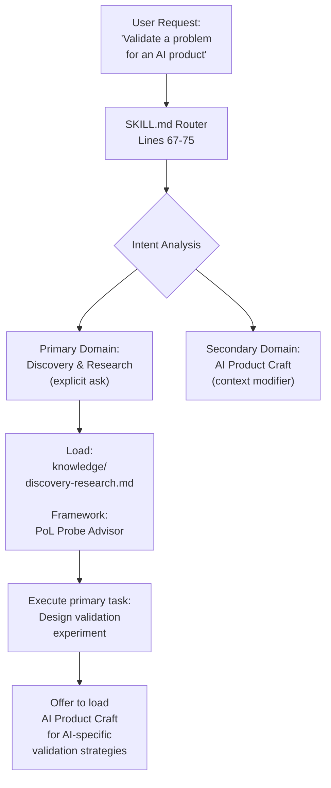
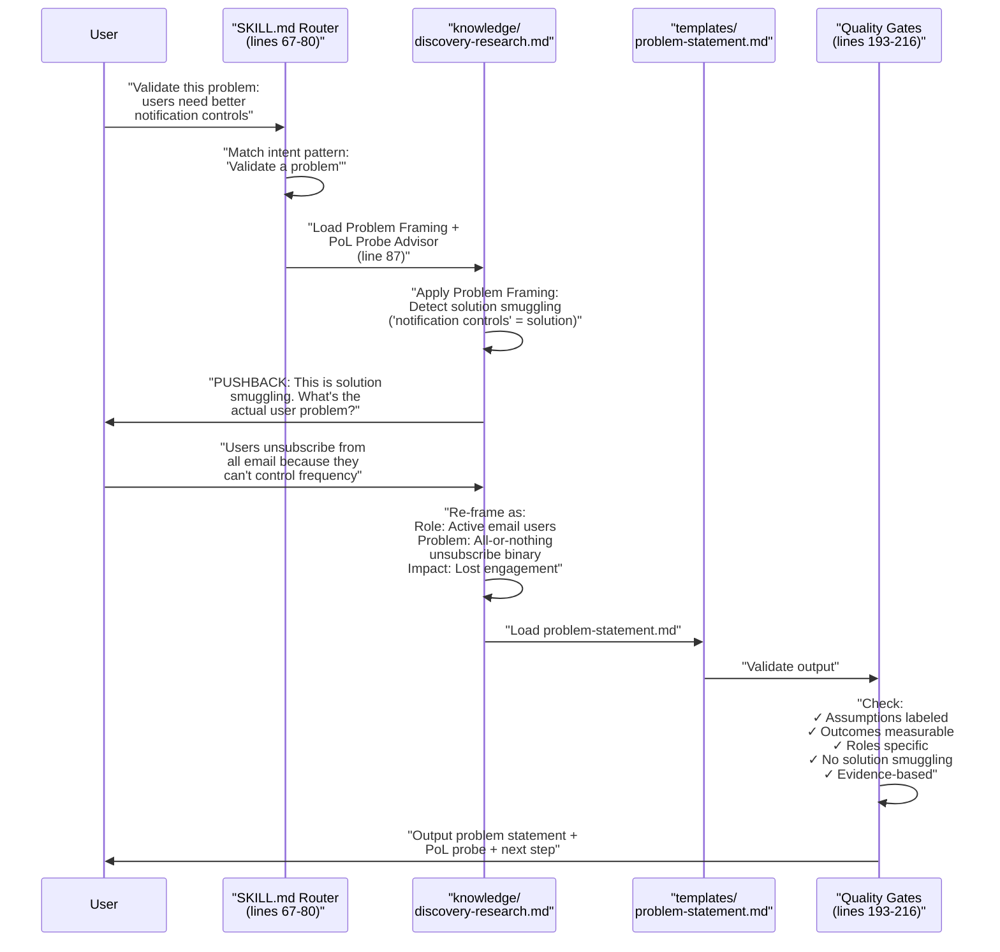

<!-- source: DeepWiki mcp.deepwiki.com · repo Digidai/product-manager-skills · page 4.1 Discovery & Research · fetched 2026-10-26 -->

# Discovery & Research

<details>
<summary>Relevant source files</summary>

The following files were used as context for generating this wiki page:

- [README.md](README.md)
- [SKILL.md](SKILL.md)

</details>


## Purpose and Scope

The Discovery & Research domain provides frameworks and workflows for validating product problems before building solutions. This domain handles user requests related to problem framing, customer interviews, hypothesis testing, opportunity mapping, and experimental validation.

For information about positioning validated problems in the market, see [Strategy & Positioning](#4.2). For creating artifacts based on validated problems (PRDs, user stories), see [Artifacts & Delivery](#4.3). For the overall domain architecture and routing system, see [Knowledge Domains](#4).

Sources: [SKILL.md:83-97](), [README.md:120]()

---

## Domain Position in the System

Discovery & Research is one of six knowledge domains in the Product Manager Skills system. It sits at the beginning of the product development workflow, handling validation before strategy or delivery.



**Execution Flow**: When a user request matches discovery intent patterns (e.g., "validate a problem", "run customer interviews"), the router at [SKILL.md:83-97]() loads `knowledge/discovery-research.md`. The system selects the appropriate framework, applies optional templates from `templates/`, validates against discovery-specific quality gates, and produces output with decisions, assumptions, and next steps.

Sources: [SKILL.md:1-216](), [README.md:118-125]()

---

## Routing Table: Intent to Framework Mapping

The routing table at [SKILL.md:83-97]() maps natural language intent patterns to specific frameworks in the Discovery & Research domain. All routes load `knowledge/discovery-research.md` but target different frameworks within that file.

| User Intent Pattern | Framework Loaded | Knowledge File |
|---|---|---|
| "Validate a problem" / "test a hypothesis" | Problem Framing + PoL Probe Advisor | `knowledge/discovery-research.md` |
| "Customer interview" / "discovery interview" | Interview Prep | `knowledge/discovery-research.md` |
| "Map the customer journey" | Customer Journey > Journey Map / Journey Mapping Workshop | `knowledge/discovery-research.md` |
| "Opportunity mapping" / "solution tree" | Opportunity Solution Tree | `knowledge/discovery-research.md` |
| "Jobs to be done" / "JTBD" / "customer needs" | JTBD Framework | `knowledge/discovery-research.md` |
| "Frame the problem" / "problem canvas" | Problem Framing Canvas (MITRE) | `knowledge/discovery-research.md` |
| "Write a problem statement" | Problem Statement | `knowledge/discovery-research.md` |
| "Lean canvas" / "validate assumptions" | Lean UX Canvas | `knowledge/discovery-research.md` |
| "Run a discovery cycle" / "discovery sprint" | Discovery Process | `knowledge/discovery-research.md` |
| "PoL probe" / "proof of life" / "validation experiment" | PoL Probe Advisor | `knowledge/discovery-research.md` |
| "A/B test" / "experiment design" / "test plan" | PoL Probe Advisor | `knowledge/discovery-research.md` |

**Routing Logic**: The router uses substring matching on user intent. Multiple intent patterns (e.g., "PoL probe", "validation experiment", "A/B test") can map to the same framework (PoL Probe Advisor). The explicit user ask determines which framework section is loaded from the knowledge file.

Sources: [SKILL.md:83-97](), [SKILL.md:66-69]()

---

## Framework Execution Workflow



**Workflow Steps**:

1. **Intent Detection** ([SKILL.md:67]()):  Router matches user request against routing table patterns
2. **Load Knowledge** ([SKILL.md:68]()): System loads `knowledge/discovery-research.md` 
3. **Select Framework** ([SKILL.md:69]()): Within loaded module, find framework section matching the routing table's "Framework" column
4. **Apply Framework**: Execute framework-specific logic and decision rules
5. **Template Loading** ([SKILL.md:71]()): If producing deliverable artifact, load matching template from `templates/` directory
6. **Quality Gates** ([SKILL.md:72]()): Apply universal gates (lines 193-216) plus domain-specific gates
7. **Output** ([SKILL.md:57-59]()): Deliver with decisions made, assumptions to validate, and recommended next step

Sources: [SKILL.md:63-74](), [SKILL.md:168-186]()

---

## Core Frameworks

### JTBD Framework

**Intent Pattern**: "Jobs to be done" / "JTBD" / "customer needs"

**Purpose**: Frames customer needs as jobs the customer is trying to accomplish, separate from current solution approaches. Prevents solution smuggling by focusing on outcomes rather than features.

**Framework Name in Code**: `JTBD Framework` (referenced in routing table at [SKILL.md:91]())

**Related Anti-Pattern Detection**: Flags "Solution Smuggling" when problem statements embed specific solutions ([SKILL.md:215]())

---

### Mom Test / Interview Prep

**Intent Pattern**: "Customer interview" / "discovery interview"

**Purpose**: Prepares structured customer interviews using Mom Test principles: ask about past behavior, not future intent; avoid leading questions; focus on specific examples.

**Framework Name in Code**: `Interview Prep` (referenced in routing table at [SKILL.md:88]())

**Template Integration**: Loads `templates/discovery-interview-plan.md` when producing interview guides ([SKILL.md:180]())

**Domain-Specific Quality Gate**: Enforces "No leading questions" rule - flags questions designed to confirm existing beliefs rather than uncover truth ([SKILL.md:209](), anti-pattern: "Confirmation Bias in Discovery")

---

### Opportunity Solution Tree (OST)

**Intent Pattern**: "Opportunity mapping" / "solution tree"

**Purpose**: Maps desired outcomes to opportunities (user problems) to potential solutions. Visualizes the problem space before committing to specific solutions.

**Framework Name in Code**: `Opportunity Solution Tree` (referenced in routing table at [SKILL.md:90]())

**Template Integration**: Loads `templates/opportunity-solution-tree.md` for structured tree visualization ([SKILL.md:181]())

---

### Problem Framing Canvas

**Intent Pattern**: "Frame the problem" / "problem canvas"

**Purpose**: Structures problem definition using MITRE's Problem Framing Canvas methodology. Separates problem from solution, identifies stakeholders, and defines success criteria.

**Framework Name in Code**: `Problem Framing Canvas (MITRE)` (referenced in routing table at [SKILL.md:92]())

**Combined Usage**: Often paired with PoL Probe Advisor for validation experiments ([SKILL.md:87]())

---

### Lean UX Canvas

**Intent Pattern**: "Lean canvas" / "validate assumptions"

**Purpose**: Structures hypothesis-driven product development. Identifies business problem, target users, outcomes, hypotheses, and experiments to run.

**Framework Name in Code**: `Lean UX Canvas` (referenced in routing table at [SKILL.md:94]())

**Template Integration**: Loads `templates/lean-ux-canvas.md` for canvas structure ([SKILL.md:186]())

**Quality Gate Integration**: Every outcome must be measurable with quantified success criteria ([SKILL.md:199]())

---

### PoL Probe Advisor

**Intent Pattern**: "PoL probe" / "proof of life" / "validation experiment" / "A/B test" / "experiment design"

**Purpose**: Designs low-cost validation experiments to test hypotheses before building full solutions. "Proof of Life" probes validate whether a problem exists and whether customers care.

**Framework Name in Code**: `PoL Probe Advisor` (referenced in routing table at [SKILL.md:96-97]())

**Combined Usage**: Paired with Problem Framing for hypothesis testing ([SKILL.md:87]())

**Related Anti-Pattern Detection**: Flags "Premature Scaling" - optimizing before validating core assumptions ([SKILL.md:213]())

---

### Customer Journey Mapping

**Intent Pattern**: "Map the customer journey"

**Purpose**: Visualizes customer experience across touchpoints, identifying pain points and opportunities for intervention.

**Framework Name in Code**: `Customer Journey > Journey Map / Journey Mapping Workshop` (referenced in routing table at [SKILL.md:89]())

**Hierarchical Loading**: The `>` syntax indicates loading a sub-section within the Customer Journey section of `knowledge/discovery-research.md`

---

### Discovery Process

**Intent Pattern**: "Run a discovery cycle" / "discovery sprint"

**Purpose**: Structures end-to-end discovery workflow from problem identification through validation experiments to decision-making.

**Framework Name in Code**: `Discovery Process` (referenced in routing table at [SKILL.md:95]())

**Multi-Framework Integration**: Discovery Process typically orchestrates multiple frameworks (JTBD, interviews, PoL probes) in sequence

---

### Problem Statement

**Intent Pattern**: "Write a problem statement"

**Purpose**: Creates empathetic, specific problem statements that avoid solution smuggling and establish clear validation criteria.

**Framework Name in Code**: `Problem Statement` (referenced in routing table at [SKILL.md:93]())

**Template Integration**: Loads `templates/problem-statement.md` ([SKILL.md:176]())

**Universal Quality Gate**: Must specify roles with context and motivation, not generic personas ([SKILL.md:201-202]())

Sources: [SKILL.md:83-97](), [SKILL.md:168-186](), [README.md:120]()

---

## Template Integration

Discovery & Research integrates four core templates from the `templates/` directory. Templates provide scaffolding; frameworks provide substance.

| Template File | Referenced At | Use When | Framework Integration |
|---|---|---|---|
| `templates/problem-statement.md` | [SKILL.md:176]() | Writing empathetic problem statements | Problem Statement framework |
| `templates/discovery-interview-plan.md` | [SKILL.md:180]() | Preparing customer interviews | Interview Prep framework |
| `templates/opportunity-solution-tree.md` | [SKILL.md:181]() | Mapping outcomes to opportunities to solutions | Opportunity Solution Tree framework |
| `templates/lean-ux-canvas.md` | [SKILL.md:186]() | Structuring hypotheses and experiments | Lean UX Canvas framework |

**Template Loading Logic** ([SKILL.md:71]()):
1. Framework execution produces content and structure
2. If producing deliverable artifact, system checks Template Index ([SKILL.md:168-186]())
3. If template exists, loads from `templates/` directory
4. Template provides structure; framework-driven content fills template
5. If no template exists, framework logic structures output directly

**Not Generic Placeholders**: Templates are not pre-filled with generic text. The system populates them with user-specific content based on framework application ([SKILL.md:22-23]()).

Sources: [SKILL.md:168-186](), [SKILL.md:71]()

---

## Quality Gates

Discovery & Research outputs pass through two quality gate tiers: universal gates (apply to all domains) and discovery-specific gates.

### Universal Quality Gates

All Discovery & Research outputs must pass five universal gates defined at [SKILL.md:193-216]():

| Gate | Requirement | Example Violation | Example Pass |
|---|---|---|---|
| **Assumptions Labeled** ([SKILL.md:195-196]()) | Mark guesses with `[assumption]` inline | "Users want email notifications" | "Users want email notifications `[assumption - validate in interviews]`" |
| **Outcomes Measurable** ([SKILL.md:198-199]()) | Every outcome needs number, direction, timeframe | "Improve the experience" | "Reduce time-to-first-value from 14 days to 3 days within Q2" |
| **Roles Specific** ([SKILL.md:201-202]()) | Name role, context, motivation - not generic personas | "Users need better dashboards" | "Mid-market ops managers running 3 product lines with no analytics support need..." |
| **Tradeoffs Named** ([SKILL.md:204-205]()) | Every recommendation must name what's traded off | "Recommend Option A" | "Recommend Option A (faster validation, lower confidence) over Option B (comprehensive study, 6-week delay)" |
| **Anti-Patterns Flagged** ([SKILL.md:207-216]()) | Detect and call out PM failure modes | Accepting "we need a dashboard" | Flagging "Solution Smuggling: problem statement embeds solution" |

### Discovery-Specific Quality Gates

Additional gates specific to Discovery & Research (referenced in Diagram 4 of high-level architecture):

| Gate | Purpose | Enforced By |
|---|---|---|
| **No Leading Questions** | Interview questions must not suggest desired answers or confirm existing beliefs | Mom Test framework, Interview Prep validation |
| **Evidence-Based Claims** | Problem statements must cite specific user evidence, not assumptions presented as facts | Problem Framing framework validation |

**Anti-Patterns Detected in Discovery** ([SKILL.md:207-216]()):

- **Confirmation Bias in Discovery** ([SKILL.md:212]()): Asking questions designed to confirm existing beliefs rather than uncover truth
- **Solution Smuggling** ([SKILL.md:215]()): Problem statements that embed a specific solution (e.g., "We need a dashboard" vs. "Managers can't see team velocity")
- **Feature Factory** ([SKILL.md:210]()): Shipping features without validating the underlying problem
- **Premature Scaling** ([SKILL.md:213]()): Running growth experiments before validating core problem-solution fit

Sources: [SKILL.md:189-216](), High-level architecture Diagram 4

---

## Multi-Domain Request Handling

Discovery & Research frequently pairs with other domains. When user intent spans multiple domains, the routing system applies multi-domain logic defined at [SKILL.md:75]().



**Multi-Domain Routing Rules** ([SKILL.md:75-76]()):

1. **Explicit ask determines primary domain**: "Roadmap for an AI product" → primary is Strategy (roadmap), secondary is AI Product Craft
2. **Load primary domain first**: Execute primary framework and produce output
3. **Mention secondary domain**: Note the cross-domain context
4. **Offer to load secondary after completion**: User can request deeper dive into secondary domain

**Common Discovery Pairings**:
- Discovery + AI Product Craft: Validating AI product hypotheses
- Discovery + Strategy: Problem validation before market positioning
- Discovery + Artifacts: Validated problems inform PRD development

Sources: [SKILL.md:75-76](), [SKILL.md:161-164]()

---

## Interaction Protocol Application

Discovery & Research workflows use the interaction protocol defined at [SKILL.md:28-60]() to adapt to request complexity.

### Protocol Decision Tree for Discovery Requests

| Request Type | Protocol Mode | Example | Rationale |
|---|---|---|---|
| Simple problem statement | **Direct Output** | "Write a problem statement for slow onboarding" | Clear request, reasonable assumptions possible |
| Interview prep with context | **Best Guess** | "Prep interviews for mid-market ops managers" | Some context missing (specific problems to explore), but draft possible with labeled assumptions |
| Full discovery cycle | **Guided Mode** | "Run a discovery sprint" | Complex, multi-step process requiring sequential decisions |
| Problem validation with all data | **Context Dump** | User pastes problem description, user quotes, usage data | All needed context provided, skip redundant questions |

**Activation-First Default** ([SKILL.md:32]()):  On first response, the system prefers producing a useful draft over asking mode selection questions. If a reasonable first version is possible with labeled assumptions, it outputs that immediately.

**Guided Mode Mechanics** ([SKILL.md:36-52]()):
- One question per turn, wait for answer
- Show progress: `Context Q3/7` or `Assessment Q2/4`
- Numbered options at decision points (accept `1`, `2 and 4`, `1,3`, or custom text)
- User can interrupt, pause, or pivot topics mid-flow

**Output Format** ([SKILL.md:56-59]()): Every Discovery & Research output ends with:
- Decisions made (bullet list)
- Assumptions to validate (if any)
- Recommended next step

Sources: [SKILL.md:28-60]()

---

## Common Discovery Workflows

### Workflow 1: Problem Validation

**User Intent**: "Validate a problem" / "test a hypothesis"

**Routing**: [SKILL.md:87]() → Problem Framing + PoL Probe Advisor

**Execution Sequence**:
1. Load `knowledge/discovery-research.md`
2. Apply Problem Framing framework to structure the problem
3. Apply PoL Probe Advisor to design validation experiment
4. Load `templates/problem-statement.md` if producing problem statement artifact
5. Validate against quality gates (no solution smuggling, measurable outcomes, evidence-based claims)
6. Output decisions + assumptions + next step

**Example Output Structure**:
- **Problem Statement**: Specific role + context + pain point (no solution embedded)
- **Evidence**: Cited user data or `[assumption - validate via X]` markers
- **PoL Probe**: Low-cost experiment to validate problem existence
- **Success Criteria**: Measurable outcomes (e.g., "3/5 target users confirm pain point in interviews")
- **Decisions**: Which hypothesis to test first
- **Assumptions**: What's inferred vs. known
- **Next Step**: Concrete action (e.g., "Schedule 5 customer interviews by Friday")

---

### Workflow 2: Customer Interview Preparation

**User Intent**: "Customer interview" / "discovery interview"

**Routing**: [SKILL.md:88]() → Interview Prep

**Execution Sequence**:
1. Load `knowledge/discovery-research.md` → Interview Prep section
2. Apply Mom Test principles (no leading questions, past behavior not future intent, specific examples)
3. Load `templates/discovery-interview-plan.md`
4. Populate template with non-leading questions
5. Validate against discovery quality gates (no confirmation bias)
6. Output interview plan + decisions + next step

**Quality Gate Application**:
- Flags leading questions: "Would you use a dashboard?" → "Tell me about the last time you needed to see team performance"
- Enforces specificity: "How do you feel about the product?" → "Walk me through the last time you tried to accomplish X"

---

### Workflow 3: Opportunity Mapping

**User Intent**: "Opportunity mapping" / "solution tree"

**Routing**: [SKILL.md:90]() → Opportunity Solution Tree

**Execution Sequence**:
1. Load `knowledge/discovery-research.md` → Opportunity Solution Tree section
2. Structure tree: Outcome → Opportunities (problems) → Solutions
3. Load `templates/opportunity-solution-tree.md`
4. Validate opportunities are problem-focused, not solution-focused
5. Ensure multiple solution options per opportunity
6. Output tree + decisions + next step

**Anti-Pattern Detection**: Flags if "opportunities" are actually solutions (e.g., "Build a dashboard" is a solution, not an opportunity)

---

### Workflow 4: Hypothesis-Driven Development

**User Intent**: "Lean canvas" / "validate assumptions"

**Routing**: [SKILL.md:94]() → Lean UX Canvas

**Execution Sequence**:
1. Load `knowledge/discovery-research.md` → Lean UX Canvas section
2. Structure business problem, target users, outcomes, hypotheses
3. Load `templates/lean-ux-canvas.md`
4. Design experiments to test hypotheses (integrates PoL Probe Advisor)
5. Ensure outcomes are measurable (universal quality gate)
6. Output canvas + experiment plan + next step

**Integration with PoL Probes**: Canvas hypotheses feed directly into PoL Probe design for validation experiments

Sources: [SKILL.md:83-97](), [SKILL.md:168-186](), [README.md:25-29]()

---

## Example: Discovery Request Execution

### Input Request
```text
Validate this problem: users need better notification controls
```

### System Execution Trace



### Output Example

**Problem Statement**:
Active email users who engage with product updates face an all-or-nothing unsubscribe binary. When a single email type becomes too frequent, they unsubscribe from all product communication, losing visibility into critical updates.

**Evidence**: `[assumption - validate in user interviews]` 15% unsubscribe rate correlates with email frequency increases

**PoL Probe**: Send 50 recently-unsubscribed users a survey: "Would you re-subscribe if you could control email types and frequency?" Track re-subscription rate. Success = 20%+ re-subscribe.

**Decisions Made**:
- Re-framed solution ("notification controls") as user problem (all-or-nothing binary)
- Defined specific role (active email users) not generic "users"
- Designed low-cost PoL probe before building solution

**Assumptions to Validate**:
- `[assumption]` Unsubscribe rate correlates with frequency (validate via data analysis)
- `[assumption]` Users would re-engage with granular controls (validate via PoL probe)

**Recommended Next Step**: Run data analysis on unsubscribe events vs. email frequency this week. Then launch PoL probe to 50 users if correlation confirmed.

Sources: [SKILL.md:87](), [SKILL.md:215](), [SKILL.md:56-59]()

---

## Integration with Other Domains

Discovery & Research outputs frequently become inputs to other knowledge domains:

| Discovery Output | Feeds Into | Domain | Workflow Example |
|---|---|---|---|
| Validated problem statement | Positioning statement | [Strategy & Positioning](#4.2) | Problem → Geoffrey Moore positioning |
| Customer interview insights | PRD development | [Artifacts & Delivery](#4.3) | Validated pain points → PRD problem section |
| PoL probe results | Business case | [Finance & Metrics](#4.4) | Validation data → feature ROI analysis |
| Opportunity Solution Tree | Roadmap planning | [Strategy & Positioning](#4.2) | Opportunities → prioritization → roadmap |
| Lean UX Canvas | AI validation strategy | [AI Product Craft](#4.6) | Hypothesis → AI-specific validation experiments |

**Cross-Domain Routing**: When a request spans domains (e.g., "Write a PRD for a validated problem"), the routing system loads Discovery & Research for problem validation first, then offers to load Artifacts & Delivery for PRD development ([SKILL.md:75-76]()).

Sources: [SKILL.md:75-76](), [README.md:118-125]()

---

## System Comparison: Discovery vs. Generic Prompting

The Discovery & Research domain demonstrates the system's architectural advantages over generic AI prompting.

| Generic AI Prompting | Discovery & Research Domain |
|---|---|
| Accepts "users need better notifications" as valid problem framing | Flags solution smuggling, asks for actual user problem ([SKILL.md:215]()) |
| Suggests generic interview questions: "How do you feel about...?" | Applies Mom Test: asks about past behavior, specific examples, avoids leading questions |
| Produces generic problem statements with placeholder personas | Enforces specific roles with context ([SKILL.md:201-202]()): "mid-market ops managers running 3 product lines" |
| Recommends "validate with users" without specifics | Designs concrete PoL probes with success criteria (e.g., "3/5 users confirm pain point") |
| No framework application | Routes to JTBD, OST, Lean UX Canvas based on intent ([SKILL.md:83-97]()) |
| Accepts bad framing | Active pushback when anti-patterns detected ([SKILL.md:207-216]()) |

**Architectural Difference**: Generic prompting produces plausible text. Discovery & Research loads framework logic from `knowledge/discovery-research.md`, applies domain-specific quality gates, and actively detects anti-patterns like confirmation bias and solution smuggling.

Sources: [SKILL.md:83-97](), [SKILL.md:189-216](), [README.md:129-135]()

---

## Files and Components

### Core Files
- [SKILL.md:1-216]() - Main orchestrator, routing table at lines 83-97
- `knowledge/discovery-research.md` - Framework logic and domain knowledge (not provided in source files but referenced extensively)

### Templates
- `templates/problem-statement.md` - Problem statement structure ([SKILL.md:176]())
- `templates/discovery-interview-plan.md` - Interview guide template ([SKILL.md:180]())
- `templates/opportunity-solution-tree.md` - OST visualization template ([SKILL.md:181]())
- `templates/lean-ux-canvas.md` - Hypothesis canvas template ([SKILL.md:186]())

### Quality Gates
- Universal gates: [SKILL.md:193-216]()
- Discovery-specific gates: Referenced in high-level architecture Diagram 4
- Anti-pattern detection: [SKILL.md:207-216]()

### Integration Points
- Routing system: [SKILL.md:79-97]()
- Template loading: [SKILL.md:168-186]()
- Multi-domain handling: [SKILL.md:75-76]()
- Interaction protocol: [SKILL.md:28-60]()
- Output format: [SKILL.md:56-59]()

Sources: [SKILL.md:1-216](), [README.md:1-211]()

---

