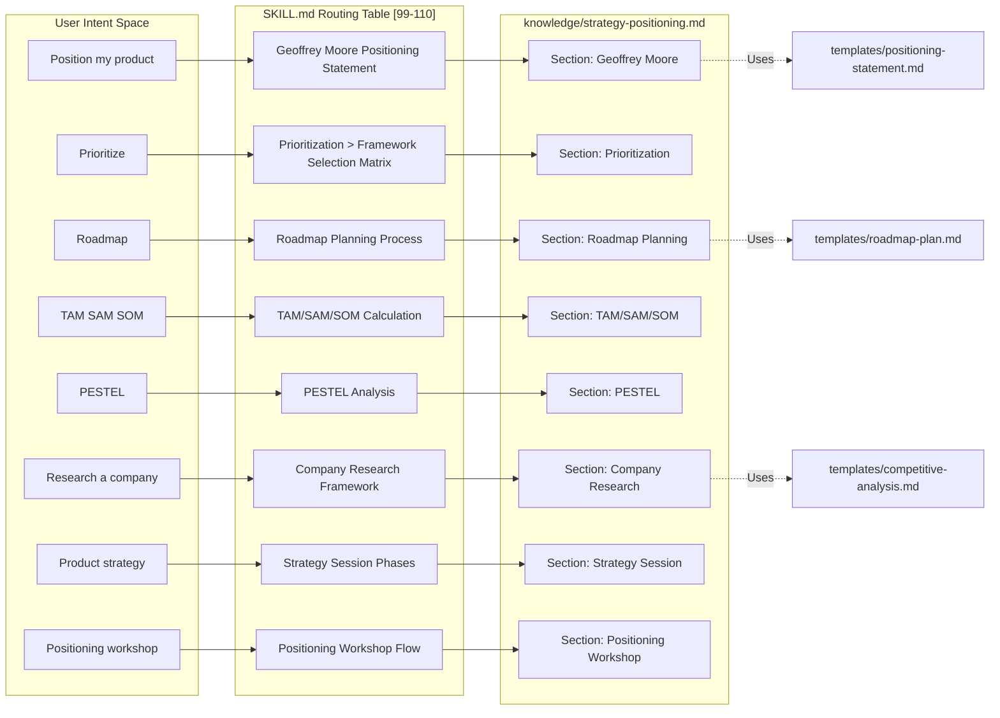
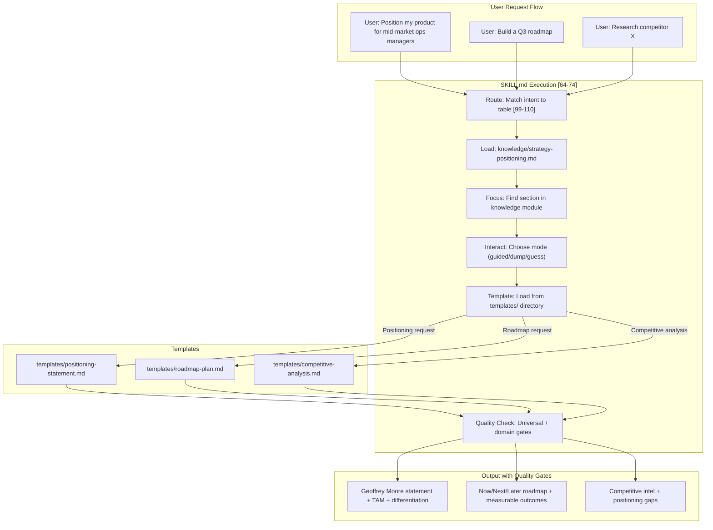
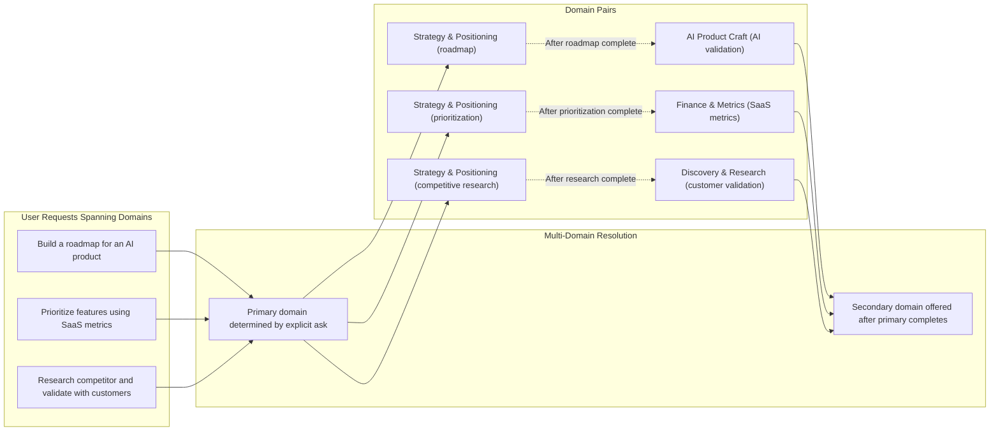

<!-- source: DeepWiki mcp.deepwiki.com · repo Digidai/product-manager-skills · page 4.2 Strategy & Positioning · fetched 2026-10-26 -->

# Strategy & Positioning

<details>
<summary>Relevant source files</summary>

The following files were used as context for generating this wiki page:

- [README.md](README.md)
- [SKILL.md](SKILL.md)

</details>


## Purpose and Scope

The Strategy & Positioning domain provides frameworks and templates for market positioning, prioritization, roadmap planning, competitive analysis, and market sizing. This knowledge module is loaded when user requests match strategic planning intents, as defined in the routing table at [SKILL.md:99-110]().

This domain focuses on **pre-delivery strategy work**: defining market position, choosing what to build, planning releases, and sizing opportunities. For problem validation and customer discovery, see [Discovery & Research](#4.1). For execution artifacts like PRDs and user stories, see [Artifacts & Delivery](#4.3).

**Sources:** [SKILL.md:99-110](), [README.md:119-125]()

---

## Domain Architecture

The Strategy & Positioning domain operates as one of six knowledge modules in the SKILL.md routing system. When a user request matches strategic intent phrases, the system loads `knowledge/strategy-positioning.md` and applies the matched framework.

### Routing Table Entry Points



**Routing Table Mapping**

| User Intent | Framework | Load Command | Line Reference |
|-------------|-----------|--------------|----------------|
| "Position my product" / "positioning statement" | Geoffrey Moore Positioning Statement | `knowledge/strategy-positioning.md` | [SKILL.md:103]() |
| "Positioning workshop" / "find our position" | Positioning Workshop Flow | `knowledge/strategy-positioning.md` | [SKILL.md:104]() |
| "Product strategy" / "strategy session" / "GTM strategy" | Strategy Session Phases | `knowledge/strategy-positioning.md` | [SKILL.md:105]() |
| "Research a company" / "competitive intel" / "competitive analysis" | Company Research Framework | `knowledge/strategy-positioning.md` | [SKILL.md:106]() |
| "PESTEL" / "macro environment" / "external factors" | PESTEL Analysis | `knowledge/strategy-positioning.md` | [SKILL.md:107]() |
| "Prioritize" / "prioritization framework" / "what to build next" | Prioritization > Framework Selection Matrix | `knowledge/strategy-positioning.md` | [SKILL.md:108]() |
| "Roadmap" / "roadmap planning" / "release plan" | Roadmap Planning Process | `knowledge/strategy-positioning.md` | [SKILL.md:109]() |
| "TAM SAM SOM" / "market size" / "addressable market" | TAM/SAM/SOM Calculation | `knowledge/strategy-positioning.md` | [SKILL.md:110]() |

**Sources:** [SKILL.md:99-110](), [SKILL.md:67-73]()

---

## Framework Coverage

The Strategy & Positioning domain includes eight primary framework categories. Each framework has specific decision logic, formulas, and quality gates defined in `knowledge/strategy-positioning.md`.

### 1. Geoffrey Moore Positioning Statement

Structures product positioning using Moore's canonical format: "For [target customer] who [statement of need], the [product name] is a [product category] that [key benefit]. Unlike [primary competitive alternative], our product [primary differentiation]."

**Used for:** Market positioning, competitive differentiation, messaging alignment.

**Template integration:** Loads [templates/positioning-statement.md:1-end]() for structured output.

### 2. Prioritization Framework Selection Matrix

Decision matrix for choosing the right prioritization framework based on context:
- **RICE** (Reach, Impact, Confidence, Effort) for data-driven teams with quantitative inputs
- **ICE** (Impact, Confidence, Ease) for rapid scoring when reach data is unavailable
- **Kano Model** for balancing delighters, performance features, and must-haves
- **Value vs. Effort** for simple 2x2 prioritization
- **Weighted Scoring** for stakeholder-heavy environments requiring explicit criteria

**Used for:** Choosing what to build next, evaluating feature requests, roadmap sequencing.

### 3. Roadmap Planning Process

Structures roadmaps using Now/Next/Later horizons with clear outcomes and success metrics per item.

**Used for:** Release planning, stakeholder communication, quarterly planning cycles.

**Template integration:** Loads [templates/roadmap-plan.md:1-end]() for structured roadmap output.

### 4. TAM/SAM/SOM Calculation

Market sizing methodology:
- **TAM (Total Addressable Market):** Total market demand for the category
- **SAM (Serviceable Addressable Market):** Segment reachable with current GTM
- **SOM (Serviceable Obtainable Market):** Realistic capture in timeframe

**Used for:** Investor pitches, market validation, strategic planning, resource allocation decisions.

### 5. PESTEL Analysis

Macro-environmental analysis framework covering:
- **Political:** Regulations, government stability, trade policies
- **Economic:** Growth rates, inflation, employment
- **Social:** Demographics, cultural trends, lifestyle changes
- **Technological:** Innovation rate, automation, infrastructure
- **Environmental:** Sustainability requirements, climate impact
- **Legal:** Employment law, consumer protection, IP protection

**Used for:** Strategic planning, risk assessment, long-term product strategy.

### 6. Company Research Framework

Structured competitive intelligence gathering covering:
- Product positioning and messaging
- Pricing and packaging
- Target customer segments
- Key features and gaps
- GTM strategy and channels
- Funding and growth trajectory

**Template integration:** Loads [templates/competitive-analysis.md:1-end]() for structured competitive analysis.

### 7. Strategy Session Phases

Multi-phase process for product strategy development:
1. **Context:** Market trends, customer needs, competitive landscape
2. **Diagnosis:** Key bottlenecks and opportunities
3. **Guiding Policy:** Strategic choices and tradeoffs
4. **Coherent Actions:** Specific initiatives with measurable outcomes

**Used for:** Quarterly strategy reviews, pivot decisions, new product strategy.

### 8. Positioning Workshop Flow

Facilitated workshop structure for collaborative positioning development:
1. Customer problem identification
2. Competitive alternative mapping
3. Key differentiator brainstorming
4. Positioning statement drafting
5. Validation against real customer language

**Used for:** Cross-functional alignment, repositioning efforts, new product launches.

**Sources:** [SKILL.md:99-110](), [README.md:119-125]()

---

## Template Integration Architecture

The Strategy & Positioning domain integrates with three primary templates from the `templates/` directory. The system loads these when producing deliverable artifacts.



**Template Loading Logic**

When `SKILL.md` reaches step 5 (Template) in the execution workflow [SKILL.md:71](), it checks the Template Index [SKILL.md:168-186]() for matching templates:

| Request Type | Knowledge Section | Template Path | Template Index Reference |
|--------------|-------------------|---------------|-------------------------|
| Positioning statement | Geoffrey Moore | `templates/positioning-statement.md` | [SKILL.md:177]() |
| Roadmap planning | Roadmap Planning Process | `templates/roadmap-plan.md` | [SKILL.md:182]() |
| Competitive analysis | Company Research Framework | `templates/competitive-analysis.md` | [SKILL.md:184]() |

If no template exists, the system structures output using the framework defined in `knowledge/strategy-positioning.md` [SKILL.md:71]().

**Sources:** [SKILL.md:64-74](), [SKILL.md:168-186]()

---

## Quality Gates

The Strategy & Positioning domain applies both universal quality gates [SKILL.md:189-216]() and domain-specific gates defined in `knowledge/strategy-positioning.md`.

### Universal Gates Applied

All outputs from this domain must pass:

1. **Assumptions Labeled** [SKILL.md:195-196](): Market size estimates, competitive assumptions, and addressable segment definitions must be marked with `[assumption]` inline when inferred.

2. **Outcomes Measurable** [SKILL.md:198-199](): Roadmap items must include quantified success metrics. "Improve market position" is rejected; "Capture 15% of mid-market segment (estimated 2,000 companies) by Q4" passes.

3. **Roles Specific** [SKILL.md:201-202](): Positioning statements must name specific personas. "Enterprise users" is rejected; "Mid-market ops managers running 3+ product lines with no dedicated analytics support" passes.

4. **Tradeoffs Named** [SKILL.md:204-205](): Prioritization recommendations must state what is being deprioritized and why. "Build Feature A (faster revenue, defers technical debt cleanup)" passes.

5. **Anti-Patterns Flagged** [SKILL.md:207-216](): The system detects and calls out:
   - **Stakeholder-Driven Roadmap:** Roadmap shaped by loudest voice, not evidence
   - **Feature Factory:** Prioritization without problem validation
   - **Premature Scaling:** Market expansion before unit economics work

### Domain-Specific Quality Gates

Outputs from `knowledge/strategy-positioning.md` must additionally pass:

**TAM/SAM/SOM Calculations:**
- Calculation methodology shown (top-down vs. bottom-up)
- Assumptions about segment size labeled explicitly
- Timeframe specified for SOM estimate

**Positioning Statements:**
- Competitive alternative explicitly named (not generic "other tools")
- Differentiation maps to measurable customer outcome
- Target customer segment validated with real personas

**Roadmap Plans:**
- Each Now/Next/Later item has quantified success metric
- Items vertically sliced by user value, not technical layer
- Guardrail metrics defined to detect negative side effects

**Prioritization:**
- Framework choice justified based on context
- Scoring inputs documented with sources
- De-prioritized items named with explicit tradeoff

**Competitive Analysis:**
- Claims backed by specific evidence (not generic impressions)
- Pricing comparison includes packaging and feature tiers
- Positioning gaps identified with opportunity sizing

**Sources:** [SKILL.md:189-216]()

---

## Usage Patterns

The Strategy & Positioning domain supports recurring PM workflows. Most users reuse these patterns weekly or quarterly.

### Weekly Roadmap Review

**Prompt pattern:**
```text
Review my roadmap. Flag where stakeholder requests are outweighing evidence, and where items lack measurable outcomes.
```

**Execution flow:**
1. Routes to Roadmap Planning Process [SKILL.md:109]()
2. Loads `knowledge/strategy-positioning.md`
3. Applies roadmap quality gates (measurable outcomes, vertical slicing)
4. Flags Stakeholder-Driven Roadmap anti-pattern [SKILL.md:211]()
5. Returns specific line-by-line critique with recommendations

**Expected output format:**
- Decisions: Which items to keep/remove/reframe
- Assumptions: Market readiness, customer demand estimates
- Next step: Validate specific roadmap item with customer interviews

### Quarterly Prioritization

**Prompt pattern:**
```text
Help me prioritize these 8 feature requests. We have quantitative data on reach and impact but fuzzy effort estimates.
```

**Execution flow:**
1. Routes to Prioritization > Framework Selection Matrix [SKILL.md:108]()
2. Recommends RICE (has reach/impact data, can estimate effort ranges)
3. Applies framework with user's data
4. Names tradeoffs explicitly (feature X deprioritized due to low reach)
5. Returns ranked list with scoring breakdown

### Positioning Workshop

**Prompt pattern:**
```text
Run a positioning workshop for our new observability product targeting mid-market DevOps teams.
```

**Execution flow:**
1. Routes to Positioning Workshop Flow [SKILL.md:104]()
2. Enters guided mode (one question at a time) [SKILL.md:36-37]()
3. Walks through 5-phase workshop structure
4. Loads `templates/positioning-statement.md` [SKILL.md:177]()
5. Returns Geoffrey Moore positioning statement with competitive differentiation

**Guided mode progress indicators:**
```text
Context Q1/5: What customer problem are you solving?
Context Q2/5: What do customers use today as an alternative?
Context Q3/5: What is your key differentiator?
...
```

### Competitive Intelligence

**Prompt pattern:**
```text
Research Company X. Focus on pricing, positioning, and target customer segments.
```

**Execution flow:**
1. Routes to Company Research Framework [SKILL.md:106]()
2. Loads `templates/competitive-analysis.md` [SKILL.md:184]()
3. Structures research across 6 categories (positioning, pricing, features, GTM, funding, gaps)
4. Applies domain gate: claims must have evidence sources
5. Returns structured competitive analysis with positioning gap opportunities

**Sources:** [SKILL.md:99-110](), [SKILL.md:28-53](), [README.md:159-165]()

---

## Multi-Domain Integration

Strategy & Positioning requests often span multiple knowledge domains. The routing system handles these using the multi-domain protocol [SKILL.md:75-76]().

### Cross-Domain Routing Examples



**Multi-Domain Handling Logic:**

1. **"Roadmap for an AI product"**
   - Primary: Strategy & Positioning (explicit ask = roadmap) [SKILL.md:109]()
   - Secondary: AI Product Craft (context modifier = AI product) [SKILL.md:156]()
   - Execution: Load `knowledge/strategy-positioning.md` → produce roadmap → offer to validate AI-specific risks

2. **"Prioritize features using SaaS metrics"**
   - Primary: Strategy & Positioning (explicit ask = prioritize) [SKILL.md:108]()
   - Secondary: Finance & Metrics (context modifier = SaaS metrics) [SKILL.md:132-140]()
   - Execution: Load prioritization framework → apply RICE/ICE → reference SaaS metrics for impact scoring

3. **"Research competitor and validate with customers"**
   - Primary: Strategy & Positioning (first action = research) [SKILL.md:106]()
   - Secondary: Discovery & Research (second action = customer validation) [SKILL.md:87-88]()
   - Execution: Complete competitive analysis → offer to design discovery interview plan

**Resolution rule:** The explicit verb determines primary domain. Load primary first, complete that task, then mention secondary and offer to load it [SKILL.md:75-76]().

**Sources:** [SKILL.md:75-76](), [SKILL.md:99-160]()

---

## File Structure Reference

The Strategy & Positioning domain spans three directories in the repository:

```text
knowledge/
  strategy-positioning.md          # Core frameworks and decision logic

templates/
  positioning-statement.md         # Geoffrey Moore positioning format
  roadmap-plan.md                  # Now/Next/Later roadmap structure
  competitive-analysis.md          # Structured competitive research

examples/
  (No Strategy & Positioning examples currently included)
```

**Knowledge module:** [knowledge/strategy-positioning.md:1-end]() contains:
- Framework definitions and decision logic
- Domain-specific quality gates
- Formulas for TAM/SAM/SOM calculations
- Prioritization framework selection criteria

**Templates:** [templates/positioning-statement.md:1-end](), [templates/roadmap-plan.md:1-end](), [templates/competitive-analysis.md:1-end]() provide structured output formats that the system populates with framework-driven content [SKILL.md:170-171]().

**Routing integration:** [SKILL.md:99-110]() maps user intents to frameworks in the knowledge module.

**Sources:** [SKILL.md:168-186](), [README.md:176-187]()

---

## Comparison to Generic AI Prompting

The Strategy & Positioning domain demonstrates the architectural differences between this system and generic prompting:

| Generic AI Prompting | Strategy & Positioning Domain |
|---------------------|-------------------------------|
| "Here are 5 prioritization frameworks to consider" | Applies Framework Selection Matrix to choose RICE vs. ICE vs. Kano based on user's data availability |
| "Your TAM is large, good opportunity" | Calculates TAM/SAM/SOM with explicit methodology, labels assumptions, flags if SOM estimate is unrealistic given GTM constraints |
| Accepts "improve market position" as roadmap goal | Rejects vague outcomes, requires quantified metric like "Capture 15% of mid-market segment by Q4" |
| Produces Geoffrey Moore statement with generic placeholders | Populates positioning statement with specific competitive alternative, measurable differentiation, validated persona |
| Generates roadmap from stakeholder requests | Flags Stakeholder-Driven Roadmap anti-pattern, requires evidence for each item |

**Architectural enabler:** The routing system [SKILL.md:79-165]() loads domain-specific frameworks and quality gates [SKILL.md:189-216]() that enforce rigor, not just plausibility.

**Sources:** [SKILL.md:79-165](), [SKILL.md:189-216](), [README.md:127-135]()

---

