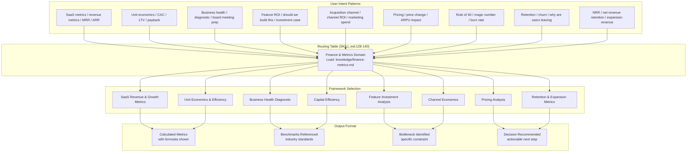
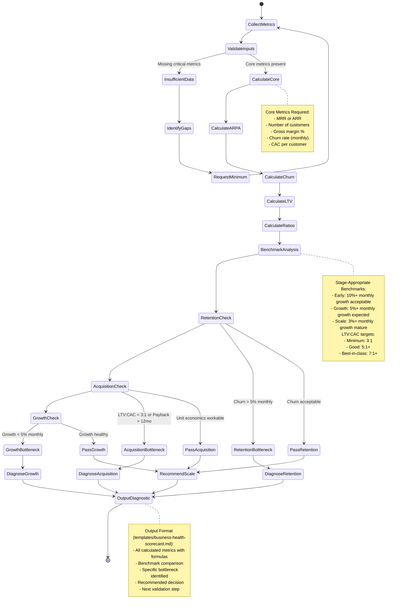
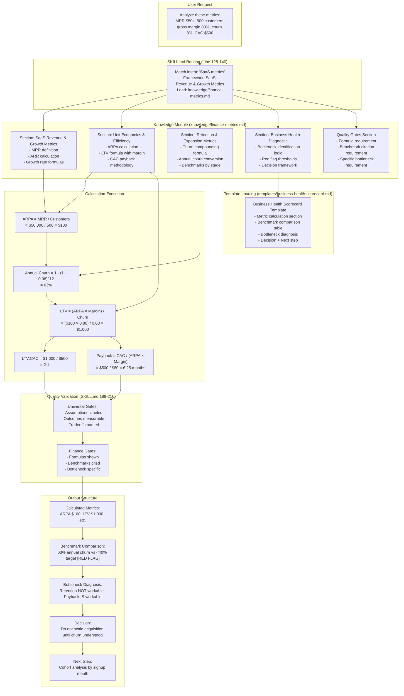

<!-- source: DeepWiki mcp.deepwiki.com · repo Digidai/product-manager-skills · page 4.4 Finance & Metrics · fetched 2026-10-26 -->

# Finance & Metrics

<details>
<summary>Relevant source files</summary>

The following files were used as context for generating this wiki page:

- [README.md](README.md)
- [SKILL.md](SKILL.md)

</details>


This document covers the Finance & Metrics knowledge domain, which provides frameworks for calculating SaaS business metrics, analyzing unit economics, diagnosing business health, and evaluating feature investments. This domain transforms raw business data (MRR, churn, CAC) into actionable diagnostic output with specific bottlenecks identified and decisions recommended.

For artifact creation workflows (PRDs, user stories), see [Artifacts & Delivery](#4.3). For strategic market analysis and prioritization, see [Strategy & Positioning](#4.2).

## Domain Purpose

The Finance & Metrics domain enables product managers to:

- Calculate 32+ SaaS metrics with formulas and industry benchmarks
- Diagnose business health by identifying specific growth bottlenecks
- Evaluate feature ROI and channel economics
- Analyze pricing changes and unit economics shifts
- Make data-driven decisions about scaling acquisition vs. fixing retention

This domain is loaded when user intent matches patterns in the routing table [SKILL.md:128-140](). The system applies specific frameworks from `knowledge/finance-metrics.md` and enforces domain-specific quality gates that require formulas, benchmarks, and specific bottleneck identification.

**Sources:** [SKILL.md:128-140](), [README.md:118-125]()

## Routing Architecture



**Sources:** [SKILL.md:128-140](), [SKILL.md:79-165]()

## Metrics Categories

The Finance & Metrics domain organizes metrics into eight categories, each with specific formulas and benchmarks:

| Category | Key Metrics | Primary Use Case |
|----------|-------------|------------------|
| **Revenue & Growth** | MRR, ARR, New MRR, Expansion MRR, Contraction MRR | Track revenue composition and growth rate |
| **Retention & Expansion** | Churn Rate (Gross/Net), NRR, GRR, ARPA Expansion | Identify retention vs. expansion bottlenecks |
| **Unit Economics** | CAC, LTV, LTV:CAC Ratio, Payback Period | Evaluate customer acquisition efficiency |
| **Capital Efficiency** | Rule of 40, Magic Number, Burn Multiple, Months of Runway | Assess growth/profitability balance |
| **Engagement** | DAU, MAU, WAU, Stickiness (DAU/MAU), Feature Adoption | Measure product usage patterns |
| **Conversion** | Lead-to-Customer Rate, Trial-to-Paid Rate, Time-to-Value | Optimize conversion funnels |
| **Channel Economics** | Channel-specific CAC, Channel LTV:CAC, Channel Payback | Compare acquisition channel efficiency |
| **Pricing** | ARPU, ARPA, Price Elasticity, Expansion Revenue % | Analyze pricing strategy impact |

Each category includes:
- Formula definition with variables explained
- Calculation methodology with edge cases handled
- Industry benchmarks by company stage and segment
- Common misinterpretations flagged
- Diagnostic guidance for interpreting results

**Sources:** [README.md:123](), [SKILL.md:128-140]()

## Calculation Engine Workflow

```mermaid
graph LR
    subgraph "Input Processing"
        IN["Raw Metrics<br/>MRR, Customers,<br/>CAC, Churn, Margin"]
    end
    
    subgraph "Metric Calculation (knowledge/finance-metrics.md)"
        C1["Calculate ARPA<br/>MRR / Customers"]
        C2["Calculate Annual Churn<br/>1 - (1 - monthly)^12"]
        C3["Calculate LTV<br/>ARPA × Margin / Churn"]
        C4["Calculate Ratios<br/>LTV:CAC, Payback"]
        C5["Compare Benchmarks<br/>industry standards"]
    end
    
    subgraph "Business Health Diagnostic"
        D1["Identify Bottleneck<br/>Retention? Acquisition?"]
        D2["Flag Red Flags<br/>compound effects"]
        D3["Recommend Decision<br/>scale/fix/investigate"]
    end
    
    subgraph "Quality Gates"
        Q1["Formulas Included<br/>show calculation"]
        Q2["Benchmarks Referenced<br/>cite standards"]
        Q3["Specific Bottleneck<br/>not generic advice"]
    end
    
    subgraph "Output (templates/business-health-scorecard.md)"
        OUT["Scorecard:<br/>- Calculated metrics<br/>- Benchmark comparison<br/>- Bottleneck diagnosis<br/>- Decision + Next step"]
    end
    
    IN --> C1
    C1 --> C2
    C2 --> C3
    C3 --> C4
    C4 --> C5
    
    C5 --> D1
    D1 --> D2
    D2 --> D3
    
    D3 --> Q1
    Q1 --> Q2
    Q2 --> Q3
    
    Q3 --> OUT
```



**Calculation Sequence:**

1. **ARPA Calculation**: MRR ÷ Number of Customers = Average Revenue Per Account
2. **Annual Churn Conversion**: 1 - (1 - monthly_churn_rate)^12 = Annual Churn Rate
3. **LTV Calculation**: (ARPA × Gross Margin %) ÷ Churn Rate = Customer Lifetime Value
4. **Efficiency Ratios**: LTV ÷ CAC, CAC ÷ (ARPA × Gross Margin %) = Payback Period
5. **Benchmark Comparison**: Compare calculated values against stage-appropriate industry standards
6. **Bottleneck Identification**: Determine which metric is the primary constraint on growth

**Sources:** [README.md:62-75](), [SKILL.md:128-140]()

## Business Health Diagnostic Process

The Business Health Diagnostic is the most frequently used workflow in this domain. It systematically analyzes SaaS metrics to identify growth bottlenecks.

### Diagnostic State Machine



**Sources:** [README.md:62-75](), [SKILL.md:128-140]()

### Example Diagnostic Flow

**Input:**
```
MRR: $50,000
Customers: 500
Gross Margin: 80%
Monthly Churn: 8%
CAC: $500
```

**Calculation Steps:**

1. **ARPA**: $50,000 ÷ 500 = $100/month
2. **Annual Churn**: 1 - (1 - 0.08)^12 = 63% annually
3. **LTV**: ($100 × 80%) ÷ 8% = $1,000
4. **LTV:CAC**: $1,000 ÷ $500 = 2:1
5. **Payback Period**: $500 ÷ ($100 × 80%) = 6.25 months

**Diagnostic Output:**

| Metric | Value | Benchmark | Status |
|--------|-------|-----------|--------|
| Monthly Churn | 8% | <5% target | ❌ RED FLAG |
| Annual Churn | 63% | <40% target | ❌ RED FLAG |
| LTV:CAC | 2:1 | 3:1 minimum | ⚠️ Below target |
| Payback Period | 6.25 months | <12 months | ✅ Workable |

**Bottleneck Identified:** Retention failure. 63% annual churn means the business is losing nearly two-thirds of its customer base each year.

**Decision:** Do not scale acquisition until churn is understood cohort-by-cohort. Current unit economics (2:1 LTV:CAC) would be 5:1+ with healthy retention.

**Next Step:** Cohort analysis by signup month, feature usage, and customer segment to identify churn drivers.

**Sources:** [README.md:62-75](), [examples/saas-health-diagnostic.md]()

## Domain-Specific Quality Gates

The Finance & Metrics domain enforces specialized quality gates beyond the universal gates [SKILL.md:189-216]():

### Finance Gates

| Gate | Requirement | Example Violation | Correct Implementation |
|------|-------------|-------------------|------------------------|
| **Formulas Included** | Show calculation methodology, not just final numbers | "LTV is $1,000" | "LTV = ($100 ARPA × 80% margin) ÷ 8% churn = $1,000" |
| **Benchmarks Referenced** | Cite industry standards or stage-appropriate targets | "Churn is high" | "8% monthly churn = 63% annual, vs. <40% target for SaaS" |
| **Compound Effects Shown** | Demonstrate non-linear impacts, especially for churn | "8% monthly churn is bad" | "8% monthly compounds to 63% annually [RED FLAG]" |
| **Specific Bottleneck Named** | Identify the constraint, not list all metrics | "Improve all metrics" | "Retention is NOT workable. Payback IS workable. Fix retention first." |
| **Units Explicit** | Never assume time units; state monthly vs. annual | "5% churn" | "5% monthly churn (46% annually)" |

### Anti-Pattern Detection

The system actively flags these finance-specific anti-patterns:

**1. Metrics Theater**
- **Definition:** Tracking metrics that look impressive but drive no decisions
- **Example:** "We have 100 metrics dashboards" but can't answer "Should we scale acquisition?"
- **Detection:** Output mentions many metrics but provides no diagnostic conclusion

**2. Vanity Metrics**
- **Definition:** Reporting absolute numbers without context or growth rate
- **Example:** "We have 10,000 users!" (no retention, engagement, or revenue data)
- **Detection:** User requests metric celebration without trend analysis or efficiency ratios

**3. Premature Scaling**
- **Definition:** Increasing acquisition spend before unit economics are validated
- **Example:** "Let's 10x marketing budget" when LTV:CAC is 1.5:1
- **Detection:** Scaling recommendation when payback >12 months or LTV:CAC <3:1

**Sources:** [SKILL.md:189-216](), [SKILL.md:207-215]()

## Framework-to-Code Mapping



**Sources:** [SKILL.md:66-74](), [SKILL.md:128-140](), [SKILL.md:189-216]()

## Template Integration

The Finance & Metrics domain uses `templates/business-health-scorecard.md` as its primary artifact template.

### Template Structure

| Section | Purpose | Populated From |
|---------|---------|----------------|
| **Input Metrics** | Raw data provided by user | User's original request |
| **Core Calculations** | ARPA, Churn, LTV, ratios with formulas shown | `knowledge/finance-metrics.md` calculation methodology |
| **Benchmark Comparison** | Actual vs. target for each metric | `knowledge/finance-metrics.md` benchmark tables |
| **Bottleneck Analysis** | Identify the specific constraint | `knowledge/finance-metrics.md` diagnostic logic |
| **Decisions Made** | Recommended action with tradeoff | Universal output format [SKILL.md:56-59]() |
| **Assumptions to Validate** | What's inferred vs. known | Universal quality gate [SKILL.md:196]() |
| **Next Step** | Concrete next action | Universal output format [SKILL.md:56-59]() |

**Template Loading Logic:**

1. User request routed to Finance & Metrics domain [SKILL.md:128-140]()
2. SKILL.md loads `knowledge/finance-metrics.md` [SKILL.md:68]()
3. If producing diagnostic artifact, also load `templates/business-health-scorecard.md` [SKILL.md:71]()
4. Populate template with calculated values and framework-driven analysis
5. Apply quality gates [SKILL.md:72]()
6. Output structured scorecard [SKILL.md:74]()

**Sources:** [SKILL.md:168-186](), [SKILL.md:66-74]()

## Metrics Formula Reference

### Revenue Metrics

| Metric | Formula | Variables |
|--------|---------|-----------|
| **MRR** | Sum of all recurring monthly revenue | Excludes one-time fees |
| **ARR** | MRR × 12 | Annualized recurring revenue |
| **New MRR** | MRR from new customers this month | Only first-month revenue |
| **Expansion MRR** | Additional MRR from existing customers | Upgrades, add-ons |
| **Contraction MRR** | Lost MRR from downgrades | Excluding full churn |
| **Churned MRR** | Lost MRR from canceled customers | Full account cancellations |
| **Net New MRR** | New + Expansion - Contraction - Churned | Monthly change |

### Unit Economics

| Metric | Formula | Variables |
|--------|---------|-----------|
| **ARPA** | MRR ÷ Number of Customers | Average revenue per account |
| **CAC** | Total S&M Spend ÷ New Customers Acquired | Fully-loaded acquisition cost |
| **Gross Margin %** | (Revenue - COGS) ÷ Revenue | Cost of goods sold % |
| **LTV** | (ARPA × Gross Margin %) ÷ Churn Rate | Customer lifetime value |
| **LTV:CAC Ratio** | LTV ÷ CAC | Efficiency of customer acquisition |
| **Payback Period** | CAC ÷ (ARPA × Gross Margin %) | Months to recover CAC |

### Retention Metrics

| Metric | Formula | Variables |
|--------|---------|-----------|
| **Gross Churn Rate** | Churned MRR ÷ Starting MRR | Monthly percentage |
| **Net Churn Rate** | (Churned MRR - Expansion MRR) ÷ Starting MRR | Can be negative |
| **Logo Churn** | Churned Customers ÷ Starting Customers | Customer count-based |
| **Annual Churn** | 1 - (1 - Monthly Churn Rate)^12 | Compounded annually |
| **GRR (Gross Revenue Retention)** | (Starting MRR - Churned - Contraction) ÷ Starting MRR | Retention without expansion |
| **NRR (Net Revenue Retention)** | (Starting MRR - Churned - Contraction + Expansion) ÷ Starting MRR | Retention with expansion |

### Capital Efficiency

| Metric | Formula | Variables |
|--------|---------|-----------|
| **Rule of 40** | Revenue Growth Rate % + Profit Margin % | Should exceed 40% |
| **Magic Number** | Net New ARR ÷ Prior Quarter S&M Spend | Sales efficiency |
| **Burn Multiple** | Net Burn ÷ Net New ARR | Capital efficiency of growth |
| **Months of Runway** | Cash Balance ÷ Monthly Burn Rate | Time until cash out |

**Sources:** [README.md:123](), [SKILL.md:128-140]()

## Common Usage Patterns

### Pattern 1: Weekly SaaS Health Check

**Frequency:** Weekly (typically Friday)

**Input Format:**
```
Analyze these metrics from this week:
MRR: $X, Customers: Y, Churn: Z%, New MRR: $A, Expansion MRR: $B
```

**Output:** Business Health Scorecard with week-over-week changes, bottleneck identification, and recommended focus area for next week.

**Triggered Route:** `knowledge/finance-metrics.md` → Business Health Diagnostic section

### Pattern 2: Feature ROI Evaluation

**Frequency:** Ad-hoc (before committing to large features)

**Input Format:**
```
Should we build [feature]? Expected impact: [metric] improves by [%]
Current: MRR $X, Churn Y%, [other context]
Investment: [engineering weeks/months]
```

**Output:** ROI calculation showing:
- Expected MRR impact
- Payback period for engineering investment
- Comparison to alternative features or channels
- Decision with named tradeoffs

**Triggered Route:** `knowledge/finance-metrics.md` → Feature Investment Analysis section

### Pattern 3: Pre-Board Meeting Diagnostic

**Frequency:** Monthly or quarterly

**Input Format:**
```
Board meeting prep. Diagnose our SaaS health:
[Full metric dump including MRR, ARR, NRR, CAC, churn, growth rate, etc.]
```

**Output:** Comprehensive scorecard formatted for board presentation with:
- All key metrics calculated
- Benchmark comparisons
- Trend analysis (if historical data provided)
- Top 3 priorities identified
- Risks flagged with mitigation recommendations

**Triggered Route:** `knowledge/finance-metrics.md` → Business Health Diagnostic section + `templates/business-health-scorecard.md`

**Sources:** [README.md:159-165](), [STARTER-PROMPTS.md]()

## Integration with Other Domains

The Finance & Metrics domain frequently combines with other knowledge domains for multi-faceted analysis:

### Cross-Domain Routing Examples

| Primary Domain | Secondary Domain | Example Request | Routing Logic |
|----------------|------------------|-----------------|---------------|
| Finance & Metrics | Strategy & Positioning | "Diagnose SaaS health and recommend roadmap priorities" | Finance primary, then offer Strategy after metrics diagnosis |
| Finance & Metrics | Artifacts & Delivery | "Evaluate ROI for this PRD feature" | Finance calculates ROI, Artifacts reviews PRD structure |
| Strategy & Positioning | Finance & Metrics | "Size the market and calculate unit economics" | Strategy for TAM/SAM/SOM, Finance for LTV/CAC |
| Discovery & Research | Finance & Metrics | "Validate this problem and estimate revenue impact" | Discovery for problem validation, Finance for revenue modeling |

**Multi-Domain Handling:** When a request spans two domains, the explicit ask determines the primary domain [SKILL.md:76](). Load primary first, complete that task, then offer to load secondary for follow-up analysis.

**Sources:** [SKILL.md:76](), [SKILL.md:161-164]()

## Error Handling and Edge Cases

### Insufficient Data

**Scenario:** User provides partial metrics (e.g., MRR but no churn rate)

**Handling:**
1. Calculate metrics that are possible with available data
2. Flag which calculations require missing inputs
3. Show example calculation with assumed values labeled `[assumption]`
4. Request only the minimum additional data needed

**Example Output:**
```
With MRR $50k and 500 customers, ARPA is $100.

Cannot calculate LTV without churn rate. If churn were 5% monthly [assumption],
LTV would be approximately $1,600 at 80% margin.

To complete the diagnostic, provide: churn rate (monthly preferred).
```

### Ambiguous Time Units

**Scenario:** User says "5% churn" without specifying monthly or annual

**Handling:**
1. Ask clarifying question: "Is that 5% monthly or annual churn?"
2. If user doesn't clarify, assume monthly (more common in SaaS) and label assumption
3. Show both monthly and annual churn in output to surface any misunderstanding

**Example Output:**
```
Assuming 5% monthly churn [assumption based on SaaS convention].
This compounds to 46% annual churn.

If you meant 5% annual churn, please clarify and I'll recalculate.
```

### Benchmark Unavailability

**Scenario:** Metric lacks established industry benchmark

**Handling:**
1. Calculate the metric with formula shown
2. State explicitly that no standard benchmark exists
3. Provide context-based reasoning (e.g., trend over time, comparison to similar companies)
4. Avoid fabricating benchmarks

**Sources:** [SKILL.md:196](), [SKILL.md:14-19]()

## Output Format Standards

Every Finance & Metrics output must include [SKILL.md:56-59]():

### Required Components

1. **Calculated Metrics with Formulas**
   - Show calculation methodology, not just final number
   - Example: `LTV = ($100 ARPA × 80% margin) / 8% churn = $1,000`

2. **Benchmark Comparison**
   - Cite industry standards or stage-appropriate targets
   - Example: `8% monthly churn = 63% annually [RED FLAG vs. <40% target]`

3. **Bottleneck Identification**
   - Name the specific constraint, not generic advice
   - Example: `Retention NOT workable. Payback IS workable. Fix retention first.`

4. **Decisions Made**
   - Concrete recommendation with tradeoff named
   - Example: `Decision: Do not scale acquisition until churn understood. Tradeoff: Slower top-line growth in Q1.`

5. **Assumptions to Validate**
   - List what's inferred vs. known
   - Example: `[assumption] Churn is evenly distributed across segments. Validate with cohort analysis.`

6. **Recommended Next Step**
   - Actionable next step, not summary
   - Example: `Next step: Cohort analysis by signup month and feature usage to identify churn drivers.`

**Sources:** [SKILL.md:56-59](), [SKILL.md:189-216]()

## Domain-Specific Vocabulary

| Term | Definition | Context |
|------|------------|---------|
| **ARPA** | Average Revenue Per Account | Per-customer revenue metric |
| **ARPU** | Average Revenue Per User | Per-user revenue metric (ARPA if 1 user = 1 account) |
| **NRR** | Net Revenue Retention | Retention rate including expansion revenue |
| **GRR** | Gross Revenue Retention | Retention rate excluding expansion revenue |
| **Magic Number** | Net New ARR ÷ Prior Quarter S&M Spend | Sales efficiency metric |
| **Rule of 40** | Growth Rate % + Profit Margin % | Should exceed 40% for healthy SaaS |
| **Burn Multiple** | Net Burn ÷ Net New ARR | Capital efficiency of growth |
| **Payback Period** | Months to recover CAC from gross margin | CAC ÷ (ARPA × Gross Margin %) |
| **Logo Churn** | Customer count-based churn | Distinct from revenue-based churn |
| **Expansion MRR** | Additional revenue from existing customers | Upgrades, add-ons, seat expansion |

For full terminology reference, see [Terminology](#9.2).

**Sources:** [SKILL.md:128-140](), [README.md:123]()

---

