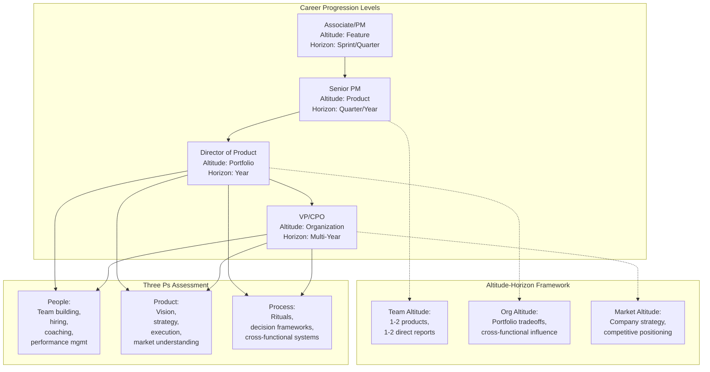
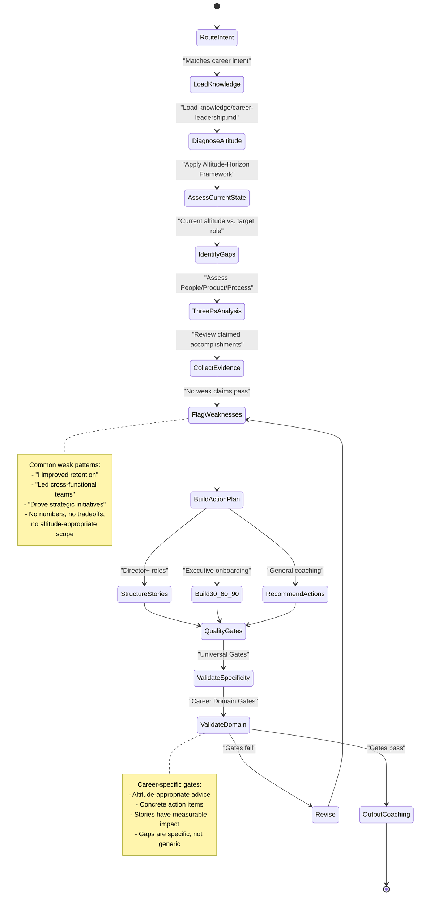
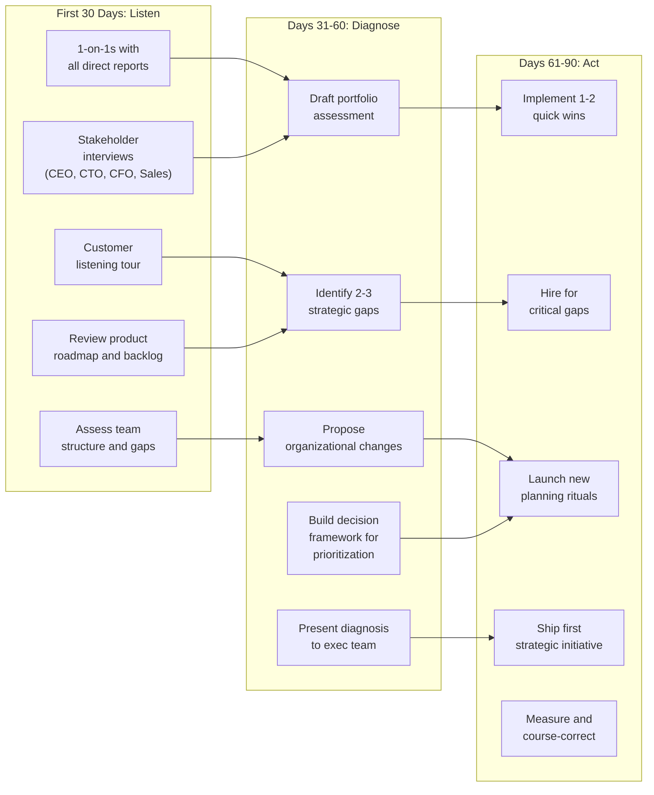

<!-- source: DeepWiki mcp.deepwiki.com · repo Digidai/product-manager-skills · page 4.5 Career & Leadership · fetched 2026-10-26 -->

# Career & Leadership

<details>
<summary>Relevant source files</summary>

The following files were used as context for generating this wiki page:

- [README.md](README.md)
- [SKILL.md](SKILL.md)

</details>


This document describes the Career & Leadership knowledge domain, which provides frameworks for coaching product managers through role transitions, diagnosing readiness gaps, and developing leadership capabilities. This domain covers individual contributor (IC) to Director transitions, Director to VP/CPO progressions, executive onboarding, and career trajectory planning using altitude-based assessment frameworks.

For frameworks about building and delivering product artifacts, see [Artifacts & Delivery](#4.3). For organizational strategy and positioning work, see [Strategy & Positioning](#4.2).

---

## Purpose and Scope

The Career & Leadership domain enables AI coding tools to function as a career coach for product managers. Unlike generic career advice that optimizes for encouragement, this domain applies specific PM career frameworks that:

- Diagnose readiness gaps using the **Altitude-Horizon Framework** to assess operating level versus role requirements
- Structure career transitions using the **Three Ps Model** (People, Product, Process) to identify capability gaps
- Prepare interview narratives with concrete examples of organizational influence and portfolio management
- Build **30-60-90 day plans** for executive onboarding with measurable outcomes
- Provide pushback on weak interview stories, vague leadership claims, and altitude mismatches

The domain is optimized for PMs preparing for specific transitions (Senior PM → Director, Director → VP) rather than general career exploration.

**Sources:** [SKILL.md:143-151](), [README.md:124-125]()

---

## Knowledge Module Structure

The Career & Leadership domain is stored in `knowledge/career-leadership.md` and loaded when user intent matches career-related patterns in the routing table.

### Routing Table Mappings

The following user intents route to this domain:

| User Intent Pattern | Framework Applied | Context |
|---|---|---|
| `"PM to Director"` / `"director transition"` / `"altitude horizon"` | Altitude-Horizon Framework | Diagnosing IC vs. Director operating differences |
| `"Director interview"` / `"director readiness"` / `"preparing for Director"` | PM to Director Transition | Interview preparation, gap analysis, story framing |
| `"VP"` / `"CPO"` / `"executive transition"` | Director to VP/CPO Transition | Portfolio management, org-level impact, strategic influence |
| `"New role"` / `"first 90 days"` / `"onboarding as VP"` / `"onboarding as CPO"` | Executive Onboarding (30-60-90) | Structured onboarding with measurable deliverables |
| `"Career advice"` / `"next step in my career"` | Altitude-Horizon + Readiness Coaching | General career trajectory assessment |

**Sources:** [SKILL.md:143-151]()

---

## Career Progression Framework Architecture

The domain organizes PM career development around two core concepts:

1. **Altitude** — The scope at which a PM operates (feature, product, portfolio, org)
2. **Horizon** — The time horizon a PM influences (sprint, quarter, year, multi-year)



**Diagram: Career Progression and Assessment Frameworks**

The progression model distinguishes between altitude (scope of responsibility) and horizon (time scale of impact). The Three Ps model assesses capabilities across People, Product, and Process dimensions. Director-level roles require all three; VP-level roles require mastery at organizational scale.

**Sources:** [SKILL.md:143-151](), [README.md:124-125]()

---

## Execution Workflow for Career Coaching

When a user requests career coaching, the system follows this workflow:



**Diagram: Career Coaching Execution Workflow**

The workflow diagnoses current operating altitude, compares it to target role requirements, assesses gaps across People/Product/Process dimensions, and produces altitude-appropriate coaching with concrete action items. The system actively flags weak interview stories and vague leadership claims.

**Sources:** [SKILL.md:63-74](), [SKILL.md:143-151]()

---

## Altitude-Horizon Framework Application

The Altitude-Horizon Framework is the core diagnostic tool for assessing PM career readiness. It maps a PM's current operating level against role requirements.

### Altitude Levels

| Altitude Level | Scope | Key Responsibilities | Horizon |
|---|---|---|---|
| **Feature Altitude** | Individual features or small components | Execute well-defined work, write clear specs, collaborate with 1-2 engineers | Sprint to Quarter |
| **Product Altitude** | Single product or product area | Own product vision, set roadmap priorities, manage stakeholder tradeoffs | Quarter to Year |
| **Team Altitude** | Small portfolio (2-4 products), managing 1-2 PMs | Balance portfolio, coach direct reports, influence adjacent teams | Year |
| **Org Altitude** | Cross-functional portfolio, 5-10+ product managers | Set portfolio strategy, resource allocation, organizational process design | Year to Multi-Year |
| **Market Altitude** | Company strategy, competitive positioning | Define company product direction, market positioning, executive leadership | Multi-Year |

**Common Mismatches Detected:**

1. **Senior PM operating at feature altitude** — Strong execution skills but no product-level vision or roadmap ownership
2. **Director candidate with no org altitude evidence** — Can describe team wins but not cross-functional influence or portfolio tradeoffs
3. **VP candidate with product altitude only** — Deep product expertise but no organizational systems or market-level strategy

**Sources:** [SKILL.md:143-151](), [README.md:99-114]()

---

## Three Ps Model (People, Product, Process)

Director and VP roles require demonstrated capability across all three dimensions:

```mermaid
graph TB
    subgraph "People Dimension"
        HIRE["Hiring:<br/>Define role requirements,<br/>assess candidates,<br/>build diverse teams"]
        COACH["Coaching:<br/>Develop direct reports,<br/>provide growth paths,<br/>manage performance"]
        INFLUENCE["Influence:<br/>Build coalitions,<br/>manage stakeholders,<br/>resolve conflict"]
    end
    
    subgraph "Product Dimension"
        VISION["Vision:<br/>Define multi-year direction,<br/>position in market,<br/>strategic bets"]
        EXECUTION["Execution:<br/>Set priorities,<br/>manage tradeoffs,<br/>deliver outcomes"]
        METRICS["Metrics:<br/>Define success measures,<br/>diagnose health,<br/>course-correct"]
    end
    
    subgraph "Process Dimension"
        RITUALS["Rituals:<br/>Design team ceremonies,<br/>decision frameworks,<br/>communication systems"]
        SYSTEMS["Systems:<br/>Resource allocation,<br/>portfolio planning,<br/>escalation paths"]
        CULTURE["Culture:<br/>Set operating principles,<br/>model behavior,<br/>shape team identity"]
    end
    
    DIRECTOR_ROLE["Director Role"]
    VP_ROLE["VP/CPO Role"]
    
    DIRECTOR_ROLE --> HIRE
    DIRECTOR_ROLE --> COACH
    DIRECTOR_ROLE --> VISION
    DIRECTOR_ROLE --> EXECUTION
    DIRECTOR_ROLE --> RITUALS
    
    VP_ROLE --> HIRE
    VP_ROLE --> COACH
    VP_ROLE --> INFLUENCE
    VP_ROLE --> VISION
    VP_ROLE --> EXECUTION
    VP_ROLE --> METRICS
    VP_ROLE --> RITUALS
    VP_ROLE --> SYSTEMS
    VP_ROLE --> CULTURE
```



**Diagram: Three Ps Model for Director and VP Roles**

Directors must demonstrate competence across all three Ps at team altitude. VPs must demonstrate mastery at organizational altitude, with particular strength in organizational systems and cross-functional influence.

**Sources:** [README.md:124-125]()

---

## Interview Story Structure

For Director+ interviews, the system coaches PMs to structure stories using the **STAR + Impact + Tradeoff** format:

### Standard STAR Format (Insufficient for Director Roles)

- **S**ituation — Context of the problem
- **T**ask — What needed to be done
- **A**ction — What you did
- **R**esult — What happened

### Director-Level Enhancement

The system enforces additional requirements:

1. **Impact must be measurable** — "Improved retention" → "Reduced voluntary churn from 8% to 4% monthly, extending LTV from 12.5 months to 25 months"
2. **Tradeoffs must be named** — "Chose Option A (faster to market, lower quality bar) over Option B (more robust, 6-week delay)"
3. **Altitude must match role** — Feature-level stories don't demonstrate Director readiness
4. **Organizational influence must be concrete** — "Influenced 3 engineering teams" → "Built alignment across iOS, Android, and Backend by creating a shared quarterly planning ritual that surfaced cross-team dependencies 2 sprints earlier"

**Example Weak Story Flagged by System:**

> "I led the migration to a new analytics platform. I worked with engineering and design to deliver the project on time."

**System Pushback:**

```
This story is feature-altitude, not org-altitude. It describes execution 
of a defined project, not strategic decision-making or organizational 
influence. For Director readiness:

- What was the tradeoff? (Cost, technical debt, team capacity, timing)
- What alternatives did you reject and why?
- How did this impact the portfolio, not just one product?
- What organizational process did you change as a result?
```

**Sources:** [README.md:99-114](), [SKILL.md:189-216]()

---

## 30-60-90 Day Executive Onboarding Plans

For executive onboarding (VP, CPO), the system structures plans with three phases:



**Diagram: 30-60-90 Day Executive Onboarding Structure**

The onboarding framework emphasizes listening before diagnosing, and diagnosing before acting. Each phase has measurable deliverables. The system enforces that "quick wins" in days 61-90 must be outcome-based, not activity-based.

**Sources:** [SKILL.md:143-151]()

---

## Domain-Specific Quality Gates

When the Career & Leadership domain is loaded, the following quality gates are applied in addition to universal gates:

### Career Domain Gates

| Gate | Description | Example Violation | Corrected Output |
|---|---|---|---|
| **Altitude-Appropriate Advice** | Coaching must match target role altitude | "Focus on writing better PRDs" (feature-altitude advice for Director candidate) | "Demonstrate portfolio prioritization by showing how you balanced 3 product roadmaps with conflicting timelines" |
| **Concrete Action Items** | Next steps must be specific and measurable | "Improve your leadership presence" | "Collect 3 stories where you influenced teams outside your reporting chain, using STAR + Impact + Tradeoff format" |
| **Stories Have Measurable Impact** | Interview narratives must include quantified outcomes | "I improved team velocity" | "I reduced sprint spillover from 40% to 15% by implementing vertical slicing and explicit WIP limits" |
| **Gaps Are Specific** | Readiness gaps must identify discrete missing capabilities | "You need more leadership experience" | "Gap: No evidence of org-wide process design. Recommend: Launch a cross-functional planning ritual and measure adoption across 3+ teams" |
| **No Generic Encouragement** | Avoid motivational language without tactical guidance | "You're ready for the next level, just be confident!" | "Current altitude: Team. Target altitude: Org. Gap: Portfolio tradeoff stories. Action: Document 2 examples where you said no to stakeholder requests and explain resource allocation rationale" |

**Sources:** [SKILL.md:189-216]()

---

## Integration with Other Domains

Career coaching often requires loading frameworks from other domains:

### Cross-Domain Scenarios

| User Request | Primary Domain | Secondary Domain | Integration Point |
|---|---|---|---|
| "Prepare me for a Director interview at a SaaS company" | Career & Leadership | Finance & Metrics | Load SaaS metrics for business acumen questions |
| "Coach me on positioning my product experience for VP roles" | Career & Leadership | Strategy & Positioning | Load Geoffrey Moore positioning for interview narratives |
| "Help me build a 30-60-90 plan for a new CPO role at a B2B company" | Career & Leadership | Strategy & Positioning | Load TAM/SAM/SOM, PESTEL for market assessment phase |
| "Review my Director interview story about a discovery sprint" | Career & Leadership | Discovery & Research | Validate discovery methodology cited in story |

The routing system loads Career & Leadership as primary and mentions secondary domains, offering to load them after the initial coaching deliverable.

**Sources:** [SKILL.md:63-74](), [SKILL.md:75-76]()

---

## Example Workflow: Director Readiness Coaching

This workflow demonstrates how the system applies the Altitude-Horizon Framework and Three Ps Model to diagnose gaps and structure a coaching plan.

### User Input

```
I'm a senior PM managing two PMs, strong on execution, weak on org 
influence, and interviewing for Director roles in 3 months. Coach me.
```

### System Execution

1. **Route:** Intent matches `"Director interview"` → Load `knowledge/career-leadership.md`
2. **Focus:** Apply Altitude-Horizon Framework + PM to Director Transition
3. **Interact:** Use Best Guess mode with labeled assumptions
4. **Diagnose:**
   - Current altitude: **Team** (managing 2 PMs)
   - Target altitude: **Org** (portfolio management, cross-functional influence)
   - Gap: Weak org altitude, no evidence of portfolio tradeoffs or organizational process design
5. **Apply Three Ps:**
   - **People:** Managing 2 PMs = some capability, but need hiring/performance management evidence
   - **Product:** "Strong on execution" = likely product altitude, not org altitude
   - **Process:** "Weak on org influence" = missing process design and cross-functional systems
6. **Structure Action Plan:** Build 3 interview stories demonstrating org-level impact
7. **Quality Gates:** Check for altitude-appropriate advice, concrete actions, specific gaps

### System Output

```
Diagnosis: Strong team altitude, weak org altitude.

Current State:
- Managing 2 PMs → demonstrates some People capability
- "Strong on execution" → likely means product-level delivery, not portfolio strategy
- Self-diagnosed weak org influence → missing Process and cross-functional alignment

Gap Analysis (Three Ps):
1. People: Need evidence of hiring, performance management, coaching at scale
2. Product: Need portfolio prioritization stories with explicit tradeoffs
3. Process: Need organizational system design (rituals, decision frameworks, escalation paths)

Action Plan (Next 90 Days):
1. Collect 3 org-altitude stories:
   - Portfolio tradeoff: "I said no to Feature X to resource Feature Y because [measurable outcome]"
   - Cross-functional influence: "I built alignment across Engineering, Sales, and Support by [specific ritual/process]"
   - Organizational process: "I changed how we [plan/review/escalate] across 3+ teams"
2. Build a weekly visibility loop:
   - Share portfolio status with stakeholders outside your reporting chain
   - Document decisions and tradeoffs in a format others can reuse
3. Practice decision framing with tradeoffs:
   - Every recommendation must name what you're NOT doing and why

Assumptions to Validate:
- [assumption] You have access to cross-functional work in next 90 days
- [assumption] Your current role allows portfolio-level visibility
- [assumption] You can influence adjacent teams without formal authority

Next Step:
Draft your strongest org-level story using STAR + Impact + Tradeoff format. 
Bring it back for review.
```

**Sources:** [README.md:99-114](), [SKILL.md:56-59]()

---

## Anti-Patterns Detected in Career Coaching

The Career & Leadership domain actively flags these anti-patterns:

### 1. Feature Altitude Stories for Org Altitude Roles

**Example:**
> "I wrote a PRD for our notification system and shipped it in Q3."

**System Pushback:**
```
This is feature-altitude work. For Director roles, interviewers expect 
portfolio-level decisions and organizational influence, not individual 
feature execution.
```

### 2. Vague Leadership Claims

**Example:**
> "I'm a strong leader who drives cross-functional alignment."

**System Pushback:**
```
Generic leadership claim with no evidence. Reframe with:
- Specific cross-functional scenario
- Measurable impact
- What you traded off
```

### 3. Process Theater (Rituals Without Outcomes)

**Example:**
> "I launched weekly stakeholder syncs to improve communication."

**System Pushback:**
```
What decision did the ritual enable? What outcome did it improve? 
"Launched a ritual" is an output. "Reduced planning cycle time from 
6 weeks to 3 weeks by surfacing dependencies earlier" is an outcome.
```

### 4. Confirmation Bias in Self-Assessment

**Example:**
> "I'm ready for VP because I have 8 years of PM experience."

**System Pushback:**
```
Years of experience ≠ altitude progression. Assess using Altitude-Horizon:
- What's the largest scope you've managed? (altitude)
- What's the longest time horizon you've influenced? (horizon)
- Do you have org-altitude evidence across People/Product/Process?
```

**Sources:** [SKILL.md:207-216]()

---

## Templates Used in Career Coaching

The Career & Leadership domain does not use templates from the `templates/` directory. Instead, it applies structured frameworks directly:

| Framework | Structure | Output Format |
|---|---|---|
| **Altitude-Horizon Diagnostic** | Current altitude vs. target altitude, gap analysis | Bullet list with specific gaps |
| **Three Ps Assessment** | People/Product/Process capability matrix | Table with strengths and gaps per dimension |
| **Interview Story Coaching** | STAR + Impact + Tradeoff | Structured narrative with labeled components |
| **30-60-90 Plan** | Listen/Diagnose/Act phases with deliverables | Phased plan with measurable outcomes per phase |

All outputs follow the universal closing format: decisions made, assumptions to validate, recommended next step.

**Sources:** [SKILL.md:168-186](), [SKILL.md:56-59]()

---

## Repeat Usage Patterns

The Career & Leadership domain is optimized for repeat coaching sessions:

### Typical Usage Cadence

| Scenario | Frequency | Example Prompt |
|---|---|---|
| **Interview Preparation** | Weekly, 8-12 weeks before interviews | "Review my latest Director story and flag weak altitude signals" |
| **New Role Onboarding** | First 90 days, weekly check-ins | "I'm in day 45 of my VP onboarding. Critique my portfolio assessment draft" |
| **Career Trajectory Planning** | Quarterly | "I want to transition from Senior PM to Director in 18 months. Diagnose my gaps" |
| **Performance Review Prep** | Twice yearly | "Help me structure my accomplishments for review using altitude-appropriate framing" |

The system maintains context about the user's target role altitude and previously identified gaps, enabling progressive coaching without repeating diagnostic questions.

**Sources:** [README.md:159-165]()

---

## Comparison to Generic Career Advice

| Generic Career Coaching | Career & Leadership Domain |
|---|---|
| "You're ready for the next level" | "Gap: No org-altitude evidence. Need 2-3 portfolio tradeoff stories" |
| "Improve your leadership presence" | "Collect 3 examples of cross-functional influence with measurable outcomes" |
| "Build more strategic thinking" | "Current altitude: Product. Target: Org. Practice framing decisions as portfolio tradeoffs with named constraints" |
| "Focus on people management" | "Three Ps gap: Strong Product, weak Process. Recommend: Design one org-wide ritual and measure adoption" |
| Accepts vague interview stories | Flags feature-altitude stories when org-altitude is required |
| Optimizes for encouragement | Optimizes for concrete capability gaps and tactical next steps |

The domain applies PM-specific career frameworks rather than generic professional development advice. It enforces altitude-appropriate coaching and actively pushes back on weak evidence.

**Sources:** [README.md:127-135]()

---

## File Structure and Code Entities

The Career & Leadership domain consists of:

| File | Purpose | Key Sections |
|---|---|---|
| `knowledge/career-leadership.md` | Core knowledge module | Altitude-Horizon Framework, Three Ps Model, PM to Director Transition, Director to VP/CPO Transition, Executive Onboarding, Interview Story Structures |
| `SKILL.md` | Routing and orchestration | Routing Table (lines 143-151), Quality Gates (lines 189-216) |
| `examples/director-coaching.md` | Reference example | Full Director readiness coaching session |

No templates are used for career coaching. All outputs are structured using frameworks directly from `knowledge/career-leadership.md`.

**Sources:** [SKILL.md:143-151](), [SKILL.md:68](), [README.md:113-114]()

---

## Summary

The Career & Leadership domain provides altitude-based frameworks for coaching PMs through role transitions. It diagnoses readiness using the Altitude-Horizon Framework, assesses capabilities using the Three Ps Model, and structures interview preparation and executive onboarding with measurable deliverables. The domain actively flags feature-altitude stories when org-altitude is required, pushes back on vague leadership claims, and enforces concrete action items over generic encouragement.

**Sources:** [SKILL.md:143-151](), [README.md:124-125](), [README.md:99-114]()

---

