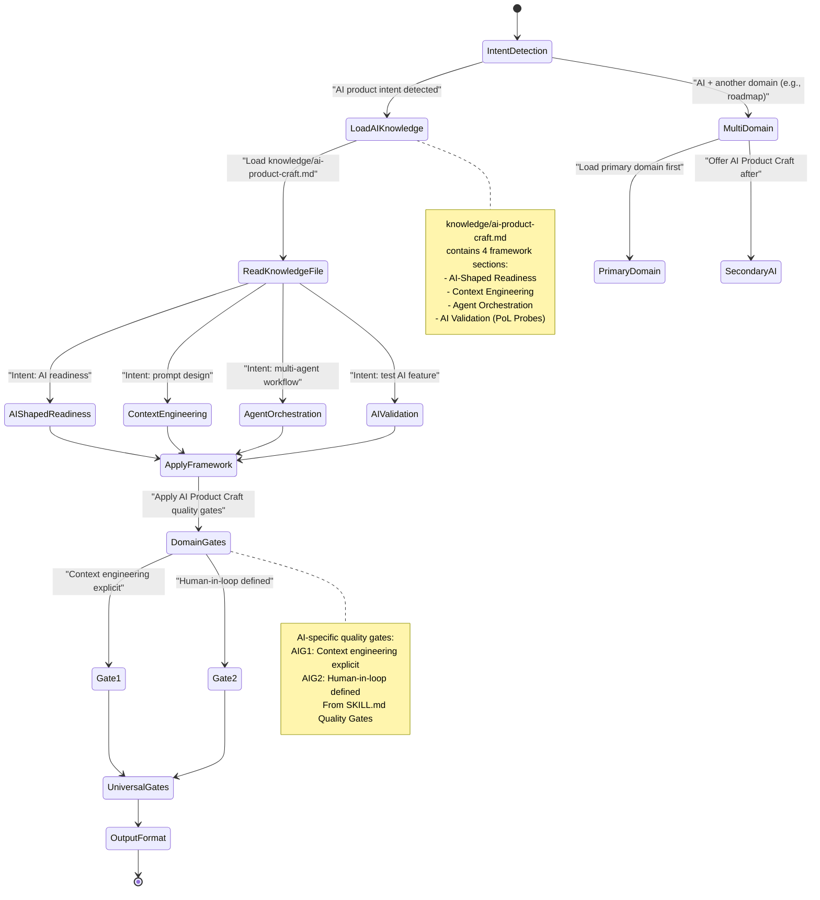
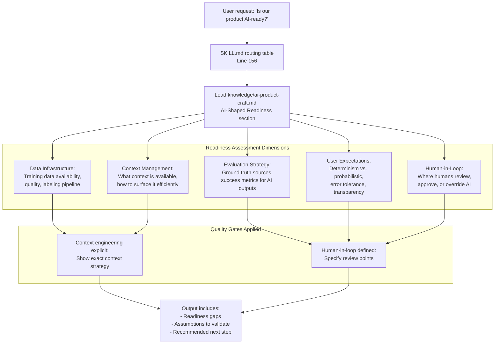
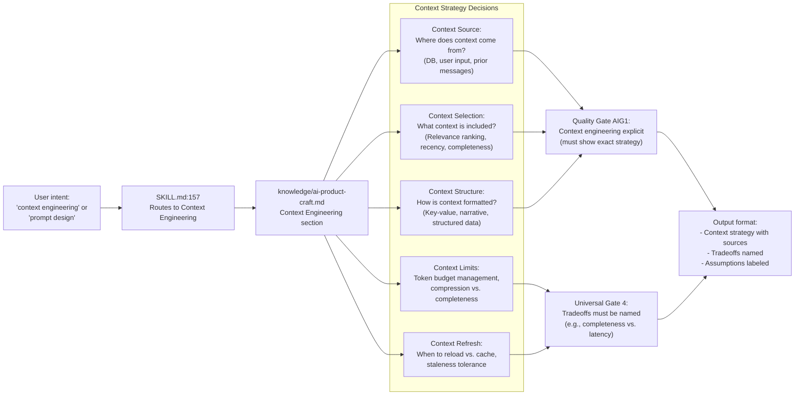
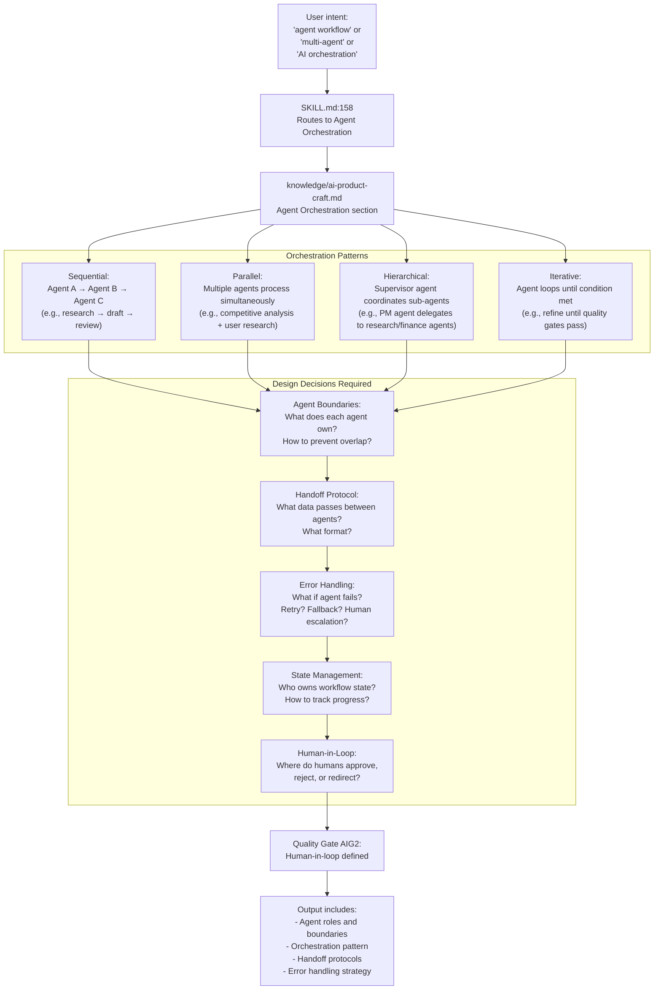
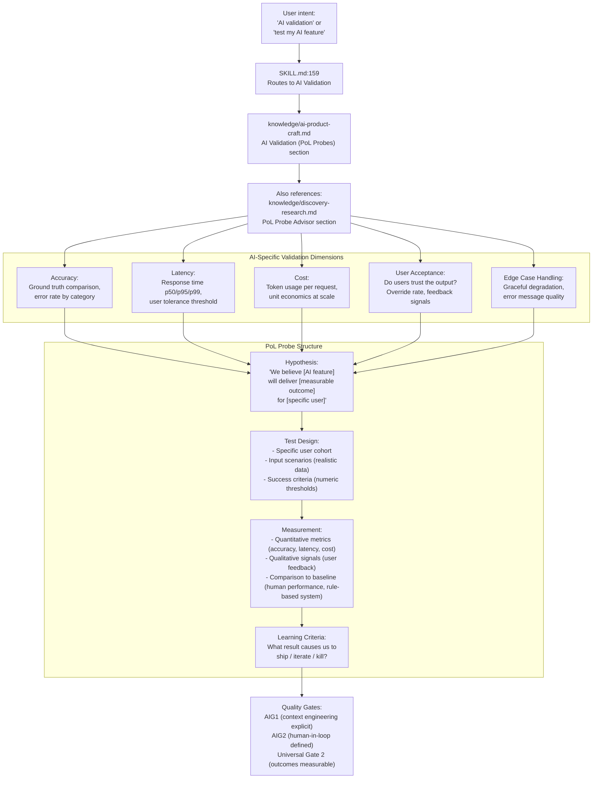
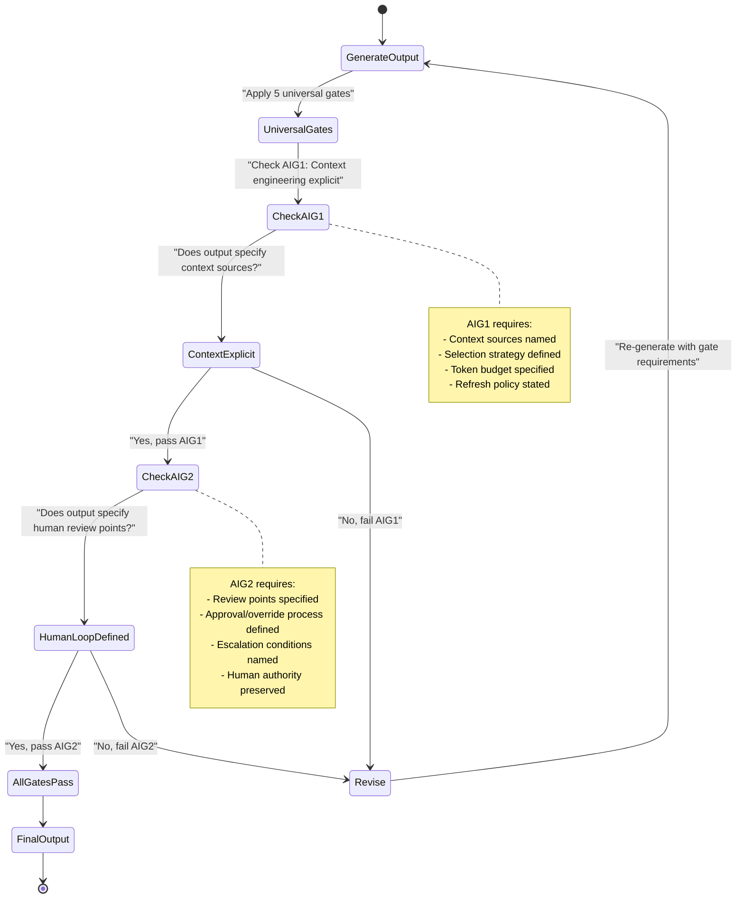
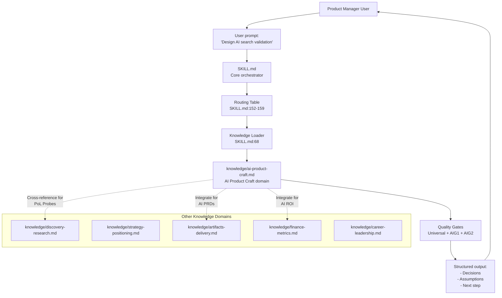

<!-- source: DeepWiki mcp.deepwiki.com · repo Digidai/product-manager-skills · page 4.6 AI Product Craft · fetched 2026-10-26 -->

# AI Product Craft

<details>
<summary>Relevant source files</summary>

The following files were used as context for generating this wiki page:

- [README.md](README.md)
- [SKILL.md](SKILL.md)

</details>


This page documents the AI Product Craft knowledge domain, which provides frameworks for building and validating AI-native products. It covers product-specific considerations for AI features, not general AI usage or prompting techniques. For frameworks on using AI tools in PM workflows, see the main system documentation in [Overview](#1).

The AI Product Craft domain addresses four core areas: assessing AI-shaped product readiness, designing context engineering strategies, orchestrating multi-agent workflows, and validating AI features with proof-of-life experiments.

**Sources:** [SKILL.md:152-159](), [README.md:125]()

---

## Domain Scope and Routing

The AI Product Craft domain handles user requests related to building, validating, and shipping AI-native product features. Unlike the other five domains (Discovery, Strategy, Artifacts, Finance, Career), this domain addresses the unique product management challenges introduced by AI capabilities.

### Intent to Framework Mapping

The routing table in `SKILL.md` maps user intents to specific frameworks within `knowledge/ai-product-craft.md`:

| User Intent | Framework Loaded | File Section |
|---|---|---|
| "AI product" / "AI-shaped" / "AI readiness" | AI-Shaped Readiness | `knowledge/ai-product-craft.md` |
| "Context engineering" / "context stuffing" / "prompt design" | Context Engineering | `knowledge/ai-product-craft.md` |
| "Agent workflow" / "multi-agent" / "AI orchestration" | Agent Orchestration | `knowledge/ai-product-craft.md` |
| "AI validation" / "test my AI feature" | AI Validation (PoL Probes) | `knowledge/ai-product-craft.md` |

When a user request contains these intent phrases, the routing system (step 1 in the execution workflow) matches to this domain and loads the corresponding framework from the knowledge module.

**Sources:** [SKILL.md:152-159](), [SKILL.md:66-73]()

---

## Execution Flow for AI Product Requests



**Execution Workflow for AI Product Craft Domain**

This diagram shows how AI product requests flow through the routing system. When the intent detector identifies AI-related phrases at [SKILL.md:152-159](), it loads `knowledge/ai-product-craft.md` and navigates to the appropriate framework section. Multi-domain requests (e.g., "roadmap for an AI product") trigger primary domain loading first, with AI Product Craft offered as secondary context per [SKILL.md:75]().

**Sources:** [SKILL.md:64-76](), [SKILL.md:152-159]()

---

## Framework 1: AI-Shaped Readiness

The AI-Shaped Readiness framework assesses whether a product or organization is ready to ship AI-native features. This framework is loaded when users ask about "AI product," "AI-shaped," or "AI readiness."

### Core Assessment Dimensions

The framework evaluates readiness across multiple dimensions specific to AI product development:



**AI-Shaped Readiness Assessment Flow**

The readiness assessment applies five evaluation dimensions from `knowledge/ai-product-craft.md`. Each dimension must produce specific, measurable gaps rather than generic observations, enforced by universal quality gates at [SKILL.md:189-216]() and AI-specific gates.

**Sources:** [SKILL.md:156]()

### Application Example

When a user asks "Is our customer support product ready for AI-powered response suggestions?", the framework:

1. Routes to `knowledge/ai-product-craft.md` via [SKILL.md:156]()
2. Loads the AI-Shaped Readiness section
3. Assesses data infrastructure (historical support tickets, resolution outcomes)
4. Evaluates context availability (customer history, product state, previous interactions)
5. Defines evaluation strategy (CSAT correlation, agent acceptance rate, resolution time)
6. Sets user expectations (probabilistic suggestions, not guaranteed answers)
7. Specifies human-in-loop (agent reviews all responses before sending)

The output must satisfy quality gate AIG1 (context engineering explicit) by detailing exactly what context feeds the AI and quality gate AIG2 (human-in-loop defined) by specifying agent review as the approval gate.

**Sources:** [SKILL.md:156](), [SKILL.md:189-216]()

---

## Framework 2: Context Engineering

Context engineering frameworks help product managers design what information to provide to AI systems and how to structure it for optimal performance. This is loaded when users mention "context engineering," "context stuffing," or "prompt design."

### Context Engineering Components



**Context Engineering Decision Flow**

Context engineering requests route through [SKILL.md:157]() to the Context Engineering section in `knowledge/ai-product-craft.md`. The framework forces explicit decisions about context sourcing, selection, structure, limits, and refresh strategies. Quality gate AIG1 requires these decisions to be concrete, not abstract. Universal gate 4 at [SKILL.md:204-205]() requires tradeoff naming (e.g., "Include full conversation history for accuracy but adds 2s latency" vs "Include last 3 messages for speed but risks missing context").

**Sources:** [SKILL.md:157](), [SKILL.md:204-205]()

### Context Engineering vs. Prompt Engineering

This framework addresses **product-level** context engineering decisions, not individual prompt optimization:

| Scope | Context Engineering (This Framework) | Prompt Engineering (Not Covered) |
|---|---|---|
| **Level** | Product architecture | Individual prompt tuning |
| **Questions** | What context sources to build? How to structure context? What to cache? | How to phrase a specific prompt? What examples to include? |
| **Artifacts** | Context sourcing strategy, token budget allocation, refresh policies | Optimized prompt templates, few-shot examples |
| **Validation** | Latency, accuracy, cost at scale | Single-prompt performance |

The framework applies when designing the context architecture for an AI feature, not when optimizing a specific prompt string.

**Sources:** [SKILL.md:157]()

---

## Framework 3: Agent Orchestration

Agent orchestration frameworks help design multi-agent workflows where multiple AI components coordinate to accomplish complex tasks. This framework is loaded when users ask about "agent workflow," "multi-agent," or "AI orchestration."

### Orchestration Architecture Patterns



**Agent Orchestration Pattern Selection**

Agent orchestration requests route via [SKILL.md:158]() to the Agent Orchestration section in `knowledge/ai-product-craft.md`. The framework provides four architectural patterns (sequential, parallel, hierarchical, iterative) and forces five design decisions. Quality gate AIG2 requires explicit specification of where humans intervene in the workflow.

**Sources:** [SKILL.md:158]()

### Multi-Domain Agent Example

When the user asks "Design a multi-agent workflow for quarterly board reporting," the framework:

1. Routes to Agent Orchestration at [SKILL.md:158]()
2. Identifies required agents (Finance Metrics Agent, Competitive Intelligence Agent, Roadmap Synthesis Agent)
3. Selects parallel pattern (all three agents work simultaneously on separate sections)
4. Defines handoff protocol (each agent outputs structured JSON to Report Assembly Agent)
5. Specifies error handling (if Finance Agent fails, Report Assembly uses previous quarter's data with `[stale data]` flag)
6. Defines human-in-loop (PM reviews assembled report before Board submission, can override any section)

This satisfies AIG2 (human-in-loop defined) and Universal Gate 3 (roles must be specific) at [SKILL.md:201-202]().

**Sources:** [SKILL.md:158](), [SKILL.md:201-202]()

---

## Framework 4: AI Validation (PoL Probes)

AI validation frameworks adapt Proof-of-Life (PoL) probe methodology from the Discovery domain to test AI features. This is loaded when users ask about "AI validation" or "test my AI feature."

### PoL Probes Adapted for AI



**AI Validation with PoL Probes**

AI validation requests route via [SKILL.md:159]() and load both the AI Validation section from `knowledge/ai-product-craft.md` and cross-reference the PoL Probe Advisor section from `knowledge/discovery-research.md`. The framework adapts PoL probe structure (hypothesis → test → measure → learn) to AI-specific dimensions (accuracy, latency, cost, user acceptance, edge cases).

**Sources:** [SKILL.md:159](), [SKILL.md:87](), [SKILL.md:96]()

### Validation Example: AI-Powered Search

For a request like "Design a validation test for AI-powered search in our docs," the framework:

1. Routes to AI Validation at [SKILL.md:159]()
2. Cross-references PoL Probe structure from Discovery domain
3. Applies AI-specific validation dimensions:
   - **Accuracy:** Does the AI return the correct doc page? (Top-3 accuracy > 85%)
   - **Latency:** Response time < 500ms for p95
   - **Cost:** Token usage < $0.02 per search at 10k searches/day
   - **User Acceptance:** Click-through rate on top result > 70%
   - **Edge Cases:** Graceful handling of typos, incomplete queries, unavailable docs
4. Structures as PoL probe:
   - **Hypothesis:** "We believe AI-powered semantic search will increase docs engagement (measured by time-on-page after search) by 30% for enterprise customers compared to keyword search"
   - **Test:** 100 enterprise users, split 50/50 AI vs. keyword, realistic search queries from support tickets
   - **Measure:** Top-3 accuracy, click-through rate, time-on-page, cost per search
   - **Learn:** If accuracy < 80% or cost > $0.03/search → iterate on context engineering. If user acceptance > 70% and cost workable → ship to all enterprise.
5. Satisfies quality gates:
   - AIG1: Context engineering explicit (semantic embeddings from which doc sections)
   - AIG2: Human-in-loop defined (support team reviews edge case failures weekly)
   - Universal Gate 2: Outcomes measurable (specific thresholds for each metric)

**Sources:** [SKILL.md:159](), [SKILL.md:199-200]()

---

## Domain-Specific Quality Gates

The AI Product Craft domain enforces two specialized quality gates in addition to the five universal gates at [SKILL.md:189-216]().

### AIG1: Context Engineering Explicit

**Requirement:** Every AI product output must specify exactly what context the AI receives, where it comes from, and how it's selected.

**Bad output:**
```
The AI will use customer data to personalize recommendations.
```

**Good output:**
```
The AI receives:
- Last 30 days of purchase history (from orders table)
- Current cart contents (from session state)
- Category preferences (inferred from click stream, last 90 days)
- Similar users' purchases (collaborative filtering, top 20 matches)

Context selection: Prioritize recent purchases (last 7 days weighted 3x), then category preferences, then collaborative signals. Token limit: 2000 tokens, truncate collaborative signals first if exceeded.
```

This gate prevents vague "AI will use data" statements and forces product-level context architecture decisions.

**Sources:** [SKILL.md:189-216]()

### AIG2: Human-in-Loop Defined

**Requirement:** Every AI product output must specify where humans review, approve, override, or escalate AI decisions.

**Bad output:**
```
The AI will generate customer support responses.
```

**Good output:**
```
The AI generates draft responses. Human-in-loop:
- Support agent reviews every AI draft before sending (approval required)
- Agent can edit, reject, or send as-is
- If agent edits >50% of draft, flag for retraining review
- If customer escalates, AI suggestions disabled for that ticket
- Weekly review of agent override rate by ticket category
```

This gate ensures AI features maintain human oversight and accountability, preventing fully autonomous AI deployments without defined review points.

**Sources:** [SKILL.md:189-216]()

### Quality Gate Application Flow



**AI Product Craft Quality Gate Validation**

After universal gates at [SKILL.md:193-216]() pass, the system applies AI-specific gates AIG1 and AIG2. If either fails, the output returns to revision with explicit gate requirements. This two-tier validation (universal + domain-specific) is documented in the Quality Gates architecture at [SKILL.md:189-192]().

**Sources:** [SKILL.md:189-216]()

---

## Integration with Other Domains

AI Product Craft frequently combines with other knowledge domains for multi-domain requests.

### Common Domain Combinations

| User Request | Primary Domain | Secondary Domain | Integration Pattern |
|---|---|---|---|
| "Roadmap for AI product launch" | Strategy & Positioning ([#4.2](#4.2)) | AI Product Craft | Load roadmap framework first, apply AI readiness assessment to each milestone |
| "PRD for AI-powered feature" | Artifacts & Delivery ([#4.3](#4.3)) | AI Product Craft | Load PRD template, apply context engineering and human-in-loop sections |
| "Calculate ROI for AI feature" | Finance & Metrics ([#4.4](#4.4)) | AI Product Craft | Load unit economics framework, add AI-specific costs (tokens, compute, training) |
| "Validate AI product hypothesis" | Discovery & Research ([#4.1](#4.1)) | AI Product Craft | Load PoL Probe framework, adapt for AI validation dimensions |
| "AI product career positioning" | Career & Leadership ([#4.5](#4.5)) | AI Product Craft | Load altitude-horizon framework, identify AI-specific PM skills for level |

**Integration mechanism:** Per [SKILL.md:75](), when intent spans two domains, the explicit request determines primary. The system loads primary domain knowledge first, completes that workflow, then offers to load secondary domain for additional context.

**Sources:** [SKILL.md:75]()

### Cross-Domain Example: PRD for AI Feature

When a user requests "Write a PRD for AI-powered email categorization," the system:

1. **Route:** Intent contains "PRD" → primary domain is Artifacts & Delivery
2. **Load primary:** Load `knowledge/artifacts-delivery.md` and `templates/prd.md`
3. **Generate PRD structure:** Apply standard PRD framework with problem statement, success metrics, scope, requirements
4. **Detect AI context:** PRD mentions "AI-powered" → secondary domain is AI Product Craft
5. **Load secondary:** Load `knowledge/ai-product-craft.md` for context engineering and human-in-loop frameworks
6. **Enhance PRD sections:**
   - Add "Context Engineering" section specifying email metadata, user categorization history, and label examples provided
   - Add "Human-in-Loop" section defining user review and correction workflow
   - Add "Validation Strategy" section with AI-specific success metrics (accuracy, latency, cost)
7. **Apply quality gates:**
   - Universal gates from [SKILL.md:193-216]()
   - PRD-specific gates from Artifacts & Delivery domain
   - AIG1 and AIG2 from AI Product Craft domain
8. **Output:** Complete PRD with AI-specific sections integrated

This multi-domain integration pattern allows AI Product Craft knowledge to enhance artifacts from other domains without requiring separate workflows.

**Sources:** [SKILL.md:75](), [SKILL.md:116](), [SKILL.md:156-159]()

---

## Usage Patterns and Examples

### Common AI Product Craft Workflows

The AI Product Craft domain is designed for recurring validation and design workflows, not one-time consultations.

**Typical usage patterns:**

| Workflow | Frequency | Typical Prompt | Framework Applied |
|---|---|---|---|
| **AI feature readiness assessment** | Per feature kick-off | "Assess our readiness to build AI-powered X" | AI-Shaped Readiness |
| **Context architecture design** | Per AI feature spec | "Design context strategy for AI feature X" | Context Engineering |
| **Agent workflow design** | Per complex AI feature | "Design agent orchestration for multi-step workflow X" | Agent Orchestration |
| **AI validation experiment** | Per feature milestone | "Design validation test for AI feature X" | AI Validation (PoL Probes) |

**Weekly ritual example:** A PM building AI features might:
- **Monday:** Review AI feature roadmap, apply readiness assessment to each planned feature
- **Wednesday:** Critique AI PRD drafts, validate context engineering and human-in-loop specifications
- **Friday:** Design or review PoL probe experiments for in-flight AI features

**Sources:** [README.md:159-166]()

### Example Session: AI Search Validation

**User prompt:**
```
Design a validation strategy for AI-powered search in our documentation. 
We have 5,000 doc pages, 10k searches per day, currently using keyword search.
```

**System execution:**

1. **Route:** [SKILL.md:159]() matches "validation" + "AI" → AI Validation framework
2. **Load knowledge:** `knowledge/ai-product-craft.md`, AI Validation section
3. **Cross-reference:** Also loads PoL Probe structure from `knowledge/discovery-research.md`
4. **Interact:** Direct output mode (request is clear, no additional context needed)
5. **Apply framework:** Structures validation across five AI dimensions (accuracy, latency, cost, user acceptance, edge cases)
6. **Template:** No specific template for validation experiments, structures using PoL probe format
7. **Quality check:**
   - **AIG1 pass:** Context engineering explicit (semantic embeddings from doc sections X, Y, Z)
   - **AIG2 pass:** Human-in-loop defined (weekly review of low-accuracy searches)
   - **Universal Gate 2 pass:** Outcomes measurable (specific numeric thresholds)
8. **Close:** Output includes decisions (test design, metrics), assumptions (baseline accuracy unknown), next step (implement test with 100-user cohort)

**Sources:** [SKILL.md:64-74](), [SKILL.md:159]()

---

## File Structure and Code Entities

The AI Product Craft domain implementation spans these files and sections:

### Primary Files

| File | Purpose | Key Sections |
|---|---|---|
| `SKILL.md` | Routing and orchestration | Lines 152-159 (routing table), 189-216 (quality gates) |
| `knowledge/ai-product-craft.md` | Framework content | AI-Shaped Readiness, Context Engineering, Agent Orchestration, AI Validation |
| `templates/` | Supporting artifacts | No AI-specific templates (uses PRD, User Story, etc. with AI enhancements) |

### Routing Table Entries

The routing table at [SKILL.md:152-159]() contains four intent patterns:

```
| "AI product" / "AI-shaped" / "AI readiness" | AI-Shaped Readiness | knowledge/ai-product-craft.md |
| "Context engineering" / "context stuffing" / "prompt design" | Context Engineering | knowledge/ai-product-craft.md |
| "Agent workflow" / "multi-agent" / "AI orchestration" | Agent Orchestration | knowledge/ai-product-craft.md |
| "AI validation" / "test my AI feature" | AI Validation (PoL Probes) | knowledge/ai-product-craft.md |
```

These patterns are matched in step 1 of the execution workflow at [SKILL.md:67]().

### Quality Gate Implementation

AI Product Craft adds two domain-specific gates enforced at step 6 of the execution workflow [SKILL.md:72]():

- **AIG1:** Context engineering explicit (referenced in quality gate diagrams)
- **AIG2:** Human-in-loop defined (referenced in quality gate diagrams)

These gates are applied **after** universal gates at [SKILL.md:193-216]() pass, following the two-tier validation architecture documented at [SKILL.md:189-192]().

**Sources:** [SKILL.md:67](), [SKILL.md:72](), [SKILL.md:152-159](), [SKILL.md:189-216]()

---

## Relationship to System Architecture

The AI Product Craft domain fits into the larger system architecture as one of six knowledge modules:



**AI Product Craft in System Architecture**

The AI Product Craft module (`knowledge/ai-product-craft.md`) is one of six knowledge domains loaded by the routing system at [SKILL.md:67-68](). It frequently cross-references Discovery (for PoL Probes) and integrates with Artifacts (for PRDs), Finance (for ROI), and Strategy (for roadmaps) via the multi-domain integration pattern at [SKILL.md:75]().

**Sources:** [SKILL.md:67-68](), [SKILL.md:75](), [SKILL.md:152-159]()

---

