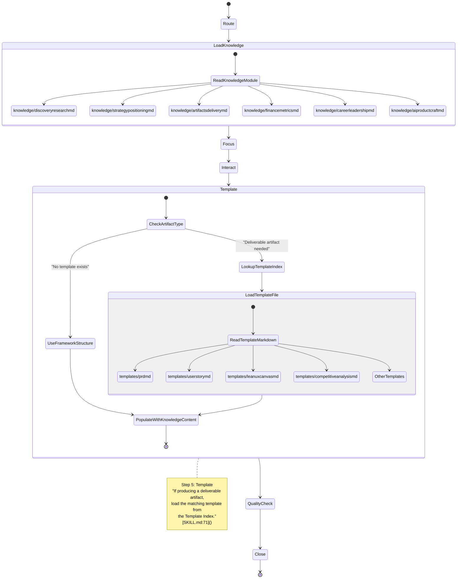
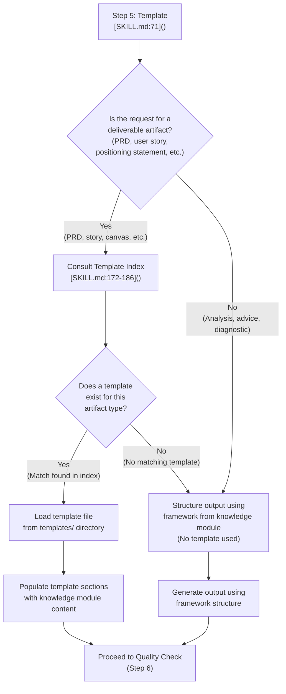

<!-- source: DeepWiki mcp.deepwiki.com · repo Digidai/product-manager-skills · page 5.1 Template Architecture · fetched 2026-10-26 -->

# Template Architecture

<details>
<summary>Relevant source files</summary>

The following files were used as context for generating this wiki page:

- [SKILL.md](SKILL.md)
- [templates/competitive-analysis.md](templates/competitive-analysis.md)
- [templates/lean-ux-canvas.md](templates/lean-ux-canvas.md)

</details>


## Purpose and Scope

This document explains the template system architecture: how templates are stored in the `templates/` directory, indexed in SKILL.md, loaded during execution, and integrated with knowledge modules to produce structured outputs. Templates provide scaffolding while knowledge modules provide substance—the template defines the format, the knowledge module supplies the framework-driven content.

For information about the knowledge modules that populate templates, see [Knowledge Domains](#4). For the complete list of available templates, see [Core Templates Reference](#5.2). For how templates are invoked during execution, see [Execution Workflow](#3.1).

---

## Template Storage and Discovery Architecture

Templates are stored as standalone Markdown files in the `templates/` directory, which is a sibling to SKILL.md. The Template Index in SKILL.md maps template names to file paths and use cases.

### Template Directory Structure

```mermaid
graph TB
    ROOT["Repository Root"]
    SKILL["SKILL.md<br/>(Orchestrator)"]
    TDIR["templates/<br/>(Template Directory)"]
    KDIR["knowledge/<br/>(Knowledge Modules)"]
    
    ROOT --> SKILL
    ROOT --> TDIR
    ROOT --> KDIR
    
    subgraph "Template Index<br/>[SKILL.md:168-186]()"
        INDEX["Template Index Table"]
    end
    
    subgraph "Template Files"
        T1["templates/prd.md"]
        T2["templates/user-story.md"]
        T3["templates/problem-statement.md"]
        T4["templates/positioning-statement.md"]
        T5["templates/epic-hypothesis.md"]
        T6["templates/press-release.md"]
        T7["templates/discovery-interview-plan.md"]
        T8["templates/opportunity-solution-tree.md"]
        T9["templates/roadmap-plan.md"]
        T10["templates/business-health-scorecard.md"]
        T11["templates/competitive-analysis.md"]
        T12["templates/lean-ux-canvas.md"]
    end
    
    subgraph "Knowledge Modules"
        K1["knowledge/discovery-research.md"]
        K2["knowledge/strategy-positioning.md"]
        K3["knowledge/artifacts-delivery.md"]
        K4["knowledge/finance-metrics.md"]
        K5["knowledge/career-leadership.md"]
        K6["knowledge/ai-product-craft.md"]
    end
    
    SKILL --> INDEX
    INDEX --> T1
    INDEX --> T2
    INDEX --> T3
    INDEX --> T4
    INDEX --> T5
    INDEX --> T6
    INDEX --> T7
    INDEX --> T8
    INDEX --> T9
    INDEX --> T10
    INDEX --> T11
    INDEX --> T12
    
    K1 -.->|"Provides content for"| T3
    K1 -.->|"Provides content for"| T7
    K1 -.->|"Provides content for"| T8
    K1 -.->|"Provides content for"| T12
    K2 -.->|"Provides content for"| T4
    K2 -.->|"Provides content for"| T9
    K2 -.->|"Provides content for"| T11
    K3 -.->|"Provides content for"| T1
    K3 -.->|"Provides content for"| T2
    K3 -.->|"Provides content for"| T5
    K3 -.->|"Provides content for"| T6
    K4 -.->|"Provides content for"| T10
```



**Sources:** [SKILL.md:168-186](), [SKILL.md:68]()

---

## Template Index Lookup Table

The Template Index maps deliverable artifact types to file paths and usage triggers. This table is consulted during step 5 of the execution workflow.

| Template | File Path | Use When | Populated By |
|----------|-----------|----------|--------------|
| PRD | `templates/prd.md` | Writing product requirements documents | `knowledge/artifacts-delivery.md` (PRD Development) |
| User Story | `templates/user-story.md` | Creating stories with acceptance criteria | `knowledge/artifacts-delivery.md` (User Story frameworks) |
| Problem Statement | `templates/problem-statement.md` | Framing a user problem empathetically | `knowledge/discovery-research.md` (Problem Framing) |
| Positioning Statement | `templates/positioning-statement.md` | Defining product market position | `knowledge/strategy-positioning.md` (Geoffrey Moore) |
| Epic Hypothesis | `templates/epic-hypothesis.md` | Framing epics as testable hypotheses | `knowledge/artifacts-delivery.md` (Epic frameworks) |
| Press Release | `templates/press-release.md` | Working Backwards / PRFAQ | `knowledge/artifacts-delivery.md` (PRFAQ) |
| Discovery Interview Plan | `templates/discovery-interview-plan.md` | Preparing for customer interviews | `knowledge/discovery-research.md` (Interview Prep) |
| Opportunity Solution Tree | `templates/opportunity-solution-tree.md` | Mapping outcomes → opportunities → solutions | `knowledge/discovery-research.md` (OST) |
| Roadmap Plan | `templates/roadmap-plan.md` | Building Now/Next/Later roadmaps | `knowledge/strategy-positioning.md` (Roadmap Planning) |
| Business Health Scorecard | `templates/business-health-scorecard.md` | Diagnosing SaaS business health | `knowledge/finance-metrics.md` (Business Health Diagnostic) |
| Competitive Analysis | `templates/competitive-analysis.md` | Analyzing competitors and market position | `knowledge/strategy-positioning.md` (Competitive Intel) |
| Lean UX Canvas | `templates/lean-ux-canvas.md` | Structuring hypotheses and experiments | `knowledge/discovery-research.md` (Lean UX Canvas) |

**Sources:** [SKILL.md:168-186]()

---

## Template Loading Mechanism in Execution Workflow

Templates are loaded during step 5 of the 7-step execution workflow, after the knowledge module has been loaded and the interaction mode determined.

### Execution Sequence with Template Loading



**Sources:** [SKILL.md:63-74](), [SKILL.md:168-186]()

---

## Template-Knowledge Integration Model

Templates provide structure (sections, headings, prompts), while knowledge modules provide substance (frameworks, decision logic, quality gates). This separation enables reusable scaffolding with domain-specific content.

### Integration Pattern

```mermaid
graph LR
    subgraph "User Request Flow"
        REQ["User: 'Write a PRD for<br/>checkout optimization'"]
    end
    
    subgraph "Routing & Knowledge Loading<br/>[SKILL.md:79-165]()"
        ROUTE["Route Table Match:<br/>'Write a PRD' →<br/>Artifacts & Delivery"]
        LOAD["Load Module:<br/>knowledge/artifacts-delivery.md"]
        FRAMEWORK["Apply Framework:<br/>PRD Development section"]
    end
    
    subgraph "Template Loading<br/>[SKILL.md:168-186]()"
        INDEX["Template Index Lookup:<br/>'PRD' → templates/prd.md"]
        TEMPLATE["Load Template Structure:<br/>Problem, Goals, Requirements,<br/>Success Metrics, etc."]
    end
    
    subgraph "Content Population"
        POPULATE["Populate Template with<br/>Framework-Driven Content"]
        CHECK["Apply Quality Gates:<br/>Universal + Domain-Specific"]
    end
    
    subgraph "Output"
        OUTPUT["Complete PRD:<br/>Structure (template) +<br/>Substance (knowledge)"]
    end
    
    REQ --> ROUTE
    ROUTE --> LOAD
    LOAD --> FRAMEWORK
    FRAMEWORK --> INDEX
    INDEX --> TEMPLATE
    TEMPLATE --> POPULATE
    FRAMEWORK --> POPULATE
    POPULATE --> CHECK
    CHECK --> OUTPUT
```



**Sources:** [SKILL.md:63-74](), [SKILL.md:168-186](), [SKILL.md:22-24]()

---

## Template File Structure

Templates are pure Markdown files containing section headings, prompts, and placeholders. They do not contain framework logic or decision trees—those live in knowledge modules.

### Example: Lean UX Canvas Template Structure

The `templates/lean-ux-canvas.md` file demonstrates the template pattern:

```
## Lean UX Canvas

### 1. Business Problem
[What business outcome are we trying to improve? State in terms of a measurable metric.]

### 2. Business Outcomes
- **Primary metric:** [metric + current value + target value + timeframe]
- **Leading indicator:** [metric that moves before the primary]

### 3. Users & Customers
- **Target user:** [specific role/persona with context]
- **Their current behavior:** [what they do today]
- **Underserved need:** [what's painful or missing]

### 4. User Outcomes & Benefits
If we solve this well, users will:
1. [behavior change or benefit]
2. [behavior change or benefit]

We'll know they got value when: [observable signal]

### 5. Solution Ideas
| Idea | Addresses | Effort | Confidence |
|------|----------|--------|------------|
| [idea 1] | [which need] | S/M/L | High/Med/Low |

### 6. Hypotheses
**We believe that** [solution idea]
**for** [target user]
**will achieve** [user outcome]
**We will know this is true when** [measurable signal + threshold]

### 7. Riskiest Assumption
[The single assumption that, if wrong, invalidates the hypothesis]

### 8. Experiment to Run
- **Type:** [PoL probe / A-B test / prototype test / concierge]
- **What we'll do:** [specific steps]
- **Success criteria:** [quantitative threshold]
- **Timeline:** [duration]
```

**Key characteristics:**
- Numbered sections with descriptive headings
- Bracketed placeholders `[...]` indicate what content should be filled in
- Structural prompts guide the type of content expected ("State in terms of a measurable metric")
- No framework logic—the knowledge module determines how to populate these sections
- Footer attribution: `*Generated with [product-manager-skills](...)*`

**Sources:** [templates/lean-ux-canvas.md:1-54]()

---

## Template vs. Knowledge Module Responsibilities

The system enforces a clear separation of concerns between templates (structure) and knowledge modules (substance).

| Aspect | Template Responsibility | Knowledge Module Responsibility |
|--------|-------------------------|--------------------------------|
| **Structure** | Defines sections, headings, table layouts | N/A |
| **Prompts** | Provides placeholder text to guide content type | N/A |
| **Frameworks** | N/A | Contains framework definitions (e.g., JTBD, Geoffrey Moore) |
| **Decision Logic** | N/A | Contains when/how to apply frameworks |
| **Quality Gates** | N/A | Contains domain-specific validation rules |
| **Examples** | N/A | Contains reference examples and patterns |
| **Content** | Empty brackets `[...]` | Fills brackets with framework-driven content |
| **Format** | Markdown structure only | N/A |

**Design principle (from SKILL.md):**
> "A template filler. Templates are scaffolding — the thinking matters more than the format."

This means templates never contain:
- Generic placeholder text ("Enter your goal here")
- Framework explanations
- Decision trees
- Validation logic

Templates are intentionally "dumb" structures that enable the knowledge modules to be the intelligent layer.

**Sources:** [SKILL.md:22-24](), [SKILL.md:71]()

---

## Template Resolution Logic

When producing output, the system follows this logic to determine whether and which template to use:



**Examples:**

| Request | Deliverable Artifact? | Template Used | Structure Source |
|---------|----------------------|---------------|-----------------|
| "Write a PRD" | Yes | `templates/prd.md` | Template structure |
| "Create a user story" | Yes | `templates/user-story.md` | Template structure |
| "Analyze these SaaS metrics" | No | None | `knowledge/finance-metrics.md` framework |
| "Position my product" | Yes | `templates/positioning-statement.md` | Template structure |
| "Advice on director transition" | No | None | `knowledge/career-leadership.md` framework |
| "Build a Lean UX Canvas" | Yes | `templates/lean-ux-canvas.md` | Template structure |

**Sources:** [SKILL.md:71](), [SKILL.md:168-186]()

---

## Template Design Principles

Templates in this system follow specific design constraints derived from the operating principles.

### 1. Scaffolding, Not Generic Placeholders

**Principle from SKILL.md:**
> "Templates are pure scaffolding — not generic placeholders." [SKILL.md:170]()

Templates use **prompts** rather than **generic placeholder text**.

**Example from `templates/competitive-analysis.md`:**

```markdown
### Strategic Implications

1. **Where we win:** [specific scenarios where you have advantage]
2. **Where we lose:** [specific scenarios where competitors win]
3. **Underserved gap:** [unmet need no competitor addresses well]
```

The bracketed text tells the user what type of content to provide ("specific scenarios"), not generic advice ("enter your competitive advantage"). This enables the knowledge module to apply frameworks like Geoffrey Moore positioning or PESTEL analysis to populate these fields with rigorous content.

**Sources:** [templates/competitive-analysis.md:35-37](), [SKILL.md:170]()

### 2. Measurability Enforced in Structure

Templates embed the "Outcomes Must Be Measurable" quality gate [SKILL.md:199]() into their structure.

**Example from `templates/lean-ux-canvas.md`:**

```markdown
### 2. Business Outcomes

- **Primary metric:** [metric + current value + target value + timeframe]
- **Leading indicator:** [metric that moves before the primary]
```

The template explicitly prompts for `current value + target value + timeframe`, enforcing measurability at the structural level. This prevents vague statements like "improve the experience."

**Sources:** [templates/lean-ux-canvas.md:8-10](), [SKILL.md:199]()

### 3. Tables for Comparative Structure

Templates use Markdown tables when the artifact requires comparison or multi-dimensional evaluation.

**Example from `templates/competitive-analysis.md`:**

```markdown
| Dimension | Your Product | Competitor A | Competitor B | Competitor C |
|-----------|-------------|-------------|-------------|-------------|
| **Positioning** | | | | |
| **Target Segment** | | | | |
| **Pricing Model** | | | | |
| **Key Differentiator** | | | | |
| **Biggest Weakness** | | | | |
```

This structure enables side-by-side comparison, which the knowledge module populates using frameworks like competitive positioning or PESTEL analysis.

**Sources:** [templates/competitive-analysis.md:11-17]()

### 4. Footer Attribution

All templates include a footer attribution linking back to the repository:

```markdown
---
*Generated with [product-manager-skills](https://github.com/Digidai/product-manager-skills)*
```

This establishes provenance for generated artifacts.

**Sources:** [templates/lean-ux-canvas.md:53](), [templates/competitive-analysis.md:46]()

---

## Template File Naming Convention

Template files follow a consistent naming pattern:

| Template Name | File Name |
|--------------|-----------|
| PRD | `prd.md` |
| User Story | `user-story.md` |
| Problem Statement | `problem-statement.md` |
| Positioning Statement | `positioning-statement.md` |
| Epic Hypothesis | `epic-hypothesis.md` |
| Press Release | `press-release.md` |
| Discovery Interview Plan | `discovery-interview-plan.md` |
| Opportunity Solution Tree | `opportunity-solution-tree.md` |
| Roadmap Plan | `roadmap-plan.md` |
| Business Health Scorecard | `business-health-scorecard.md` |
| Competitive Analysis | `competitive-analysis.md` |
| Lean UX Canvas | `lean-ux-canvas.md` |

**Pattern:** Lowercase, hyphen-separated, `.md` extension. Template names in the Template Index use title case.

**Sources:** [SKILL.md:172-186]()

---

## Integration with Quality Gates

Templates do not enforce quality gates themselves—that responsibility belongs to the knowledge modules and the universal quality gates. However, template structure often reflects quality gate requirements.

### Example: Assumptions Labeling

**Universal Quality Gate:**
> "Assumptions Must Be Labeled. If you're guessing, say so. Mark assumptions with `[assumption]` inline." [SKILL.md:196]()

Templates do not contain `[assumption]` markers—those are added by the knowledge module during content population. The template provides the structure; the knowledge module applies the gate.

### Example: Tradeoffs Must Be Named

**Universal Quality Gate:**
> "Tradeoffs Must Be Named. Never present a recommendation without naming what you're trading off." [SKILL.md:204]()

The `templates/competitive-analysis.md` includes a "Recommended Actions" section where each action is paired with what it addresses:

```markdown
### Recommended Actions

1. [action] -- addresses [gap/threat]
2. [action] -- leverages [strength]
3. [action] -- defends against [competitive move]
```

The template structure encourages tradeoff thinking, but the knowledge module enforces it during population.

**Sources:** [templates/competitive-analysis.md:39-43](), [SKILL.md:196](), [SKILL.md:204]()

---

## Summary

The template architecture enables a clean separation between:
- **Structure** (templates): Markdown files with sections, headings, tables, and prompts
- **Substance** (knowledge modules): Frameworks, decision logic, quality gates, and domain expertise

Templates are loaded from the `templates/` directory via the Template Index in SKILL.md during step 5 of the execution workflow. If no template exists for an artifact type, the system structures output using the framework from the knowledge module directly. This architecture allows the system to produce rigorous, framework-driven outputs in standardized formats without requiring templates to embed framework logic.

---

