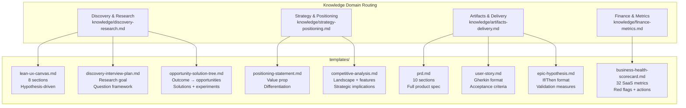
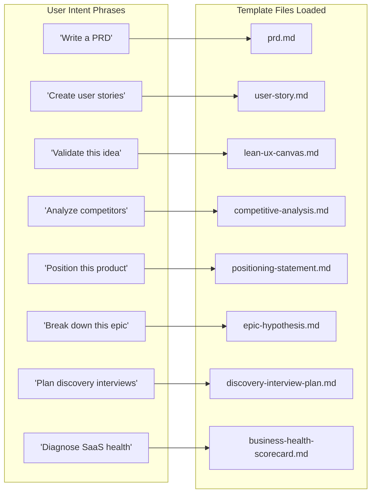

<!-- source: DeepWiki mcp.deepwiki.com · repo Digidai/product-manager-skills · page 5.2 Core Templates Reference · fetched 2026-10-26 -->

# Core Templates Reference

<details>
<summary>Relevant source files</summary>

The following files were used as context for generating this wiki page:

- [templates/business-health-scorecard.md](templates/business-health-scorecard.md)
- [templates/competitive-analysis.md](templates/competitive-analysis.md)
- [templates/discovery-interview-plan.md](templates/discovery-interview-plan.md)
- [templates/epic-hypothesis.md](templates/epic-hypothesis.md)
- [templates/lean-ux-canvas.md](templates/lean-ux-canvas.md)
- [templates/opportunity-solution-tree.md](templates/opportunity-solution-tree.md)
- [templates/positioning-statement.md](templates/positioning-statement.md)
- [templates/prd.md](templates/prd.md)

</details>


This document provides detailed technical reference for the 12+ production templates located in the `templates/` directory. Each template defines a structured Markdown format that SKILL.md populates with framework-driven content from the knowledge domains.

For information about how templates integrate with knowledge modules and the loading mechanism, see [Template Architecture](#5.1). For practical usage examples demonstrating template application in real workflows, see [Example Sessions](#6.2).

---

## Template File Structure

The templates are stored as standalone Markdown files in the `templates/` directory. Each file defines section headers, field placeholders, and output structure. SKILL.md loads these templates during the Template phase of the execution workflow (see [Execution Workflow](#3.1)).

**Template File Organization Diagram**



Sources: [templates/prd.md](), [templates/lean-ux-canvas.md](), [templates/competitive-analysis.md](), [templates/business-health-scorecard.md](), [templates/discovery-interview-plan.md](), [templates/epic-hypothesis.md](), [templates/opportunity-solution-tree.md](), [templates/positioning-statement.md]()

---

## Template Selection Logic

SKILL.md routes user intents to templates based on the artifact type requested and the knowledge domain activated. The routing table maps intent phrases to specific template files.

**Intent → Template Routing Diagram**



Sources: [SKILL.md]() (routing table section), [templates/]() (all template files)

---

## Discovery & Research Templates

### lean-ux-canvas.md

Implements the Lean UX Canvas framework for hypothesis-driven product development. Used when validating product ideas or planning experiments.

**Structure:**

| Section | Purpose | Enforced Quality Gates |
|---------|---------|------------------------|
| 1. Business Problem | Measurable business outcome to improve | Must be quantified metric |
| 2. Business Outcomes | Primary metric + leading indicator | Current → target values required |
| 3. Users & Customers | Target user + current behavior + need | Must be specific role, not generic persona |
| 4. User Outcomes & Benefits | Behavior changes + observable signals | Observable = measurable |
| 5. Solution Ideas | Idea matrix with effort/confidence | Effort must be S/M/L, confidence High/Med/Low |
| 6. Hypotheses | "We believe... for... will achieve... when..." | Must follow hypothesis format |
| 7. Riskiest Assumption | Single assumption that invalidates hypothesis | Must label as `[assumption]` |
| 8. Experiment to Run | Type + steps + success criteria + timeline | Success criteria must be quantitative threshold |

**Key Fields:**

```markdown
### 2. Business Outcomes
- **Primary metric:** [metric + current value + target value + timeframe]
- **Leading indicator:** [metric that moves before the primary]
```

The primary metric field enforces the universal quality gate for measurable outcomes. The system validates that all four components are present: metric name, current baseline, target value, and timeframe.

```markdown
### 7. Riskiest Assumption
[The single assumption that, if wrong, invalidates the hypothesis]
```

This field integrates with the universal quality gate requiring all assumptions to be labeled. The system checks that this assumption is also referenced in the hypothesis section.

Sources: [templates/lean-ux-canvas.md:1-54]()

---

### discovery-interview-plan.md

Structures Mom Test-style discovery interviews. Used when planning user research to validate problems (not solutions).

**Structure:**

| Section | Purpose | Anti-Pattern Detection |
|---------|---------|------------------------|
| Research Goal | What to learn (not prove) | Flags confirmation bias framing |
| Target Segment | Who/sample size/access | Validates specificity (no "users") |
| Methodology | JTBD/problem validation/cohort | Ensures methodology matches goal |
| Interview Framework | Opening/Core/Closing timings | Validates question structure |
| Biases to Watch | Leading questions, solution-first | Flags anti-pattern #4 (Confirmation Bias) |
| Success Criteria | "Learned enough" threshold | Must be quantified (e.g., "3+ users") |

**Core Questions Section:**

[templates/discovery-interview-plan.md:19-25]() defines the question framework. The system enforces that questions focus on past behavior (not hypotheticals), explore current workarounds (not feature requests), and probe emotional drivers (not feature prioritization).

**Bias Detection:**

[templates/discovery-interview-plan.md:29-30]() triggers anti-pattern detection for:
- Leading questions (phrasing that suggests desired answer)
- Confirmation bias (testing what you want to prove)
- Solution-first thinking (asking about solutions before understanding problems)

Sources: [templates/discovery-interview-plan.md:1-36]()

---

### opportunity-solution-tree.md

Implements Teresa Torres' Opportunity Solution Tree framework. Used when mapping multiple solution paths to a desired outcome.

**Structure:**

```markdown
## Desired Outcome
- [Business or product metric to move]

## Opportunities (Problems to Solve)
1. [Opportunity 1]
2. [Opportunity 2]

## Solutions per Opportunity
**Opportunity 1 Solutions:**
- [Solution 1]
- [Solution 2]

## Experiments (per solution)
- [Experiment for Solution 1]

## POC Selection
- **Chosen solution:** [Solution]
- **Rationale:** [Feasibility, Impact, Market Fit]
```

The tree structure enforces the principle that multiple solutions can address each opportunity, and experiments validate solutions before full build. The system validates that:
1. Desired outcome is a measurable metric (universal gate)
2. Opportunities are framed as problems, not solutions (anti-pattern #7: Solution Smuggling)
3. Each solution has at least one experiment defined
4. POC selection includes explicit rationale with tradeoffs named (universal gate)

Sources: [templates/opportunity-solution-tree.md:1-28]()

---

## Strategy & Positioning Templates

### positioning-statement.md

Implements Geoffrey Moore's positioning statement framework. Used when defining market positioning and differentiation.

**Structure:**

[templates/positioning-statement.md:1-18]() defines two core sections:

1. **Value Proposition** - Five-part statement:
   - For [target customer/persona]
   - that need [underserved need]
   - [product name]
   - is a [product category]
   - that [benefit statement focused on outcomes]

2. **Differentiation Statement** - Three-part statement:
   - Unlike [primary competitor or alternative]
   - [product name]
   - provides [unique differentiation focused on outcomes]

**Quality Gates Applied:**

- Target customer must be specific role (universal gate: specific > generic)
- Underserved need must be outcome-focused (operating principle: outcome-oriented)
- Benefit statement must focus on outcomes, not features (anti-pattern #2: Feature Factory)
- Primary competitor must be named specifically (anti-pattern #3: vague competitive positioning)
- Differentiation must be measurable or observable

Sources: [templates/positioning-statement.md:1-18]()

---

### competitive-analysis.md

Structured competitive landscape analysis with feature comparison matrix.

**Structure:**

| Section | Contents | Validation Applied |
|---------|----------|-------------------|
| Overview | Product/date/market category | - |
| Competitive Landscape | 5-dimension comparison table | Validates specific competitor names |
| Feature Comparison | Weighted capability matrix | Validates weight (High/Med/Low) |
| Competitive Dynamics | Direct/indirect/substitute | Validates all three categories filled |
| Strategic Implications | Win/lose scenarios + gap | Must be specific scenarios |
| Recommended Actions | 3 actions with rationale | Each action must address gap/threat/strength |

**Competitive Landscape Table:**

[templates/competitive-analysis.md:11-17]() defines the key dimensions:
- Positioning
- Target Segment
- Pricing Model
- Key Differentiator
- Biggest Weakness

The system validates that "Biggest Weakness" is filled for your own product (enforces operating principle: opinionated with tradeoffs).

**Feature Comparison Matrix:**

[templates/competitive-analysis.md:21-25]() includes weight column. The system checks that high-weight capabilities are specifically addressed in Strategic Implications section.

**Strategic Implications Format:**

[templates/competitive-analysis.md:35-37]() enforces three required elements:
1. Where we win - specific scenarios (not "better UX")
2. Where we lose - specific scenarios (acknowledges tradeoffs)
3. Underserved gap - opportunity no competitor addresses

Sources: [templates/competitive-analysis.md:1-47]()

---

## Artifacts & Delivery Templates

### prd.md

Full Product Requirements Document template with 10 standard sections.

**Section Reference Table:**

| Section | Key Fields | Quality Gates Applied |
|---------|-----------|----------------------|
| 1. Executive Summary | Problem + solution + impact | Must be one paragraph (compression) |
| 2. Problem Statement | Who/what/why/evidence | Evidence required (evidence-driven principle) |
| 3. Target Users & Personas | Primary/secondary/JTBD | Must be specific roles (universal gate) |
| 4. Strategic Context | OKRs/TAM-SAM-SOM/competitive/timing | TAM calculation must be shown (domain gate) |
| 5. Solution Overview | Description/flows/features | - |
| 6. Success Metrics | Primary/secondary/targets | Current → goal required (universal gate) |
| 7. User Stories & Requirements | Epic hypothesis + stories + criteria | Acceptance criteria must be testable (domain gate) |
| 8. Out of Scope | What NOT building + why | Must include rationale (enforces tradeoffs) |
| 9. Dependencies & Risks | Technical/external/mitigations | Each risk must have mitigation |
| 10. Open Questions | Unresolved decisions/discovery needed | Must label as `[assumption]` if blocking |

**Problem Statement Structure:**

[templates/prd.md:7-10]() requires four components:
- Who has this problem? (specific persona)
- What is the problem? (framed as current state pain)
- Why is it painful? (outcome impact)
- Evidence (customer quotes, data, research)

The system flags anti-pattern #7 (Solution Smuggling) if the problem statement describes the absence of a solution rather than an independent problem.

**Success Metrics Structure:**

[templates/prd.md:28-31]() enforces:
- Primary metric (what we're optimizing for) - must be single metric
- Secondary metrics - leading indicators
- Targets in format: current → goal

The system validates that primary metric appears in Business Outcomes section and that current baseline is provided (not just target).

**Out of Scope Section:**

[templates/prd.md:38-39]() is mandatory. The system checks that this section is populated and includes rationale for exclusions. This enforces the operating principle of naming tradeoffs.

Sources: [templates/prd.md:1-52]()

---

### epic-hypothesis.md

If/Then hypothesis format for epic-level user stories. Used when breaking down large initiatives into testable hypotheses.

**Structure:**

[templates/epic-hypothesis.md:1-21]() defines three sections:

1. **If/Then Hypothesis:**
   ```markdown
   **If we** [action or solution on behalf of the target persona]
   **for** [target persona]
   **Then we will** [desirable outcome or job-to-be-done]
   ```

2. **Tiny Acts of Discovery Experiments:**
   - List of 2+ experiments to validate hypothesis

3. **Validation Measures:**
   ```markdown
   **We know our hypothesis is valid if within** [timeframe]
   **we observe:**
   - [Quantitative measurable outcome]
   - [Qualitative measurable outcome]
   ```

**Quality Gates:**

- Target persona must be specific (universal gate)
- Desirable outcome must be measurable or observable (universal gate)
- Timeframe required (enables measurement)
- Experiments must be defined before full build (anti-pattern #5: Premature Scaling)
- Both quantitative and qualitative measures required

Sources: [templates/epic-hypothesis.md:1-21]()

---

## Finance & Metrics Templates

### business-health-scorecard.md

SaaS business health diagnostic using 32 metrics from the Finance & Metrics knowledge domain. Used when diagnosing business performance or preparing board reports.

**Section Structure:**

[templates/business-health-scorecard.md:1-46]() organizes metrics into four categories:

1. **Growth & Retention** - Revenue Growth, NRR, Gross Churn, Quick Ratio
2. **Unit Economics** - CAC, LTV, LTV:CAC, Payback Period, Gross Margin
3. **Capital Efficiency** - Burn Rate, Runway, Rule of 40, Magic Number
4. **Red Flags** - Checklist format with severity levels
5. **Priority Actions** - Ranked list with expected impact

**Metric Table Format:**

Each category uses consistent table structure:

| Metric | Value | Benchmark | Status |
|--------|-------|-----------|--------|

The system populates:
- **Value** from user-provided data or calculations
- **Benchmark** from [knowledge/finance-metrics.md]() benchmark tables
- **Status** calculated by comparing value to benchmark (RED/YELLOW/GREEN)

**Calculation Enforcement:**

[templates/business-health-scorecard.md:17-25]() for Unit Economics section triggers automatic calculation:
- LTV = ARPA / churn_rate (assumes churn_rate is monthly unless specified)
- LTV:CAC = LTV / CAC
- Payback Period = CAC / (ARPA × gross_margin)

The system includes formulas in output (domain-specific quality gate: formulas included).

**Red Flags Section:**

[templates/business-health-scorecard.md:36-37]() uses checklist format with severity:
- Critical - business-threatening (e.g., <3 months runway)
- High - urgent action required (e.g., LTV:CAC < 1:1)
- Medium - monitor closely (e.g., payback > 18 months)

The system maps specific metric thresholds to red flag severity from the Finance & Metrics knowledge domain.

Sources: [templates/business-health-scorecard.md:1-46](), [knowledge/finance-metrics.md]() (referenced for benchmarks)

---

## Template Field Types & Validation

All templates use consistent field placeholder syntax that SKILL.md recognizes during the Template phase.

**Field Type Reference:**

| Placeholder Syntax | Meaning | Validation Applied | Example |
|-------------------|---------|-------------------|---------|
| `[description]` | Free-text field | Length, specificity checks | `[target customer]` |
| `[metric + current + target + timeframe]` | Composite metric field | All four components required | `[MRR + $50k + $100k + Q4]` |
| `[assumption]` | Labeled assumption | Automatically wrapped in assumption tag | Becomes `[assumption: X]` |
| `High/Med/Low` | Enumerated choice | Must match exactly | Priority, confidence, weight |
| `S/M/L` | Effort estimate | Must match exactly | Shirt-size estimation |
| `| table |` | Structured comparison | Row/column validation | Feature comparison |
| `- [ ] checkbox` | Checklist item | Can be marked complete | Red flags, action items |

**Validation Rules:**

1. **Specific > Generic:** Fields like `[target customer]` reject generic terms:
   - ❌ "users", "customers", "people"
   - ✓ "SaaS finance directors at $10M-$50M ARR companies"

2. **Measurable Outcomes:** Metric fields require quantification:
   - ❌ "improve retention"
   - ✓ "reduce gross churn from 8% to 5% by Q4"

3. **Evidence-Based:** Fields like `[evidence]` in PRD Problem Statement:
   - ❌ "We think users need this"
   - ✓ "15/20 interviews mentioned manual reconciliation taking 4+ hours/week"

4. **Tradeoffs Named:** Fields like "Out of Scope" or "Biggest Weakness":
   - Cannot be left empty
   - Must include rationale for exclusions

Sources: All template files in [templates/]()

---

## Template Footer Convention

All templates include standardized footer:

```markdown
---
*Generated with [product-manager-skills](https://github.com/Digidai/product-manager-skills)*
```

This footer:
1. Marks output as AI-assisted (transparency)
2. Links to repository for version/methodology context
3. Enables tracking of template usage in the wild

The system automatically appends this footer during the Close phase of execution workflow.

Sources: [templates/lean-ux-canvas.md:52-53](), [templates/competitive-analysis.md:45-46](), [templates/prd.md:50-51]() (all templates use identical footer)

---

## Template Extension Points

Templates are designed to be extended with domain-specific sections. The system supports dynamic section injection based on context.

**Common Extension Patterns:**

1. **PRD Template + AI Product Context:**
   - Adds "Context Engineering Strategy" section
   - Adds "Human-in-Loop Definition" section
   - References [knowledge/ai-product-craft.md]()

2. **Competitive Analysis + Finance Context:**
   - Adds "Unit Economics Comparison" table
   - Adds "Capital Efficiency Benchmark" row
   - References [knowledge/finance-metrics.md]()

3. **Lean UX Canvas + Career Context:**
   - Adds "Altitude-Appropriate Scope" validation
   - Checks experiment scope matches PM level (IC vs Director)
   - References [knowledge/career-leadership.md]()

The extension logic is handled by SKILL.md during the Template phase, not in the template files themselves.

Sources: [SKILL.md]() (template loading and extension logic), [knowledge/]() (domain-specific extensions)

---

