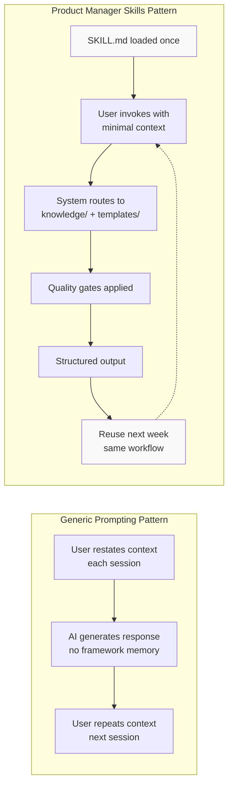
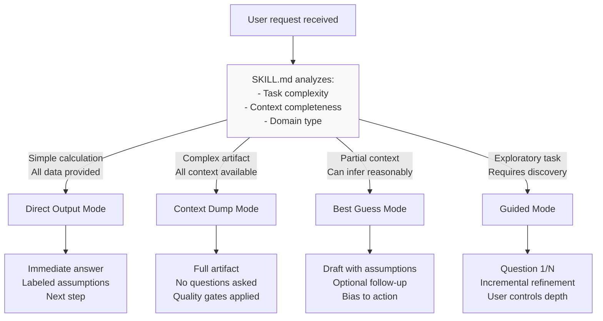
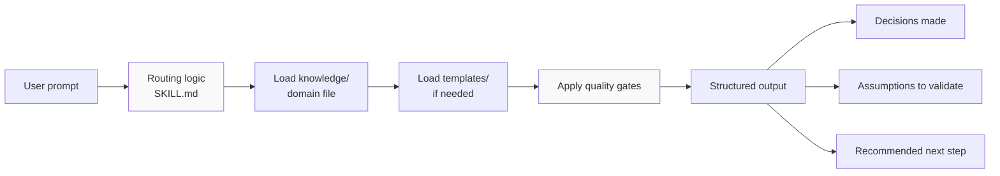
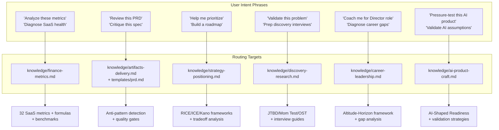

<!-- source: DeepWiki mcp.deepwiki.com · repo Digidai/product-manager-skills · page 6 Usage Patterns · fetched 2026-10-26 -->

# Usage Patterns

<details>
<summary>Relevant source files</summary>

The following files were used as context for generating this wiki page:

- [README.md](README.md)

</details>


## Purpose and Scope

This page documents how to use the Product Manager Skills system in real PM workflows. It covers invocation patterns, interaction modes in practice, and common usage scenarios. For detailed weekly workflow rituals, see [Weekly PM Workflows](#6.1). For step-by-step walkthroughs of key examples, see [Example Sessions](#6.2).

This is not about installation (see [Installation](#2.1)) or the internal routing mechanics (see [Routing System](#3.2)). This is about how you actually work with the skill after it's loaded into your AI coding tool.

---

## Core Usage Model: Reusable Workflows vs. One-Off Prompting

The fundamental architectural difference between this skill and generic AI prompting is **persistent PM context**. Once installed, SKILL.md loads into your AI tool's context and remains available across sessions. You don't re-explain PM concepts or frameworks each time you use it.



**Sources:** [README.md:159-165](), [README.md:127-135]()

This enables **weekly ritual usage**:
- Same diagnostic prompt every Friday to check SaaS health
- Same PRD review prompt before sharing with engineering
- Same roadmap pressure-test prompt every planning cycle

The skill carries the routing table, frameworks, and quality gates. You carry the product context.

---

## Entry Points: Three Starter Workflows

The system is designed around three high-leverage entry points that demonstrate routing, interaction modes, and quality validation. These are documented in detail in [Example Sessions](#6.2), but here's how to invoke them:

| Workflow | Invocation Prompt | Routing Target | Output Type |
|----------|------------------|----------------|-------------|
| **SaaS Health Diagnostic** | `"Analyze these metrics: MRR $50k, 500 customers, gross margin 80%, monthly churn 8%, CAC $500."` | `knowledge/finance-metrics.md` | Direct Output with calculations |
| **PRD Review** | `"Review this PRD draft like a strong PM peer. Flag bad framing, missing metrics, solution smuggling, and delivery risk."` | `knowledge/artifacts-delivery.md` + anti-pattern detection | Context Dump with pushback |
| **Director Readiness Coaching** | `"I'm a senior PM interviewing for Director roles in 90 days. Diagnose my gaps and coach me."` | `knowledge/career-leadership.md` | Guided interaction (multi-turn) |

**Sources:** [README.md:23-30](), [README.md:59-114]()

These three workflows exercise different parts of the system:
- SaaS diagnostic uses **formula-based calculations** from the Finance domain
- PRD review uses **anti-pattern detection** and applies quality gates
- Director coaching uses **Guided interaction mode** because it requires gathering context about experience, team size, and specific gaps

---

## Interaction Mode Selection in Practice

The system selects one of four interaction modes based on request complexity and available context. This is governed by the routing logic in SKILL.md, but from a user perspective, here's what triggers each mode:



**Sources:** [README.md:149-157]()

### Direct Output Mode
**Trigger:** Metrics calculation, simple framing question, diagnostic request with complete data.

**Example:**
```
Input: "What's the payback period if CAC is $800 and ARPA is $120 with 82% gross margin?"
Output: Payback = CAC / (ARPA × Gross Margin) = $800 / ($120 × 0.82) = 8.13 months
```

Routed through: SKILL.md → `knowledge/finance-metrics.md` → Direct calculation → Output

### Context Dump Mode
**Trigger:** User provides full context upfront (e.g., "Here's my PRD draft [paste], review it").

**Behavior:** No questions asked. System applies frameworks from appropriate knowledge domain, runs quality gates, outputs critique. This is the mode used for PRD reviews, roadmap critiques, and user story rewrites.

### Best Guess Mode
**Trigger:** Partial context but task is clear enough to draft something useful.

**Example:**
```
Input: "Write a PRD for notification preferences."
Behavior: Generates draft PRD with [assumption] labels, then offers: "Would you like me to refine the problem statement, success metrics, or scope?"
```

Routed through: SKILL.md → `knowledge/artifacts-delivery.md` → `templates/prd.md` → Populated with reasonable defaults → Quality gates → Output with labeled assumptions

### Guided Mode
**Trigger:** Genuinely exploratory tasks like career coaching, problem discovery, or complex strategy questions.

**Example:**
```
Input: "Help me validate this product idea."
Behavior: "Let's use the Mom Test approach. Question 1/5: What specific problem are you solving, and how do you currently know it exists?"
```

This mode uses incremental discovery as defined in the Discovery & Research domain.

**Sources:** Referenced in SKILL.md execution workflow (see [Execution Workflow](#3.1) and [Interaction Protocols](#3.3))

---

## Session Structure and Output Format

Every interaction follows a consistent structure, regardless of which mode is used:



**Sources:** [README.md:149-157]()

### Standard Output Components

Every output includes three mandatory sections:

1. **Decisions Made**: What choices were made, what was prioritized, what was explicitly excluded
2. **Assumptions to Validate**: Inline `[assumption]` labels plus a summary list
3. **Recommended Next Step**: Concrete action, not generic advice

Example from SaaS diagnostic:
```
Decisions Made:
- Do not scale acquisition until retention is understood
- Focus on cohort-by-cohort churn analysis before growth initiatives

Assumptions to Validate:
- [assumption] Churn is evenly distributed across customer cohorts
- [assumption] CAC is consistent across channels

Recommended Next Step:
Run cohort retention analysis for last 6 months to identify if churn concentrates in specific segments.
```

**Sources:** [README.md:68-75]()

---

## Weekly Ritual Patterns (Overview)

The skill is strongest when reused in recurring PM workflows. The typical pattern:

| Day | Workflow | Invocation |
|-----|----------|-----------|
| **Monday** | Roadmap review + prioritization | `"Review this roadmap and tell me where stakeholder requests are outweighing evidence"` |
| **Mid-week** | PRD/Epic/Story critique | `"Review this PRD for solution smuggling, weak metrics, and overscoping"` |
| **Friday** | SaaS health check | `"Analyze these metrics: [paste current numbers]"` |
| **Quarterly** | Career/altitude check | `"I'm targeting [role]. Diagnose gaps based on [recent wins]"` |

**Sources:** [README.md:159-165]()

This creates a **reusable PM operator** pattern:
1. Load the skill once per environment (Claude Code, Cursor, etc.)
2. Invoke the same diagnostic/review prompts weekly
3. System applies the same frameworks and gates each time
4. You get consistent rigor without re-teaching PM concepts

For detailed workflow walkthroughs, see [Weekly PM Workflows](#6.1).

---

## Invocation Syntax and Routing

The routing table in SKILL.md maps natural language intent phrases to specific knowledge domains and templates. Here's how common phrases route:



**Sources:** Referenced in [Routing System](#3.2), implemented across knowledge domain files

You don't need to memorize routing rules. The system matches intent phrases to domains automatically. Key insight: **use domain-specific vocabulary** to get better routing:
- "Churn" and "CAC" → Finance domain
- "Solution smuggling" and "acceptance criteria" → Artifacts domain
- "Positioning" and "TAM" → Strategy domain
- "Mom Test" and "JTBD" → Discovery domain
- "Altitude" and "Three Ps" → Career domain
- "Context engineering" and "agent orchestration" → AI Craft domain

---

## Common Usage Scenarios

Beyond the three starter workflows, here are other frequent usage patterns:

### Scenario: Feature Prioritization Request

**Input:**
```
Stakeholder wants feature X. We have features Y and Z in backlog. 
Current capacity: 2 engineers for 3 weeks. Help me prioritize.
```

**Routing:** `knowledge/strategy-positioning.md` (RICE/ICE frameworks)

**Interaction Mode:** Context Dump (enough info to evaluate)

**Output:** RICE scores with explicit tradeoffs, recommendation, and what gets deferred

---

### Scenario: User Story Rewrite

**Input:**
```
Rewrite this user story with proper Gherkin acceptance criteria:
"As a user, I want to export data so I can analyze it offline."
```

**Routing:** `knowledge/artifacts-delivery.md` → `templates/user-story.md`

**Interaction Mode:** Best Guess (will make assumptions about export format, data scope)

**Output:** Rewritten story with Given/When/Then criteria, labeled assumptions, scope constraints

---

### Scenario: Interview Prep for PM → Director

**Input:**
```
I'm interviewing for Director PM at a B2B SaaS company. 
I manage 3 PMs, strong on execution, less proven on org-level strategy. 
What stories do I need?
```

**Routing:** `knowledge/career-leadership.md` (Altitude-Horizon, Three Ps frameworks)

**Interaction Mode:** Guided (needs to probe for specific experiences)

**Output:** Gap diagnosis, 3-5 story templates, interview rehearsal questions

---

### Scenario: Lean UX Canvas for New Initiative

**Input:**
```
Help me create a Lean UX Canvas for [initiative description].
```

**Routing:** `knowledge/discovery-research.md` → `templates/lean-ux-canvas.md`

**Interaction Mode:** Best Guess if minimal context, Guided if no context provided

**Output:** Populated canvas with business problem, outcomes, users, solutions, hypotheses, and what's most risky

---

## Integration with Templates and Examples

The skill references three types of supporting files:

| Directory | Purpose | Usage Pattern |
|-----------|---------|---------------|
| `knowledge/` | Framework content and domain expertise | Loaded during routing to provide substance |
| `templates/` | Structural scaffolds for artifacts | Populated with framework-driven content |
| `examples/` | Trust-building demonstrations | Referenced for expected output quality |

When you invoke a workflow, the system:
1. Routes to the appropriate `knowledge/*.md` file(s)
2. Loads relevant `templates/*.md` if generating an artifact
3. Applies frameworks from knowledge to populate templates
4. Runs quality gates to ensure rigor
5. Outputs in the format demonstrated in `examples/`

**Sources:** [README.md:177-187](), directory structure

For detailed template mechanics, see [Template Architecture](#5.1). For example walkthroughs, see [Example Sessions](#6.2).

---

## Summary: How to Use This Skill Effectively

1. **Install once** per AI coding environment (see [Installation](#2.1))
2. **Invoke with starter prompts** from [Quick Start Guide](#2.2) or [STARTER-PROMPTS.md]()
3. **Reuse weekly** for recurring PM tasks (roadmap reviews, PRD critiques, metrics checks)
4. **Trust the routing** — use domain-specific vocabulary and let the system select frameworks
5. **Expect structured output** — every response includes decisions, assumptions, and next steps
6. **Leverage interaction modes** — provide more context for Direct/Context Dump, less for Guided mode

The skill performs best when you treat it as a **persistent PM operator** rather than a one-off prompt assistant. Load it, use it weekly, and let the frameworks compound.

For recurring workflow patterns, see [Weekly PM Workflows](#6.1). For detailed example sessions, see [Example Sessions](#6.2).

**Sources:** [README.md:14-22](), [README.md:159-165]()

---

