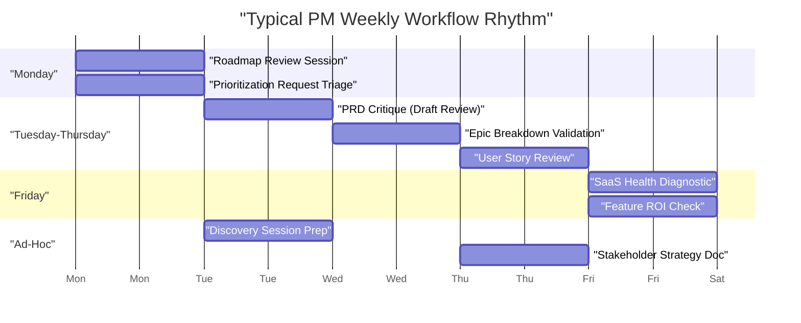
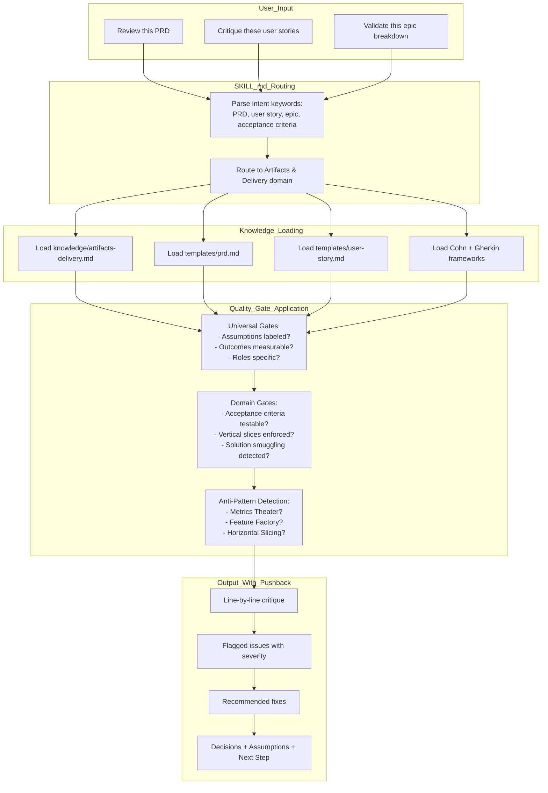
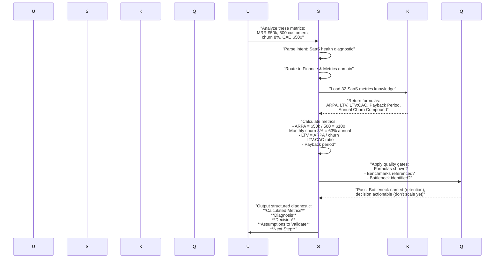
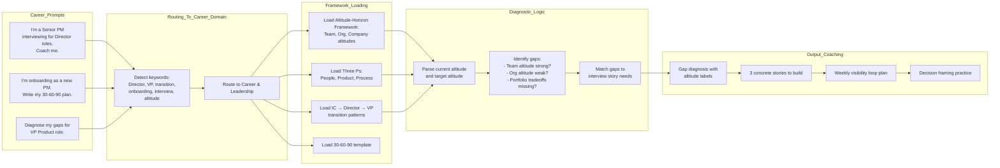
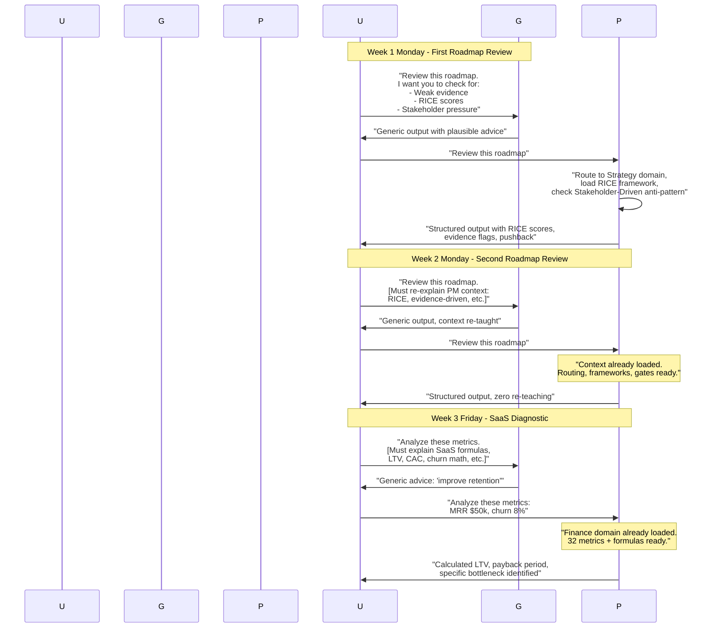

<!-- source: DeepWiki mcp.deepwiki.com · repo Digidai/product-manager-skills · page 6.1 Weekly PM Workflows · fetched 2026-10-26 -->

# Weekly PM Workflows

<details>
<summary>Relevant source files</summary>

The following files were used as context for generating this wiki page:

- [README.md](README.md)

</details>


## Purpose and Scope

This page documents recurring usage patterns for the Product Manager Skills system. Unlike generic AI prompting that requires fresh context each session, this skill is designed for weekly rituals where PMs repeatedly perform similar workflows (roadmap reviews, PRD critiques, metrics diagnostics, career coaching). The system maintains PM workflow context across sessions through the loaded SKILL.md routing and knowledge base.

For detailed walkthrough examples of specific sessions, see [Example Sessions](#6.2). For general usage guidance, see [Usage Patterns](#6). For installation and initial setup, see [Quick Start Guide](#2.2).

**Sources:** [README.md:159-165]()

---

## Weekly Ritual Architecture

Product management work is inherently cyclical: roadmaps are reviewed at regular intervals, PRDs are critiqued before engineering handoff, metrics are diagnosed weekly or monthly, and career development happens in seasonal bursts. The Product Manager Skills system is architected to support these recurring patterns by loading the PM workflow once and reusing it across sessions.

The key architectural difference from generic prompting is that `SKILL.md` remains loaded in the AI tool's context, eliminating the need to re-explain PM frameworks, quality standards, or evaluation criteria each time you perform a similar task.

### Weekly Rhythm Overview



**Sources:** [README.md:159-165]()

---

## Monday: Roadmap & Prioritization Review

### Workflow Purpose

Monday sessions focus on roadmap adjustments, prioritization framework application, and stakeholder request evaluation. The goal is to pressure-test new requests and roadmap changes before they cascade into planning and delivery commitments.

### Routing and Knowledge Loading

When you prompt for roadmap or prioritization work, `SKILL.md` routes to the **Strategy & Positioning** domain and loads frameworks including RICE, ICE, Kano, Geoffrey Moore positioning, and Now/Next/Later roadmap structures.

```mermaid
stateDiagram-v2
    [*] --> "Parse_Intent"
    
    "Parse_Intent" --> "Route_To_Strategy": "Roadmap/Prioritization keywords detected"
    
    "Route_To_Strategy" --> "Load_Knowledge"
    note right of "Load_Knowledge"
        Files loaded:
        - knowledge/strategy-positioning.md
        - Frameworks: RICE, ICE, Kano
        - Now/Next/Later structure
    end note
    
    "Load_Knowledge" --> "Apply_Framework"
    
    "Apply_Framework" --> "RICE_Scoring": "Quantitative request"
    "Apply_Framework" --> "Moore_Positioning": "Market context needed"
    "Apply_Framework" --> "Kano_Analysis": "Feature category unclear"
    
    "RICE_Scoring" --> "Quality_Gates"
    "Moore_Positioning" --> "Quality_Gates"
    "Kano_Analysis" --> "Quality_Gates"
    
    "Quality_Gates" --> "Check_Anti_Patterns"
    
    "Check_Anti_Patterns" --> "Flag_Stakeholder_Driven": "Evidence weak"
    "Check_Anti_Patterns" --> "Flag_Feature_Factory": "Problem framing missing"
    "Check_Anti_Patterns" --> "Pass": "Gates satisfied"
    
    "Flag_Stakeholder_Driven" --> "Output_With_Pushback"
    "Flag_Feature_Factory" --> "Output_With_Pushback"
    "Pass" --> "Output_With_Recommendations"
    
    "Output_With_Pushback" --> [*]
    "Output_With_Recommendations" --> [*]
```

**Sources:** [SKILL.md]() (routing logic), [knowledge/strategy-positioning.md]() (framework content)

### Typical Monday Prompts

| Prompt Pattern | Routed Framework | Expected Output |
|---|---|---|
| "Review this roadmap and flag where stakeholder requests outweigh evidence" | Stakeholder-Driven Roadmap anti-pattern detection | List of items with weak evidence, recommended validation steps |
| "Score these 5 features using RICE" | RICE prioritization framework | Reach × Impact × Confidence / Effort scores with assumptions labeled |
| "Position this feature in a Now/Next/Later roadmap" | Now/Next/Later structure | Placement with explicit rationale and tradeoffs |
| "Analyze this request using Kano" | Kano model (Must-be/Performance/Delight) | Category classification with customer satisfaction impact |

### Output Structure for Roadmap Reviews

Every roadmap review session outputs:
- **Decisions Made:** Which items are recommended for Now vs. Next vs. Later
- **Assumptions to Validate:** Market sizing, customer demand, competitive timing
- **Recommended Next Step:** Specific validation activity (e.g., "Run 3 Mom Test interviews with target persona")

**Sources:** [README.md:159-165](), [SKILL.md]() (operating principles section)

---

## Mid-Week: PRD & Artifact Critique

### Workflow Purpose

Mid-week sessions focus on critiquing PRDs, user stories, epics, and other delivery artifacts before they reach engineering. The system applies domain-specific quality gates to catch solution smuggling, weak metrics, overscoping, and horizontal slicing.

### Routing and Knowledge Loading

PRD and artifact critique prompts route to the **Artifacts & Delivery** domain, loading templates and quality validation logic.



**Sources:** [SKILL.md]() (routing table and quality gates section), [templates/prd.md](), [templates/user-story.md]()

### Typical Mid-Week Prompts

| Prompt Pattern | Applied Quality Gates | Detected Anti-Patterns |
|---|---|---|
| "Review this PRD for a notification preferences feature" | Measurable outcomes, testable acceptance criteria, vertical slicing | Solution Smuggling, Metrics Theater, Overscoping |
| "Critique these user stories for login flow" | Gherkin Given/When/Then format, specific roles, independent/negotiable | Horizontal Slicing (tech layers instead of value slices) |
| "Validate this epic breakdown for onboarding" | Testable hypotheses, thin vertical slices, measurable outcomes | Premature Scaling, Feature Factory |

### PRD Critique Workflow Detail

When you prompt "Review this PRD", the system executes:

1. **Load Template Structure:** `templates/prd.md` defines expected sections
2. **Check Universal Gates:** Assumptions labeled inline with `[assumption]` tags?
3. **Check Artifacts Gates:** Are acceptance criteria testable? Are success metrics quantified with baseline/target/guardrail?
4. **Detect Solution Smuggling:** Does the problem statement pre-assume the solution? (e.g., "Users need a dashboard")
5. **Detect Metrics Theater:** Are metrics cited without context, benchmarks, or tradeoff analysis?
6. **Output Critique:** Line-by-line flags with severity (RED FLAG, MISSING, WEAK)

**Sources:** [README.md:79-96](), [templates/prd.md](), [SKILL.md]() (quality gates section)

---

## Friday: Metrics & Business Health Diagnostic

### Workflow Purpose

Friday sessions focus on SaaS health diagnostics, feature ROI checks, and business metric analysis. The goal is to calculate precise metrics, identify bottlenecks, and make actionable decisions about scaling, retention, or acquisition strategy.

### Routing and Knowledge Loading

Metrics-related prompts route to the **Finance & Metrics** domain, loading the 32 SaaS metrics with formulas, benchmarks, and diagnostic logic.



**Sources:** [README.md:59-77](), [knowledge/finance-metrics.md]()

### Typical Friday Prompts

| Prompt Pattern | Calculated Metrics | Diagnostic Focus |
|---|---|---|
| "Analyze these metrics: MRR $50k, 500 customers, churn 8%, CAC $500" | ARPA, LTV, LTV:CAC, Payback Period, Annual Churn | Retention bottleneck, acquisition scaling risk |
| "Calculate unit economics for this SaaS: ARR $2M, 200 customers, CAC $5k, gross margin 75%" | ARPA, LTV, LTV:CAC, Months to Recover CAC, Rule of 40 | Efficient growth vs. profitability tradeoff |
| "Diagnose churn: 500 customers, 40 churned this month" | Monthly Churn Rate, Annual Churn Compound, Cohort Analysis needs | Retention crisis, need cohort-level breakdown |

### SaaS Health Diagnostic Output Structure

A Friday metrics session outputs:

1. **Calculated Metrics:** Exact formulas shown (not just results)
2. **Diagnosis:** Specific bottleneck identified (e.g., "retention is NOT workable")
3. **Decision:** Actionable directive (e.g., "Do not scale acquisition until churn understood cohort by cohort")
4. **Assumptions to Validate:** What data is missing or estimated
5. **Next Step:** Specific next action (e.g., "Run cohort analysis by signup month")

**Sources:** [README.md:69-75](), [SKILL.md]() (operating principles: outcome-oriented, bias to action)

---

## Career Season: Leadership Development Sessions

### Workflow Purpose

Career season sessions focus on PM-to-Director, Director-to-VP transitions, interview story rehearsal, 30-60-90 onboarding plans, and altitude-appropriate skill coaching. These are typically used in quarterly bursts when interviewing, onboarding, or seeking promotion.

### Routing and Knowledge Loading

Career and leadership prompts route to the **Career & Leadership** domain, loading the Altitude-Horizon framework, Three Ps (People/Product/Process), and transition coaching logic.



**Sources:** [README.md:99-114](), [knowledge/career-leadership.md]()

### Typical Career Season Prompts

| Prompt Pattern | Applied Framework | Coaching Output |
|---|---|---|
| "I'm a Senior PM interviewing for Director roles in 90 days. Coach me." | Altitude-Horizon, Three Ps | Gap diagnosis (weak org altitude), 3 stories to build, visibility loop plan |
| "Write my 30-60-90 plan as a new PM at a B2B SaaS company" | 30-60-90 template, Discovery frameworks | Onboarding plan with listening tour, discovery sessions, first decisions |
| "Diagnose my readiness for VP Product" | Altitude-Horizon (Company altitude), Three Ps at portfolio scale | Portfolio tradeoff fluency check, cross-functional influence assessment |

### Career Coaching Output Structure

Career sessions output:

1. **Current State Diagnosis:** Altitude strengths and weaknesses (e.g., "Strong team altitude, weak org altitude")
2. **Gap Analysis:** Specific missing skills or story types (e.g., "You describe execution wins but not portfolio tradeoffs")
3. **Action Plan:** 3-5 concrete next steps with weekly cadence (e.g., "Collect 3 stories showing org-level impact")
4. **Practice Areas:** Skills to rehearse (e.g., "Decision framing with explicit tradeoffs")

**Sources:** [README.md:107-112](), [knowledge/career-leadership.md]()

---

## Session Context Persistence

### How Context Reuse Works

Unlike generic prompting, where you must re-explain PM context every session, the Product Manager Skills system loads `SKILL.md` once into the AI tool's context. This file contains:

- The **routing table** mapping intent keywords to knowledge domains
- The **interaction protocol** logic (Guided/Context Dump/Best Guess/Direct Output)
- The **quality gates** (universal and domain-specific)
- The **operating principles** (outcome-oriented, evidence-driven, etc.)

Once loaded, these remain available across sessions. When you return on Friday to run another SaaS diagnostic, the system immediately routes to `knowledge/finance-metrics.md` without needing you to explain "calculate LTV as ARPA divided by churn rate" again.

### Generic Prompting vs. Skill-Based Workflow



**Sources:** [README.md:134]() (comparison table), Diagram 5 from system architecture

### Files Persisted in Tool Context

When installed, these files remain loaded:

| File Path | Size | Purpose |
|---|---|---|
| `SKILL.md` | ~500 lines | Core orchestrator: routing, protocols, quality gates |
| `knowledge/discovery-research.md` | ~400 lines | Discovery frameworks (JTBD, Mom Test, PoL Probes) |
| `knowledge/strategy-positioning.md` | ~400 lines | Strategy frameworks (RICE, Moore, Kano, roadmaps) |
| `knowledge/artifacts-delivery.md` | ~400 lines | Artifact frameworks (PRD, user stories, epics) |
| `knowledge/finance-metrics.md` | ~500 lines | 32 SaaS metrics with formulas and benchmarks |
| `knowledge/career-leadership.md` | ~400 lines | Career frameworks (Altitude-Horizon, Three Ps) |
| `knowledge/ai-product-craft.md` | ~300 lines | AI product frameworks (Context Engineering, Agent Orchestration) |
| `templates/*.md` | ~1,200 lines total | 12+ templates (PRD, user story, Lean UX Canvas, etc.) |

**Total:** ~27 files, ~2,800 lines, <200KB

**Sources:** [README.md:187]()

---

## Customizing Weekly Rituals

### Defining Your Own Recurring Workflows

While the default weekly patterns (Monday roadmap, mid-week PRD, Friday metrics) match common PM rhythms, you can define custom recurring prompts based on your team's cadence.

**Examples of Custom Rituals:**

| Custom Workflow | Frequency | Prompt Pattern |
|---|---|---|
| Sprint Planning Validation | Every 2 weeks | "Review these stories for vertical slicing and testable acceptance criteria" |
| Quarterly OKR Review | Every 13 weeks | "Evaluate these OKRs: are outcomes measurable? Are key results leading or lagging?" |
| Monthly Churn Cohort Analysis | First Friday of month | "Analyze churn by cohort for customers who signed up in [Month]. Diagnose retention." |
| Bi-Weekly Competitive Intel Review | Every other Monday | "Update competitive positioning for [Product] based on this intel" |
| Weekly Discovery Session Prep | Every Thursday | "Prep Mom Test questions for interviews on [Problem Space]" |

### Saving Prompt Templates

You can maintain a personal `my-prompts.md` file with your recurring workflows:

```markdown
# My Weekly PM Rituals

## Monday 9am: Roadmap Triage
Review this roadmap and flag where stakeholder requests outweigh evidence:
[paste roadmap]

## Wednesday 2pm: PRD Review
Review this PRD for solution smuggling, weak metrics, and overscoping:
[paste PRD]

## Friday 10am: SaaS Health Check
Analyze these metrics: MRR [X], customers [Y], churn [Z]%, CAC $[W]
```

**Sources:** [STARTER-PROMPTS.md]()

### Adapting to Your PM Context

The system's routing and quality gates work across different PM contexts (B2B SaaS, B2C marketplace, AI products, internal tools) because they apply universal PM principles (measurable outcomes, labeled assumptions, named tradeoffs). However, you can bias the system toward your context by including context keywords in your prompts:

- "Review this PRD for a B2B SaaS feature targeting enterprise IT buyers"
- "Analyze these marketplace metrics: GMV, take rate, buyer retention"
- "Validate this AI product hypothesis using PoL probes"

The routing system will still apply the correct domain and frameworks, but the output will be contextualized to your stated environment.

**Sources:** [SKILL.md]() (routing table with multi-domain handling)

---

## Summary: Weekly Rhythm Benefits

By establishing weekly PM rituals with the Product Manager Skills system, you:

1. **Eliminate Context Re-Teaching:** The routing table, frameworks, and quality gates remain loaded across sessions
2. **Enforce Consistent Standards:** Every roadmap, PRD, or metric diagnostic applies the same rigor
3. **Build Muscle Memory:** Recurring prompts become shorthand for complex PM workflows
4. **Catch Problems Early:** Friday metrics checks and mid-week PRD critiques prevent downstream issues
5. **Maintain Accountability:** Outputs always include Decisions, Assumptions, and Next Steps

The system's value compounds with repeated usage: the more you run the same type of diagnostic (e.g., SaaS health check), the faster you can interpret results and make decisions.

**Sources:** [README.md:159-165](), [README.md:134]() (comparison table)

---

