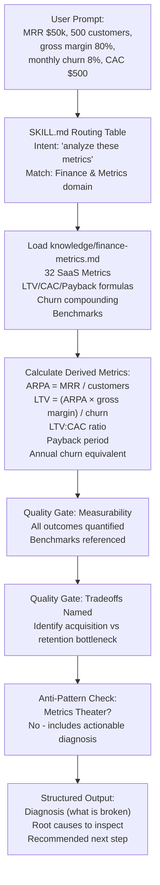
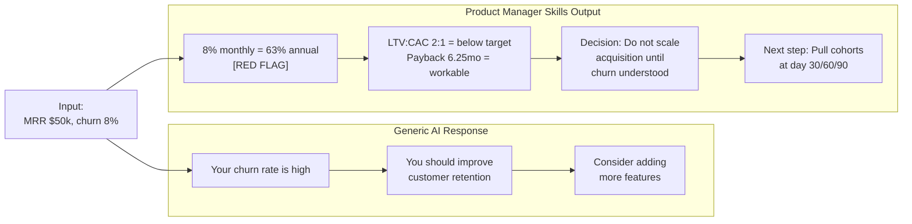
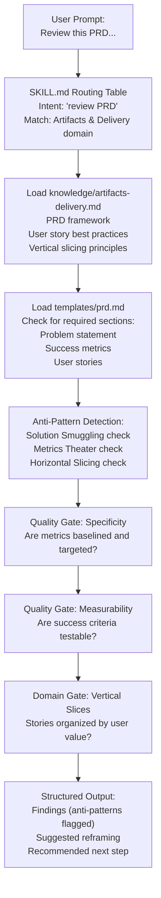
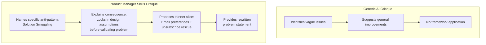
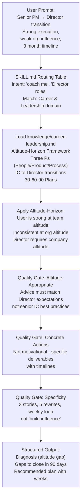
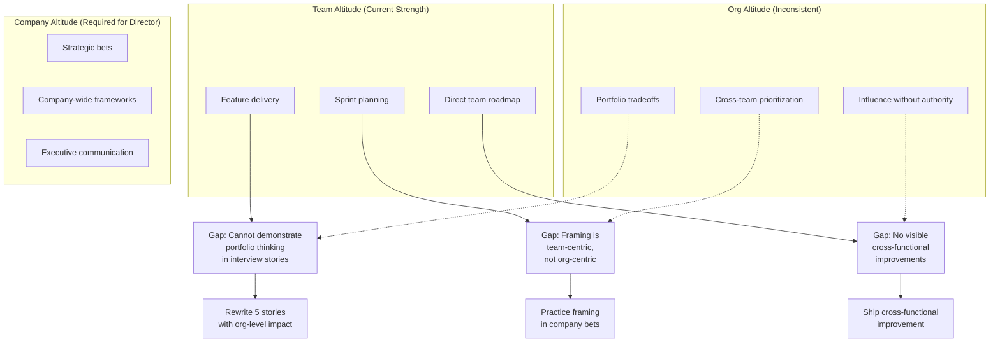
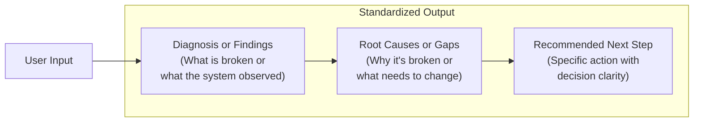

<!-- source: DeepWiki mcp.deepwiki.com · repo Digidai/product-manager-skills · page 6.2 Example Sessions · fetched 2026-10-26 -->

# Example Sessions

<details>
<summary>Relevant source files</summary>

The following files were used as context for generating this wiki page:

- [examples/director-coaching.md](examples/director-coaching.md)
- [examples/prd-review.md](examples/prd-review.md)
- [examples/saas-health-diagnostic.md](examples/saas-health-diagnostic.md)

</details>


This page provides detailed walkthroughs of three representative sessions that demonstrate how the Product Manager Skills system applies frameworks, enforces quality gates, and produces rigorous outputs. Each session shows the complete execution flow from user prompt through routing, knowledge application, and validation.

For information about recurring weekly workflows (Monday roadmap reviews, Friday metrics checks), see [Weekly PM Workflows](#6.1). For the technical details of the routing system and quality gates, see [Routing System](#3.2) and [Quality Gates](#3.4).

---

## Session 1: SaaS Health Diagnostic

### Scenario

A product manager has a small set of business metrics and needs a fast diagnosis of what is actually broken, not a generic finance lecture. This session demonstrates routing to the Finance & Metrics domain and application of the 32 SaaS metrics framework.

**Sources:** [examples/saas-health-diagnostic.md:1-38]()

### User Prompt

```text
Analyze these metrics: MRR $50k, 500 customers, gross margin 80%, monthly churn 8%, CAC $500.
```

### Execution Flow



**Sources:** [examples/saas-health-diagnostic.md:1-15](), [SKILL.md:routing-table-section]()

### Output Breakdown

The system produces a three-part structured response following the standardized output format defined in [SKILL.md:close-section]():

| Section | Content | Framework Applied |
|---------|---------|-------------------|
| **Diagnosis** | 8% monthly churn → 63% annual churn (RED FLAG)<br/>ARPA $100, LTV $1,000, LTV:CAC 2:1<br/>Payback 6.25 months = workable<br/>Retention = NOT workable | Churn compounding formula from `knowledge/finance-metrics.md`<br/>LTV calculation: (ARPA × gross margin) / monthly churn<br/>LTV:CAC benchmark: healthy = 3:1+ |
| **Root Causes** | Weak activation in first 14 days<br/>Low repeat value for core job<br/>Poor fit in acquisition cohorts | Pattern recognition from `knowledge/finance-metrics.md` churn analysis section |
| **Next Step** | Pull 3 monthly cohorts<br/>Compare retention at day 30/60/90<br/>Isolate biggest drop-off before changing spend | Evidence-driven principle:<br/>Cohort analysis before optimization |

**Sources:** [examples/saas-health-diagnostic.md:14-29]()

### Framework Application Details

The system applies multiple frameworks from [knowledge/finance-metrics.md]():

1. **ARPA Calculation**: `MRR / total_customers = $50,000 / 500 = $100`
2. **LTV Calculation**: `(ARPA × gross_margin) / monthly_churn = ($100 × 0.80) / 0.08 = $1,000`
3. **LTV:CAC Ratio**: `$1,000 / $500 = 2:1` (benchmark: 3:1 for healthy SaaS)
4. **Payback Period**: `CAC / (ARPA × gross_margin) = $500 / $80 = 6.25 months` (benchmark: <12 months)
5. **Annual Churn Equivalent**: `1 - (1 - 0.08)^12 ≈ 63%` (compounding formula)

**Sources:** [examples/saas-health-diagnostic.md:16-19](), [knowledge/finance-metrics.md]()

### Quality Gates Applied

| Gate Type | Validation | Result |
|-----------|------------|--------|
| **Universal: Measurability** | All metrics quantified with specific numbers | ✓ Pass |
| **Universal: Tradeoffs Named** | Explicitly states "bottleneck is retention, not acquisition" | ✓ Pass |
| **Universal: Assumptions Labeled** | Output uses "about" and "roughly" for estimates | ✓ Pass |
| **Domain-Specific: Formulas Included** | LTV, payback calculations shown inline | ✓ Pass |
| **Domain-Specific: Benchmarks Referenced** | Compares to "healthy SaaS target" | ✓ Pass |
| **Anti-Pattern: Metrics Theater** | Not just stats - includes actionable diagnosis | ✓ Pass |

**Sources:** [examples/saas-health-diagnostic.md:31-37](), [SKILL.md:quality-gates-section]()

### Comparison: Generic vs Skilled Output



**Key Differences:**

| Dimension | Generic AI | Product Manager Skills |
|-----------|------------|------------------------|
| **Diagnosis Specificity** | "Churn is high" | "8% monthly compounds to 63% annual - RED FLAG" |
| **Framework Application** | No calculations shown | LTV, payback, LTV:CAC formulas with benchmarks |
| **Decision Guidance** | "Improve retention" | "Do not scale acquisition until churn understood cohort by cohort" |
| **Next Action** | Generic advice | Specific analysis: "Pull 3 monthly cohorts, compare at day 30/60/90" |
| **Tradeoff Clarity** | Not addressed | Explicitly states retention vs acquisition bottleneck |

**Sources:** [examples/saas-health-diagnostic.md:31-37]()

---

## Session 2: PRD Review with Pushback

### Scenario

A product manager has a PRD draft and wants rigorous peer review, not grammar cleanup. This session demonstrates routing to the Artifacts & Delivery domain and anti-pattern detection (Solution Smuggling, Metrics Theater, Horizontal Slicing).

**Sources:** [examples/prd-review.md:1-37]()

### User Prompt

```text
Review this PRD for a notification preferences center. Flag solution smuggling, weak metrics, overscoping, and delivery risk. Be opinionated.
```

### Execution Flow



**Sources:** [examples/prd-review.md:1-28](), [SKILL.md:anti-pattern-section]()

### Output Breakdown

| Section | Content | Anti-Pattern Detected |
|---------|---------|----------------------|
| **Findings** | Problem statement is solution-smuggled: "users need a preferences dashboard" starts from UI, not user problem | **Solution Smuggling** ([SKILL.md:anti-pattern-7]()) |
| **Findings** | Success metrics incomplete: no baseline, no target, no guardrail | **Metrics Theater** ([SKILL.md:anti-pattern-1]()) |
| **Findings** | Scope too broad: channel controls, digest preferences, quiet hours, admin policy, migration = multiple slices | **Overscoping** (common PRD failure) |
| **Findings** | User stories are horizontal: API, UI, notification service separated instead of cut by user value | **Horizontal Slicing** ([SKILL.md:anti-pattern-6]()) |
| **Suggested Reframing** | Problem: users receive too many irrelevant notifications and lack confidence they can control frequency without missing critical updates | Proper problem framing from `knowledge/artifacts-delivery.md` |
| **Suggested Reframing** | First release: account-level email preferences + unsubscribe rescue flow + instrumentation | Vertical slice approach |
| **Next Step** | Rewrite problem statement and success metrics first. Do not expand solution detail until scope is sliced vertically. | Bias to action principle |

**Sources:** [examples/prd-review.md:14-28]()

### Anti-Pattern Detection Details

The system applies the anti-pattern detection logic from [SKILL.md:anti-pattern-section]():

**1. Solution Smuggling Detection**
- **Trigger**: Problem statement begins with "users need a [UI component]"
- **Pattern**: Starting from solution instead of user problem
- **Consequence**: Locks in design assumptions before validating problem
- **Remediation**: Reframe as user struggle or unmet outcome

**2. Metrics Theater Detection**
- **Trigger**: Success metrics present but no baseline, target, or guardrail
- **Pattern**: Metrics listed for appearance, not measurement
- **Consequence**: No way to determine success or failure
- **Remediation**: Add baseline (current state), target (success threshold), guardrail (acceptable risk)

**3. Horizontal Slicing Detection**
- **Trigger**: User stories organized by technical layer (API, UI, backend)
- **Pattern**: Stories cannot be independently shipped as value to users
- **Consequence**: Long integration phase, delayed user feedback
- **Remediation**: Reorganize by user-facing capability (e.g., "User can unsubscribe from email digests")

**Sources:** [examples/prd-review.md:14-21](), [SKILL.md:anti-pattern-detection]()

### Quality Gates Applied

| Gate Type | Validation | Result |
|-----------|------------|--------|
| **Universal: Anti-Patterns Flagged** | 3 anti-patterns explicitly named (Solution Smuggling, Metrics Theater, Horizontal Slicing) | ✓ Pass |
| **Universal: Tradeoffs Named** | Explains consequence of each anti-pattern | ✓ Pass |
| **Universal: Specificity** | Proposes specific reframing, not just "improve the PRD" | ✓ Pass |
| **Domain-Specific: Acceptance Criteria Testable** | Flags missing baseline/target as untestable | ✓ Pass |
| **Domain-Specific: Vertical Slices Enforced** | Explicitly calls out horizontal slicing and proposes vertical alternative | ✓ Pass |

**Sources:** [examples/prd-review.md:30-37]()

### Comparison: Generic vs Skilled Output

| Review Type | Problem Identification | Remediation Provided | Actionable Next Step |
|-------------|----------------------|---------------------|---------------------|
| **Generic AI Review** | "The problem statement could be clearer" | "Try to make the problem more user-focused" | "Revise and resubmit" |
| **Product Manager Skills Review** | "Problem statement is solution-smuggled: 'users need a preferences dashboard' starts from UI, not user problem" | "Reframe as: users receive too many irrelevant notifications and lack confidence they can control frequency without missing critical updates" | "Rewrite problem statement and success metrics first. Do not expand solution detail until scope is sliced vertically." |

**Critique Quality Breakdown:**



**Sources:** [examples/prd-review.md:30-37]()

---

## Session 3: Director Readiness Coaching

### Scenario

A senior product manager is transitioning to Director-level responsibilities and needs altitude-appropriate coaching, not generic career advice. This session demonstrates routing to the Career & Leadership domain and application of the Altitude-Horizon Framework.

**Sources:** [examples/director-coaching.md:1-34]()

### User Prompt

```text
I'm a senior PM managing two PMs, strong on execution, weak on org influence, and interviewing for Director roles in 3 months. Coach me.
```

### Execution Flow



**Sources:** [examples/director-coaching.md:8-29](), [SKILL.md:career-domain-routing]()

### Output Breakdown

The system structures the coaching using the Altitude-Horizon Framework from [knowledge/career-leadership.md]():

| Section | Content | Framework Applied |
|---------|---------|-------------------|
| **Diagnosis** | Operating strongly at team altitude<br/>Inconsistent at org altitude<br/>Interview risk is not execution depth - it's proving you can shape priorities across teams and influence without direct authority | **Altitude-Horizon Framework**<br/>Team altitude = one team's roadmap<br/>Org altitude = portfolio across teams<br/>Company altitude = strategic bets |
| **Gaps to Close** | Build 3 stories showing portfolio tradeoffs, not just feature delivery<br/>Practice framing decisions in terms of company bets, not team output<br/>Create weekly visibility loop with engineering, design, GTM stakeholders | **Three Ps Framework**<br/>People = stakeholder relationships<br/>Product = portfolio thinking<br/>Process = cross-functional systems |
| **Recommended Plan** | Weeks 1-2: Inventory past projects, rewrite 5 stories using org-level impact language<br/>Weeks 3-6: Run mock interviews on conflict, strategy, delegation<br/>Weeks 7-12: Ship one visible cross-functional improvement and capture evidence of influence | **30-60-90 Plan Structure**<br/>Immediate = storytelling inventory<br/>Near-term = interview preparation<br/>Long-term = evidence creation |

**Sources:** [examples/director-coaching.md:14-29]()

### Altitude-Horizon Framework Application



**Sources:** [examples/director-coaching.md:16-18](), [knowledge/career-leadership.md:altitude-horizon-section]()

### Quality Gates Applied

| Gate Type | Validation | Result |
|-----------|------------|--------|
| **Universal: Specificity** | "3 stories", "5 rewrites", "weekly loop" - concrete numbers, not vague goals | ✓ Pass |
| **Universal: Measurability** | Timeline with specific week ranges (1-2, 3-6, 7-12) | ✓ Pass |
| **Universal: Assumptions Labeled** | "likely interview risk" acknowledges assumption | ✓ Pass |
| **Domain-Specific: Altitude-Appropriate** | Advice targets org/company altitude, not team altitude | ✓ Pass |
| **Domain-Specific: Concrete Actions** | Each gap has specific deliverable (stories, mock interviews, shipped improvement) | ✓ Pass |

**Sources:** [examples/director-coaching.md:20-29]()

### Comparison: Generic vs Skilled Output

| Dimension | Generic Career Coaching | Product Manager Skills Coaching |
|-----------|------------------------|--------------------------------|
| **Problem Diagnosis** | "You need to work on leadership skills" | "Operating strongly at team altitude, inconsistent at org altitude. Interview risk is proving portfolio tradeoffs." |
| **Gap Identification** | "Improve communication and influence" | "Build 3 stories showing portfolio tradeoffs. Practice framing in company bets. Create weekly stakeholder loop." |
| **Action Plan** | "Network more, take on bigger projects" | Week-by-week plan: 1-2 (inventory + rewrite), 3-6 (mock interviews), 7-12 (ship visible improvement) |
| **Framework** | Motivational, generic | Altitude-Horizon Framework + Three Ps |
| **Timeboxing** | "Over the next few months" | Specific week ranges tied to 90-day interview deadline |

**Why This Gets Reused:**

Career coaching becomes a weekly ritual when the advice is:
- **Altitude-specific**: Director advice differs from senior IC advice
- **Timeline-bound**: 90 days with weekly milestones
- **Evidence-oriented**: "Capture evidence of influence" for interview stories
- **Actionable**: Rewrite 5 stories vs "build influence"

**Sources:** [examples/director-coaching.md:31-34]()

---

## Cross-Session Execution Patterns

All three sessions follow the same execution architecture defined in [SKILL.md:execution-workflow]():

### Standardized Output Structure

Every session produces output in this three-part format:



**Sources:** [SKILL.md:close-section](), [examples/saas-health-diagnostic.md:14-29](), [examples/prd-review.md:14-28](), [examples/director-coaching.md:14-29]()

### Framework-to-Output Mapping

| Session | Domain Routed | Framework(s) Applied | Quality Gates Enforced | Anti-Pattern(s) Checked |
|---------|---------------|---------------------|----------------------|------------------------|
| **SaaS Health** | Finance & Metrics | 32 SaaS Metrics<br/>LTV/CAC/Payback<br/>Churn Compounding | Measurability<br/>Benchmarks Referenced<br/>Formulas Included | Metrics Theater |
| **PRD Review** | Artifacts & Delivery | PRD Structure<br/>Vertical Slicing<br/>User Story Best Practices | Testable Criteria<br/>Vertical Slices<br/>Anti-Patterns Flagged | Solution Smuggling<br/>Metrics Theater<br/>Horizontal Slicing |
| **Director Coaching** | Career & Leadership | Altitude-Horizon<br/>Three Ps<br/>30-60-90 Plans | Altitude-Appropriate<br/>Concrete Actions<br/>Specificity | None (coaching session) |

**Sources:** [SKILL.md:routing-table](), [SKILL.md:quality-gates]()

### Decision-Oriented Output Pattern

All three sessions convert analysis into **decisions**, not just observations:

| Session | Analysis | Decision |
|---------|----------|----------|
| **SaaS Health** | LTV:CAC is 2:1, churn is 63% annually | **Decision:** Do not scale acquisition until churn understood cohort by cohort |
| **PRD Review** | Scope includes 5 separate features with horizontal stories | **Decision:** Rewrite problem statement and success metrics first. Do not expand solution detail until scope is sliced vertically. |
| **Director Coaching** | Strong at team altitude, weak at org altitude, 3 months to interview | **Decision:** Inventory past projects and rewrite 5 stories using org-level impact language (weeks 1-2) |

This decision-oriented structure is enforced by the **Bias to Action** operating principle in [SKILL.md:operating-principles]().

**Sources:** [SKILL.md:operating-principles](), [examples/saas-health-diagnostic.md:26-29](), [examples/prd-review.md:26-28](), [examples/director-coaching.md:25-29]()

### Routing Table Pattern Recognition

The routing table in [SKILL.md:routing-section]() matches these intent phrases:

| User Intent Phrase | Domain Matched | Knowledge File Loaded | Template Loaded |
|-------------------|----------------|---------------------|-----------------|
| "analyze these metrics" | Finance & Metrics | `knowledge/finance-metrics.md` | None (direct calculation) |
| "review this PRD" | Artifacts & Delivery | `knowledge/artifacts-delivery.md` | `templates/prd.md` |
| "coach me" + "Director roles" | Career & Leadership | `knowledge/career-leadership.md` | None (guided interaction) |

**Sources:** [SKILL.md:routing-table]()

---

## Reusability Mechanisms

These three sessions become reusable workflows because they demonstrate:

1. **Consistent Framework Application**: The same Finance formulas apply to any set of SaaS metrics. The same Altitude-Horizon framework applies to any career transition.

2. **Quality Gate Enforcement**: The system always checks for Solution Smuggling, Metrics Theater, and Horizontal Slicing in PRD reviews.

3. **Standardized Output Format**: Users learn to expect Diagnosis → Root Causes → Next Step in every session.

4. **Decision Clarity**: Every session ends with a specific decision or action, not "keep improving."

These patterns enable weekly ritual usage documented in [Weekly PM Workflows](#6.1).

**Sources:** [examples/saas-health-diagnostic.md:31-37](), [examples/prd-review.md:30-37](), [examples/director-coaching.md:31-34]()

---

