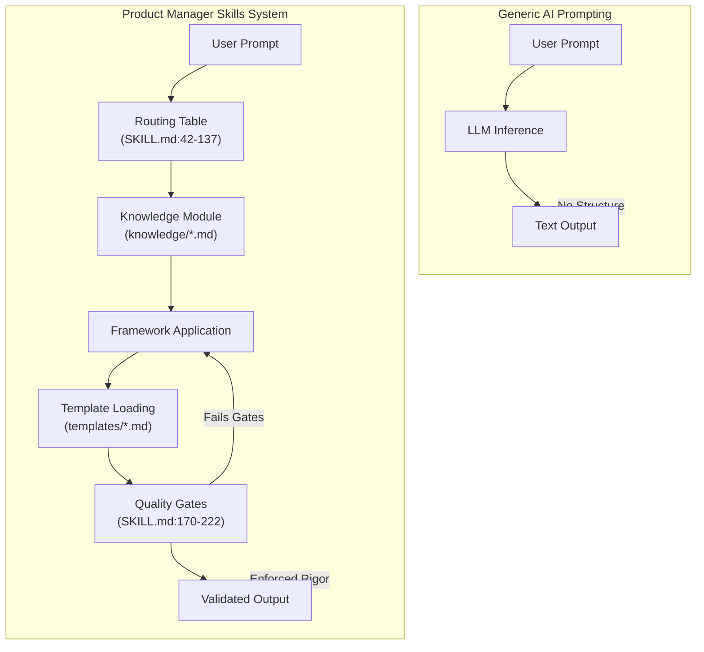
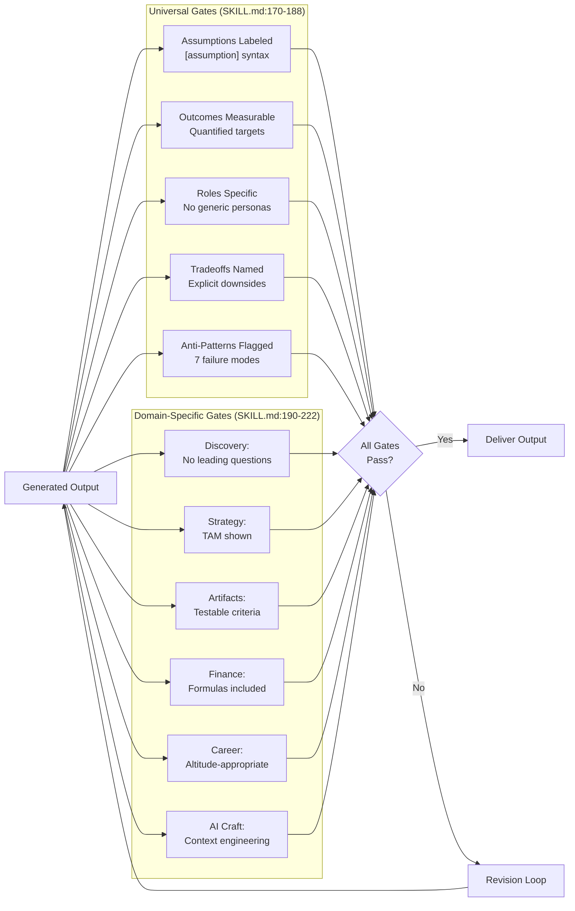
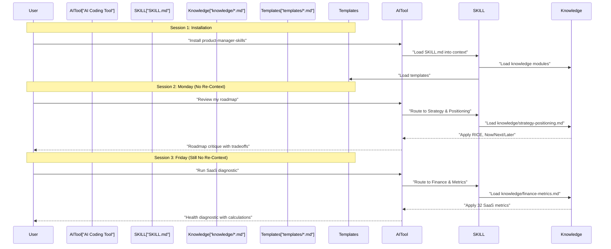
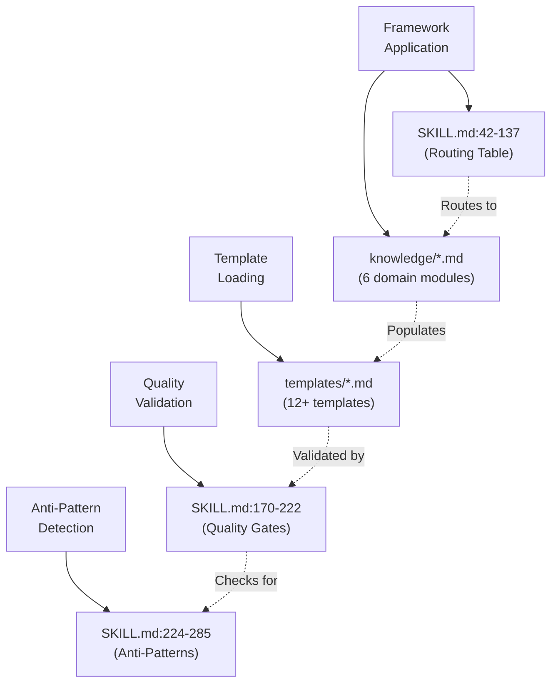

<!-- source: DeepWiki mcp.deepwiki.com · repo Digidai/product-manager-skills · page 7 System Comparison · fetched 2026-10-26 -->

# System Comparison

<details>
<summary>Relevant source files</summary>

The following files were used as context for generating this wiki page:

- [README.md](README.md)

</details>


This page explains the architectural and functional differences between the Product Manager Skills system and generic AI prompting. It documents the specific technical mechanisms that enable superior performance on product management workflows: framework routing, two-tier quality validation, anti-pattern detection, and reusable context architecture.

For information about the specific frameworks applied by the system, see [Knowledge Domains](#4). For details on the quality validation implementation, see [Quality Gates](#3.4). For the routing mechanism that selects frameworks, see [Routing System](#3.2).

---

## Architectural Comparison Overview

The fundamental difference is that generic AI prompting generates plausible text without enforced structure, while this system routes requests through a framework-based pipeline with validation checkpoints.



**Sources:** [SKILL.md:1-300](), [README.md:127-135]()

---

## Core Architectural Differences

### 1. Framework Application vs. Text Generation

Generic AI prompting relies on pattern matching from training data. This system loads specific PM frameworks from the `knowledge/` directory based on routing table matches.

| Aspect | Generic Prompting | Product Manager Skills System |
|--------|-------------------|-------------------------------|
| **Knowledge Source** | Training data patterns | Explicit knowledge modules in `knowledge/*.md` |
| **Framework Selection** | Implicit/probabilistic | Explicit routing table in `SKILL.md:42-137` |
| **Consistency** | Varies by prompt phrasing | Deterministic based on intent classification |
| **Framework Coverage** | Generic concepts | 30+ specific frameworks across 6 domains |
| **Extensibility** | Requires model retraining | Add files to `knowledge/` directory |

**Example Framework Application:**

When a user submits: *"Analyze these metrics: MRR $50k, 500 customers, churn 8%"*

- **Generic prompting:** Generates generic advice like "Your churn is high, consider improving retention"
- **This system:** Routes to `knowledge/finance-metrics.md`, applies 32 SaaS metrics formulas, calculates ARPA ($100), LTV ($1,000), LTV:CAC ratio (2:1), payback period (6.25 months), and identifies that 8% monthly churn = 63% annual churn is the primary bottleneck

**Sources:** [README.md:62-75](), [SKILL.md:42-137](), [knowledge/finance-metrics.md:1-500]()

---

### 2. Two-Tier Quality Gate System

The system enforces quality through validation checkpoints that generic prompting lacks.



**Universal Gates Implementation:**

| Gate | Enforcement Mechanism | Example |
|------|----------------------|---------|
| **Assumptions Labeled** | Inline `[assumption]` syntax required | "Users check email daily [assumption]" |
| **Outcomes Measurable** | Numeric targets mandatory | "Reduce churn from 8% to 5% monthly" not "improve retention" |
| **Roles Specific** | Concrete titles/contexts required | "Series B SaaS CTO" not "technical stakeholder" |
| **Tradeoffs Named** | Explicit downside documentation | "This prioritizes speed over testing coverage" |
| **Anti-Patterns Flagged** | Detects 7 common failures | Solution Smuggling, Metrics Theater, Feature Factory, etc. |

**Sources:** [SKILL.md:170-222](), [README.md:88-94]()

---

### 3. Anti-Pattern Detection System

The system actively identifies and pushes back on seven common PM failure modes. Generic prompting accepts problematic framing.

| Anti-Pattern | Detection Mechanism | Pushback Example |
|--------------|---------------------|------------------|
| **Solution Smuggling** | Problem statements that presuppose solutions | "Your problem statement is solution-smuggled: 'users need a preferences dashboard.' Reframe as evidence of user pain." |
| **Metrics Theater** | Success metrics without baselines/targets | "Your success metric has no baseline, target, or guardrail. 'Increase engagement' is not measurable." |
| **Feature Factory** | Roadmaps without problem framing | "This roadmap lists features without problem statements. What evidence validates each bet?" |
| **Confirmation Bias** | Leading questions in discovery | "This interview guide has leading questions. Use Mom Test principles: ask about past behavior, not future intentions." |
| **Premature Scaling** | Growth before product-market fit | "8% monthly churn = 63% annual churn. Do not scale acquisition until retention is understood cohort by cohort." |
| **Horizontal Slicing** | Technical layers instead of user value | "This epic is sliced horizontally (API layer, UI layer). Slice vertically: each release must deliver user value." |
| **Stakeholder-Driven Roadmap** | Requests without evidence | "This roadmap is stakeholder-driven. Which items have supporting evidence from users?" |

**Sources:** [SKILL.md:224-285](), [README.md:88-94](), [examples/prd-review.md:1-150]()

---

### 4. Reusable Workflow Architecture

Generic prompting requires context repetition in each session. This system loads `SKILL.md` once, creating a persistent PM workflow.



**Contrast with Generic Prompting:**

| Session | Generic Prompting | Product Manager Skills |
|---------|-------------------|------------------------|
| **Week 1** | "I'm a PM at a B2B SaaS. We have 500 customers, $50k MRR, 8% churn..." | "Run SaaS diagnostic" |
| **Week 2** | "I'm a PM at a B2B SaaS. Review this PRD. Our context is..." | "Review this PRD" |
| **Week 3** | "I'm a PM at a B2B SaaS. Help me prioritize..." | "Review roadmap" |

The system eliminates ~200 words of repeated context per request because routing, frameworks, and validation are pre-loaded.

**Sources:** [README.md:159-165](), [SKILL.md:1-40]()

---

## Detailed Comparison Matrix

| Dimension | Generic AI Prompting | Product Manager Skills System |
|-----------|---------------------|-------------------------------|
| **Architecture** | Stateless text generation | Stateful workflow with routing + validation |
| **Knowledge Representation** | Implicit in weights | Explicit in `knowledge/*.md` (27 files, ~2,800 lines) |
| **Framework Application** | Probabilistic pattern matching | Deterministic routing table (`SKILL.md:42-137`) |
| **Quality Assurance** | None | Two-tier gates (`SKILL.md:170-222`) |
| **Feedback Mechanism** | Accepts user framing | Pushes back on 7 anti-patterns |
| **Context Persistence** | Requires repetition each session | Loads once, reuses weekly |
| **Measurability** | Generic advice ("improve retention") | Quantified outputs ("reduce 8% to 5% monthly") |
| **Tradeoff Transparency** | Rarely mentioned | Mandatory per Universal Gate 4 |
| **Assumption Handling** | Implicit or omitted | Labeled inline with `[assumption]` |
| **Template Integration** | Generic structure | 12+ domain-specific templates in `templates/` |
| **Extensibility** | Requires model retraining | Add Markdown files to `knowledge/` or `templates/` |
| **Security Model** | Black box | Pure Markdown, zero scripts, fully inspectable |
| **Installation** | N/A (always available) | Platform-specific: ClawHub, npm, or manual upload |
| **Optimization Goal** | Politeness and coherence | Decisions, tradeoffs, and next steps |

**Sources:** [README.md:127-135](), [SKILL.md:1-300]()

---

## Example Output Comparisons

### Example 1: SaaS Health Diagnostic

**Input:** *"Analyze these metrics: MRR $50k, 500 customers, gross margin 80%, monthly churn 8%, CAC $500."*

#### Generic AI Output:
```
Your churn rate of 8% is slightly high for a SaaS business. Industry 
benchmarks suggest aiming for 5-7% monthly churn. Consider implementing 
customer success programs to improve retention. Your MRR shows healthy 
growth, and your customer base is solid. Focus on understanding why 
customers are churning and address those pain points.
```

#### Product Manager Skills Output:
```
**Metrics Analysis:**
- ARPA: $100/month ($50k MRR ÷ 500 customers)
- Gross Margin LTV: $1,000 (assuming 80% margin, 8% monthly churn = 12.5 month avg lifetime)
- LTV:CAC Ratio: 2:1 ($1,000 ÷ $500)
- Payback Period: 6.25 months ($500 CAC ÷ $80 gross profit per month)
- Annual Churn: ~63% (1 - (1-0.08)^12)

**Red Flags:**
8% monthly churn compounding to 63% annual churn is NOT "slightly high" - 
this is an existential retention problem. At this churn rate, you lose 
nearly two-thirds of your customer base annually.

**Decision:**
Do NOT scale customer acquisition until churn is understood cohort by cohort.
Your payback period (6.25 months) is workable, but scaling acquisition into 
a leaky bucket will destroy unit economics.

**Assumptions to Validate:**
- [assumption] Churn is evenly distributed across cohorts
- [assumption] Gross margin remains at 80% at higher volumes

**Next Step:**
Run cohort retention analysis for last 12 months. Identify if churn is 
concentrated in specific customer segments, product tiers, or time periods.
```

**Key Differences:**
1. **Calculations shown:** ARPA, LTV, LTV:CAC, payback period (from `knowledge/finance-metrics.md`)
2. **Red flag identification:** 63% annual churn called out as existential, not "slightly high"
3. **Explicit decision:** "Do NOT scale acquisition" with reasoning
4. **Labeled assumptions:** Two assumptions marked with `[assumption]` syntax
5. **Actionable next step:** Specific cohort analysis request

**Sources:** [README.md:62-75](), [examples/saas-health-diagnostic.md:1-100](), [knowledge/finance-metrics.md:1-500]()

---

### Example 2: PRD Review with Anti-Pattern Detection

**Input:** *"Review this PRD for a notification preferences feature."*

**Sample PRD Excerpt:**
```
Problem: Users need a centralized dashboard to manage their notification preferences.
Success Metrics: Increase user engagement and satisfaction.
Scope: Build a preferences center with email, SMS, and in-app toggles, digest options, 
quiet hours, and admin-level permission controls.
```

#### Generic AI Output:
```
This PRD looks good overall. The problem statement clearly identifies the 
user need for managing notifications. Success metrics focus on engagement, 
which is appropriate. The scope is comprehensive, covering multiple channels.
Consider breaking this into phases for easier delivery.
```

#### Product Manager Skills Output:
```
**Anti-Pattern Detection:**

1. **Solution Smuggling** (Line 1)
   Your problem statement is solution-smuggled: "users need a centralized dashboard."
   Evidence required: What user pain are you solving? Do users complain about notification 
   volume? Do they unsubscribe? Are they missing critical alerts?
   Reframe as: "Users are unsubscribing from email at X% rate, citing inability to control 
   frequency. This creates Y cost in re-engagement campaigns."

2. **Metrics Theater** (Line 2)
   "Increase user engagement and satisfaction" has no baseline, target, or guardrail.
   Required: "Reduce email unsubscribe rate from 15% to 10% within 90 days, without 
   decreasing critical alert open rates below 40%."

3. **Horizontal Slicing** (Line 3)
   Scope mixes email toggles, SMS, in-app, digests, quiet hours, admin rules, and 
   migration. This is 3-4 releases worth of work packaged as one feature.
   
   Vertical slice recommendation:
   - Release 1: Email opt-out + account-level preferences (reduces unsubscribe churn)
   - Release 2: Quiet hours (improves satisfaction metric)
   - Release 3: Admin delegation (enterprise tier unlock)

**Tradeoffs:**
- Building all channels at once delays validation by ~3 months
- Thinner first slice allows testing "does preference control reduce churn?" in 3 weeks

**Decision:**
Recommend descoping to email preferences only for first release. Measure impact on 
unsubscribe rate before building additional channels.

**Assumptions to Validate:**
- [assumption] Email is the primary channel users want to control
- [assumption] Unsubscribe rate is a meaningful proxy for notification pain

**Next Step:**
Interview 5 users who recently unsubscribed. Ask: "Walk me through the last time you 
decided to unsubscribe. What happened right before that decision?"
```

**Key Differences:**
1. **Anti-pattern detection:** Identifies Solution Smuggling, Metrics Theater, and Horizontal Slicing
2. **Specific line-level critique:** Cites exact PRD problems with evidence requirements
3. **Named tradeoffs:** Explicitly states "3 months delay vs. 3 weeks validation"
4. **Descoping recommendation:** Proposes vertical slice with release sequencing
5. **Validation questions:** Provides Mom Test interview question to validate problem

**Sources:** [README.md:88-94](), [examples/prd-review.md:1-150](), [knowledge/artifacts-delivery.md:1-400]()

---

### Example 3: Career Coaching with Altitude Framework

**Input:** *"I'm a senior PM managing two PMs, strong on execution, weak on org influence, interviewing for Director roles in 90 days. Coach me."*

#### Generic AI Output:
```
Great that you're preparing early for Director interviews. Focus on developing 
your leadership skills and strategic thinking. Practice explaining your management 
philosophy. Build relationships across the organization to increase your influence. 
Consider working on communication skills and executive presence. Prepare stories 
that demonstrate your impact at scale.
```

#### Product Manager Skills Output:
```
**Altitude-Horizon Diagnostic:**

Your current altitude breakdown [assumption based on "managing 2 PMs, strong execution"]:
- Team Altitude (Product/Process): Strong - You deliver reliably and coach direct reports
- Org Altitude (People/Portfolio): Weak - You describe wins at team level, not portfolio tradeoffs
- Market Altitude (Strategy/Positioning): Unknown - No signal in your self-assessment

**Gap Analysis for Director Role:**
Director interviews assess org altitude + team altitude. You're 1-for-2.

Specific gaps:
1. You likely describe execution wins ("shipped X feature on time") vs. portfolio wins 
   ("chose to kill Feature B to double down on Feature A, which increased NRR by 5 points")
2. You manage people but may not have stories about cross-functional influence 
   (e.g., "convinced Sales to change comp plan to align with product strategy")
3. Unknown: Do you have market positioning stories? (e.g., "repositioned product from 
   IT tool to revenue driver, expanded ICP")

**90-Day Action Plan:**

**Weeks 1-4: Build Org-Level Story Bank**
- Collect 3 stories that show portfolio tradeoffs with measurable outcomes
- Template: "We had budget for X and Y. Chose X because [evidence]. Result: [metric]."
- Practice framing decisions as "What did you NOT do and why?"

**Weeks 5-8: Create Weekly Visibility Loop**
- Share a 1-pager every Friday to Director+ audience: "This week's decision + next week's tradeoff"
- Goal: Train yourself to think in portfolio terms and build visibility
- Side benefit: References will have seen your strategic thinking in action

**Weeks 9-12: Interview Prep**
- Script 5 STAR stories at org altitude (Situation, Task, Action, Result)
- 2 stories on cross-functional influence without authority
- 2 stories on portfolio prioritization with explicit tradeoffs
- 1 story on market strategy or positioning shift

**Tradeoffs:**
- Aggressive 90-day timeline means less time for execution wins; delegate more to your 2 PMs
- Visibility loop increases exposure but also increases scrutiny of your decisions

**Assumptions to Validate:**
- [assumption] Your execution strength is table-stakes, not differentiator
- [assumption] You have access to Director+ audience for visibility loop

**Next Step:**
This week: Write down 3 major decisions you made in the last year. For each, document: 
What you chose, what you didn't choose, the evidence that informed the decision, and 
the measurable outcome. If you can't complete this exercise, your org altitude gap is 
larger than described.
```

**Key Differences:**
1. **Framework application:** Uses Altitude-Horizon model from `knowledge/career-leadership.md`
2. **Specific gap diagnosis:** "1-for-2" on altitude dimensions, not generic "build leadership skills"
3. **Structured 90-day plan:** Weekly breakdown with concrete deliverables
4. **Story template provided:** STAR format with tradeoff emphasis
5. **Validation test:** "If you can't complete this exercise, your gap is larger"
6. **Labeled assumptions:** Two explicit assumptions about current skills and org access

**Sources:** [README.md:103-112](), [examples/director-coaching.md:1-150](), [knowledge/career-leadership.md:1-400]()

---

## Technical Implementation: File-to-Behavior Mapping

This section maps specific files to the behaviors that differentiate this system from generic prompting.



### Routing Table Implementation

The routing table in `SKILL.md:42-137` maps user intent phrases to knowledge modules and templates:

| Intent Phrase Pattern | Routes To | Loads |
|----------------------|-----------|-------|
| "analyze metrics", "diagnose health", "MRR", "churn" | Finance & Metrics | `knowledge/finance-metrics.md` |
| "write PRD", "review PRD", "critique PRD" | Artifacts & Delivery | `knowledge/artifacts-delivery.md` + `templates/prd.md` |
| "validate problem", "discovery interview", "customer research" | Discovery & Research | `knowledge/discovery-research.md` + `templates/lean-ux-canvas.md` |
| "prioritize", "roadmap", "RICE", "market size" | Strategy & Positioning | `knowledge/strategy-positioning.md` |
| "career", "Director role", "leadership", "altitude" | Career & Leadership | `knowledge/career-leadership.md` |
| "AI product", "LLM", "agent", "context engineering" | AI Product Craft | `knowledge/ai-product-craft.md` |

**Sources:** [SKILL.md:42-137]()

---

### Quality Gates Implementation

The validation system in `SKILL.md:170-222` defines the two-tier gate structure:

**Universal Gates (5 total):**
```markdown
1. Assumptions Must Be Labeled: Any inference not directly stated by user requires 
   [assumption] inline tag.
   
2. Outcomes Must Be Measurable: Every success metric must have baseline, target, 
   and timeframe. "Improve X" is insufficient; "Increase X from Y to Z in N weeks" 
   is required.
   
3. Roles Must Be Specific: No generic personas. "Technical stakeholder" → 
   "Series B SaaS CTO managing 15-person eng team"
   
4. Tradeoffs Must Be Named: Every recommendation must state explicit downside or 
   opportunity cost. "Choose A over B because..." must include "...but this means 
   we sacrifice C"
   
5. Anti-Patterns Must Be Flagged: Scan output for 7 common PM failures (defined in 
   lines 224-285). If detected, push back before delivery.
```

**Domain-Specific Gates (6 domains × 2-4 gates each):**
- Discovery: No leading questions, evidence-based claims
- Strategy: TAM calculation shown, competitive positioning explicit
- Artifacts: Acceptance criteria testable, vertical slicing enforced
- Finance: Formulas included, benchmarks referenced
- Career: Altitude-appropriate advice, concrete action items
- AI Craft: Context engineering explicit, human-in-loop defined

**Sources:** [SKILL.md:170-222]()

---

### Anti-Pattern Detection Implementation

The anti-pattern system in `SKILL.md:224-285` defines seven failure modes with detection rules:

| Anti-Pattern | Detection Rule | File Reference |
|--------------|----------------|----------------|
| **Solution Smuggling** | Problem statement contains solution keywords ("dashboard", "feature", "tool") | `SKILL.md:224-234` |
| **Metrics Theater** | Success metrics lack baseline, target, or guardrail | `SKILL.md:235-244` |
| **Feature Factory** | Roadmap items lack problem statements or evidence | `SKILL.md:245-254` |
| **Confirmation Bias** | Discovery questions are leading or future-hypothetical | `SKILL.md:255-264` |
| **Premature Scaling** | Growth tactics proposed before retention validated | `SKILL.md:265-274` |
| **Horizontal Slicing** | Epic breakdown by technical layer (API, UI, DB) not user value | `SKILL.md:275-284` |
| **Stakeholder-Driven** | Prioritization based on requests not evidence | `SKILL.md:285-295` |

**Sources:** [SKILL.md:224-285]()

---

## Performance Characteristics

### Consistency Across Requests

Generic prompting output varies significantly with prompt phrasing. This system's routing table ensures consistent framework application.

**Test:** Same request phrased 3 different ways

| Phrasing | Generic AI (Varies) | This System (Consistent) |
|----------|---------------------|--------------------------|
| "Look at my metrics" | Generic response about data analysis | Routes to Finance & Metrics, applies 32 SaaS formulas |
| "Diagnose my SaaS health" | High-level health commentary | Routes to Finance & Metrics, applies 32 SaaS formulas |
| "MRR $50k, churn 8%, help" | Churn advice without calculations | Routes to Finance & Metrics, applies 32 SaaS formulas |

All three route to the same `knowledge/finance-metrics.md` module and apply identical validation gates.

**Sources:** [SKILL.md:42-137]()

---

### Extensibility Model

| Change Type | Generic Prompting | This System |
|-------------|------------------|-------------|
| **Add new framework** | Impossible without model retraining | Add content to `knowledge/[domain].md` |
| **Add new template** | N/A | Add file to `templates/` directory |
| **Add new domain** | Impossible without model retraining | Create new `knowledge/[domain].md` + add routing rules |
| **Modify validation** | Impossible | Edit `SKILL.md:170-222` |
| **Add anti-pattern** | Impossible | Add detection rule to `SKILL.md:224-285` |

**Sources:** [README.md:1-210]()

---

## Summary: Why Performance Differs

| Capability | Mechanism | File Location |
|------------|-----------|---------------|
| **Framework Application** | Intent → Framework routing table | `SKILL.md:42-137` |
| **Quality Enforcement** | Two-tier validation gates | `SKILL.md:170-222` |
| **Pushback on Bad Framing** | Seven anti-pattern detection rules | `SKILL.md:224-285` |
| **Context Reuse** | Pre-loaded `SKILL.md` persists across sessions | Installation via ClawHub/npm |
| **Measurable Outputs** | Universal Gate 2 enforces numeric targets | `SKILL.md:174-178` |
| **Explicit Tradeoffs** | Universal Gate 4 requires downside naming | `SKILL.md:182-186` |
| **Labeled Assumptions** | Universal Gate 1 enforces inline tagging | `SKILL.md:170-173` |
| **Domain Expertise** | 27 Markdown files, ~2,800 lines of frameworks | `knowledge/*.md` |

The performance difference is architectural, not stylistic. Generic prompting optimizes for plausibility and politeness. This system optimizes for rigor, measurability, and actionable decisions through enforced structure and validation.

**Sources:** [README.md:127-135](), [SKILL.md:1-300](), [examples/saas-health-diagnostic.md:1-100](), [examples/prd-review.md:1-150](), [examples/director-coaching.md:1-150]()

---

