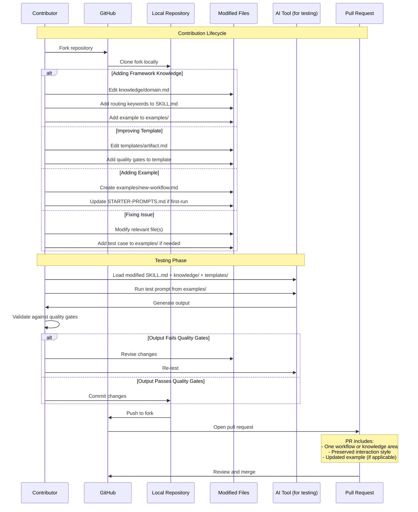
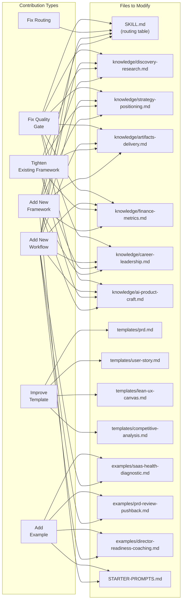

<!-- source: DeepWiki mcp.deepwiki.com · repo Digidai/product-manager-skills · page 8 Contributing · fetched 2026-10-26 -->

# Contributing

<details>
<summary>Relevant source files</summary>

The following files were used as context for generating this wiki page:

- [CONTRIBUTING.md](CONTRIBUTING.md)
- [package.json](package.json)

</details>


This page provides guidelines for contributing to the Product Manager Skills project. It explains the repository structure, the types of contributions that add value, and the process for submitting changes.

For information about using the skill in your own workflows, see [Usage Patterns](#6). For details on the system architecture, see [Overview](#1).

---

## Purpose and Scope

The Product Manager Skills repository is designed to be improved through concrete feedback: missing workflows, tighter frameworks, clearer examples, and better interaction patterns. This page documents:

- The repository file structure and what each area contains
- The types of contributions that strengthen the skill
- Guidelines for making changes that preserve the system's operating principles
- The process for testing and submitting contributions

All contributions must maintain the skill's core design: **push back, label assumptions, name tradeoffs**. Generic theory does not improve the skill; specific frameworks, real prompts, and measurable examples do.

**Sources:** [CONTRIBUTING.md:1-36]()

---

## Repository Architecture

The repository follows a pure Markdown architecture with zero dependencies. All logic resides in Markdown files organized into four functional areas.

### Directory Structure

```mermaid
graph TB
    ROOT["Repository Root"]
    
    SKILL["SKILL.md<br/>(Orchestrator)"]
    KNOWLEDGE["knowledge/<br/>(Domain Logic)"]
    TEMPLATES["templates/<br/>(Output Scaffolding)"]
    EXAMPLES["examples/<br/>(Trust-Building Demos)"]
    STARTER["STARTER-PROMPTS.md<br/>(First-Run Prompts)"]
    README["README.md"]
    CONTRIBUTING["CONTRIBUTING.md"]
    LICENSE["LICENSE"]
    PKG["package.json"]
    
    ROOT --> SKILL
    ROOT --> KNOWLEDGE
    ROOT --> TEMPLATES
    ROOT --> EXAMPLES
    ROOT --> STARTER
    ROOT --> README
    ROOT --> CONTRIBUTING
    ROOT --> LICENSE
    ROOT --> PKG
    
    subgraph "knowledge/ - 6 Domain Files"
        K1["discovery-research.md<br/>(JTBD, Mom Test, PoL)"]
        K2["strategy-positioning.md<br/>(Moore, RICE, TAM)"]
        K3["artifacts-delivery.md<br/>(PRD, User Stories)"]
        K4["finance-metrics.md<br/>(32 SaaS Metrics)"]
        K5["career-leadership.md<br/>(Altitude-Horizon)"]
        K6["ai-product-craft.md<br/>(Context Engineering)"]
    end
    
    subgraph "templates/ - 12+ Artifact Templates"
        T1["prd.md"]
        T2["user-story.md"]
        T3["lean-ux-canvas.md"]
        T4["competitive-analysis.md"]
        T5["problem-statement.md"]
        T6["epic-hypothesis.md"]
        TDOTS["... 6 more templates"]
    end
    
    subgraph "examples/ - Real Workflow Demos"
        E1["saas-health-diagnostic.md"]
        E2["prd-review-pushback.md"]
        E3["director-readiness-coaching.md"]
    end
    
    KNOWLEDGE --> K1
    KNOWLEDGE --> K2
    KNOWLEDGE --> K3
    KNOWLEDGE --> K4
    KNOWLEDGE --> K5
    KNOWLEDGE --> K6
    
    TEMPLATES --> T1
    TEMPLATES --> T2
    TEMPLATES --> T3
    TEMPLATES --> T4
    TEMPLATES --> T5
    TEMPLATES --> T6
    TEMPLATES --> TDOTS
    
    EXAMPLES --> E1
    EXAMPLES --> E2
    EXAMPLES --> E3
```



**Diagram: Repository File Structure**

**Sources:** [CONTRIBUTING.md:29-35](), [package.json:37-46]()

### File Responsibilities

| File/Directory | Purpose | Change Frequency |
|----------------|---------|------------------|
| `SKILL.md` | Routing table, interaction protocols, quality gates, execution workflow | Low - only when adding new domains or protocols |
| `knowledge/*.md` | Framework definitions, domain-specific quality gates, routing keywords | Medium - when tightening frameworks or adding workflows |
| `templates/*.md` | Output scaffolding for artifacts (PRDs, user stories, canvases) | Low - templates are stable structures |
| `examples/*.md` | Real session walkthroughs showing expected inputs and outputs | High - examples drive trust and clarify usage |
| `STARTER-PROMPTS.md` | First-run prompts for new users to try immediately | Medium - updated when new workflows are added |
| `README.md` | Public-facing documentation, installation instructions, quick start | Low - only for major feature releases |
| `CONTRIBUTING.md` | Contribution guidelines (this wiki page's source) | Low - process changes infrequently |

**Sources:** [CONTRIBUTING.md:29-35](), [package.json:37-46]()

---

## Types of Valuable Contributions

Not all contributions strengthen the skill equally. The following types of changes have the highest impact.

### High-Value Contributions

#### 1. Adding Missing PM Workflows

**What:** A PM workflow that the skill does not currently handle well, or at all.

**Format:** A clear user prompt + realistic expected output + the domain(s) involved.

**Example:**
```
Prompt: "Help me run a pre-mortem for this Q3 launch"
Expected: Structured pre-mortem facilitation with failure scenario generation
Domain: Artifacts & Delivery, Strategy & Positioning
```

**Where to contribute:**
- Add the workflow to the appropriate `knowledge/*.md` file
- Add an example to `examples/` showing the full interaction
- Update `STARTER-PROMPTS.md` if it's a common first-use case

#### 2. Tightening Existing Frameworks

**What:** An existing framework's guidance is too generic, leading to weak outputs.

**Example:** If the "Opportunity Solution Tree" section in `knowledge/discovery-research.md` doesn't specify how to distinguish opportunities from solutions, add that distinction with concrete criteria.

**Where to contribute:**
- Edit the relevant `knowledge/*.md` file
- Add domain-specific quality gates if the framework has measurable failure modes
- Update an example in `examples/` to show the improved output

#### 3. Improving Trust-Building Examples

**What:** First-time users need to see "good" outputs before they trust the skill. Examples that show rigorous pushback, specific tradeoffs, and measurable outcomes build trust faster.

**Where to contribute:**
- Add to or improve files in `examples/`
- Show the full interaction: prompt → AI response → user clarification → final output
- Include inline annotations explaining why the output is strong

#### 4. Reporting Interaction Failures

**What:** The skill asks too many questions (Guided mode overuse), misses a tradeoff (quality gate failure), or fails to push back on bad framing (anti-pattern undetected).

**Where to file:**
- GitHub Issues with the format specified in [CONTRIBUTING.md:12-20]()
- Include: prompt, actual output, expected output, domain, failure type

**Sources:** [CONTRIBUTING.md:6-11]()

---

## Contribution Guidelines by Change Type

### Adding Knowledge or Frameworks

When adding new frameworks or workflows to `knowledge/*.md` files:

#### Required Elements

1. **Routing Keywords:** Add intent phrases that should trigger this framework to the routing table in [SKILL.md]()
2. **Framework Definition:** Explain the framework with specific steps, criteria, or formulas
3. **Domain-Specific Quality Gates:** Define what constitutes a "good" output using this framework
4. **Anti-Patterns:** If the framework has common failure modes, document them

#### Structure Template

```markdown
## [Framework Name]

### When to Use
- User intent: "[specific prompt patterns]"
- Routing keywords: "[keyword1]", "[keyword2]", "[keyword3]"

### Framework Application
[Step-by-step guidance with specific criteria]

### Quality Gates
- [ ] Gate 1: [measurable criterion]
- [ ] Gate 2: [measurable criterion]

### Common Mistakes (Anti-Patterns)
- [Specific failure mode 1]
- [Specific failure mode 2]

### Example Output
[Show what a strong application of this framework looks like]
```

**Sources:** [CONTRIBUTING.md:24-27]()

---

### Improving Templates

Templates in `templates/*.md` provide output scaffolding. Changes to templates should:

1. **Preserve Section Structure:** Templates are loaded by [SKILL.md]() and populated with framework-driven content. Changing section names breaks the loading logic.
2. **Add Specificity:** Replace generic placeholders with specific prompts that guide framework application.
3. **Include Validation Criteria:** Each section should specify what makes it "complete" (e.g., "Acceptance Criteria must be testable in isolation").

#### Example: Improving `templates/user-story.md`

**Before:**
```markdown
## Acceptance Criteria
- [Criterion 1]
- [Criterion 2]
```

**After:**
```markdown
## Acceptance Criteria
Each criterion must be testable in isolation using Given-When-Then format (Gherkin).

- Given [specific system state]
- When [specific user action]
- Then [specific observable outcome]

Quality Gate: Each criterion must be verifiable without accessing internal system state.
```

**Sources:** [CONTRIBUTING.md:24-27]()

---

### Adding Examples

Examples in `examples/*.md` are the fastest way to improve skill adoption. Good examples:

1. **Show Full Interactions:** Include the user prompt, AI response, user clarification (if any), and final output
2. **Annotate Quality Signals:** Use inline comments to highlight why the output is strong (e.g., `[Note: This flags the solution smuggling anti-pattern]`)
3. **Demonstrate Pushback:** Show where the skill challenges weak framing or missing evidence
4. **Include Measurable Outcomes:** Show specific metrics, tradeoffs, or decisions

#### Example Structure

```markdown
# [Workflow Name]

## User Prompt
```
[Exact prompt the user provided]
```

## Initial AI Response
[First response, showing framework application]

## User Clarification (if needed)
```
[Follow-up prompt]
```

## Final Output
[Complete output with annotations]

### Quality Signals in This Output
1. **[Signal 1]:** [Why this strengthens the output]
2. **[Signal 2]:** [Why this strengthens the output]

### Frameworks Applied
- [Framework 1 from knowledge/domain.md]
- [Framework 2 from knowledge/domain.md]
```

**Sources:** [CONTRIBUTING.md:26-27]()

---

## Contribution Workflow



**Diagram: Contribution and Testing Workflow**

**Sources:** [CONTRIBUTING.md:23-27]()

---

## Testing Your Changes

Before submitting a pull request, test your changes by loading the modified skill into an AI coding tool.

### Testing Process

1. **Load Modified Files:**
   - For Claude Code/OpenClaw: Point to your local fork
   - For Cursor/Codex/Windsurf: Use `npx skills add /path/to/local/fork`
   - For Claude Projects: Upload modified `SKILL.md`, `knowledge/`, `templates/`, `examples/`

2. **Run Test Prompts:**
   - Use prompts from `STARTER-PROMPTS.md` relevant to your changes
   - If you added a new workflow, create a test prompt that exercises it
   - If you modified a framework, test with the prompt pattern that routes to it

3. **Validate Against Quality Gates:**
   - Check that outputs meet the five universal quality gates (see [Quality Gates](#3.4))
   - Check domain-specific quality gates for the relevant domain
   - Verify anti-pattern detection if your change affects validation logic

### Example Test Session

```markdown
# Testing Addition of "Pre-Mortem" Framework

## Change Made
Added pre-mortem facilitation framework to knowledge/artifacts-delivery.md

## Test Prompt
"Help me run a pre-mortem for our Q3 product launch"

## Expected Behavior
- Routes to Artifacts & Delivery domain
- Loads pre-mortem framework
- Asks Guided questions about launch scope, team, timeline
- Generates failure scenarios with specific risks
- Provides mitigation strategies with measurable actions

## Actual Output
[Paste AI output here]

## Validation
- [x] Routes correctly
- [x] Applies framework
- [x] Labels assumptions
- [x] Names tradeoffs
- [x] Provides measurable next steps
```

**Sources:** [CONTRIBUTING.md:24-27]()

---

## Pull Request Requirements

### Good Pull Requests

A pull request that strengthens the skill has these characteristics:

| Requirement | Why It Matters |
|-------------|----------------|
| **Scoped to One Area** | Changes to routing + knowledge + examples for *one* workflow are reviewable. Changes across multiple domains are not. |
| **Preserves Interaction Style** | The skill's value comes from pushing back, labeling assumptions, and naming tradeoffs. Generic politeness weakens it. |
| **Improves Real Prompts** | Adding "PM theory" helps no one. Improving how the skill handles `"Review this PRD"` helps everyone. |
| **Includes Example (if new workflow)** | Users need to see the workflow in action. No example = no trust. |
| **Passes Quality Gates** | Test your changes. If the output doesn't pass the universal + domain gates, the change isn't ready. |

### PR Description Template

```markdown
## Change Type
- [ ] Add missing workflow
- [ ] Tighten existing framework
- [ ] Improve example
- [ ] Fix interaction issue

## Domain(s) Affected
[Discovery, Strategy, Artifacts, Finance, Career, AI Craft]

## User Prompt(s) This Addresses
```
[Paste the exact prompt(s) this improves]
```

## Files Changed
- `knowledge/[domain].md`: [what changed]
- `SKILL.md`: [routing keywords added, if any]
- `examples/[example].md`: [new or updated example]

## Testing
- [ ] Loaded modified skill into [AI Tool]
- [ ] Tested with prompt(s) above
- [ ] Output passes universal quality gates
- [ ] Output passes domain-specific quality gates

## Example Output
[Paste a representative output showing the improvement]
```

**Sources:** [CONTRIBUTING.md:23-27]()

---

## File-to-Logic Mapping

This diagram maps contribution types to the specific files you need to modify.



**Diagram: Contribution Type to File Mapping**

**Sources:** [CONTRIBUTING.md:29-35]()

---

## Issue Reporting Format

When reporting issues, use this format to make the problem actionable.

### Required Information

```markdown
## Prompt Used
[Exact prompt you provided to the AI tool]

## Actual Output
[What the skill generated]

## Expected Output
[What you expected instead]

## Domain Involved
[Discovery, Strategy, Artifacts, Finance, Career, AI Craft]

## Issue Type
- [ ] Missing knowledge (skill doesn't know framework X)
- [ ] Weak reasoning (skill applied framework incorrectly)
- [ ] Bad interaction flow (too many questions, wrong mode)
- [ ] Quality gate failure (output violates operating principles)
- [ ] Anti-pattern undetected (skill accepted bad framing)
```

### Example Issue

```markdown
Title: PRD review misses solution smuggling

## Prompt Used
"Review this PRD: [Problem] Users struggle with onboarding. [Solution] Build an onboarding wizard with 5 steps."

## Actual Output
Skill reviewed the wizard design without questioning whether onboarding is the root problem.

## Expected Output
Skill should flag solution smuggling anti-pattern and ask:
- What evidence shows users struggle specifically during onboarding vs. other lifecycle stages?
- What jobs-to-be-done does the product serve, and where does onboarding fit?

## Domain Involved
Artifacts & Delivery

## Issue Type
- [x] Anti-pattern undetected (solution smuggling)
```

**Sources:** [CONTRIBUTING.md:12-20]()

---

## License Considerations

This project is licensed under [CC-BY-NC-SA-4.0](). Contributions must be compatible with this license.

### What This Means

- **Attribution (BY):** Your contributions will be attributed to you
- **Non-Commercial (NC):** The skill cannot be used for commercial purposes without permission
- **ShareAlike (SA):** Derivative works must use the same license

### What You Retain

- You retain copyright to your contributions
- You grant the project permission to use your contributions under CC-BY-NC-SA-4.0
- You can use your own contributions in other contexts under your own license

**Sources:** [package.json:36]()

---

## Summary: Contribution Checklist

Before submitting a contribution, verify:

- [ ] **Scoped:** Change affects one workflow or one knowledge area
- [ ] **Tested:** Loaded modified skill and tested with real prompts
- [ ] **Quality Gates:** Outputs pass universal + domain-specific gates
- [ ] **Examples:** New workflows include examples in `examples/`
- [ ] **Routing:** New frameworks include routing keywords in [SKILL.md]()
- [ ] **Style:** Changes preserve "push back, label assumptions, name tradeoffs" interaction
- [ ] **Documentation:** Updated relevant files (knowledge, templates, examples, starter prompts)

**Sources:** [CONTRIBUTING.md:1-36]()

---

