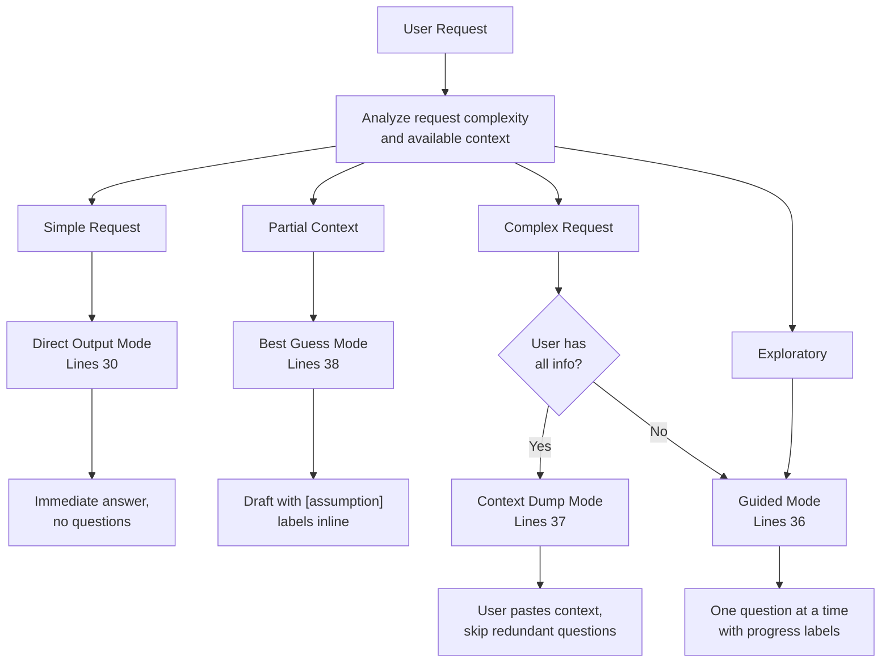
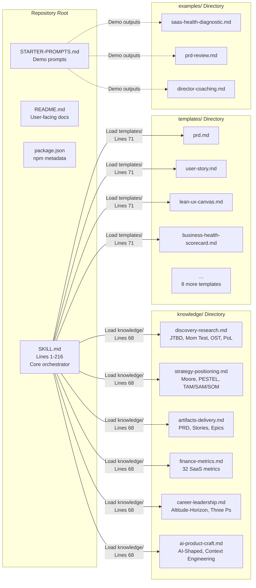

<!-- source: DeepWiki mcp.deepwiki.com · repo Digidai/product-manager-skills · page 9 Reference · fetched 2026-10-26 -->

# Reference

<details>
<summary>Relevant source files</summary>

The following files were used as context for generating this wiki page:

- [README.md](README.md)
- [SKILL.md](SKILL.md)

</details>


## Purpose and Scope

This page provides quick-reference materials for the Product Manager Skills system, including lookup tables, key concepts, file locations, and system constants. Use this page to quickly find routing mappings, quality gates, templates, and code entity locations without reading through full documentation.

For detailed explanations of the seven anti-patterns detected by the system, see [Anti-Patterns Detected](#9.1). For definitions of domain-specific terminology and acronyms, see [Terminology](#9.2).

---

## System Components Overview

The following diagram maps the system's natural language concepts to their concrete file locations and code entities:

```mermaid
graph TB
    SKILL["SKILL.md<br/>Core orchestrator<br/>Lines 1-216"]
    
    subgraph "Knowledge Modules"
        K1["knowledge/<br/>discovery-research.md"]
        K2["knowledge/<br/>strategy-positioning.md"]
        K3["knowledge/<br/>artifacts-delivery.md"]
        K4["knowledge/<br/>finance-metrics.md"]
        K5["knowledge/<br/>career-leadership.md"]
        K6["knowledge/<br/>ai-product-craft.md"]
    end
    
    subgraph "Templates"
        T1["templates/prd.md"]
        T2["templates/user-story.md"]
        T3["templates/positioning-statement.md"]
        T4["templates/epic-hypothesis.md"]
        T5["templates/lean-ux-canvas.md"]
        T6["templates/business-health-scorecard.md"]
        T7["templates/roadmap-plan.md"]
        T8["templates/competitive-analysis.md"]
    end
    
    subgraph "Support Files"
        E1["examples/<br/>saas-health-diagnostic.md"]
        E2["examples/<br/>prd-review.md"]
        E3["examples/<br/>director-coaching.md"]
        SP["STARTER-PROMPTS.md"]
    end
    
    SKILL -->|"Routing Table<br/>Lines 79-164"| K1
    SKILL -->|"Routing Table<br/>Lines 79-164"| K2
    SKILL -->|"Routing Table<br/>Lines 79-164"| K3
    SKILL -->|"Routing Table<br/>Lines 79-164"| K4
    SKILL -->|"Routing Table<br/>Lines 79-164"| K5
    SKILL -->|"Routing Table<br/>Lines 79-164"| K6
    
    SKILL -->|"Template Index<br/>Lines 168-186"| T1
    SKILL -->|"Template Index<br/>Lines 168-186"| T2
    SKILL -->|"Template Index<br/>Lines 168-186"| T3
    SKILL -->|"Template Index<br/>Lines 168-186"| T4
    SKILL -->|"Template Index<br/>Lines 168-186"| T5
    SKILL -->|"Template Index<br/>Lines 168-186"| T6
    SKILL -->|"Template Index<br/>Lines 168-186"| T7
    SKILL -->|"Template Index<br/>Lines 168-186"| T8
    
    SP -.->|"Demo prompts"| E1
    SP -.->|"Demo prompts"| E2
    SP -.->|"Demo prompts"| E3
```



**Sources:** [SKILL.md:1-216](), [README.md:177-187]()

---

## Operating Principles Quick Reference

These six principles govern all system outputs and are encoded in [SKILL.md:13-19]():

| Principle | Definition | Code Location |
|-----------|------------|---------------|
| **Outcome-oriented** | Ask "What decision does this enable?" before "What document should I produce?" | [SKILL.md:14]() |
| **Evidence-driven** | State assumptions explicitly. Label what's known vs. hypothesized. | [SKILL.md:15]() |
| **Opinionated with tradeoffs** | Take a stance, name the tradeoff, never hedge with "it depends" alone. | [SKILL.md:16]() |
| **Specific > complete** | One sharp example beats a page of generic advice. | [SKILL.md:17]() |
| **Compression by default** | Say it in 3 bullets, not 3 paragraphs. Expand only when asked. | [SKILL.md:18]() |
| **Bias to action** | End every interaction with a next step, not a summary. | [SKILL.md:19]() |

**Sources:** [SKILL.md:13-19]()

---

## Routing Table Quick Reference

### Discovery & Research Domain

User intents that route to `knowledge/discovery-research.md`:

| User Intent Pattern | Framework Applied | Line Reference |
|---------------------|-------------------|----------------|
| "Validate a problem" / "test a hypothesis" | Problem Framing + PoL Probe Advisor | [SKILL.md:87]() |
| "Customer interview" / "discovery interview" | Interview Prep | [SKILL.md:88]() |
| "Map the customer journey" | Customer Journey > Journey Map | [SKILL.md:89]() |
| "Opportunity mapping" / "solution tree" | Opportunity Solution Tree | [SKILL.md:90]() |
| "Jobs to be done" / "JTBD" | JTBD Framework | [SKILL.md:91]() |
| "Frame the problem" / "problem canvas" | Problem Framing Canvas (MITRE) | [SKILL.md:92]() |
| "Write a problem statement" | Problem Statement | [SKILL.md:93]() |
| "Lean canvas" / "validate assumptions" | Lean UX Canvas | [SKILL.md:94]() |
| "PoL probe" / "proof of life" | PoL Probe Advisor | [SKILL.md:96]() |
| "A/B test" / "experiment design" | PoL Probe Advisor | [SKILL.md:97]() |

### Strategy & Positioning Domain

User intents that route to `knowledge/strategy-positioning.md`:

| User Intent Pattern | Framework Applied | Line Reference |
|---------------------|-------------------|----------------|
| "Position my product" / "positioning statement" | Geoffrey Moore Positioning Statement | [SKILL.md:103]() |
| "Product strategy" / "strategy session" | Strategy Session Phases | [SKILL.md:105]() |
| "Research a company" / "competitive intel" | Company Research Framework | [SKILL.md:106]() |
| "PESTEL" / "macro environment" | PESTEL Analysis | [SKILL.md:107]() |
| "Prioritize" / "what to build next" | Prioritization > Framework Selection Matrix | [SKILL.md:108]() |
| "Roadmap" / "roadmap planning" | Roadmap Planning Process | [SKILL.md:109]() |
| "TAM SAM SOM" / "market size" | TAM/SAM/SOM Calculation | [SKILL.md:110]() |

### Artifacts & Delivery Domain

User intents that route to `knowledge/artifacts-delivery.md`:

| User Intent Pattern | Framework Applied | Line Reference |
|---------------------|-------------------|----------------|
| "Write a PRD" / "product requirements" | PRD Development | [SKILL.md:116]() |
| "Write a user story" / "acceptance criteria" | User Story (Cohn + Gherkin) | [SKILL.md:117]() |
| "Split this story" / "story too big" | User Story Splitting (8 patterns) | [SKILL.md:118]() |
| "Story map" / "user story mapping" | User Story Mapping | [SKILL.md:119]() |
| "Epic" / "epic hypothesis" | Epics > Epic Hypothesis | [SKILL.md:120]() |
| "Break down this epic" | Epics > Epic Breakdown (9 Patterns) | [SKILL.md:121]() |
| "Proto-persona" / "persona" | Proto-Persona | [SKILL.md:122]() |
| "Press release" / "PRFAQ" | Press Release / PRFAQ | [SKILL.md:123]() |

### Finance & Metrics Domain

User intents that route to `knowledge/finance-metrics.md`:

| User Intent Pattern | Framework Applied | Line Reference |
|---------------------|-------------------|----------------|
| "SaaS metrics" / "MRR" / "ARR" | SaaS Revenue & Growth Metrics | [SKILL.md:132]() |
| "Unit economics" / "CAC" / "LTV" | Unit Economics & Efficiency | [SKILL.md:133]() |
| "Business health" / "diagnostic" | Business Health Diagnostic | [SKILL.md:134]() |
| "Feature ROI" / "should we build this" | Feature Investment Analysis | [SKILL.md:135]() |
| "Acquisition channel" / "channel ROI" | Channel Economics | [SKILL.md:136]() |
| "Pricing" / "price change" | Pricing Analysis | [SKILL.md:137]() |
| "Rule of 40" / "magic number" | Capital Efficiency | [SKILL.md:138]() |
| "Retention" / "churn" | Retention & Expansion Metrics | [SKILL.md:139]() |
| "NRR" / "net revenue retention" | Retention & Expansion Metrics | [SKILL.md:140]() |

### Career & Leadership Domain

User intents that route to `knowledge/career-leadership.md`:

| User Intent Pattern | Framework Applied | Line Reference |
|---------------------|-------------------|----------------|
| "PM to Director" / "altitude horizon" | Altitude-Horizon Framework | [SKILL.md:146]() |
| "Director interview" / "director readiness" | PM to Director Transition | [SKILL.md:147]() |
| "VP" / "CPO" / "executive transition" | Director to VP/CPO Transition | [SKILL.md:148]() |
| "New role" / "first 90 days" | Executive Onboarding (30-60-90) | [SKILL.md:149]() |
| "Career advice" / "next step" | Altitude-Horizon + Readiness Coaching | [SKILL.md:150]() |

### AI Product Craft Domain

User intents that route to `knowledge/ai-product-craft.md`:

| User Intent Pattern | Framework Applied | Line Reference |
|---------------------|-------------------|----------------|
| "AI product" / "AI-shaped" | AI-Shaped Readiness | [SKILL.md:156]() |
| "Context engineering" / "prompt design" | Context Engineering | [SKILL.md:157]() |
| "Agent workflow" / "multi-agent" | Agent Orchestration | [SKILL.md:158]() |
| "AI validation" / "test my AI feature" | AI Validation (PoL Probes) | [SKILL.md:159]() |

**Sources:** [SKILL.md:79-164]()

---

## Execution Workflow State Machine

The following diagram maps the seven-step execution workflow to specific code sections in `SKILL.md`:

```mermaid
stateDiagram-v2
    [*] --> Route
    
    state "1. Route<br/>Lines 67" as Route
    state "2. Load Knowledge<br/>Lines 68" as LoadKnowledge
    state "3. Focus<br/>Lines 69" as Focus
    state "4. Interact<br/>Lines 70" as Interact
    state "5. Template<br/>Lines 71" as Template
    state "6. Quality Check<br/>Lines 72" as QualityCheck
    state "7. Close<br/>Lines 73" as Close
    
    state Route {
        [*] --> MatchIntent
        MatchIntent --> LoadModule: "Intent matched"
        MatchIntent --> Clarify: "Ambiguous"
        MatchIntent --> OutOfScope: "Non-PM request"
        Clarify --> MatchIntent
        OutOfScope --> [*]
        LoadModule --> [*]
    }
    
    Route --> LoadKnowledge: "Routing Table<br/>Lines 79-164"
    
    state LoadKnowledge {
        [*] --> ReadModule
        ReadModule --> [*]: "knowledge/<br/>domain-module.md"
    }
    
    LoadKnowledge --> Focus: "Module loaded"
    
    state Focus {
        [*] --> FindSection
        FindSection --> ApplyFramework
        ApplyFramework --> [*]
    }
    
    Focus --> Interact: "Framework selected"
    
    state Interact {
        [*] --> SelectMode
        SelectMode --> Guided: "Complex,<br/>step-by-step"
        SelectMode --> ContextDump: "Has all info"
        SelectMode --> BestGuess: "Can infer"
        SelectMode --> DirectOutput: "Simple request"
        Guided --> [*]
        ContextDump --> [*]
        BestGuess --> [*]
        DirectOutput --> [*]
    }
    
    Interact --> Template: "Interaction Protocol<br/>Lines 28-60"
    
    state Template {
        [*] --> CheckArtifact
        CheckArtifact --> LoadTemplate: "Deliverable needed"
        CheckArtifact --> UseFramework: "No template"
        LoadTemplate --> [*]: "Template Index<br/>Lines 168-186"
        UseFramework --> [*]
    }
    
    Template --> QualityCheck: "Output generated"
    
    state QualityCheck {
        [*] --> UniversalGates
        UniversalGates --> DomainGates
        DomainGates --> ValidationResult
        ValidationResult --> Pass: "All gates pass"
        ValidationResult --> Fail: "Gate violation"
        Pass --> [*]
        Fail --> [*]
    }
    
    QualityCheck --> Close: "Quality Gates<br/>Lines 189-216"
    QualityCheck --> Focus: "Revision needed"
    
    state Close {
        [*] --> FormatOutput
        FormatOutput --> AddDecisions
        AddDecisions --> AddAssumptions
        AddAssumptions --> AddNextStep
        AddNextStep --> [*]
    }
    
    Close --> [*]: "Lines 56-59"
```



**Sources:** [SKILL.md:63-76]()

---

## Universal Quality Gates

These five gates apply to **all outputs** regardless of domain. They are checked in [SKILL.md:189-216]():

| Gate | Requirement | Validation Logic | Line Reference |
|------|-------------|------------------|----------------|
| **1. Assumptions Labeled** | All inferred data marked with `[assumption]` inline | Search output for unmarked guesses | [SKILL.md:195-196]() |
| **2. Outcomes Measurable** | Every outcome has number, direction, timeframe | Validate metrics are quantified | [SKILL.md:198-199]() |
| **3. Roles Specific** | No generic personas like "users" | Check for role + context + motivation | [SKILL.md:201-202]() |
| **4. Tradeoffs Named** | Every recommendation includes what's traded off | Validate explicit tradeoff statements | [SKILL.md:204-205]() |
| **5. Anti-Patterns Flagged** | Seven PM failure modes actively detected | See [Anti-Patterns Reference](#anti-patterns-reference) below | [SKILL.md:207-216]() |

**Sources:** [SKILL.md:189-216]()

---

## Anti-Patterns Reference

The system detects and flags these seven anti-patterns defined in [SKILL.md:208-216]():

| Anti-Pattern | Definition | Detection Trigger | Line Reference |
|--------------|------------|-------------------|----------------|
| **Metrics Theater** | Tracking metrics that look good but drive no decisions | Metrics present without decision logic | [SKILL.md:209]() |
| **Feature Factory** | Shipping features without validating the problem | Solution proposed without problem framing | [SKILL.md:210]() |
| **Stakeholder-Driven Roadmap** | Roadmap shaped by loudest voice, not evidence | Prioritization lacks evidence citations | [SKILL.md:211]() |
| **Confirmation Bias in Discovery** | Asking questions designed to confirm existing beliefs | Interview questions presuppose answers | [SKILL.md:212]() |
| **Premature Scaling** | Optimizing growth before unit economics work | Growth initiatives when LTV:CAC < 3:1 | [SKILL.md:213]() |
| **Horizontal Slicing** | Splitting work by architecture layer instead of user value | Stories organized by tech stack not user outcomes | [SKILL.md:214]() |
| **Solution Smuggling** | Problem statements that embed a solution | Problem statement contains "need a [solution]" | [SKILL.md:215-216]() |

For detailed descriptions and examples, see [Anti-Patterns Detected](#9.1).

**Sources:** [SKILL.md:207-216]()

---

## Template Index Reference

Templates provide artifact structure and are loaded from the `templates/` directory:

| Template File | Artifact Type | Loaded When | Line Reference |
|---------------|---------------|-------------|----------------|
| `prd.md` | Product Requirements Document | User requests PRD | [SKILL.md:174]() |
| `user-story.md` | User Story with acceptance criteria | User requests story | [SKILL.md:175]() |
| `problem-statement.md` | Problem framing | User frames problem | [SKILL.md:176]() |
| `positioning-statement.md` | Market positioning | User positions product | [SKILL.md:177]() |
| `epic-hypothesis.md` | Epic as testable hypothesis | User creates epic | [SKILL.md:178]() |
| `press-release.md` | PRFAQ / Working Backwards | User writes press release | [SKILL.md:179]() |
| `discovery-interview-plan.md` | Interview preparation | User plans discovery | [SKILL.md:180]() |
| `opportunity-solution-tree.md` | OST mapping | User maps opportunities | [SKILL.md:181]() |
| `roadmap-plan.md` | Now/Next/Later roadmap | User plans roadmap | [SKILL.md:182]() |
| `business-health-scorecard.md` | SaaS health diagnostic | User diagnoses business | [SKILL.md:183]() |
| `competitive-analysis.md` | Market analysis | User researches competitors | [SKILL.md:184]() |
| `lean-ux-canvas.md` | Hypothesis structuring | User validates assumptions | [SKILL.md:185]() |

**Sources:** [SKILL.md:168-186]()

---

## Interaction Modes Reference

The system selects one of four interaction modes based on request complexity, defined in [SKILL.md:34-44]():



| Mode | When Used | Behavior | Line Reference |
|------|-----------|----------|----------------|
| **Direct Output** | Simple, clear requests | Answer immediately, no questions | [SKILL.md:30]() |
| **Best Guess** | Partial info, reasonable assumptions possible | Deliver draft, label all `[assumption]` inline | [SKILL.md:38]() |
| **Context Dump** | Complex but user has all info | User pastes context, skip questions | [SKILL.md:37]() |
| **Guided** | Complex, needs step-by-step | One question per turn, show progress `Q3/7` | [SKILL.md:36]() |

**Sources:** [SKILL.md:28-52]()

---

## Standard Output Format

Every system output must follow this structure, enforced in [SKILL.md:56-59]():

```
[Main content body]

---

**Decisions made:**
- [Decision 1]
- [Decision 2]

**Assumptions to validate:**
- [Assumption 1] [if any]
- [Assumption 2] [if any]

**Recommended next step:**
[Single actionable next step]
```

**Sources:** [SKILL.md:56-59]()

---

## File Structure and Entity Mapping

The repository structure maps directly to system components:



**File Paths:**
- Core orchestrator: [SKILL.md:1-216]()
- Knowledge modules: `knowledge/[domain-name].md`
- Templates: `templates/[artifact-name].md`
- Examples: `examples/[workflow-name].md`
- Starter prompts: [STARTER-PROMPTS.md:1-end]()

**Total size:** Approximately 27 Markdown files, ~2,800 lines, <200KB

**Sources:** [README.md:177-187](), [SKILL.md:68](), [SKILL.md:71]()

---

## Installation Paths by Platform

The system supports multiple installation methods with platform-specific commands:

| Platform | Command | Package Source | Line Reference |
|----------|---------|----------------|----------------|
| Claude Code / OpenClaw | `clawhub install product-manager-skills` | ClawHub Registry | [README.md:38-40]() |
| Codex / Cursor / Windsurf | `npx skills add Digidai/product-manager-skills` | npm Registry | [README.md:44-46]() |
| Claude Projects | Manual upload of `SKILL.md`, `knowledge/`, `templates/` | Direct file upload | [README.md:173]() |
| Generic LLM | Point system prompt at `SKILL.md` | Local file system | [README.md:174]() |

**Package metadata:** [package.json:1-end]() contains npm registry configuration

**Sources:** [README.md:34-57](), [README.md:168-175]()

---

## System Constants

### Version Information
- Current version: `v0.3.1` (from [package.json]())
- License: `CC BY-NC-SA 4.0`
- Repository: `Digidai/product-manager-skills`

### System Constraints
- Zero executable scripts
- Zero network calls
- Zero dependencies
- Pure Markdown architecture
- All files human-readable

### Language Support
The system responds in the user's input language, defined in [SKILL.md:54]():
- User writes in English → System responds in English
- User writes in Chinese → System responds in Chinese
- Language detection is automatic per interaction

**Sources:** [SKILL.md:54](), [README.md:9-12](), [README.md:190-197]()

---

## What This Skill Is NOT

These constraints are explicitly defined in [SKILL.md:21-24]():

| Not This | Instead This | Line Reference |
|----------|--------------|----------------|
| A template filler | Templates are scaffolding — thinking matters more | [SKILL.md:22]() |
| A yes-machine | Push back when framing is off or problem unclear | [SKILL.md:23]() |
| A knowledge dump | Apply frameworks to user's specific situation | [SKILL.md:24]() |

**Sources:** [SKILL.md:21-24]()

---

