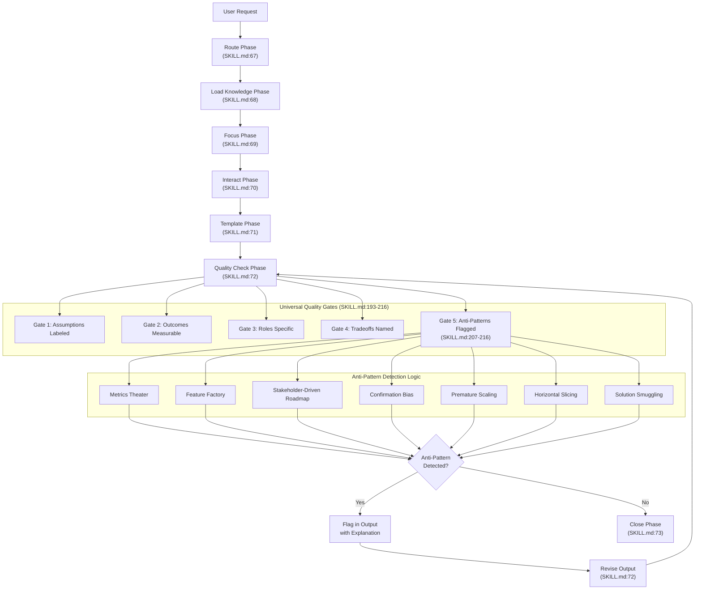
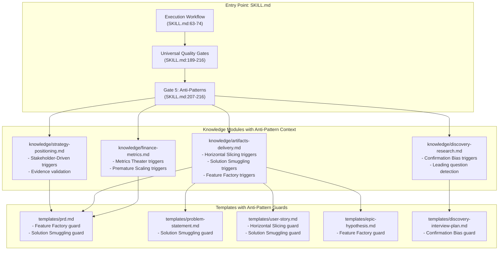

<!-- source: DeepWiki mcp.deepwiki.com · repo Digidai/product-manager-skills · page 9.1 Anti-Patterns Detected · fetched 2026-10-26 -->

# Anti-Patterns Detected

<details>
<summary>Relevant source files</summary>

The following files were used as context for generating this wiki page:

- [SKILL.md](SKILL.md)

</details>


## Purpose and Scope

This page documents the seven product management anti-patterns that the system actively detects and flags during quality validation. Anti-pattern detection is implemented as part of Universal Quality Gate #5 in [SKILL.md:207-216]() and executed during the Quality Check phase of the execution workflow.

This page covers:
- The detection mechanism and where it executes in the workflow
- Detailed descriptions of each anti-pattern with detection triggers
- How anti-patterns are flagged in output

For information about the broader quality validation system, see [Quality Gates](#3.4). For the complete execution workflow context, see [Execution Workflow](#3.1).

## Anti-Pattern Detection Architecture

Anti-pattern detection operates as the fifth universal quality gate, applying to every output regardless of knowledge domain. The system provides **active pushback** rather than accepting problematic framing, distinguishing it from generic AI assistants that optimize for politeness over rigor.

### Detection Flow in Execution Workflow



**Sources:** [SKILL.md:63-74](), [SKILL.md:189-216]()

### Detection Triggers by Input Type

Different anti-patterns are triggered by specific types of user requests and content. The system scans both the user's input and the generated output.

| Input/Output Type | Primary Anti-Patterns Checked | Detection Location |
|-------------------|-------------------------------|-------------------|
| PRD or product spec | Feature Factory, Solution Smuggling, Horizontal Slicing | Output analysis during Quality Check phase |
| Discovery interview plan | Confirmation Bias | Output analysis (question phrasing) |
| Roadmap or prioritization | Stakeholder-Driven Roadmap, Feature Factory | Input framing + output reasoning |
| SaaS metrics analysis | Metrics Theater, Premature Scaling | Output interpretation + recommendations |
| Epic breakdown or story splitting | Horizontal Slicing, Solution Smuggling | Output structure validation |
| Feature investment analysis | Premature Scaling, Metrics Theater | Output assumptions + decision logic |
| User stories with acceptance criteria | Solution Smuggling, Horizontal Slicing | Criteria structure validation |

**Sources:** [SKILL.md:207-216]()

## The Seven Anti-Patterns

### 1. Metrics Theater

**Definition:** Tracking metrics that appear rigorous but drive no actual decisions or reveal no actionable insights.

**Detection Triggers:**
- Metrics presented without benchmarks or thresholds for action
- Dashboard designs with no clear decision owner or decision trigger
- KPIs that measure activity (features shipped, meetings held) rather than outcomes
- Metrics included in output that have no connection to stated objectives

**Example Detection Scenario:**

```
User Input: "Track DAU, MAU, session length, page views, and feature adoption"

System Flags: "🚩 Metrics Theater detected. Five metrics listed with no:
- Decision criteria (what value triggers action?)
- Owner assignment (who acts on each metric?)
- Relationship to business outcome (how does session length impact revenue/retention?)

Recommend: Start with one metric tied to a specific decision. Example: 
'If 7-day retention drops below 40%, pause acquisition and debug onboarding.'"
```

**Where It's Checked:**
- Finance & Metrics domain outputs: ensures every metric has a decision threshold
- Business Health Diagnostic outputs: validates that tracked metrics connect to actions
- PRD success criteria: ensures metrics drive go/no-go decisions

**Sources:** [SKILL.md:209]()

### 2. Feature Factory

**Definition:** Shipping features without validating the underlying problem, treating output (features delivered) as success rather than outcomes (customer problems solved).

**Detection Triggers:**
- PRDs that start with solution requirements before problem validation
- Roadmaps organized by feature names rather than customer outcomes or problems
- User stories that specify implementation details before acceptance criteria
- Absence of problem evidence or customer validation in artifact outputs

**Example Detection Scenario:**

```
User Input: "Write a PRD for a dashboard showing real-time analytics"

System Flags: "🚩 Feature Factory detected. This PRD jumps to solution 
(dashboard) before problem validation.

Missing:
- What decision is blocked by current analytics?
- Who needs real-time vs daily/weekly data, and why?
- What's the cost of delayed data today? (quantified)

Recommend: Start with problem statement using template/problem-statement.md.
Validate problem before designing solution."
```

**Where It's Checked:**
- PRD Development outputs: requires Problem/Opportunity section before Requirements
- Epic Hypothesis outputs: validates problem framing before solution specification
- Roadmap outputs: checks that roadmap items link to validated problems or opportunities

**Sources:** [SKILL.md:210]()

### 3. Stakeholder-Driven Roadmap

**Definition:** Roadmap shaped by political influence, title hierarchy, or loudest voice rather than evidence-based prioritization and strategic alignment.

**Detection Triggers:**
- Roadmap justifications citing stakeholder requests without supporting evidence
- Prioritization that references organizational politics ("exec wants this") without strategic rationale
- Absence of prioritization framework application (RICE, ICE, Kano, etc.)
- No clear tie between roadmap items and company strategy or validated customer problems

**Example Detection Scenario:**

```
User Input: "Prioritize these features: A (CEO wants it), B (sales is asking), 
C (engineering thinks it's cool)"

System Flags: "🚩 Stakeholder-Driven Roadmap detected. All three items justified 
by internal requests, zero customer evidence.

Missing:
- Customer problem validation for each item
- Strategic alignment (how does each support company objectives?)
- Prioritization framework (RICE scores, Kano classification, TAM/impact analysis)

Recommend: Load knowledge/strategy-positioning.md > Prioritization Framework Selection 
Matrix. Run RICE on all three. If customer evidence doesn't exist, run discovery first."
```

**Where It's Checked:**
- Roadmap Planning outputs: validates that priorities include evidence beyond stakeholder preference
- Prioritization framework outputs: ensures framework application, not title-based ranking
- Strategy session outputs: checks for strategic rationale beyond organizational politics

**Sources:** [SKILL.md:211]()

### 4. Confirmation Bias in Discovery

**Definition:** Asking discovery questions designed to validate existing beliefs rather than test hypotheses or surface disconfirming evidence.

**Detection Triggers:**
- Interview questions that embed assumptions or lead toward desired answers
- Discovery plans without disconfirming criteria (what would prove us wrong?)
- Questions phrased as "Don't you think...?" or "Wouldn't it be great if...?"
- Absence of question types that explore problem severity, current alternatives, or willingness to pay

**Example Detection Scenario:**

```
User generates Interview Plan with questions:
1. "Don't you find the current process frustrating?"
2. "Wouldn't a faster workflow help you?"
3. "What features would you want in an ideal tool?"

System Flags: "🚩 Confirmation Bias detected in questions 1-2. Leading questions 
that prime for agreement.

Q1: 'Don't you find...' → Assumes frustration exists
Q2: 'Wouldn't X help...' → Assumes solution validity
Q3: Features-first before validating problem severity

Recommend: Rephrase using Mom Test principles:
1. 'Walk me through the last time you did [process]. What happened?'
2. 'How much time/money does [current approach] cost you per week?'
3. 'What have you tried to solve this? Why did you stop using it?'"
```

**Where It's Checked:**
- Discovery Interview Plan outputs: validates question neutrality and non-leading phrasing
- Problem Framing outputs: checks for disconfirming criteria and falsifiable hypotheses
- PoL Probe Advisor outputs: ensures experiments test assumptions rather than confirm them

**Sources:** [SKILL.md:212]()

### 5. Premature Scaling

**Definition:** Optimizing for growth or scaling operations before validating unit economics, product-market fit, or core retention mechanics.

**Detection Triggers:**
- Acquisition scaling recommendations when LTV:CAC ratio is unhealthy (<3:1)
- Feature expansion plans when core retention metrics are broken (high churn)
- Channel investment increases before payback period is workable (<12 months)
- Growth initiatives proposed without resolving fundamental business health issues

**Example Detection Scenario:**

```
User Input: "We have 8% monthly churn. Should we increase ad spend to grow faster?"

System Analysis:
- MRR: $50k
- Churn: 8% monthly = 63% annual
- LTV:CAC: 2:1 (borderline)

System Flags: "🚩 Premature Scaling detected. 63% annual churn = broken retention. 
Scaling acquisition will compound the problem.

Math:
- Every 100 customers acquired → 63 churn in year 1
- You're pouring water into a leaking bucket

Decision: DO NOT scale acquisition until churn is understood cohort by cohort.
Recommended sequence:
1. Cohort analysis: when/why do users churn?
2. Retention experiment: test fixes
3. Validate retention improvement (target: <5% monthly)
4. THEN scale acquisition"
```

**Where It's Checked:**
- Business Health Diagnostic outputs: flags scaling recommendations when unit economics fail thresholds
- Channel Economics outputs: validates payback period and LTV:CAC before recommending budget increases
- Feature Investment Analysis outputs: checks that proposed investments address retention before expansion

**Sources:** [SKILL.md:213]()

### 6. Horizontal Slicing

**Definition:** Splitting work by technical architecture layers (frontend, backend, database) rather than by deliverable user value or vertical slices.

**Detection Triggers:**
- Epic breakdowns that separate UI work from API work from data layer work
- User stories that deliver no standalone user value (e.g., "Build API endpoint")
- Sprint plans where technical components span multiple sprints before integration
- Story splitting patterns that use technical boundaries rather than user journeys

**Example Detection Scenario:**

```
User Input: "Split this epic into stories:
1. Build database schema for analytics
2. Create API endpoints
3. Build frontend dashboard
4. Connect frontend to backend"

System Flags: "🚩 Horizontal Slicing detected. Four stories, zero deliver user value 
independently. User gets nothing until story 4 completes.

Problem: Risk accumulation, late integration issues, no early feedback.

Recommend: Vertical slicing using knowledge/artifacts-delivery.md > User Story Splitting 
(8 Patterns). Example vertical slices:

Story 1: 'As analyst, view last 7 days of sign-ups (count only) on basic page'
  - Simple DB query, minimal API, basic UI
  - Delivers value: analyst sees data

Story 2: 'As analyst, filter sign-ups by date range'
  - Extends existing vertical slice
  - Delivers value: flexible reporting

Story 3: 'As analyst, view sign-up trends as line chart'
  - Adds visualization to working system
  - Delivers value: better insights"
```

**Where It's Checked:**
- Epic Breakdown outputs: validates that each story delivers independent user value
- User Story Splitting outputs: ensures splitting patterns use value-based boundaries
- Story Mapping outputs: checks that vertical slices are prioritized over horizontal layers

**Sources:** [SKILL.md:214]()

### 7. Solution Smuggling

**Definition:** Problem statements that embed the solution rather than describing the customer's context, goals, and obstacles neutrally.

**Detection Triggers:**
- Problem statements that mention specific features or technologies
- User stories with solution assumptions in the narrative (e.g., "As user, I need a dashboard...")
- Problem framing that assumes implementation approach before validation
- Opportunity descriptions that conflate problem with solution

**Example Detection Scenario:**

```
User Input: "Problem: Users need a dashboard to see their metrics."

System Flags: "🚩 Solution Smuggling detected. 'Need a dashboard' embeds the solution 
in the problem statement.

Actual problem is hidden. Questions:
- What decision are users trying to make?
- What's blocking them today?
- Why is current data access insufficient?
- Would email reports solve it? Slack notifications? API access?

Recommend: Rephrase problem without solution:
'Marketing managers cannot see campaign ROI within 24 hours of launch, causing budget 
misallocations that cost $X per week. They currently wait 7 days for manual reports 
from analytics team.'

Now solution space is open: dashboard, automated reports, Slack bot, or real-time alerts."
```

**Where It's Checked:**
- Problem Statement outputs: validates that problem description is solution-neutral
- PRD Development outputs: ensures problem section describes context without prescribing implementation
- User Story outputs: checks that story focuses on user goal, not technical mechanism
- Epic Hypothesis outputs: validates that hypothesis tests problem validity before solution design

**Sources:** [SKILL.md:215-216]()

## Anti-Pattern Detection Integration Points

### Code Entity Mapping

The following diagram maps anti-pattern detection to specific code entities and execution points in the system.



**Sources:** [SKILL.md:63-74](), [SKILL.md:189-216]()

### Detection Timing by Workflow Phase

| Anti-Pattern | Detection Phase | Input Check | Output Check | Revision Trigger |
|--------------|----------------|-------------|--------------|------------------|
| Metrics Theater | Quality Check (SKILL.md:72) | ❌ | ✅ | Missing decision thresholds |
| Feature Factory | Quality Check (SKILL.md:72) | ✅ | ✅ | Solution before problem validation |
| Stakeholder-Driven Roadmap | Quality Check (SKILL.md:72) | ✅ | ✅ | Absent evidence or framework |
| Confirmation Bias | Quality Check (SKILL.md:72) | ❌ | ✅ | Leading questions detected |
| Premature Scaling | Quality Check (SKILL.md:72) | ✅ | ✅ | Unit economics below thresholds |
| Horizontal Slicing | Quality Check (SKILL.md:72) | ❌ | ✅ | Stories lack vertical value delivery |
| Solution Smuggling | Focus (SKILL.md:69) + Quality Check (SKILL.md:72) | ✅ | ✅ | Solution embedded in problem description |

**Sources:** [SKILL.md:63-74](), [SKILL.md:207-216]()

## Anti-Pattern Flag Format

When anti-patterns are detected, the system outputs structured flags in the following format:

```
🚩 [Anti-Pattern Name] detected.

[Specific evidence from input/output that triggered detection]

Missing:
- [Required element 1]
- [Required element 2]
- [Required element 3]

Recommend: [Specific corrective action with framework/template reference]
```

This format ensures:
- Clear identification of the problem
- Specific evidence (not generic warnings)
- Actionable remediation steps
- Links to relevant frameworks or templates

**Sources:** [SKILL.md:22-24]() (Operating principle: "Push back when framing is off")

## Related Systems

Anti-pattern detection integrates with several other system components:

- **Quality Gates (#3.4):** Anti-patterns are Gate 5 of the universal validation system
- **Execution Workflow (#3.1):** Detection occurs during Quality Check phase (step 6)
- **Operating Principles (#3.5):** "Push back when framing is off" principle drives detection
- **Knowledge Domains (#4):** Each domain defines domain-specific anti-pattern triggers
- **Templates (#5):** Templates include structural guards against specific anti-patterns

**Sources:** [SKILL.md:63-74](), [SKILL.md:189-216]()

---

