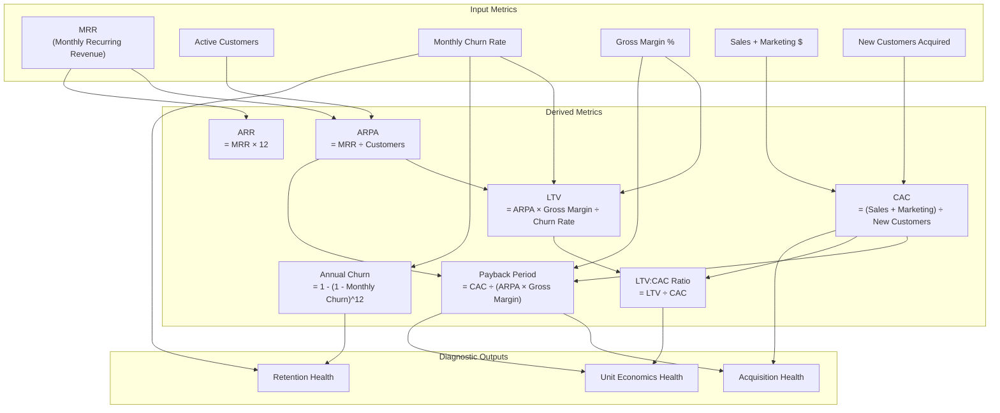
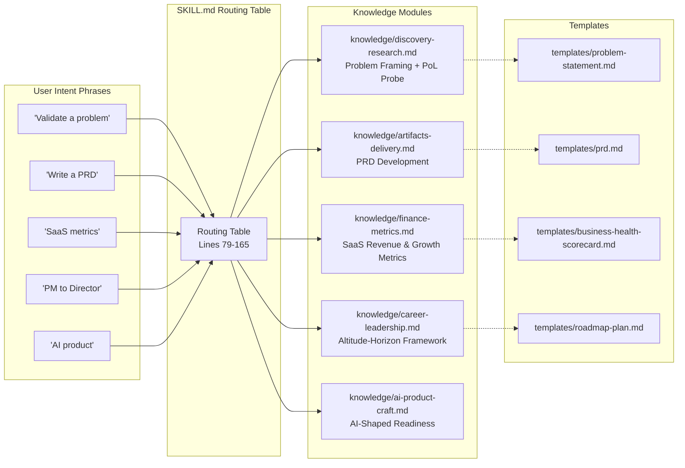
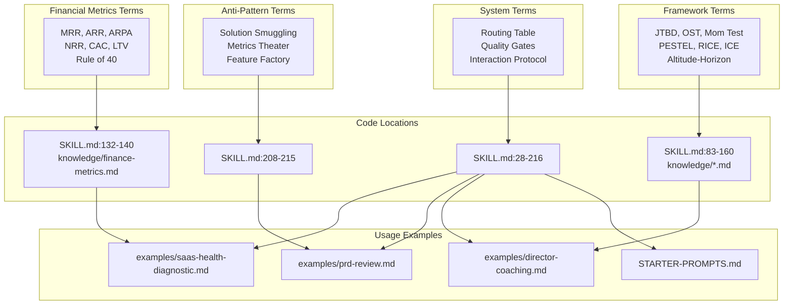

<!-- source: DeepWiki mcp.deepwiki.com · repo Digidai/product-manager-skills · page 9.2 Terminology · fetched 2026-10-26 -->

# Terminology

<details>
<summary>Relevant source files</summary>

The following files were used as context for generating this wiki page:

- [README.md](README.md)
- [SKILL.md](SKILL.md)

</details>


This page provides a glossary of key product management terms, frameworks, metrics, and concepts used throughout the Product Manager Skills system. Each entry includes the definition, relevant formulas or frameworks, and citations to where the term appears in the codebase.

For detailed explanations of common PM failure modes, see [Anti-Patterns Detected](#9.1). For framework-specific methodologies, see the individual knowledge domain pages ([Discovery & Research](#4.1), [Strategy & Positioning](#4.2), [Artifacts & Delivery](#4.3), [Finance & Metrics](#4.4), [Career & Leadership](#4.5), [AI Product Craft](#4.6)).

---

## SaaS Financial Metrics

### Revenue Metrics

**MRR (Monthly Recurring Revenue)**  
The predictable monthly revenue from subscriptions, excluding one-time fees. Calculated as the sum of all active subscription values normalized to a monthly period.

**ARR (Annual Recurring Revenue)**  
Annualized value of recurring revenue. Calculated as `MRR × 12`.

**ARPA (Average Revenue Per Account)**  
Revenue per customer. Calculated as `MRR ÷ Active Customers`.

**ARPU (Average Revenue Per User)**  
Similar to ARPA but measured per individual user rather than per account. In B2B contexts with multi-seat licenses, ARPU is `MRR ÷ Total Active Users`.

Sources: [SKILL.md:132-133](), [README.md:62-75]()

---

### Growth & Retention Metrics

**NRR (Net Revenue Retention)**  
Percentage of revenue retained from existing customers over a period, including expansions and downgrades. Calculated as `(Starting MRR + Expansion - Contraction - Churn) ÷ Starting MRR × 100%`. Values above 100% indicate net expansion.

**Churn Rate**  
Percentage of customers or revenue lost in a period. Monthly churn compounds annually, so 8% monthly churn ≈ 63% annual churn using the formula `1 - (1 - monthly_churn)^12`.

**Logo Churn vs. Revenue Churn**  
Logo churn measures customer count lost. Revenue churn measures dollar value lost. A company can have low logo churn but high revenue churn if large customers leave.

**Expansion Revenue**  
Additional revenue from existing customers through upsells, cross-sells, or increased usage.

Sources: [SKILL.md:139-140](), [README.md:73-74]()

---

### Unit Economics Metrics

**CAC (Customer Acquisition Cost)**  
Total sales and marketing expense divided by number of new customers acquired in the same period. Calculated as `(Sales Expense + Marketing Expense) ÷ New Customers`.

**LTV (Lifetime Value)**  
Total profit expected from a customer over their entire relationship. For SaaS with monthly churn, calculated as `ARPA × Gross Margin ÷ Monthly Churn Rate`.

**LTV:CAC Ratio**  
Lifetime value divided by acquisition cost. Benchmarks:
- < 1:1 = unprofitable
- 1:1 to 3:1 = caution zone
- 3:1+ = healthy
- 5:1+ = potentially underinvesting in growth

**Payback Period**  
Months required to recover CAC from gross profit. Calculated as `CAC ÷ (ARPA × Gross Margin)`. Benchmarks: <12 months is strong, 12-18 months is acceptable, >18 months requires substantial capital.

Sources: [SKILL.md:133](), [README.md:69-74]()

---

### Diagram: SaaS Metrics Calculation Dependencies



Sources: [SKILL.md:132-140](), [README.md:62-75](), [knowledge/finance-metrics.md]()

---

### Capital Efficiency Metrics

**Rule of 40**  
A heuristic that says a SaaS company's growth rate plus profit margin should exceed 40%. Calculated as `Revenue Growth Rate % + EBITDA Margin %`. Companies above 40% are considered efficient.

**Magic Number**  
Sales efficiency metric. Calculated as `(Current Quarter ARR - Prior Quarter ARR) ÷ Prior Quarter Sales & Marketing Expense`. Values above 0.75 indicate efficient growth.

**Burn Rate**  
Net cash consumed per month. Gross burn is total monthly expenses. Net burn is gross burn minus revenue.

Sources: [SKILL.md:138](), [README.md:123]()

---

## Discovery & Research Frameworks

### JTBD (Jobs To Be Done)

A framework for understanding customer motivation by focusing on the "job" a customer is trying to accomplish rather than demographic attributes. Jobs have functional, emotional, and social dimensions.

**Job Statement Format:**  
"When [situation], I want to [motivation], so I can [expected outcome]."

Sources: [SKILL.md:91]()

---

### Mom Test

An interview approach that avoids asking hypothetical questions or fishing for compliments. Named after the principle: "Talk about their life instead of your idea." Key rules:
1. Ask about past behavior, not future intentions
2. Ask about specifics, not generics
3. Listen more than pitch

Sources: [SKILL.md:88](), [README.md:120]()

---

### PoL Probes (Proof of Life Probes)

Small, fast experiments designed to validate a specific hypothesis before building a full solution. Types include:
- Landing page tests
- Wizard of Oz (manual backend)
- Concierge (manual full service)
- Smoke tests
- Fake door tests

Sources: [SKILL.md:87,96-97](), [README.md:120]()

---

### OST (Opportunity Solution Tree)

A visual framework for mapping desired outcomes to customer opportunities to possible solutions. Structure:
- Top: Desired outcome (product goal)
- Middle: Opportunities (customer problems/needs)
- Bottom: Solutions (features/experiments)

Sources: [SKILL.md:90](), [README.md:120]()

---

### Lean UX Canvas

A one-page framework for structuring assumptions and experiments. Sections include:
- Business problem
- Business outcomes
- Users and customers
- User benefits
- Solution ideas
- Hypotheses
- Assumptions (riskiest first)
- Experiments

Sources: [SKILL.md:94](), [README.md:120]()

---

## Strategy & Positioning Frameworks

### Geoffrey Moore Positioning Statement

A structured format for product positioning:  
"For [target customer] who [statement of need], [product name] is a [market category] that [key benefit]. Unlike [primary competitive alternative], our product [primary differentiation]."

Sources: [SKILL.md:103](), [README.md:121]()

---

### PESTEL Analysis

A macro-environment scanning framework examining:
- **P**olitical factors
- **E**conomic factors
- **S**ocial/cultural factors
- **T**echnological factors
- **E**nvironmental factors
- **L**egal/regulatory factors

Sources: [SKILL.md:107](), [README.md:121]()

---

### TAM/SAM/SOM (Market Sizing)

Three layers of market size estimation:
- **TAM (Total Addressable Market):** Total demand for a solution category
- **SAM (Serviceable Addressable Market):** Portion of TAM your product can serve
- **SOM (Serviceable Obtainable Market):** Portion of SAM you can realistically capture

Sources: [SKILL.md:110](), [README.md:121]()

---

### Prioritization Frameworks

**RICE**  
Scoring formula: `(Reach × Impact × Confidence) ÷ Effort`. Each component is quantified on a defined scale.

**ICE**  
Simplified version: `(Impact × Confidence × Ease) ÷ 3`. Often used for quicker prioritization decisions.

**Kano Model**  
Categorizes features into:
- Must-be (expected features)
- One-dimensional (more is better)
- Attractive (delighters)
- Indifferent
- Reverse (actively disliked)

Sources: [SKILL.md:108](), [README.md:121]()

---

### Roadmap Types

**Now/Next/Later Roadmap**  
Time-horizon based roadmap avoiding specific dates:
- Now: Currently in progress
- Next: Validated and queued
- Later: Exploring or not yet validated

Sources: [SKILL.md:109]()

---

## Artifacts & Delivery Terms

### PRD (Product Requirements Document)

A specification document describing what will be built and why. Key sections typically include:
- Problem statement
- Success metrics
- User personas
- User stories or requirements
- Non-goals
- Dependencies and risks

Sources: [SKILL.md:116](), [README.md:83-94]()

---

### User Story Format

**Cohn Format:**  
"As a [role], I want [capability], so that [benefit]."

**Gherkin Acceptance Criteria:**  
```
Given [initial context]
When [action]
Then [expected outcome]
```

Sources: [SKILL.md:117](), [README.md:122]()

---

### Epic

A large body of work that can be broken down into multiple user stories. Epics span multiple sprints and typically deliver a complete user capability or workflow.

**Epic Hypothesis Format:**  
"We believe that [doing this] for [these people] will achieve [this outcome]. We'll know we're right when we see [this measurable signal]."

Sources: [SKILL.md:120-121]()

---

### Story Splitting Patterns

Eight patterns for breaking down large user stories:
1. Workflow steps
2. Business rule variations
3. Major effort
4. Simple/complex
5. Variations in data
6. Data entry methods
7. Defer performance
8. Operations (CRUD)

Sources: [SKILL.md:118]()

---

### PRFAQ (Press Release / Frequently Asked Questions)

A working-backwards format popularized by Amazon. Start by writing:
1. Press release announcing the product (future state)
2. FAQ addressing common questions
3. Work backwards to define what must be built

Sources: [SKILL.md:123](), [README.md:122]()

---

### Proto-Persona

A lightweight persona based on assumptions rather than extensive user research. Used when moving quickly or in early-stage discovery. Must be validated with real user research.

Sources: [SKILL.md:122]()

---

## Career & Leadership Frameworks

### Altitude-Horizon Framework

A model for understanding PM scope across two dimensions:

**Altitude (Scope):**
- Team altitude: Single team/product area
- Org altitude: Multiple teams/products
- Company altitude: Strategic portfolio

**Horizon (Timeframe):**
- Now: Current quarter execution
- Next: 1-3 quarters planning
- Later: 1+ years vision

Progression from IC to Director to VP requires expanding both altitude and horizon.

Sources: [SKILL.md:146,150](), [README.md:124]()

---

### Three Ps Framework

Leadership focus areas for product leaders:
- **People:** Hiring, coaching, career development
- **Product:** Vision, strategy, portfolio management
- **Process:** Operating rhythms, decision frameworks, quality standards

Sources: [README.md:124]()

---

### 30-60-90 Day Plan

Onboarding structure for new executives:
- **Days 1-30:** Listen and learn (stakeholder interviews, data review)
- **Days 31-60:** Quick wins and diagnosis
- **Days 61-90:** Strategic plan and early initiatives

Sources: [SKILL.md:149](), [README.md:124]()

---

## AI Product Craft Terms

### AI-Shaped Readiness

A framework for assessing whether a product problem is well-suited for AI solutions. Evaluates:
- Availability of training/fine-tuning data
- Tolerance for imperfect outputs
- Ability to provide human oversight
- Clear success metrics for AI performance

Sources: [SKILL.md:156](), [README.md:125]()

---

### Context Engineering

The practice of structuring and managing context provided to AI systems, including:
- Context window management
- Prompt design and templating
- Few-shot examples
- System instructions and constraints

Sources: [SKILL.md:157](), [README.md:125]()

---

### Agent Orchestration

Coordinating multiple AI agents or models to accomplish complex tasks. Patterns include:
- Sequential workflows (Agent A → Agent B)
- Parallel processing
- Supervisory agents
- Human-in-the-loop checkpoints

Sources: [SKILL.md:158](), [README.md:125]()

---

## System-Specific Terms

### Routing Table

The mapping system in [SKILL.md:79-165]() that connects user intent phrases to specific frameworks and knowledge modules. The routing table is organized by domain (Discovery, Strategy, Artifacts, Finance, Career, AI Craft) and matches natural language requests to the appropriate framework and file path.

Sources: [SKILL.md:79-165]()

---

### Diagram: Routing Table to Knowledge Module Mapping



Sources: [SKILL.md:79-165]()

---

### Interaction Protocols

The four modes of interaction defined in [SKILL.md:28-60]():

**Guided Mode**  
One question at a time with progress labels (`Q1/6`, `Q2/6`). Used for complex discovery, diagnostics, or strategy sessions.

**Context Dump**  
User provides all available information upfront. System skips redundant questions and delivers output directly.

**Best Guess**  
System makes reasonable assumptions, labels each with `[assumption]` inline, and delivers immediately for user validation.

**Direct Output**  
For simple, clear requests, system produces output immediately without questioning.

Sources: [SKILL.md:28-60]()

---

### Quality Gates

Two-tier validation system applied to all outputs:

**Universal Gates** [SKILL.md:193-216]():
1. Assumptions must be labeled
2. Outcomes must be measurable
3. Roles must be specific
4. Tradeoffs must be named
5. Anti-patterns must be flagged

**Domain-Specific Gates**  
Additional validation rules defined in each knowledge module file (e.g., discovery requires non-leading questions, finance requires formulas shown).

Sources: [SKILL.md:189-216]()

---

### Solution Smuggling

An anti-pattern where a problem statement actually embeds a predetermined solution. Example:
- ❌ Solution-smuggled: "Users need a dashboard to track metrics"
- ✅ Properly framed: "Managers can't see team velocity and miss delivery risks"

This is one of seven anti-patterns actively flagged by the system. See [Anti-Patterns Detected](#9.1) for complete list.

Sources: [SKILL.md:215](), [README.md:83-94]()

---

### Metrics Theater

An anti-pattern of tracking metrics that look impressive but drive no actual decisions. Example: tracking "number of features shipped" without measuring impact or outcomes.

Sources: [SKILL.md:209]()

---

### Feature Factory

An anti-pattern of shipping features without validating the underlying problem. Characterized by output-focused roadmaps and lack of discovery.

Sources: [SKILL.md:210]()

---

### Activation-First Default

The interaction principle in [SKILL.md:32]() where the system prefers producing a useful first draft immediately over asking setup questions. Assumptions are labeled inline for validation.

Sources: [SKILL.md:32]()

---

### Horizontal vs. Vertical Slicing

**Horizontal Slicing (Anti-Pattern):**  
Breaking work by technical layer (e.g., "database sprint", "API sprint", "UI sprint"). Delivers no user value until all layers complete.

**Vertical Slicing (Preferred):**  
Breaking work by end-to-end user value (e.g., "read-only view", "basic CRUD", "advanced features"). Each slice is potentially shippable.

Sources: [SKILL.md:214]()

---

## Installation & Distribution Terms

### ClawHub

A registry for AI coding skills, used by Claude Code and OpenClaw. Install command: `clawhub install product-manager-skills`.

Sources: [README.md:37-40]()

---

### NPM Skills Loader

Installation method for Codex, Cursor, Windsurf using: `npx skills add Digidai/product-manager-skills`.

Sources: [README.md:43-46]()

---

### Pure Markdown Architecture

System design philosophy: zero executable scripts, zero dependencies, zero network calls. All logic is expressed in Markdown files that AI tools can read and interpret.

Sources: [README.md:12](), [README.md:190-198]()

---

## Usage Pattern Terms

### Weekly PM Workflows

Recurring usage patterns where the skill is applied to regular rituals:
- Monday: Roadmap reviews and prioritization requests
- Mid-week: PRD/epic/story critiques
- Friday: SaaS health diagnostics or feature ROI checks

Sources: [README.md:159-165]()

---

### Trust-Building Demos

Example outputs in the `examples/` directory that demonstrate the system's capabilities and expected output quality. Includes:
- SaaS health diagnostic
- PRD review
- Director coaching

Sources: [README.md:24-31](), [README.md:59-114]()

---

## Diagram: Term Usage Across System Components



Sources: [SKILL.md:1-216](), [README.md:1-211]()