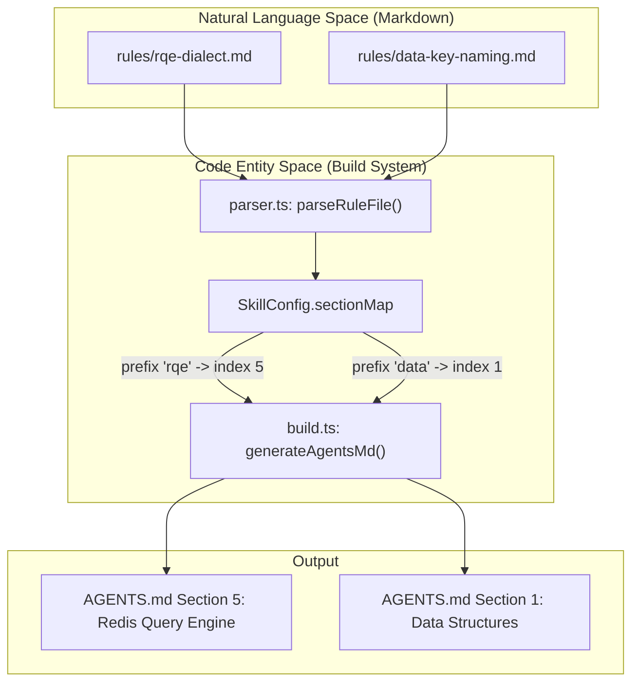
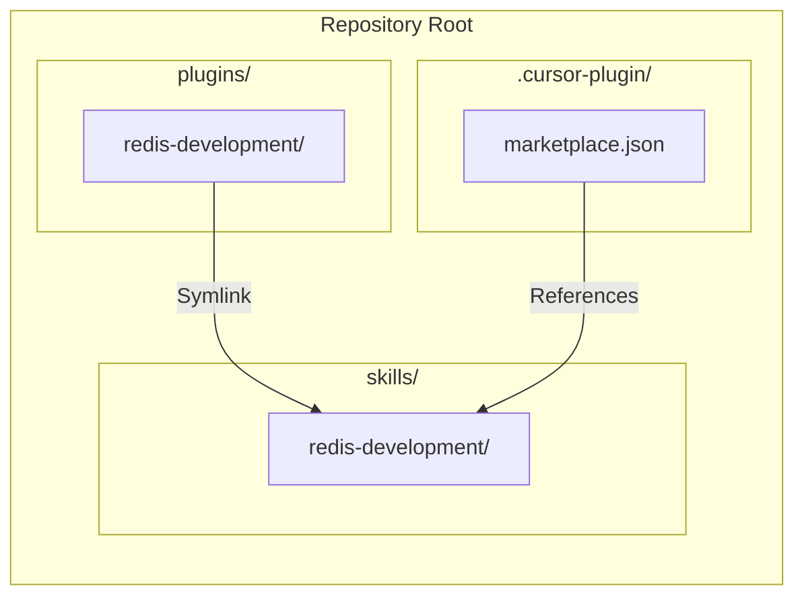

<!-- source: DeepWiki mcp.deepwiki.com · repo redis/agent-skills · page 1.2 Repository Structure & Conventions · fetched 2026-10-26 -->

# Repository Structure & Conventions

<details>
<summary>Relevant source files</summary>

The following files were used as context for generating this wiki page:

- [CLAUDE.md](CLAUDE.md)
- [README.md](README.md)
- [skills/redis-development/AGENTS.md](skills/redis-development/AGENTS.md)
- [skills/redis-development/SKILL.md](skills/redis-development/SKILL.md)
- [skills/redis-development/metadata.json](skills/redis-development/metadata.json)

</details>


This page details the organization of the `redis/agent-skills` repository, the naming conventions used for skill development, and the technical implementation of the plugin distribution strategy.

## Directory Layout

The repository is organized into a modular structure that separates the core skill content from the build tooling and platform-specific plugin packaging.

| Directory | Purpose |
|:---|:---|
| `skills/` | The source of truth for all skill content. Each subdirectory represents a standalone skill (e.g., `redis-development`). [README.md:38-38](), [CLAUDE.md:14-15]() |
| `plugins/` | Contains platform-specific plugin wrappers (e.g., for Claude Code) that symlink to the `skills/` directory. [README.md:38-38]() |
| `packages/` | Houses internal TypeScript packages, such as the build system used to compile rules. [CLAUDE.md:138-140]() |
| `scripts/` | Utility scripts for validation and CI/CD automation. [README.md:61-61]() |
| `.cursor-plugin/` | Global configuration and marketplace registry for Cursor IDE integration. |
| `.claude-plugin/` | Global configuration and marketplace registry for Claude Code integration. |

### Skill Directory Structure
Each skill within `skills/{skill-name}/` must follow a strict internal structure to be compatible with the build system and CLI:

*   `SKILL.md`: The primary entry point for agents, containing high-level instructions and a rule index. [CLAUDE.md:16-16]()
*   `AGENTS.md`: A generated, monolithic file containing the full text of all expanded rules, optimized for LLM context. [CLAUDE.md:17-17]()
*   `metadata.json`: Machine-readable versioning and reference data. [CLAUDE.md:19-19]()
*   `rules/`: A directory containing individual markdown files for each rule, along with `_sections.md` for category definitions. [CLAUDE.md:20-23]()

**Sources:** [README.md:55-61](), [CLAUDE.md:11-26]()

---

## Naming Conventions

Consistency in naming is enforced to ensure the build system can correctly map rule files to their respective sections in the compiled `AGENTS.md`.

### Core Entities
*   **Skill Directories**: Must use `kebab-case` (e.g., `redis-development`). [CLAUDE.md:30-30]()
*   **Rule Files**: Must follow the pattern `{prefix}-{description}.md`. [CLAUDE.md:32-32]()
*   **Section Prefixes**: Short identifiers (e.g., `rqe-` for Redis Query Engine) that map a file to a specific chapter in the documentation. [skills/redis-development/SKILL.md:26-38]()

### Rule File Mapping
The build system uses a `sectionMap` defined in the build configuration to route files based on their prefix.

**Data Flow: Rule File to AGENTS.md Section**


**Sources:** [CLAUDE.md:28-34](), [CLAUDE.md:150-165](), [skills/redis-development/SKILL.md:26-38]()

---

## Symlink & Plugin Strategy

To avoid duplicating content while supporting multiple agent platforms (Cursor, Claude Code, etc.), the repository uses a symlink-based strategy.

### Implementation
1.  **Source of Truth**: All content resides in `skills/`. [README.md:38-38]()
2.  **Plugin Folders**: Directories like `plugins/redis-development/` do not contain copies of the rules. Instead, they contain a `.claude-plugin/` or `.cursor-plugin/` directory with a `plugin.json` manifest.
3.  **Symlinking**: The plugin folder symlinks the relevant skill directory. This allows platform-specific metadata to live alongside the shared content without fragmentation. [README.md:38-38]()

### Plugin Structure Overview


**Sources:** [README.md:30-38](), [CLAUDE.md:175-180]()

---

## Build System Integration

The build system is a TypeScript application located in `packages/redis-development-build/`. It bridges the gap between individual rule files and the final distributed assets.

### Key Functions
*   **`validate`**: Checks rule files for required frontmatter (title, impact, tags) and ensures the markdown structure follows the `_template.md`. [CLAUDE.md:144-144]()
*   **`build`**: Orchestrates the reading of `metadata.json`, `SKILL.md`, and the `rules/` directory to produce the consolidated `AGENTS.md`. [CLAUDE.md:145-145]()

### Configuration Example
New skills must be registered in the build system's configuration to be included in the automated pipeline.

```typescript
// packages/redis-development-build/src/config.ts
export const SKILLS: Record<string, SkillConfig> = {
  'redis-development': {
    name: 'redis-development',
    skillDir: join(SKILLS_DIR, 'redis-development'),
    rulesDir: join(SKILLS_DIR, 'redis-development/rules'),
    outputFile: join(SKILLS_DIR, 'redis-development/AGENTS.md'),
    sectionMap: {
      'data': 1,
      'ram': 2,
      'conn': 3
      // ... maps prefix to TOC number
    }
  }
}
```

**Sources:** [CLAUDE.md:138-165](), [README.md:63-71]()

---

