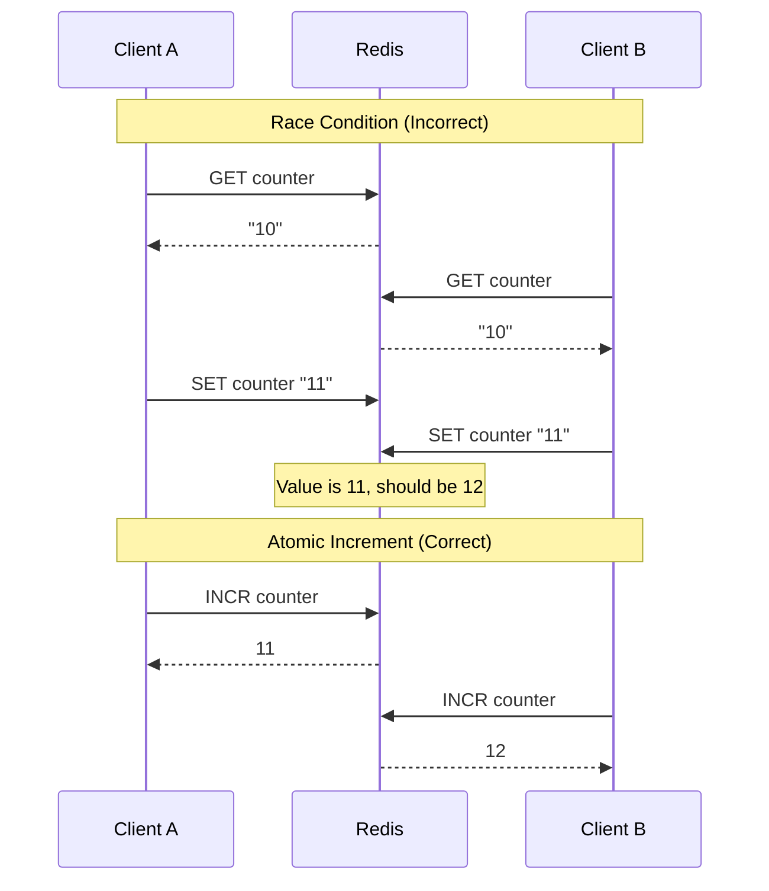
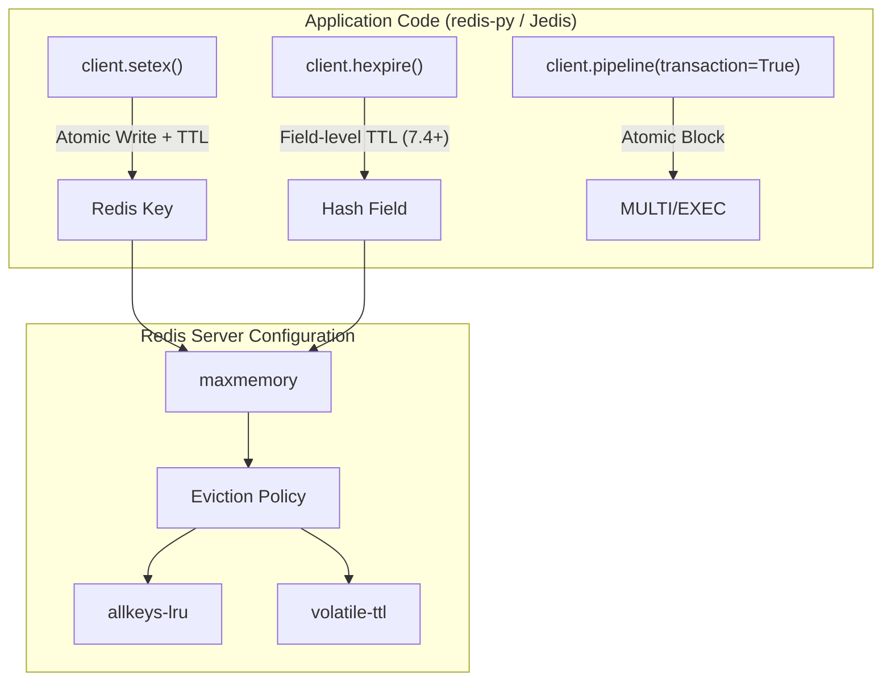

<!-- source: DeepWiki mcp.deepwiki.com · repo redis/agent-skills · page 2.1 Data Structures, Keys & Memory Rules · fetched 2026-10-26 -->

# Data Structures, Keys & Memory Rules

Relevant source files

The following files were used as context for generating this wiki page:

- [skills/redis-development/rules/conn-client-cache.md](skills/redis-development/rules/conn-client-cache.md)
- [skills/redis-development/rules/data-choose-structure.md](skills/redis-development/rules/data-choose-structure.md)
- [skills/redis-development/rules/data-hash-field-expiry.md](skills/redis-development/rules/data-hash-field-expiry.md)
- [skills/redis-development/rules/data-incr.md](skills/redis-development/rules/data-incr.md)
- [skills/redis-development/rules/data-key-naming.md](skills/redis-development/rules/data-key-naming.md)
- [skills/redis-development/rules/data-transactions.md](skills/redis-development/rules/data-transactions.md)
- [skills/redis-development/rules/ram-limits.md](skills/redis-development/rules/ram-limits.md)
- [skills/redis-development/rules/ram-ttl.md](skills/redis-development/rules/ram-ttl.md)

This page outlines the technical standards for data modeling, key management, and memory optimization within the `redis-development` skill. It covers the fundamental rules for choosing Redis data types, naming conventions, and implementing expiration strategies to ensure performance and prevent unbounded memory growth.

## 1. Data Structure Selection

Choosing the correct Redis data type is the most critical factor in determining the performance and memory footprint of an application. The system provides specific guidance on mapping application use cases to Redis types.

### Recommended Mappings

| Use Case | Recommended Type | Why |
|----------|------------------|-----|
| Simple values, counters | **String** | Fast, atomic operations |
| Object with fields | **Hash** | Memory efficient, partial updates, field-level expiration |
| Queue, recent items | **List** | O(1) push/pop at ends |
| Unique items, membership | **Set** | O(1) add/remove/check |
| Rankings, ranges | **Sorted Set** | Score-based ordering |
| Nested/hierarchical data | **JSON** | Path queries, nested structures |
| Event logs, messaging | **Stream** | Persistent, consumer groups |
| Similarity search | **Vector Set** | Native vector storage with built-in HNSW indexing |

### Implementation Logic: Objects and Counters
Avoid using Strings for complex objects (e.g., serializing a whole JSON blob into a String). This pattern forces a full read-modify-write cycle for any update [skills/redis-development/rules/data-choose-structure.md:25-36](). Instead, use **Hashes** to allow atomic field-level updates [skills/redis-development/rules/data-choose-structure.md:47-56]().

For numeric values, use `INCR` or `INCRBY` to perform atomic increments directly on the server, avoiding race conditions inherent in client-side calculation [skills/redis-development/rules/data-incr.md:10-14]().

### Atomic Multi-Command Operations
When multiple keys must be updated as a single unit, use `MULTI`/`EXEC` transactions. This ensures that no other client requests are processed during execution, preventing partial state reads [skills/redis-development/rules/data-transactions.md:10-13]().

**Data Flow: Atomic Counter vs. Race Condition**

Sources: [skills/redis-development/rules/data-choose-structure.md:10-24](), [skills/redis-development/rules/data-incr.md:10-15](), [skills/redis-development/rules/data-transactions.md:10-13]()

---

## 2. Key Naming Conventions

Consistent key naming is required for maintainability and efficient scanning. The repository enforces a hierarchical structure using colons as separators.

### The Hierarchy Pattern
Keys should follow the pattern: `service:entity:id:attribute` [skills/redis-development/rules/data-key-naming.md:17-23]().

*   **Correct:** `user:1001:profile`, `order:2024:items`
*   **Incorrect:** `User_1001_Profile` (inconsistent), `my key with spaces` (wasteful/fragile), or using full URLs as keys [skills/redis-development/rules/data-key-naming.md:41-53]().

### Memory Optimization for Keys
*   Keep keys short but readable, as they consume RAM [skills/redis-development/rules/data-key-naming.md:56-56]().
*   For large binary values, use a hash digest (e.g., SHA-256) as the key instead of the value itself [skills/redis-development/rules/data-key-naming.md:59-59]().

Sources: [skills/redis-development/rules/data-key-naming.md:10-23](), [skills/redis-development/rules/data-key-naming.md:55-61]()

---

## 3. Memory & Expiration Rules

Unbounded memory growth is prevented through mandatory TTL (Time-To-Live) settings and explicit server-side eviction policies.

### TTL Strategies
All cache keys must have an expiration set at write time [skills/redis-development/rules/ram-ttl.md:12-14]().

*   **Standard Cache:** 1-24 hours [skills/redis-development/rules/ram-ttl.md:49-49]().
*   **Sessions:** 30 minutes to 24 hours [skills/redis-development/rules/ram-ttl.md:50-50]().
*   **Hash Field Expiration:** For Redis 7.4+, use `HEXPIRE` to set TTLs on individual fields within a hash, which is more efficient than managing multiple keys [skills/redis-development/rules/data-hash-field-expiry.md:10-14]().

### Eviction Policies
Redis must be configured with `maxmemory` and a `maxmemory-policy` to prevent Out-Of-Memory (OOM) crashes [skills/redis-development/rules/ram-limits.md:10-12]().

| Policy | Use Case |
|--------|----------|
| `allkeys-lru` | General purpose; evicts any least recently used key |
| `volatile-lru` | Evicts only keys with an expiration set |
| `noeviction` | Returns errors when full (use for critical/non-cache data) |

### Client-Side Caching
For data that is read frequently but updated rarely (e.g., config flags), use **Client-Side Caching** with the RESP3 protocol. This allows the client to store a local copy of the data, with Redis sending invalidation messages only when the data changes [skills/redis-development/rules/conn-client-cache.md:10-12]().

**Code Entity Mapping: Memory Management**

Sources: [skills/redis-development/rules/ram-ttl.md:10-24](), [skills/redis-development/rules/ram-limits.md:10-27](), [skills/redis-development/rules/data-hash-field-expiry.md:10-14](), [skills/redis-development/rules/conn-client-cache.md:10-30]()

---

