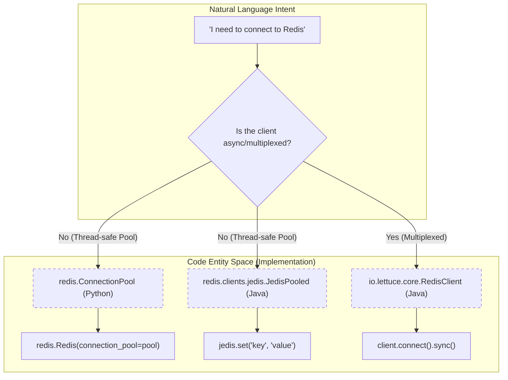
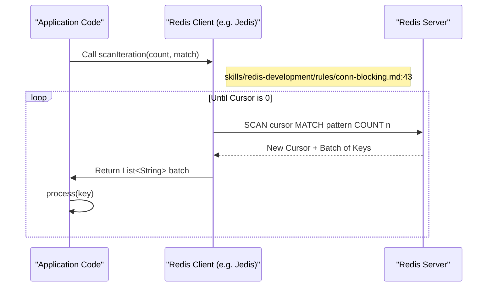

<!-- source: DeepWiki mcp.deepwiki.com · repo redis/agent-skills · page 2.2 Connection & Performance Rules · fetched 2026-10-26 -->

# Connection & Performance Rules

Relevant source files

The following files were used as context for generating this wiki page:

- [skills/redis-development/README.md](skills/redis-development/README.md)
- [skills/redis-development/rules/cluster-read-replicas.md](skills/redis-development/rules/cluster-read-replicas.md)
- [skills/redis-development/rules/conn-blocking.md](skills/redis-development/rules/conn-blocking.md)
- [skills/redis-development/rules/conn-client-cache.md](skills/redis-development/rules/conn-client-cache.md)
- [skills/redis-development/rules/conn-pipelining.md](skills/redis-development/rules/conn-pipelining.md)
- [skills/redis-development/rules/conn-pooling.md](skills/redis-development/rules/conn-pooling.md)
- [skills/redis-development/rules/conn-timeouts.md](skills/redis-development/rules/conn-timeouts.md)
- [skills/redis-development/rules/data-hash-field-expiry.md](skills/redis-development/rules/data-hash-field-expiry.md)
- [skills/redis-development/rules/data-incr.md](skills/redis-development/rules/data-incr.md)

This page details the implementation and best practices for managing Redis connections and optimizing command performance. It focuses on reducing network overhead, preventing server blocking, and leveraging advanced client-side features to ensure high-throughput, low-latency applications.

## Connection Management: Pooling & Multiplexing

Efficient connection management is critical for Redis performance. Creating a new TCP connection for every request introduces significant latency and CPU overhead. The codebase recommends two primary patterns: **Connection Pooling** and **Multiplexing**.

### Implementation Patterns

*   **Connection Pooling**: Maintains a set of established connections that are checked out and returned. This is the standard for thread-per-request models like those used in `redis-py` or `Jedis` [skills/redis-development/rules/conn-pooling.md:14-33]().
*   **Multiplexing**: A single connection handles all traffic asynchronously. This is the default for libraries like `Lettuce` (Java) or `NRedisStack` [skills/redis-development/rules/conn-pooling.md:35-44](). Note that multiplexing cannot support blocking commands (e.g., `BLPOP`) as they would stall the shared connection [skills/redis-development/rules/conn-pooling.md:69-69]().

### Connection Logic Flow

The following diagram illustrates how different client types handle the transition from "Natural Language Space" (the intent to connect) to "Code Entity Space" (the specific classes used).

**Connection Strategy Mapping**

**Sources:** [skills/redis-development/rules/conn-pooling.md:16-44]()

## Performance Optimization: Pipelining & Batching

Pipelining allows a client to send multiple commands to the server without waiting for the replies. This reduces the number of network round trips, often resulting in a 5-10x speedup for bulk operations [skills/redis-development/rules/conn-pipelining.md:4-4]().

| Feature | Description | Code Entity (Python) | Code Entity (Java) |
| :--- | :--- | :--- | :--- |
| **Pipelining** | Buffer commands and send in one batch | `redis.pipeline()` | `jedis.pipelined()` |
| **Execution** | Send buffered commands to server | `pipe.execute()` | `pipe.sync()` |

**Sources:** [skills/redis-development/rules/conn-pipelining.md:16-37]()

## Avoiding Blocking Operations

Redis is single-threaded for command execution. Slow commands block all other clients. The ruleset mandates replacing O(N) commands that scan the entire keyspace with incremental alternatives [skills/redis-development/rules/conn-blocking.md:12-12]().

### Slow Command Alternatives

| Blocking Command | Recommended Alternative | Implementation Detail |
| :--- | :--- | :--- |
| `KEYS *` | `SCAN` | Use `cursor` to iterate without blocking [skills/redis-development/rules/conn-blocking.md:16-16]() |
| `SMEMBERS` | `SSCAN` | For large Sets [skills/redis-development/rules/conn-blocking.md:17-17]() |
| `HGETALL` | `HSCAN` | For large Hashes [skills/redis-development/rules/conn-blocking.md:18-18]() |
| `LRANGE 0 -1` | `LRANGE 0 100` | Paginate large Lists [skills/redis-development/rules/conn-blocking.md:19-19]() |

**Non-Blocking Iteration Flow**

**Sources:** [skills/redis-development/rules/conn-blocking.md:23-52]()

## Client-Side Caching (RESP3)

For frequently read but rarely updated data (e.g., configuration or session flags), client-side caching significantly reduces network traffic [skills/redis-development/rules/conn-client-cache.md:10-12](). This requires the **RESP3** protocol to allow the server to send invalidation messages to the client [skills/redis-development/rules/conn-client-cache.md:24-24]().

### Configuration Parameters
*   **Protocol**: Must be set to `3` [skills/redis-development/rules/conn-client-cache.md:24-24]().
*   **CacheConfig**: Defines `max_size` for the local memory cache [skills/redis-development/rules/conn-client-cache.md:25-25]().

**Sources:** [skills/redis-development/rules/conn-client-cache.md:17-50]()

## Connection Resilience & Timeouts

Hardcoding or relying on default timeouts can lead to application hanging during network partitions. The guidelines suggest tuning three specific parameters:

1.  **`socket_connect_timeout`**: Shorter duration for fast failure detection [skills/redis-development/rules/conn-timeouts.md:20-20]().
2.  **`socket_timeout`**: Read/write timeout tuned to expected operation time [skills/redis-development/rules/conn-timeouts.md:19-19]().
3.  **`retry_on_timeout`**: Boolean flag for automatic recovery [skills/redis-development/rules/conn-timeouts.md:21-21]().

**Sources:** [skills/redis-development/rules/conn-timeouts.md:16-23]()

## Atomic Operations & Field Expiry

Performance is also gained by reducing the number of round trips for logic-heavy operations.

*   **Atomic Counters**: Use `INCR` or `INCRBY` instead of a read-modify-write pattern to avoid race conditions and extra network calls [skills/redis-development/rules/data-incr.md:10-12]().
*   **Hash Field Expiration**: In Redis 7.4+, use `HEXPIRE` to set TTLs on individual fields within a Hash, avoiding the need for manual cleanup logic or multiple keys [skills/redis-development/rules/data-hash-field-expiry.md:10-14]().

**Sources:** [skills/redis-development/rules/data-incr.md:17-45](), [skills/redis-development/rules/data-hash-field-expiry.md:17-48]()

---

