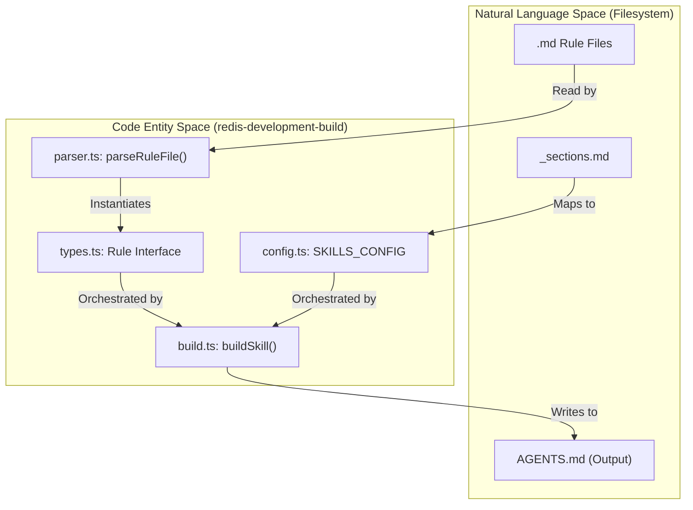
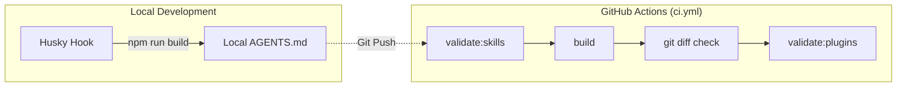

<!-- source: DeepWiki mcp.deepwiki.com · repo redis/agent-skills · page 3 Build System & Tooling · fetched 2026-10-26 -->

# Build System & Tooling

Relevant source files

The following files were used as context for generating this wiki page:

- [.github/workflows/ci.yml](.github/workflows/ci.yml)
- [package.json](package.json)
- [packages/redis-development-build/package.json](packages/redis-development-build/package.json)

The **agent-skills** repository utilizes a TypeScript-based build pipeline to transform a collection of modular markdown rule files into a single, cohesive `AGENTS.md` file for each skill. This system ensures that high-level guidance for LLMs is maintained in a structured, easy-to-edit format while remaining compatible with agentic platforms that require a monolithic instruction file.

The build system is centralized within the `redis-development-build` package and is integrated into the development workflow via Husky hooks and GitHub Actions.

### Build Architecture Overview

The pipeline follows a "Source -> Validate -> Assemble" pattern. Individual rules are authored as markdown files with YAML frontmatter in the `rules/` directory of a skill. The build tool parses these files, validates their schema and cross-references, and then concatenates them into a final output based on a predefined section map.

#### Logic Flow: Natural Language to Code Entities
The following diagram illustrates how the build system bridges the gap between the natural language markdown files and the TypeScript entities that process them.

**Diagram: Build Pipeline Entity Mapping**

**Sources:** [packages/redis-development-build/package.json:7-9](), [package.json:8-10]()

---

### Core Components

#### 1. Build Orchestration
The primary entry point for the build system is `src/build.ts` within the `redis-development-build` workspace. It is responsible for iterating through the configured skills, loading the rules, and generating the `AGENTS.md` file.

*   **Command:** `npm run build` (invokes `tsx src/build.ts --all`).
*   **Key Logic:** The builder uses a configuration object to determine the sort order of sections and which files to include in the final bundle.

For details, see [Build Package Internals (redis-development-build)](#3.1).

#### 2. Validation Tooling
Before a build is finalized, the system runs a validation suite located in `src/validate.ts`. This ensures that all rules adhere to the required frontmatter schema (e.g., impact levels, descriptions) and that code examples are correctly formatted.

*   **Command:** `npm run validate:skills` (invokes `tsx src/validate.ts`).
*   **Scope:** Checks for missing metadata, invalid section prefixes, and broken links between rules and the contributing guide.

For details, see [Rule File Format & Authoring Guide](#3.2).

#### 3. Plugin Verification
Beyond the core build, the repository includes scripts to validate the integrity of Cursor and Claude Code plugins. These scripts ensure that the `marketplace.json` and `plugin.json` manifests are correctly configured and that relative paths to skill content are safe and valid.

*   **Scripts:** `scripts/validate-claude-plugins.mjs` and `scripts/validate-cursor-plugins.mjs`.

For details, see [CI/CD Pipeline & Pre-commit Hooks](#3.3).

---

### Automation & CI/CD Integration

The build system is strictly enforced through two layers of automation to prevent `AGENTS.md` from drifting out of sync with the source rules.

**Diagram: Automation Workflow**

| Component | File/Path | Purpose |
| :--- | :--- | :--- |
| **Pre-commit Hook** | `package.json:14` | Uses `husky` to trigger validation and builds before every commit. |
| **CI Workflow** | `.github/workflows/ci.yml` | Runs on every PR to `main` to ensure the committed `AGENTS.md` matches the source files. |
| **Workspaces** | `package.json:4-5` | Manages `packages/*` to allow the build tool to be shared across different skills. |

**Sources:** [package.json:4-14](), [.github/workflows/ci.yml:25-40](), [packages/redis-development-build/package.json:1-10]()

---

### Child Pages
*   **[Build Package Internals (redis-development-build)](#3.1)**: Deep dive into the TypeScript source code, including the parser, configuration maps, and data models.
*   **[Rule File Format & Authoring Guide](#3.2)**: Technical specification for the markdown frontmatter, section definitions, and example conventions.
*   **[CI/CD Pipeline & Pre-commit Hooks](#3.3)**: Details on the GitHub Actions workflow and how idempotency is checked in the pipeline.

---

