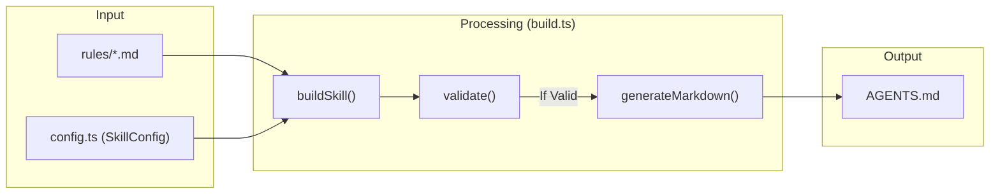

<!-- source: DeepWiki mcp.deepwiki.com · repo redis/agent-skills · page 3.1 Build Package Internals (redis-development-build) · fetched 2026-10-26 -->

# Build Package Internals (redis-development-build)

<details>
<summary>Relevant source files</summary>

The following files were used as context for generating this wiki page:

- [packages/redis-development-build/src/build.ts](packages/redis-development-build/src/build.ts)
- [packages/redis-development-build/src/config.ts](packages/redis-development-build/src/config.ts)
- [packages/redis-development-build/src/parser.ts](packages/redis-development-build/src/parser.ts)
- [packages/redis-development-build/src/types.ts](packages/redis-development-build/src/types.ts)
- [packages/redis-development-build/src/validate.ts](packages/redis-development-build/src/validate.ts)
- [packages/redis-development-build/tsconfig.json](packages/redis-development-build/tsconfig.json)

</details>


The `redis-development-build` package is a TypeScript-based build pipeline responsible for transforming a collection of individual Markdown rule files into a single, cohesive `AGENTS.md` file optimized for LLM consumption. It provides the data models, parsing logic, and validation routines used across the repository.

## Data Model (types.ts)

The system uses a structured data model to represent Redis best practices. The hierarchy flows from a `GuidelinesDocument` down to individual `CodeExample` objects.

| Type | Description | Key Properties |
|:---|:---|:---|
| `Rule` | Represents a single optimization or best practice. | `id`, `title`, `impact`, `explanation`, `examples` |
| `Section` | A grouping of related rules (e.g., "Memory & Expiration"). | `number`, `title`, `impact`, `rules` |
| `CodeExample` | A code snippet demonstrating correct or incorrect usage. | `label`, `code`, `language`, `description` |
| `ImpactLevel` | Enum defining the severity of a rule. | `CRITICAL`, `HIGH`, `MEDIUM-HIGH`, `MEDIUM`, `LOW-MEDIUM`, `LOW` |

Sources: [packages/redis-development-build/src/types.ts:5-44]()

## Configuration & Mapping (config.ts)

The build system is multi-skill aware. It defines a `SkillConfig` interface to manage different sets of rules and their output destinations.

The `SKILLS` constant maps skill names (like `redis-development`) to their directory structures and `sectionMap`. The `sectionMap` is critical for the parser: it maps filename prefixes (e.g., `data-`, `ram-`) to the logical section numbers (1, 2, etc.) used in the final document.

### Section Map Example
For the `redis-development` skill, the mapping is defined as:
- `data`: Section 1 (Data Structures)
- `ram`: Section 2 (Memory)
- `conn`: Section 3 (Connection)
- ...and so on up to `observe`: Section 11.

Sources: [packages/redis-development-build/src/config.ts:15-49]()

## Rule Parser (parser.ts)

The `parseRuleFile` function is the core engine that converts Markdown source into the `Rule` object. It handles three distinct parts of a rule file:

1.  **Frontmatter**: Extracts metadata like `id` or `tags` if present [packages/redis-development-build/src/parser.ts:43-60]().
2.  **Metadata Extraction**: Identifies the `title` from headings and the `impact` level from bolded text [packages/redis-development-build/src/parser.ts:66-111]().
3.  **Example Parsing**: A stateful loop that detects code blocks and labels (e.g., `**Correct:**`). It uses a `smartJoin` helper to preserve Markdown table formatting while managing whitespace between paragraphs [packages/redis-development-build/src/parser.ts:12-22](), [packages/redis-development-build/src/parser.ts:147-184]().

### Parser Data Flow
The following diagram shows how raw Markdown is transformed into the internal `RuleFile` interface.

**Diagram: Markdown to Code Entity Transformation**
```mermaid
graph TD
    subgraph "Natural Language Space (Markdown File)"
        MD["rule-file.md"]
        FM["--- frontmatter ---"]
        H2["## Title"]
        IMP["**Impact: HIGH**"]
        EXP["Explanation text..."]
        CB["```python\n# code\n```"]
    end

    subgraph "Code Entity Space (parser.ts)"
        PRF["parseRuleFile()"]
        RO["Rule Object"]
        CEO["CodeExample Object"]
    end

    MD --> PRF
    FM -- "Extracted to" --> RO
    H2 -- "Sets rule.title" --> RO
    IMP -- "Sets rule.impact" --> RO
    EXP -- "Sets rule.explanation" --> RO
    CB -- "Becomes" --> CEO
    CEO -- "Pushed to" --> RO
```
Sources: [packages/redis-development-build/src/parser.ts:33-225]()

## Build Orchestrator (build.ts)

The `build.ts` script acts as the conductor for the compilation process. It performs the following sequence:

1.  **Discovery**: Scans the `rules/` directory for `.md` files, excluding those starting with `_` (templates/internal docs) [packages/redis-development-build/src/build.ts:169-171]().
2.  **Parsing**: Iterates through files, calling `parseRuleFile` for each.
3.  **Aggregation**: Groups rules into `Section` objects based on the `sectionMap` [packages/redis-development-build/src/build.ts:197-200]().
4.  **Markdown Generation**: The `generateMarkdown` function takes the aggregated sections and metadata to produce the final `AGENTS.md` string [packages/redis-development-build/src/build.ts:32-130]().
5.  **Persistence**: Writes the result to the `outputFile` defined in `config.ts`.

### Build Pipeline Logic
**Diagram: Build Process Orchestration**

Sources: [packages/redis-development-build/src/build.ts:135-195]()

## Validation (validate.ts)

The validation logic ensures that the content meets the strict requirements for AI-assisted workflows. The `validateRule` function enforces:

*   **Content Presence**: Rules must have a title, explanation, and at least one code example [packages/redis-development-build/src/validate.ts:26-35]().
*   **Example Quality**: At least one "good" or "correct" example must be present. The validator checks for labels like `Correct`, `Usage`, or specific language names (Python, Java, etc.) [packages/redis-development-build/src/validate.ts:50-65]().
*   **Impact Levels**: Validates that the impact string matches the allowed `ImpactLevel` enum [packages/redis-development-build/src/validate.ts:82-85]().

The validation script exits with code `1` if any errors are found, preventing the CI/CD pipeline from publishing invalid rules [packages/redis-development-build/src/validate.ts:129-134]().

Sources: [packages/redis-development-build/src/validate.ts:21-88](), [packages/redis-development-build/src/validate.ts:93-142]()

---

