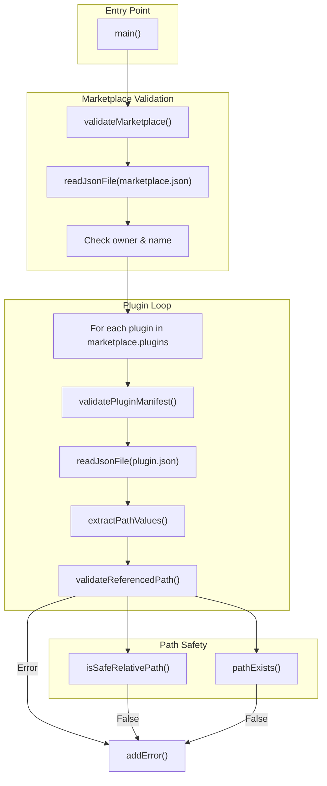
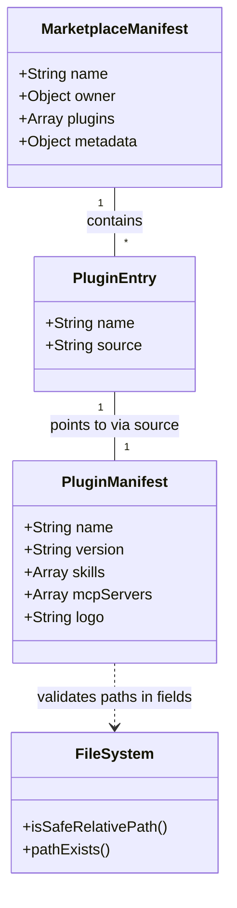

<!-- source: DeepWiki mcp.deepwiki.com · repo redis/agent-skills · page 4.3 Plugin Validation Scripts · fetched 2026-10-26 -->

# Plugin Validation Scripts

Relevant source files

The following files were used as context for generating this wiki page:

- [package.json](package.json)
- [scripts/validate-claude-plugins.mjs](scripts/validate-claude-plugins.mjs)
- [scripts/validate-cursor-plugins.mjs](scripts/validate-cursor-plugins.mjs)

The `agent-skills` repository utilizes specialized Node.js scripts to ensure the integrity of plugin manifests and marketplace registries. These scripts validate that all JSON metadata follows the required schema and that all file references (e.g., logos, skill files, MCP servers) point to existing, safe paths within the repository.

## Overview

Validation is split into two primary scripts located in the `scripts/` directory:
- `validate-cursor-plugins.mjs`: Validates Cursor IDE plugin integrations [scripts/validate-cursor-plugins.mjs:1-244]().
- `validate-claude-plugins.mjs`: Validates Claude Code plugin integrations [scripts/validate-claude-plugins.mjs:1-220]().

These scripts are executed as part of the `npm run validate:plugins` command [package.json:13-13]() and are typically triggered during CI/CD or via pre-commit hooks [package.json:9-14]().

### Validation Logic Flow

The following diagram illustrates the common execution flow used by both validation scripts to traverse from a marketplace registry to individual plugin manifests.

**Plugin Discovery and Validation Flow**

Sources: [scripts/validate-cursor-plugins.mjs:166-233](), [scripts/validate-claude-plugins.mjs:110-207]()

---

## Key Validation Functions

### `isSafeRelativePath(value)`
This function prevents path traversal attacks by ensuring that all paths defined in JSON manifests remain within the plugin's directory. It checks that paths are not absolute and do not use `../` to escape the root [scripts/validate-cursor-plugins.mjs:58-67](), [scripts/validate-claude-plugins.mjs:59-68]().

### `extractPathValues(value)`
Manifests often contain paths in different formats: simple strings, arrays of strings, or objects containing `path` or `file` keys. This utility flattens these diverse structures into a single array of strings for validation [scripts/validate-cursor-plugins.mjs:69-87](), [scripts/validate-claude-plugins.mjs:70-88]().

### `validatePluginManifest()`
Performs deep inspection of a `plugin.json` file. It verifies:
1.  **Naming**: Ensures the `name` matches the `pluginNamePattern` (lowercase, alphanumerics, hyphens, and periods) [scripts/validate-cursor-plugins.mjs:10-10](), [scripts/validate-cursor-plugins.mjs:120-127]().
2.  **Metadata**: Checks for required fields like `version`, `description`, `license`, `author.name`, and `keywords` [scripts/validate-cursor-plugins.mjs:129-149]().
3.  **Asset References**: Iterates through fields such as `logo`, `rules`, `skills`, `agents`, `commands`, `hooks`, and `mcpServers` to ensure every referenced file exists on disk [scripts/validate-cursor-plugins.mjs:151-163]().

---

## Script Specifics

### Cursor Plugin Validation (`validate-cursor-plugins.mjs`)

The Cursor script is designed to handle both a single root plugin or a multi-plugin marketplace.

1.  **Entry Point**: `main()` checks for the existence of `.cursor-plugin/marketplace.json`. If missing, it falls back to validating a standalone `.cursor-plugin/plugin.json` [scripts/validate-cursor-plugins.mjs:235-246]().
2.  **Marketplace Metadata**: It supports a `metadata.pluginRoot` field in the marketplace manifest, which provides a base directory for all plugin source paths [scripts/validate-cursor-plugins.mjs:188-193]().
3.  **Source Resolution**: Resolves the plugin directory by combining `repoRoot`, `pluginRoot`, and the plugin's `source` path [scripts/validate-cursor-plugins.mjs:220-220]().

Sources: [scripts/validate-cursor-plugins.mjs:166-247]()

### Claude Code Plugin Validation (`validate-claude-plugins.mjs`)

The Claude script focuses on the marketplace structure required for Claude Code integrations.

1.  **Marketplace Schema**: Enforces a strict `marketplaceNamePattern` [scripts/validate-claude-plugins.mjs:11-11]() and ensures the `owner.name` is present [scripts/validate-claude-plugins.mjs:133-139]().
2.  **Duplicate Detection**: Uses a `Set` named `seenNames` to ensure that no two plugins in the marketplace share the same name [scripts/validate-claude-plugins.mjs:146-164]().
3.  **LSP Support**: Unlike the Cursor script, this specifically validates `lspServers` paths [scripts/validate-claude-plugins.mjs:197-197]().

Sources: [scripts/validate-claude-plugins.mjs:110-207]()

---

## Data Model & Logic Mapping

The scripts bridge the gap between the JSON configuration files and the physical file system.

**Entity Relationship: Manifest to File System**

Sources: [scripts/validate-cursor-plugins.mjs:112-164](), [scripts/validate-cursor-plugins.mjs:166-233](), [scripts/validate-claude-plugins.mjs:147-204]()

---

## Error Aggregation and Exit Codes

Both scripts utilize a centralized error handling mechanism:
-   **`errors` Array**: A global array that collects strings describing validation failures [scripts/validate-cursor-plugins.mjs:8-8](), [scripts/validate-claude-plugins.mjs:8-8]().
-   **`addError(message)`**: A helper function to push new messages to the array [scripts/validate-cursor-plugins.mjs:12-14](), [scripts/validate-claude-plugins.mjs:13-15]().
-   **`summarizeAndExit()`**: Called at the end of execution. If `errors.length > 0`, it prints all messages to `stderr` and exits with code `1`. Otherwise, it exits with code `0` [scripts/validate-claude-plugins.mjs:209-218]().

| Condition | Action | Exit Code |
| :--- | :--- | :--- |
| All files exist and JSON is valid | Log "Validation passed." | `0` |
| Missing manifest file | Log error to `errors` | `1` |
| Invalid JSON syntax | Log error with JSON.parse message | `1` |
| Path traversal detected (`../`) | Log "invalid relative path" | `1` |
| Referenced asset missing | Log "references missing path" | `1` |

Sources: [scripts/validate-cursor-plugins.mjs:8-14](), [scripts/validate-claude-plugins.mjs:209-218]()

---

