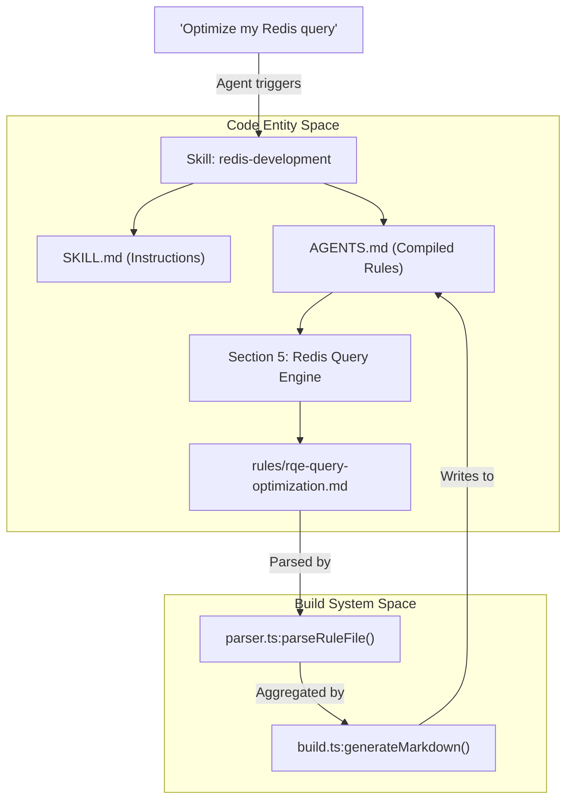
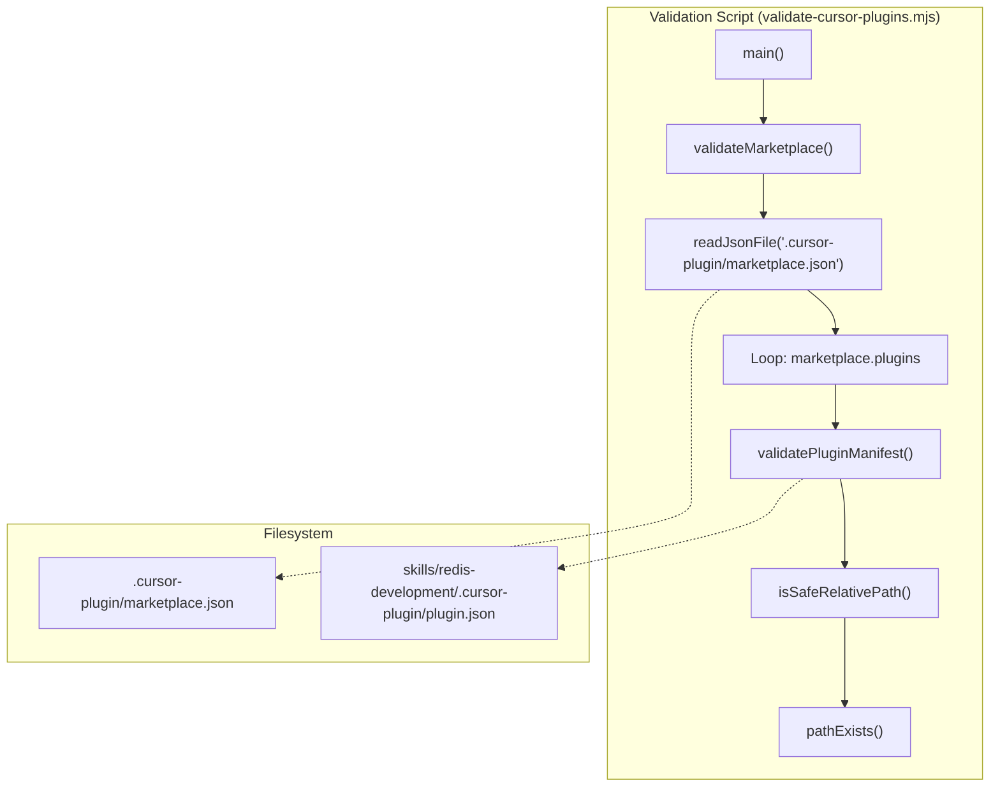

<!-- source: DeepWiki mcp.deepwiki.com · repo redis/agent-skills · page 5 Glossary · fetched 2026-10-26 -->

# Glossary

Relevant source files

The following files were used as context for generating this wiki page:

- [README.md](README.md)
- [packages/redis-development-build/src/build.ts](packages/redis-development-build/src/build.ts)
- [packages/redis-development-build/src/config.ts](packages/redis-development-build/src/config.ts)
- [scripts/validate-cursor-plugins.mjs](scripts/validate-cursor-plugins.mjs)
- [skills/redis-development/.cursor-plugin/plugin.json](skills/redis-development/.cursor-plugin/plugin.json)
- [skills/redis-development/AGENTS.md](skills/redis-development/AGENTS.md)
- [skills/redis-development/SKILL.md](skills/redis-development/SKILL.md)
- [skills/redis-development/assets/logo.png](skills/redis-development/assets/logo.png)
- [skills/redis-development/rules/_sections.md](skills/redis-development/rules/_sections.md)

This glossary defines the technical terms, abbreviations, and domain-specific concepts used within the `redis/agent-skills` repository. It provides a bridge between high-level Redis concepts and their specific implementations or representations in the codebase.

## Codebase Terminology

### Skill
A "Skill" is a packaged set of instructions, rules, and resources designed to extend the capabilities of an AI coding agent [README.md:3-5](). In this repository, skills are located in the `skills/` directory [README.md:38]().
*   **Implementation**: A skill directory must contain a `SKILL.md` (agent instructions) and `AGENTS.md` (compiled rules) [README.md:57-60]().
*   **Code Pointer**: [skills/redis-development/SKILL.md:1-8]() defines the manifest for the core Redis skill.

### Rule
An individual best-practice guideline. Rules are authored as standalone Markdown files in a skill's `rules/` subdirectory [README.md:60]().
*   **Implementation**: Represented by the `Rule` interface in the build system [packages/redis-development-build/src/types.ts]().
*   **Data Flow**: `parser.ts` reads these files, extracts frontmatter and content, and `build.ts` aggregates them into a single `AGENTS.md` file [packages/redis-development-build/src/build.ts:6-9]().

### Section
A logical grouping of rules based on a functional domain (e.g., "Memory & Expiration").
*   **Implementation**: Sections are defined in `_sections.md` [skills/redis-development/rules/_sections.md:1-4]().
*   **Mapping**: The build system uses a `sectionMap` in `config.ts` to associate filename prefixes (like `ram-` or `conn-`) with specific section numbers [packages/redis-development-build/src/config.ts:35-47]().

### Plugin
A distribution-ready package of a skill tailored for specific AI IDEs like Cursor or Claude Code [README.md:21-32]().
*   **Structure**: Plugins often use symlinks to reference the source-of-truth in the `skills/` directory [README.md:38]().
*   **Validation**: Scripts like `validate-cursor-plugins.mjs` ensure that plugin manifests (`plugin.json`) are valid and safe [scripts/validate-cursor-plugins.mjs:112-164]().

## Redis Domain Concepts

### RQE (Redis Query Engine)
Refers to the querying and indexing capabilities of Redis (formerly known as RediSearch).
*   **Key Commands**: `FT.CREATE`, `FT.SEARCH`, `FT.AGGREGATE` [skills/redis-development/SKILL.md:19]().
*   **Code Pointer**: Rules prefixed with `rqe-` in `skills/redis-development/rules/` [skills/redis-development/SKILL.md:64-71]().

### RedisVL
The Redis Vector Library, a client-side library used for building applications with vector search and RAG (Retrieval-Augmented Generation) patterns [skills/redis-development/SKILL.md:20]().
*   **Concepts**: HNSW (Hierarchical Navigable Small World) vs FLAT indexing algorithms [skills/redis-development/AGENTS.md:49]().

### Semantic Caching (LangCache)
A technique for caching LLM responses based on semantic similarity rather than exact string matches.
*   **Implementation**: Leveraged via the `LangCache` library [skills/redis-development/SKILL.md:21]().
*   **Code Pointer**: Rules prefixed with `semantic-cache-` [skills/redis-development/SKILL.md:79-83]().

---

## Technical Architecture Diagrams

### From Natural Language to Code Entities
This diagram illustrates how a user's intent is mapped to specific code structures within the repository.

**Intent Mapping Architecture**

**Sources**: [README.md:57-60](), [packages/redis-development-build/src/build.ts:32-42](), [skills/redis-development/SKILL.md:64-71]()

### Plugin Validation Data Flow
This diagram shows how the validation scripts process the marketplace and plugin manifests to ensure integrity.

**Validation Logic Flow**

**Sources**: [scripts/validate-cursor-plugins.mjs:235-246](), [scripts/validate-cursor-plugins.mjs:166-186](), [scripts/validate-cursor-plugins.mjs:112-120]()

---

## Summary Table of Key Symbols

| Symbol | Definition | Context | Code Reference |
| :--- | :--- | :--- | :--- |
| `AGENTS.md` | The final compiled output of all rules in a skill. | Build Artifact | [packages/redis-development-build/src/config.ts:34]() |
| `SKILL.md` | High-level instructions for the AI agent. | Skill Definition | [skills/redis-development/SKILL.md:1-8]() |
| `SectionMap` | A mapping of filename prefixes to section numbers. | Build Config | [packages/redis-development-build/src/config.ts:35-47]() |
| `ImpactLevel` | Enum defining the severity of a rule (HIGH, MEDIUM, LOW). | Rule Metadata | [packages/redis-development-build/src/types.ts]() |
| `Dialect 2` | A specific version of the Redis Query Engine syntax. | Query Optimization | [skills/redis-development/SKILL.md:66]() |

**Sources**: [README.md:57-60](), [packages/redis-development-build/src/config.ts:35-47](), [skills/redis-development/SKILL.md:64-71]()