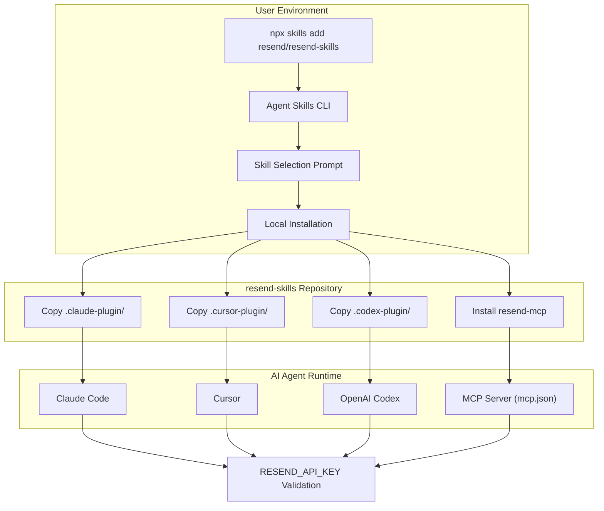
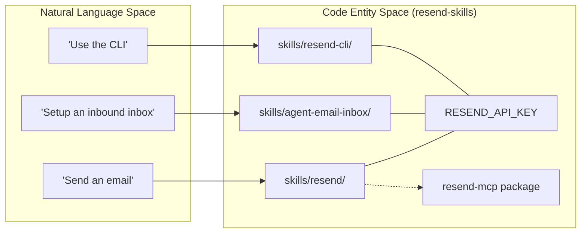

<!-- source: DeepWiki mcp.deepwiki.com · repo resend/resend-skills · page 1.1 Getting Started & Installation · fetched 2026-10-26 -->

# Getting Started & Installation

<details>
<summary>Relevant source files</summary>

The following files were used as context for generating this wiki page:

- [.gitignore](.gitignore)
- [README.md](README.md)
- [skills/resend/references/installation.md](skills/resend/references/installation.md)

</details>


This page provides a technical guide for installing and configuring the `resend-skills` collection. It covers the installation process via the Agent Skills CLI, environmental configuration, and the selection of specific skills for AI agents.

## Prerequisites

Before installing the skills, ensure the following requirements are met:

1.  **Resend Account**: An active account at [resend.com](https://resend.com).
2.  **Verified Domain**: You must have a verified domain configured in your Resend dashboard to send emails from your own identity [README.md:45-45]().
3.  **API Key**: A valid API key generated from [resend.com/api-keys](https://resend.com/api-keys) [README.md:48-48]().
4.  **Environment Variable**: The key must be stored in the `RESEND_API_KEY` environment variable [README.md:46-46]().

## Installation via npx

The `resend-skills` package follows the [Agent Skills](https://agentskills.io) format and is installed using the `skills` CLI tool.

```bash
npx skills add resend/resend-skills
```
[README.md:9-11]()

### Skill Selection Process

Upon running the installation command, the CLI prompts the user to select specific skills from the collection. The repository contains two types of skills:

| Type | Description | Skills |
| :--- | :--- | :--- |
| **Authored** | Developed directly within this repository. | `resend`, `agent-email-inbox` |
| **Synced** | Automatically pulled from external source repositories. | `resend-cli`, `react-email`, `email-best-practices` |

[README.md:17-23](), [README.md:37-41]()

## Data Flow: Installation & Bootstrapping

The following diagram illustrates the flow from the initial installation command to the availability of tools within an AI agent's environment.

### System Bootstrapping Flow

**Sources:** [README.md:9-12](), [README.md:25-35](), [README.md:46-46]()

## SDK & Language Support

While the skills themselves are platform-agnostic for the agent, the `resend` skill often assists in installing the appropriate SDK within the project being worked on. The skill references a minimum version matrix to ensure compatibility with features like `emails.receiving.get()` and `webhooks.verify()` [skills/resend/references/installation.md:3-3]().

### Minimum Version Requirements
| SDK Language | Package Name | Min Version |
| :--- | :--- | :--- |
| Node.js | `resend` | `>= 6.9.2` |
| Python | `resend` | `>= 2.21.0` |
| Go | `resend-go/v3` | `>= 3.1.0` |
| PHP | `resend/resend-php` | `>= 1.1.0` |

[skills/resend/references/installation.md:9-18]()

### Project Detection Logic
The skills use specific file markers to determine which SDK to recommend for installation:
*   **Node.js**: `package.json`
*   **Python**: `requirements.txt` or `pyproject.toml`
*   **Go**: `go.mod`
*   **Rust**: `Cargo.toml`

[skills/resend/references/installation.md:22-37]()

## Implementation: Skill to Entity Mapping

The following diagram bridges the Natural Language requests handled by the agent to the specific code entities and configurations defined in the repository.

### Natural Language to Code Entity Mapping

**Sources:** [README.md:15-23](), [README.md:25-27](), [README.md:46-46]()

## Environment Configuration

The primary configuration point is the `RESEND_API_KEY`. This key authorizes the [Resend MCP server](https://github.com/resend/resend-mcp) included in the plugin [README.md:25-27]().

### Configuration Checklist
1.  **Export Variable**: Ensure `export RESEND_API_KEY='re_123...'` is set in your shell profile (`.zshrc`, `.bashrc`).
2.  **Plugin Verification**: For Claude Code, the `.claude-plugin/` directory must be accessible to the agent.
3.  **MCP JSON**: The Model Context Protocol (MCP) server configuration is typically managed via an `mcp.json` file generated or updated during the `skills add` process.

**Sources:** [README.md:5-5](), [README.md:31-35](), [README.md:46-48]()

---

