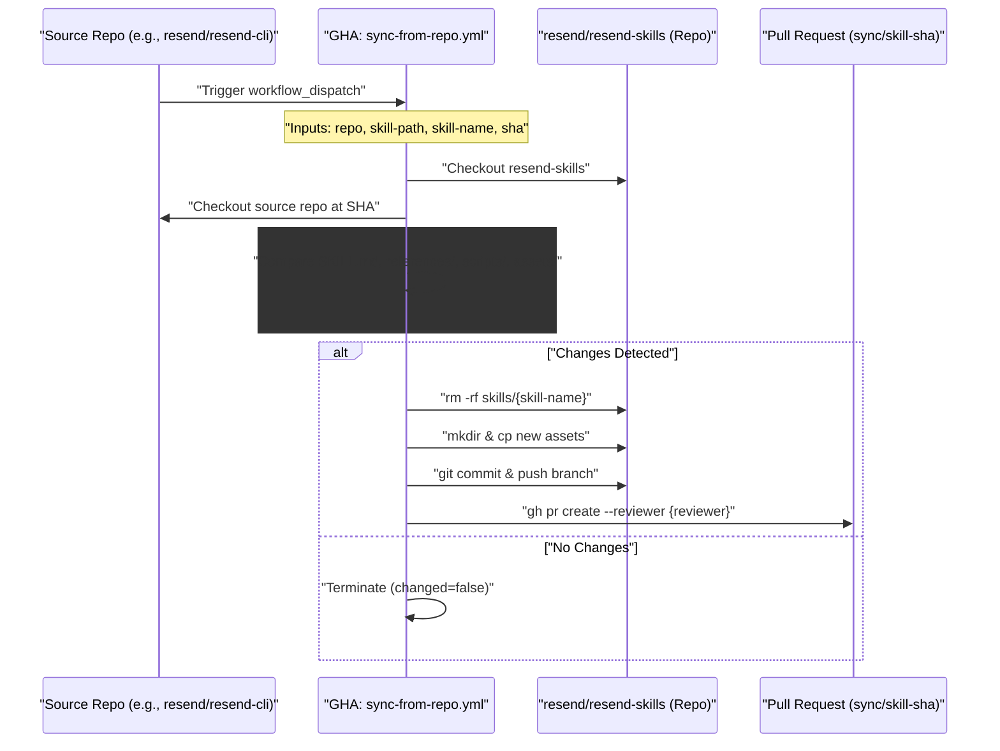
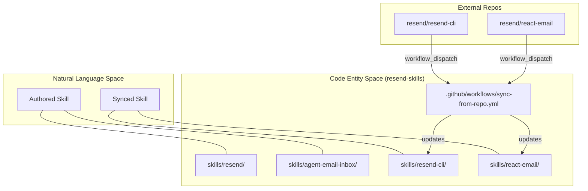

<!-- source: DeepWiki mcp.deepwiki.com · repo resend/resend-skills · page 1.3 Skill Authoring vs. Synced Skills · fetched 2026-10-26 -->

# Skill Authoring vs. Synced Skills

Relevant source files

The following files were used as context for generating this wiki page:

- [.github/workflows/sync-from-repo.yml](.github/workflows/sync-from-repo.yml)
- [AGENTS.md](AGENTS.md)

The `resend-skills` repository serves as a centralized distribution hub for Resend agent capabilities. Because these skills often depend on specific product implementations or documentation maintained in separate repositories, the codebase is divided into two categories: **Authored Skills** and **Synced Skills**.

This page details the architectural distinction between these categories, the automated synchronization workflow, and the governance model for contributions.

## Architectural Overview

The repository distinguishes between skills based on their source of truth. This ensures that documentation and logic for complex tools like the `resend-cli` remain coupled with their primary source code while still being accessible to AI agents through this central distribution point.

| Category | Skills | Source of Truth | Maintenance Policy |
| :--- | :--- | :--- | :--- |
| **Authored** | `resend`, `agent-email-inbox` | `resend/resend-skills` | Edit directly in this repo. |
| **Synced** | `resend-cli`, `react-email`, `email-best-practices` | External Repos (e.g., `resend/resend-cli`) | **Do not edit here.** Changes are overwritten. |

Sources: [AGENTS.md:5-20]()

### Skill Anatomy
Regardless of their origin, all skills follow a standard directory structure within the `skills/` directory to ensure compatibility with the platform plugins:
*   `SKILL.md`: The primary prompt and tool definition.
*   `references/`: Supporting technical documentation.
*   `scripts/`: Executable scripts or helper logic.
*   `assets/`: Images or static files used by the skill.

Sources: [.github/workflows/sync-from-repo.yml:56-67](), [.github/workflows/sync-from-repo.yml:90-95]()

## Synced Skills Workflow

Synced skills are managed via an automated GitHub Action that pulls content from source repositories and creates Pull Requests in `resend-skills`. This ensures that the agent's knowledge remains current with the latest CLI versions or best practices.

### The Sync Mechanism
The synchronization is driven by the `Sync Skills from Source Repo` workflow [.github/workflows/sync-from-repo.yml:1-106](). It uses a `workflow_dispatch` trigger, typically called by a CI process in the source repository when a change is merged.

#### Sync Data Flow: Source to Distribution
The following diagram illustrates how an external update (e.g., a new command in `resend-cli`) propagates into the `resend-skills` ecosystem.

**Diagram: External Skill Synchronization Pipeline**

Sources: [.github/workflows/sync-from-repo.yml:4-20](), [.github/workflows/sync-from-repo.yml:43-70](), [.github/workflows/sync-from-repo.yml:85-105]()

### Implementation Details
*   **Concurrency**: The workflow uses a concurrency group `sync-${{ inputs.skill-name }}` to prevent race conditions if multiple updates for the same skill occur simultaneously [.github/workflows/sync-from-repo.yml:29-31]().
*   **Selective Sync**: The sync script specifically targets `SKILL.md`, `references`, `scripts`, and `assets`. It performs a recursive diff (`diff -rq`) to determine if an update is necessary [.github/workflows/sync-from-repo.yml:56-67]().
*   **PR Automation**: The workflow automatically formats the PR body with a link to the source commit SHA and assigns a reviewer if provided in the dispatch inputs [.github/workflows/sync-from-repo.yml:101-105]().

## Skill Authoring & Contributions

The contribution path depends entirely on the skill's category.

### Authored Skills (`resend`, `agent-email-inbox`)
These are "Safe to edit" directly within this repository [AGENTS.md:15-19](). 
*   **Location**: `skills/resend/` and `skills/agent-email-inbox/`.
*   **Workflow**: standard GitHub Flow (Branch -> Commit -> PR).
*   **Validation**: Contributors should run the evaluation suite described in `7. Skill Evaluations` to ensure no regressions in agent behavior.

### Synced Skills (`resend-cli`, `react-email`, etc.)
These are "Do not edit" in this repository [AGENTS.md:5-13](). 
*   **Location**: Respective source repositories (e.g., `github.com/resend/resend-cli`).
*   **Workflow**: 
    1.  Submit a PR to the **source** repository.
    2.  Once merged, the source repo's CI triggers the `sync-from-repo.yml` workflow in `resend-skills`.
    3.  A bot-generated PR appears in this repo for final verification.

### Mapping Space to Code Entities
The following diagram maps the logical "Skill Categories" to the physical file structure and the automation entities that manage them.

**Diagram: Skill Entity Mapping**

Sources: [AGENTS.md:5-20](), [.github/workflows/sync-from-repo.yml:1-20]()

---

