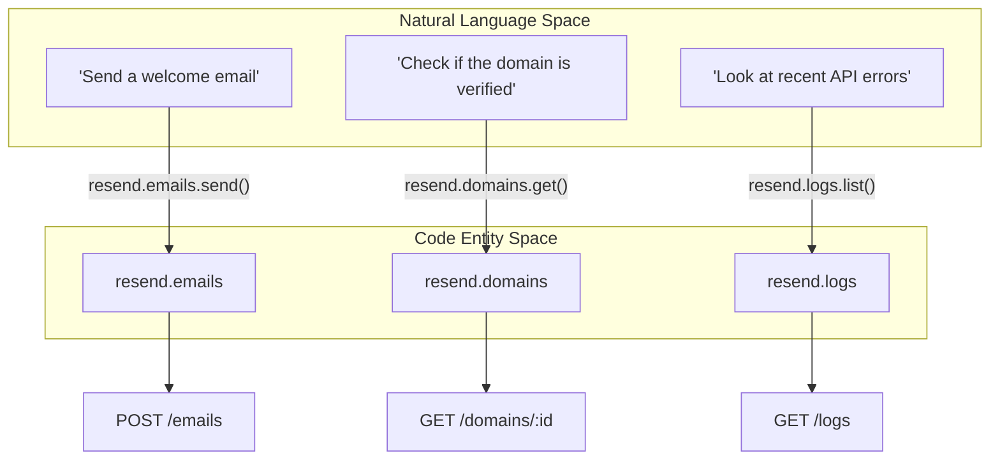
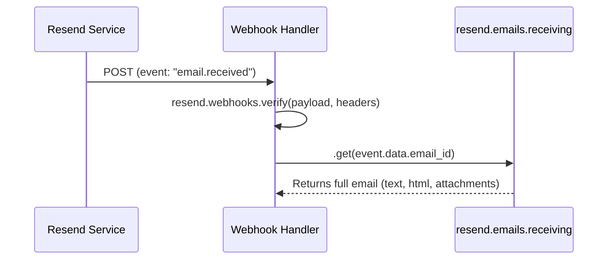

<!-- source: DeepWiki mcp.deepwiki.com · repo resend/resend-skills · page 2 Resend API Skill · fetched 2026-10-26 -->

# Resend API Skill

Relevant source files

The following files were used as context for generating this wiki page:

- [skills/resend/SKILL.md](skills/resend/SKILL.md)
- [skills/resend/references/logs.md](skills/resend/references/logs.md)

The `resend` skill serves as the core interface for the Resend email platform, providing comprehensive tools for transactional messaging, inbound processing, and marketing automation. It encapsulates the functionality of the Resend SDK and REST API, offering a unified bridge for AI agents to interact with email infrastructure.

[skills/resend/SKILL.md:2-3]()

### Architecture Overview

The skill is designed around a request-response pattern where the Node.js SDK returns a consistent `{ data, error }` object instead of throwing exceptions. This ensures predictable error handling across all email operations.

#### Natural Language to Code Mapping: Sending & Management

Sources: [skills/resend/SKILL.md:60-77](), [skills/resend/references/logs.md:9-10]()

### Core Capabilities

The skill is partitioned into several functional areas, each managed by specific SDK namespaces:

| Category | Primary SDK Namespace | Key Operations |
|----------|----------------------|----------------|
| **Messaging** | `resend.emails` | `send()`, `batch()`, `get()`, `cancel()` |
| **Inbound** | `resend.emails.receiving` | `get()` (retrieval after webhook) |
| **Automation** | `resend.automations` | `create()`, `list()`, `runs.list()` |
| **Identity** | `resend.domains` | `create()`, `verify()`, `list()` |
| **Audience** | `resend.contacts` | `create()`, `list()`, `update()` |
| **Observability** | `resend.logs` | `list()`, `get()` |

Sources: [skills/resend/SKILL.md:151-172](), [skills/resend/references/logs.md:7-11]()

### Messaging & Reliability
The skill supports both single and batch sending. A critical feature is **Idempotency**, which prevents duplicate sends during network retries by using the `idempotencyKey` header.

*   **Single Send:** Supports attachments and scheduling via `scheduled_at`. [skills/resend/SKILL.md:99-100]()
*   **Batch Send:** Atomic operation for up to 100 emails. Does not support attachments or scheduling. [skills/resend/SKILL.md:100-102]()

For details, see [Sending Emails](#2.1).

### Inbound & Event Handling
Resend handles inbound emails via MX record configuration. The skill implements a two-step retrieval pattern: a webhook notifies the system of an `email.received` event, and the agent uses the `email_id` to fetch the full content.

#### Webhook Processing Flow

Sources: [skills/resend/SKILL.md:120-143]()

For details, see [Receiving Inbound Emails](#2.2) and [Webhooks & Event Tracking](#2.3).

### Marketing & Workflows
Beyond transactional mail, the skill manages the marketing lifecycle through Contacts, Segments, and Topics. It also interfaces with the Resend Automation engine, allowing for the creation of event-driven Directed Acyclic Graphs (DAGs) that trigger based on custom application events.

*   **Automations:** Manage steps like `delay`, `condition`, and `send_email`. [skills/resend/SKILL.md:171-172]()
*   **Marketing:** Handle broadcasts and subscription preferences via Topics. [skills/resend/SKILL.md:165-170]()

For details, see [Automations & Events](#2.4) and [Contacts, Broadcasts & Marketing](#2.5).

### Infrastructure Management
The skill provides tools for managing the underlying Resend configuration, including DNS verification for domains and API key permission scoping.

*   **Logs:** The `resend.logs` namespace allows for programmatic auditing of API requests, including full request/response body inspection for debugging. [skills/resend/references/logs.md:3-5]()
*   **Templates:** CRUD operations for email templates using triple-mustache `{{{variable}}}` syntax. [skills/resend/SKILL.md:161]()

For details, see [Domains, API Keys & Templates](#2.6).

---
**Sources:**
- [skills/resend/SKILL.md]()
- [skills/resend/references/logs.md]()

---

