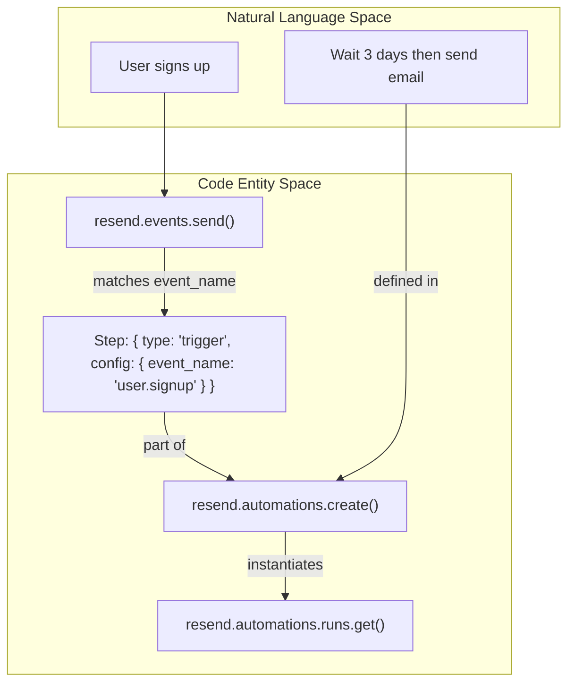
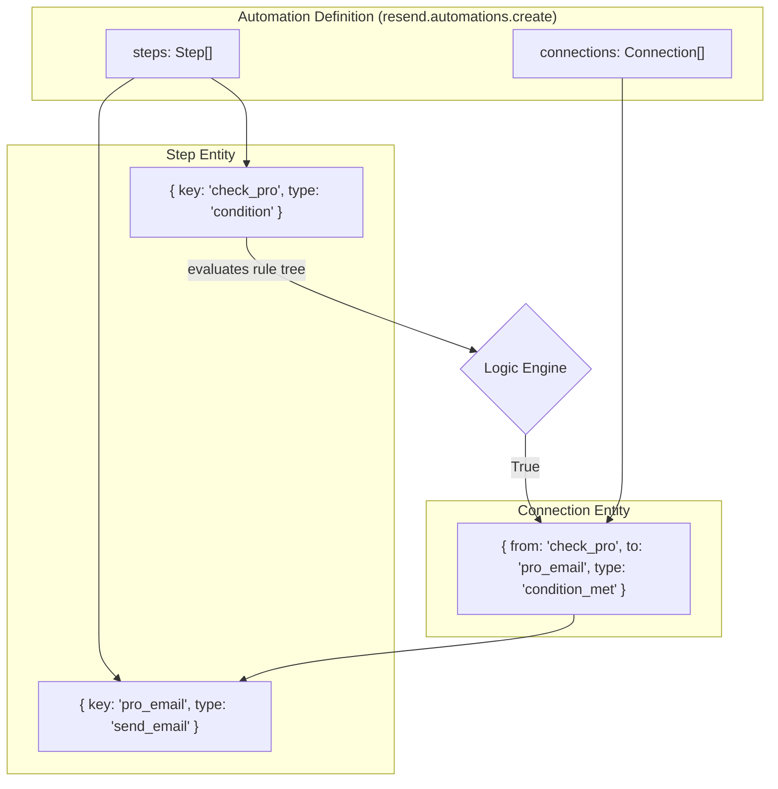

<!-- source: DeepWiki mcp.deepwiki.com · repo resend/resend-skills · page 2.4 Automations & Events · fetched 2026-10-26 -->

# Automations & Events

Relevant source files

The following files were used as context for generating this wiki page:

- [skills/resend/references/automations.md](skills/resend/references/automations.md)
- [skills/resend/references/events.md](skills/resend/references/events.md)
- [skills/resend/references/sending/overview.md](skills/resend/references/sending/overview.md)

Automations are event-driven workflows composed of steps connected in a directed graph (DAG). They allow for complex, asynchronous messaging patterns by reacting to specific events associated with contacts. The engine supports branching logic, delays, and stateful waiting for external signals.

## Event System

Events are named signals that serve as the primary entry point for automations. They associate specific activities with a contact and can carry a structured payload.

### Event Definition and Schema
Events can be defined with an optional schema—a flat key/type map—to enforce payload structure. Supported types include `string`, `number`, `boolean`, and `date` [skills/resend/references/events.md:24-29]().

*   **Reserved Prefix:** Event names starting with `resend:` are reserved for system events and cannot be used for custom events [skills/resend/references/events.md:113]().
*   **Asynchronous Processing:** Sending an event returns a `202 Accepted` status, as the subsequent automation triggers are processed asynchronously [skills/resend/references/events.md:86]().

### Sending Events
To trigger an automation, an event must be sent and associated with a contact using either a `contactId` or an `email` address (mutually exclusive) [skills/resend/references/events.md:58-59]().

**Sources:** [skills/resend/references/events.md:1-120]()

---

## Automation Graph Model

An automation is a Directed Acyclic Graph (DAG) consisting of **steps** and **connections**.

### Step Types
Each step is defined by a unique `key`, a `type`, and a `config` object [skills/resend/references/automations.md:34]().

| Type | Config Key Details | Purpose |
| :--- | :--- | :--- |
| `trigger` | `event_name` | The entry point for the workflow [skills/resend/references/automations.md:38](). |
| `send_email` | `template`, `subject`, `from` | Sends an email via a published template [skills/resend/references/automations.md:39](). |
| `delay` | `duration` (e.g., "3 days") | Pauses the run for a human-readable duration [skills/resend/references/automations.md:40](). |
| `wait_for_event` | `event_name`, `timeout` | Pauses until a specific event is received or timeout occurs [skills/resend/references/automations.md:41](). |
| `condition` | `rule tree` | Branches the flow based on contact property data [skills/resend/references/automations.md:42](). |
| `contact_update` | `properties`, `unsubscribed` | Modifies contact attributes [skills/resend/references/automations.md:43](). |

### Connection Types
Connections define the edges between steps. While most steps use a `default` connection, branching steps require specific types [skills/resend/references/automations.md:59-68]():

*   **`condition_met` / `condition_not_met`**: Used for `condition` steps.
*   **`event_received` / `timeout`**: Used for `wait_for_event` steps.

### Constraints
*   **Step Limit:** Automations are limited to 150 steps.
*   **Update Requirements:** When updating a workflow graph via `resend.automations.update()`, both the `steps` and `connections` arrays must be provided in full [skills/resend/references/automations.md:167-168]().

**Sources:** [skills/resend/references/automations.md:5-68](), [skills/resend/references/automations.md:167-184]()

---

## Implementation & Data Flow

The following diagrams illustrate how high-level automation concepts map to specific SDK methods and data structures.

### Logic Flow: From Event to Automation Run
This diagram shows the transition from a "Natural Language" trigger to the execution of a "Code Entity" `Run`.

**Sources:** [skills/resend/references/events.md:18-18](), [skills/resend/references/automations.md:15-22](), [skills/resend/references/automations.md:38-38]()

### Step Configuration and Connection Mapping
This diagram maps the SDK parameter structures to the internal execution logic for branching.

**Sources:** [skills/resend/references/automations.md:34-68](), [skills/resend/references/automations.md:143-163]()

---

## Run Lifecycle & Monitoring

Once an automation is `enabled`, every matching event creates a `Run`.

### Run States
The status of a run can be monitored using the `resend.automations.runs` namespace.
*   **`list`**: Retrieves runs for a specific `automationId`, filterable by status [skills/resend/references/automations.md:21]().
*   **`get`**: Returns the full execution history of a run, including which steps were executed and their outcomes [skills/resend/references/automations.md:22]().

### Lifecycle Operations
| Operation | Method | Effect |
| :--- | :--- | :--- |
| **Start** | `resend.events.send()` | Triggers a new run if an automation's `trigger` matches the event name [skills/resend/references/events.md:18](). |
| **Stop** | `resend.automations.stop()` | Sets automation status to `disabled`; new runs will not start [skills/resend/references/automations.md:20](). |
| **Delete** | `resend.automations.remove()` | Permanently deletes the automation and its configuration [skills/resend/references/automations.md:19](). |

**Sources:** [skills/resend/references/automations.md:15-22](), [skills/resend/references/events.md:5-18]()

---

