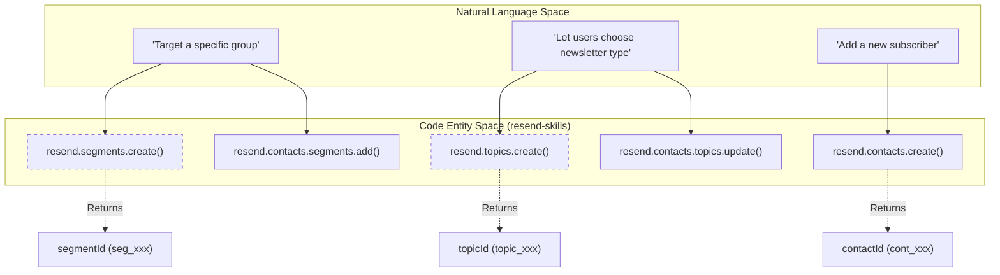
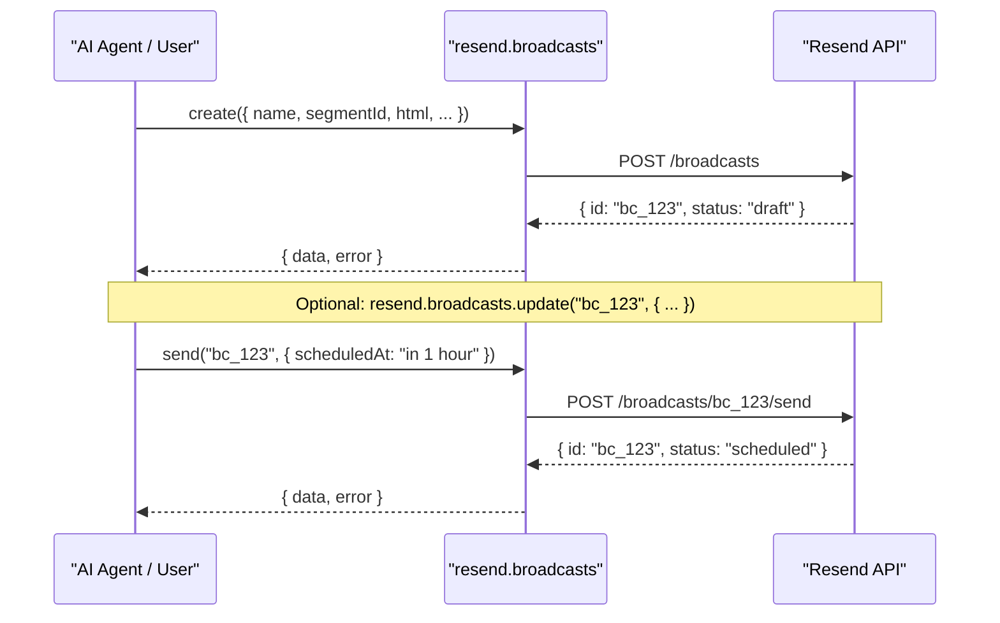

<!-- source: DeepWiki mcp.deepwiki.com · repo resend/resend-skills · page 2.5 Contacts, Broadcasts & Marketing · fetched 2026-10-26 -->

# Contacts, Broadcasts & Marketing

Relevant source files

The following files were used as context for generating this wiki page:

- [skills/resend/references/broadcasts.md](skills/resend/references/broadcasts.md)
- [skills/resend/references/contact-properties.md](skills/resend/references/contact-properties.md)
- [skills/resend/references/contacts.md](skills/resend/references/contacts.md)
- [skills/resend/references/segments.md](skills/resend/references/segments.md)
- [skills/resend/references/topics.md](skills/resend/references/topics.md)

This page details the management of marketing-related resources within the Resend ecosystem. While transactional emails are sent via the core `emails` API, marketing campaigns utilize **Broadcasts** to target **Segments** of **Contacts**. This system includes fine-grained subscription management through **Topics** and dynamic content personalization using **Contact Properties**.

## Contact Management

Contacts are the central entity for marketing activities. They represent individual recipients and store metadata used for segmentation and personalization.

### Data Flow: Creating and Updating Contacts
Contacts can be managed via the Node.js or Python SDKs. The `email` field is the unique identifier and the only required field for creation [skills/resend/references/contacts.md:104-104]().

| Feature | Description |
| :--- | :--- |
| **Identification** | Contacts are looked up or modified using either their unique `id` (e.g., `cont_xxx`) or their `email` [skills/resend/references/contacts.md:13-17](). |
| **Properties** | Custom metadata stored as key-value pairs [skills/resend/references/contacts.md:31-35](). |
| **Segments** | Static groupings for broadcast targeting [skills/resend/references/contacts.md:36-36](). |
| **Topics** | Preference-based subscriptions (opt-in/opt-out) [skills/resend/references/contacts.md:37-40](). |

### Deleting Properties
To delete a specific property from a contact, the value must be set to `null` in an update call; passing an empty string will not remove the key [skills/resend/references/contacts.md:77-77]().

**Sources:** [skills/resend/references/contacts.md:1-105]()

---

## Segmentation and Topics

Resend distinguishes between organizational groupings (Segments) and recipient preferences (Topics).

### Segments
Segments have replaced the legacy "Audiences" system [skills/resend/references/segments.md:3-3](). They are used to group contacts for targeting.
* **Creation:** Segments are created with a `name` [skills/resend/references/segments.md:30-32]().
* **Membership:** Contacts are added or removed explicitly via the `resend.contacts.segments` sub-resource [skills/resend/references/segments.md:48-51]().
* **Immutability:** Segments cannot be updated. To rename a segment, it must be removed and recreated [skills/resend/references/segments.md:16-16]().

### Topics
Topics provide granular control over what types of content a contact receives.
* **Default Subscription:** Must be set to `opt_in` or `opt_out` at creation and is immutable [skills/resend/references/topics.md:32-32]().
* **Visibility:** `public` topics appear on the Resend-hosted preference page, while `private` topics are managed only via API [skills/resend/references/topics.md:93-93]().
* **Broadcast Filtering:** If a `topicId` is provided during broadcast creation, only contacts opted into that topic within the target segment will receive the email [skills/resend/references/topics.md:73-73]().

### Natural Language to Code Entity: Audience Management
This diagram maps the conceptual marketing entities to their respective SDK classes and methods.

**Sources:** [skills/resend/references/segments.md:9-14](), [skills/resend/references/topics.md:9-15](), [skills/resend/references/contacts.md:11-17]()

---

## Contact Properties and Interpolation

Contact Properties define the schema for custom data across the entire account [skills/resend/references/contact-properties.md:3-3]().

### Property Configuration
* **Type:** Supports `string` or `number`. This is immutable after creation [skills/resend/references/contact-properties.md:21-21]().
* **Key:** Alphanumeric and underscores only, max 50 characters [skills/resend/references/contact-properties.md:22-22]().
* **Fallback:** An account-wide `fallbackValue` can be defined for cases where a contact lacks data for that property [skills/resend/references/contact-properties.md:23-23]().

### Personalization Syntax
Resend uses **triple-mustache** syntax `{{{ }}}` for variable interpolation in broadcasts to prevent HTML escaping of dynamic content [skills/resend/references/broadcasts.md:123-123]().

**Pipe Fallbacks:**
You can override property-level fallbacks within the HTML template using a pipe:
`{{{PROPERTY_KEY|fallback_text}}}` [skills/resend/references/broadcasts.md:107-107]().

**Sources:** [skills/resend/references/contact-properties.md:1-112](), [skills/resend/references/broadcasts.md:105-112]()

---

## Broadcasts API

Broadcasts follow a strict two-step lifecycle: **Create** (Draft) and **Send**.

### The Lifecycle Flow
1.  **Create:** Generates a draft. Requires `segmentId`, `from`, `subject`, and content (`html`, `text`, or `react`) [skills/resend/references/broadcasts.md:18-18]().
2.  **Send:** Triggers the delivery. This is where `scheduledAt` can be defined using ISO 8601 or natural language (e.g., "in 1 hour") [skills/resend/references/broadcasts.md:44-46]().

*Shortcut:* Passing `send: true` during the `create` call combines these steps [skills/resend/references/broadcasts.md:56-56]().

### Implementation Diagram: Broadcast Execution
This diagram illustrates the transition from a draft state to delivery.

### Compliance Requirements
Every broadcast sent via Resend must include an unsubscribe link using the reserved variable: `{{{RESEND_UNSUBSCRIBE_URL}}}` [skills/resend/references/broadcasts.md:122-122]().

**Sources:** [skills/resend/references/broadcasts.md:1-126]()

---

