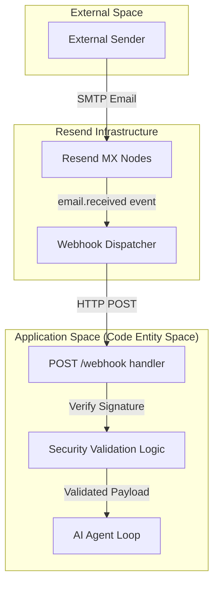
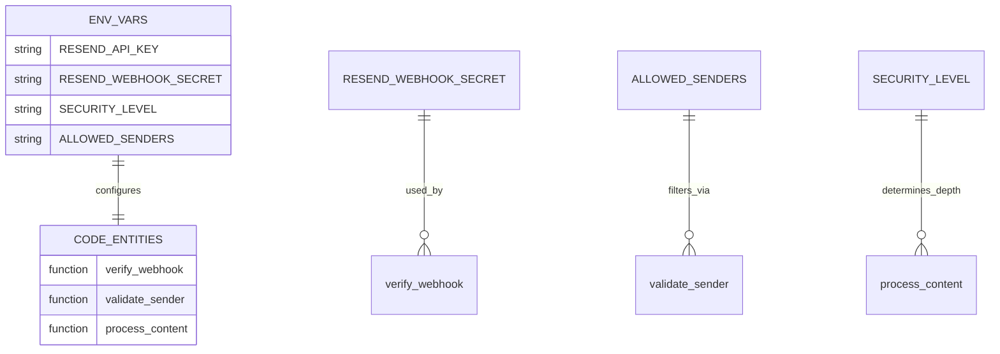

<!-- source: DeepWiki mcp.deepwiki.com · repo resend/resend-skills · page 3 Agent Email Inbox Skill · fetched 2026-10-26 -->

# Agent Email Inbox Skill

Relevant source files

The following files were used as context for generating this wiki page:

- [skills/agent-email-inbox/SKILL.md](skills/agent-email-inbox/SKILL.md)

The **agent-email-inbox** skill is a security-first framework designed for AI agents that need to receive and process inbound email. Unlike standard email integrations, this skill focuses on the unique security challenges of AI agents, such as prompt injection via email content and the need for event-driven responsiveness.

## Overview

AI agents are inherently vulnerable when exposed to untrusted inbound data. The `agent-email-inbox` skill provides a structured approach to building these systems by leveraging Resend's webhook-based architecture. This ensures that agents are notified instantly of new messages without the overhead of polling or cron jobs [skills/agent-email-inbox/SKILL.md:58-65]().

### Core Architecture

The skill follows an event-driven pipeline where Resend handles the SMTP reception and your application processes the resulting webhook.

**System Data Flow**

Sources: [skills/agent-email-inbox/SKILL.md:69-75]()

## Setup & Pipeline

Setting up an agent inbox involves configuring DNS records and implementing a secure webhook endpoint.

*   **Managed vs. Custom Domains**: For rapid prototyping, agents can use the `<anything>@<your-id>.resend.app` managed domain, which requires no DNS setup [skills/agent-email-inbox/SKILL.md:132-137](). Production agents should use subdomains (e.g., `agent.example.com`) to avoid disrupting existing mail services [skills/agent-email-inbox/SKILL.md:151-152]().
*   **Webhook Implementation**: The skill requires a `POST` route capable of capturing the raw request body for cryptographic signature verification using `resend.webhooks.verify()` [skills/agent-email-inbox/SKILL.md:79-99]().

For a step-by-step implementation guide, including Next.js and Express examples and local tunneling with Tailscale or ngrok, see **[Inbound Email Pipeline & Webhook Setup (#3.1)](#)**.

## Security Framework

The skill enforces a "Security First" principle because an agent's inbox is a vector for untrusted input [skills/agent-email-inbox/SKILL.md:56-57]().

### Security Levels
The skill defines a classification system to manage risk:
*   **Strict**: Only allows specific email addresses defined in `ALLOWED_SENDERS` [skills/agent-email-inbox/SKILL.md:25-27]().
*   **Moderate**: Allows entire domains defined in `ALLOWED_DOMAINS` [skills/agent-email-inbox/SKILL.md:28-30]().
*   **Permissive**: Uses content filtering and sandboxed processing for any sender.

### Entity Relationship: Security & Configuration
This diagram maps configuration variables to the security logic components.

Sources: [skills/agent-email-inbox/SKILL.md:15-33]()

For details on implementing prompt injection protection, idempotency for retries, and human-in-the-loop patterns, see **[Security Levels & Advanced Patterns (#3.2)](#)**.

## SDK Requirements

To use this skill, the following minimum SDK versions are required to support `emails.receiving.get()` and `webhooks.verify()` [skills/agent-email-inbox/SKILL.md:79-90]():

| Language | Package | Min Version |
| :--- | :--- | :--- |
| **Node.js** | `resend` | `>= 6.9.2` |
| **Python** | `resend` | `>= 2.21.0` |
| **Go** | `resend-go/v3` | `>= 3.1.0` |
| **Ruby** | `resend` | `>= 1.0.0` |

Sources: [skills/agent-email-inbox/SKILL.md:81-90]()

---

